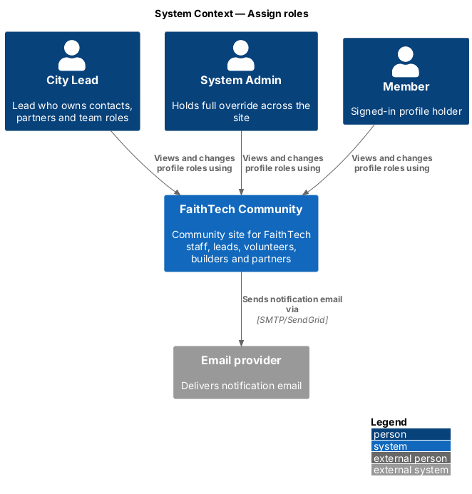
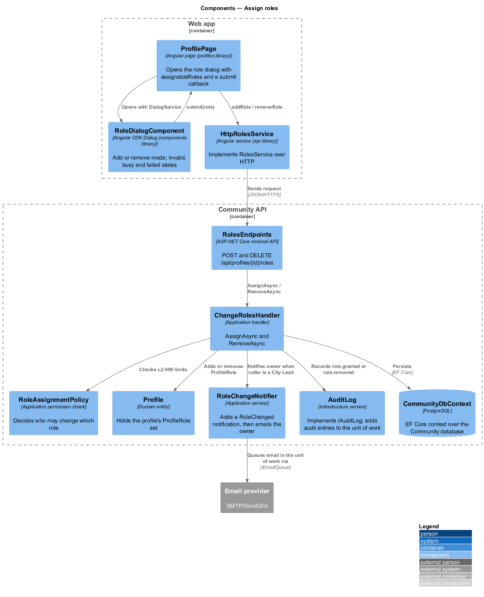
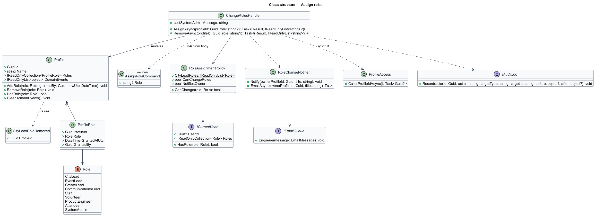
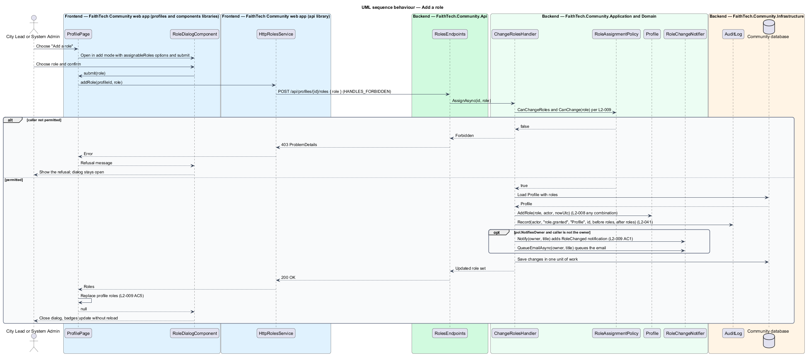
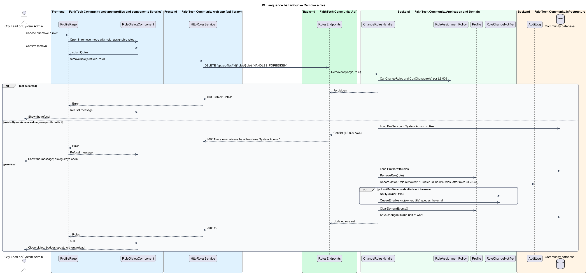

# Assign roles

## Overview

FaithTech Community grants permissions through *global roles*. A **global role** — named permission set held by a profile, not tied to any city. The nine roles are City Lead, Event Lead, Create Lead, Communications Lead, Staff, Volunteer, Product Engineer, Attendee and System Admin. A profile may hold any combination of them, and a new account holds none.

This feature covers adding and removing roles on a profile. Two tiers of authority apply. A City Lead may add or remove the Event Lead, Create Lead, Communications Lead, Volunteer, Product Engineer and Attendee roles on any profile. Only a System Admin may grant or remove City Lead, Staff and System Admin. Every role change is audited, and the profile owner is notified when a City Lead changes their roles. The last remaining System Admin role can never be removed, so the site always keeps an administrator.

The feature sits in the admin subsystem because role grants are the root of every other permission check. The add-role and remove-role dialogs open from a profile page.

## Description

The slice runs from the profile page in the web app to the `ProfileRole` rows in the Community database.

- **`RoleDialogComponent`** — presentational Angular CDK dialog in the `components` library with an `add` and a `remove` mode (ADR 0005). It receives the person's name, a description, the role options and a `submit(value)` callback through `DIALOG_DATA`. In `remove` mode with a single removable role it shows no radio group, since the title already names the role; with several it shows the group. It owns the invalid ("Choose a role to add."), busy and failed states, and closes with the chosen role once `submit` resolves to `null`. A message from `submit`, such as a `403` or `409` reason, shows inside the dialog.
- **`ProfilePage`** — page in the `profiles` library that opens `RoleDialogComponent` with `DialogService`. It offers only the roles `assignableRoles(callerRoles)` returns, and passes a `submit` that calls `ROLES_SERVICE` and replaces the profile's roles with the returned set, so the badges update without a page reload. The `admin` library does not open the dialog; the admin users page links to the profile.
- **`RolesService`** / **`ROLES_SERVICE`** / **`HttpRolesService`** — API client contract, injection token and HTTP implementation in the `api` library. They call `POST /api/profiles/{id}/roles` and `DELETE /api/profiles/{id}/roles/{role}`. Requests carry the `HANDLES_FORBIDDEN` `HttpContextToken`, so a `403` reaches the dialog instead of the global `/forbidden` redirect.
- **`assignableRoles`**, **`ROLE_LABELS`** and **`ROLE_DESCRIPTIONS`** — exports of `api/src/lib/shared/role.ts` that mirror `RoleAssignmentPolicy` and label each role in the dialog.
- **`RolesEndpoints`** — minimal API mapping in `FaithTech.Community.Api`. It authenticates the caller and calls the handler; it holds no business logic. Both routes return the profile's new role set.
- **`AssignRoleCommand`** (`Role`) — request body of the add route. The profile id and, for removal, the role come from the route.
- **`ChangeRolesHandler`** — Application handler in `Admin/` with `AssignAsync(profileId, role)` and `RemoveAsync(profileId, role)`. It asks `RoleAssignmentPolicy` whether the caller may change the role, applies the change to `Profile`, records an audit entry for every change and, when the caller is a City Lead without System Admin, notifies the profile owner through `RoleChangeNotifier`. It resolves the caller's profile id, used as the actor, through `ProfileAccess.CallerProfileIdAsync`.
- **`RoleAssignmentPolicy`** — concrete Application class. `CanChangeRoles` is true for a City Lead or System Admin; `CanChange(role)` allows a System Admin any role and a City Lead the six roles in `CityLeadRoles`; `NotifiesOwner` is true for a City Lead without System Admin. The last-System-Admin check is a count in `ChangeRolesHandler`, not a policy method.
- **`SystemAdminRoster`** — Domain entity (`Admin/`) with exactly one row, which serializes System Admin removals so overlapping requests cannot both pass the count and leave no administrator. A removal first takes the roster's lease (`TryTake`) in a save of its own. `Version` is an optimistic concurrency token, so when two removals overlap only one save succeeds, and the other gets `409` "Someone else changed System Admin roles at the same time. Reload and try again." with nothing changed, audited or notified. The lease holder counts the admins, returns the existing "There must always be at least one System Admin." message when only one is left, and otherwise removes the role, audits it and releases the lease in one save. A lease left behind by a request that failed expires after 30 seconds. In PostgreSQL the concurrency token is checked by the `UPDATE ... WHERE "Version" = @original` of each save inside its transaction. The `SystemAdminRoster` migration inserts the row, and `CommunitySeeder` adds it if it is missing. The behaviour is tested by overlapping two requests at the save with a test-only EF interceptor on the in-memory provider.
- **`Role`** — Domain enumeration of the nine global roles. **`Profile`** — Domain entity that owns a set of `ProfileRole` entries (role, who granted it, when) and enforces no duplicates: `AddRole(role, grantedBy, nowUtc)` rejects a role already held and `RemoveRole(role)` rejects one not held. Removing City Lead raises the **`CityLeadRoleRemoved`** domain event in `Profile.DomainEvents` (`L2-037`).
- **`ICurrentUser`** — caller user id and roles, read from the access token.
- **`IAuditLog`** — `Record(actorId, action, targetType, targetId, before, after)` adds an entry with the before and after role sets; `AuditLog` stamps the UTC time and IP address (`L2-041`).
- **`RoleChangeNotifier`** — Application service. `Notify(ownerProfileId, title)` adds an in-app `Notification` (`RoleChanged`) to the unit of work; `QueueEmailAsync(ownerProfileId, title)` queues the owner's email through `IEmailQueue` in the same unit of work, so the role change, its notification and its email are saved together.
- **`RoleLabels`** — Application helper that gives each `Role` its display name for notification titles and audit summaries.
- **`GrantSystemAdminAsync`** — `CommunitySeeder` method behind the Cli `grant-admin <email>` command. It grants the first System Admin and writes a `role.granted` entry with an empty actor id and IP address `cli`.

The visible role options in the dialog are a convenience; the server returns `403` for any change the caller is not permitted to make.

## Requirements

The feature realizes the following level-2 (L2) requirements. Each L2 requirement refines a level-1 (L1) requirement, cited by identifier.

| L2 ID | Refines (L1) | Requirement |
|-------|--------------|-------------|
| `L2-008` | `L1-003` | The roles are City Lead, Event Lead, Create Lead, Communications Lead, Staff, Volunteer, Product Engineer, Attendee and System Admin. |
| `L2-009` | `L1-003` | Role assignment limits |

### Acceptance criteria

**`L2-008` — Multiple global roles**

1. Given a profile, when roles are assigned, then it can hold any combination of roles at once, and no role is tied to a city.
2. Given a new account, when it is created, then it holds no role.

**`L2-009` — Role assignment limits**

1. Given a City Lead, when they add or remove Event Lead, Create Lead, Communications Lead, Volunteer, Product Engineer or Attendee on any profile, then the change succeeds and the profile owner is notified.
2. Given a City Lead, when they try to grant or remove City Lead, Staff or System Admin, then the option is not shown and the API returns 403.
3. Given a System Admin, when they grant or remove any role, then the change succeeds and an audit entry is written.
4. Given any other role, when it tries to change roles through the API, then the response is 403.
5. Given a removal, when the add-role or remove-role dialog is confirmed, then the profile's roles update without a page reload.
6. Given the last System Admin, when anyone tries to remove that role, then the change is refused.

## Diagrams

### System context

City Leads and System Admins change roles on member profiles through FaithTech Community. The site notifies the affected member by email through the email provider.

### Containers

The `profiles` feature library in the Angular web app opens the role dialog from `components` and calls the Community API through the `api` library over HTTPS with an OAuth2 bearer token. The API persists state in the PostgreSQL Community database and sends email through the email provider.

### Components

`ProfilePage` opens `RoleDialogComponent`; its `submit` callback calls `HttpRolesService`, which reaches `RolesEndpoints`. `ChangeRolesHandler` consults `RoleAssignmentPolicy`, mutates the `Profile`, records the audit entry, adds the owner's notification, saves through `CommunityDbContext` and then emails the owner.

### Class structure

`Profile` composes zero or more `ProfileRole` entries, each holding a `Role`. `ChangeRolesHandler` depends on `RoleAssignmentPolicy`, `ProfileAccess`, `IAuditLog` and `RoleChangeNotifier`; the policy reads `ICurrentUser`.

### Behaviour — add a role

`ChangeRolesHandler.AssignAsync` checks `L2-009` limits before any write. A permitted change is persisted and audited and, for a City Lead caller without System Admin, notified to the owner; a forbidden change returns `403` with no state change.

### Behaviour — remove a role

`ChangeRolesHandler.RemoveAsync` follows the same checks and additionally refuses removal of the last System Admin role with `409` (`L2-009` AC6).

## Open questions

Decisions recorded while building the Domain layer (`FaithTech.Community.Domain`):

- Role count: `L2-008` lists nine roles and the Domain `Role` enumeration holds exactly those nine. The earlier single `Lead` value is replaced by City Lead, Event Lead, Create Lead and Communications Lead. Resolved.
- Roles persist as `ProfileRole` rows (table `ProfileRoles`, key profile and role), replacing the earlier text-array column.
- Domain events: `Profile` collects `CityLeadRoleRemoved` in `DomainEvents`; the handler that saves the profile dispatches and clears them. `ChangeRolesHandler` clears them without dispatching in v1, because the workspace handler for `CityLeadRoleRemoved` belongs to the deferred Agile design. A shared domain-event base type is deferred until a second aggregate raises events.
- Domain rule violations throw `InvalidOperationException` (a broken rule) or `ArgumentException` (invalid input); there is no shared domain exception type. Handlers check permissions and preconditions first and map any remaining violation to a `400` or `409` result.
- Responses: both routes return the profile's new role set. A role name that is not one of the nine answers `400` "Choose a role." Adding a role already held, or removing one not held, answers `409`. Removing the last System Admin answers `409` "There must always be at least one System Admin." An unknown profile answers `404` to a caller who may change roles and `403` to anyone else.
- Every role change is audited (`role.granted`, `role.removed`), whoever makes it; the owner is notified only when the caller is a City Lead acting without System Admin, and not when that City Lead changes their own profile. The in-app notification is saved with the change; the email is sent after the save.
- A caller changing roles through the profile page is shown "Add a role" and "Remove a role" only when `assignableRoles` offers at least one option.
