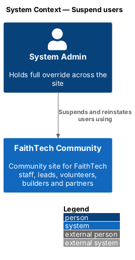
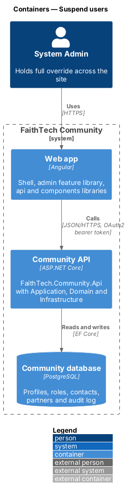
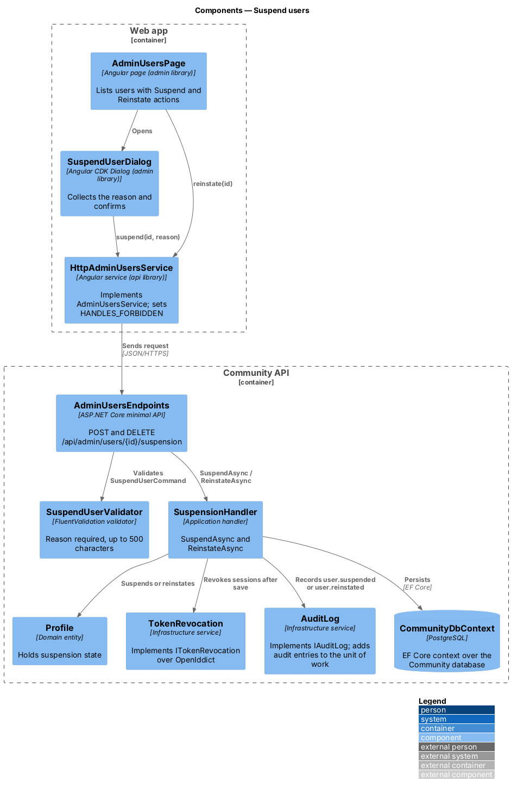
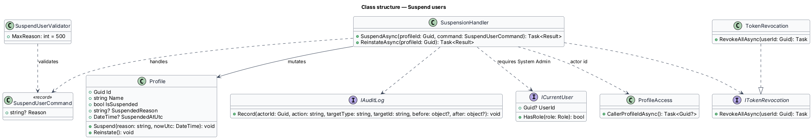
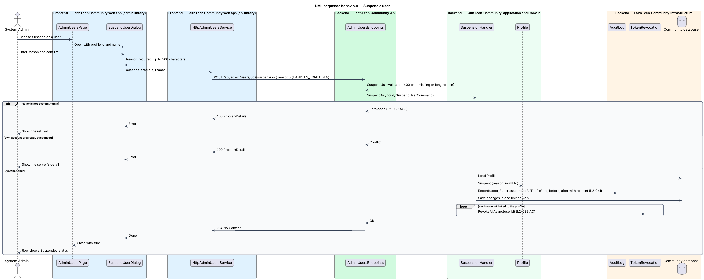
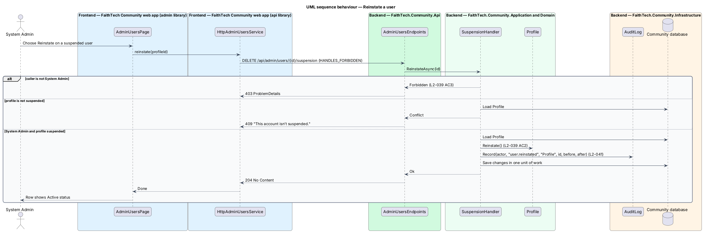

# Suspend users

## Overview

A System Admin may need to stop a person from using FaithTech Community, for example after misuse. **Suspension** — admin-imposed state of an account that refuses sign-in and revokes existing sessions until reinstatement. Suspension does not delete the profile or its data; reinstatement returns the account to normal use.

This feature covers suspending a user with a reason and reinstating them. Only a System Admin may do either. Sign-in itself enforces the suspended state (`L2-003`), so this feature changes account state and revokes tokens, while the identity subsystem refuses later sign-ins.

## Description

- **`AdminUsersPage`** — page in the `admin` feature library that lists users and offers a **Suspend** action on active rows and a **Reinstate** action on suspended rows. Reinstate calls the service directly, with no dialog. On success the row's status badge changes without a reload.
- **`SuspendUserDialog`** — CDK dialog in the `admin` library, opened with `DialogService`, that collects the required reason and confirms the suspension; the reason is read-only while the request is in flight. It checks the reason on the client with the server's messages, shows a `4xx` refusal (for example `409`) from the server's `detail`, shows an *Account not suspended* alert otherwise (failed dialog titles name what was not saved), and closes with `true` once the user is suspended.
- **`AdminUsersService`** / **`ADMIN_USERS_SERVICE`** / **`HttpAdminUsersService`** — API client in the `api` library. `suspend(id, reason)` calls `POST /api/admin/users/{id}/suspension` and `reinstate(id)` calls `DELETE /api/admin/users/{id}/suspension`, where `{id}` is the profile id. Requests carry the `HANDLES_FORBIDDEN` `HttpContextToken`, so a `403` reaches the page or dialog instead of the global `/forbidden` redirect.
- **`AdminUsersEndpoints`** — minimal API mapping; requires an authenticated caller, validates the body with `SuspendUserValidator` and calls the handler. Both routes answer `204` on success.
- **`SuspendUserCommand`** (`Reason`) — request body of the suspend route; the profile id comes from the route.
- **`SuspensionHandler`** in Application `Admin/` — `SuspendAsync(profileId, command)` and `ReinstateAsync(profileId)`. Each requires the caller to hold System Admin and returns `403` otherwise, `404` for an unknown profile, and `409` when the profile is already in the requested state. `SuspendAsync` saves the suspension and its audit entry, then revokes every token of the accounts linked to the profile.
- **`SuspendUserValidator`** — requires a non-empty reason ("Give a reason so other admins understand."). Maximum reason length: 500 characters.
- **`Profile`** — Domain entity that holds the suspended state: `IsSuspended`, `SuspendedReason`, `SuspendedAtUtc`, `Suspend(reason, nowUtc)` and `Reinstate()`. `Suspend` requires a reason and rejects a profile that is already suspended; `Reinstate` rejects a profile that is not suspended.
- **`ITokenRevocation`** — Application abstraction in `Identity/` with `RevokeAllAsync(userId)`; **`TokenRevocation`** in Infrastructure implements it over the OpenIddict token and authorization stores.
- **`ProfileAccess`** — resolves the caller's profile id, used as the audit actor and for the own-account check.
- **`IAuditLog`** — `Record(actorId, action, targetType, targetId, before, after)` records each suspension and reinstatement (`L2-041`).

A System Admin may suspend another System Admin but not their own account (`409` "You can’t suspend your own account."), so the site always keeps an administrator who can reinstate.

## Requirements

The feature realizes the following level-2 (L2) requirements. Each L2 requirement refines a level-1 (L1) requirement, cited by identifier.

| L2 ID | Refines (L1) | Requirement |
|-------|--------------|-------------|
| `L2-039` | `L1-014` | Suspend users |

### Acceptance criteria

**`L2-039` — Suspend users**

1. Given a System Admin, when they suspend a user with a reason after confirming, then that user's sessions are revoked, and sign-in is refused (L2-003).
2. Given a suspended user, when a System Admin reinstates them, then they can sign in again.
3. Given any other role, when it calls the suspend API, then the response is 403.

## Diagrams

### System context

Only the System Admin uses this feature. No external system takes part; session revocation happens inside the Community API's OpenIddict stores.

### Containers

The `admin` feature library in the Angular web app calls the Community API over HTTPS with an OAuth2 bearer token. The API persists state in the PostgreSQL Community database.

### Components

The page opens `SuspendUserDialog`, which calls the API client. `SuspensionHandler` changes `Profile`, records the audit entry, saves, and then revokes tokens through `TokenRevocation`.

### Class structure

`SuspensionHandler` depends on `ICurrentUser`, `ProfileAccess`, `ITokenRevocation` and `IAuditLog`, and mutates `Profile`. `SuspendUserValidator` validates `SuspendUserCommand` at the endpoint.

### Behaviour — suspend a user

`SuspensionHandler.SuspendAsync` rejects non-admin callers with `403` and the caller's own account with `409`. It then sets the suspended state and saves it with the audit entry in one unit of work, and revokes every token once the save succeeds.

### Behaviour — reinstate a user

`SuspensionHandler.ReinstateAsync` clears the suspended state and audits it, so the next sign-in succeeds (`L2-039` AC2).

## Open questions

Decisions recorded while building the Domain layer (`FaithTech.Community.Domain`):

- Suspension lives on `Profile`, not on a separate `UserAccount` entity: the Domain has no dependency on ASP.NET Identity, and sign-in already reads `Profile.IsSuspended` (`identity/sign-in-and-sign-out`). Resolved.
- Domain rule violations throw `InvalidOperationException` (a broken rule) or `ArgumentException` (invalid input); there is no shared domain exception type. Handlers check permissions and preconditions first and map any remaining violation to a `400` or `409` result.
- Suspending an already-suspended profile, or reinstating an active one, answers `409`. Audit actions are `user.suspended` (after: `IsSuspended` and the reason) and `user.reinstated` (before: the reason). Suspending one's own account answers `409` "You can’t suspend your own account."; a missing or over-long reason answers `400`.
- Token revocation runs after the suspension is saved, not inside the same unit of work: the OpenIddict authorization and token managers save each revocation themselves. If revocation fails after the save, the profile stays suspended and sign-in stays refused.
