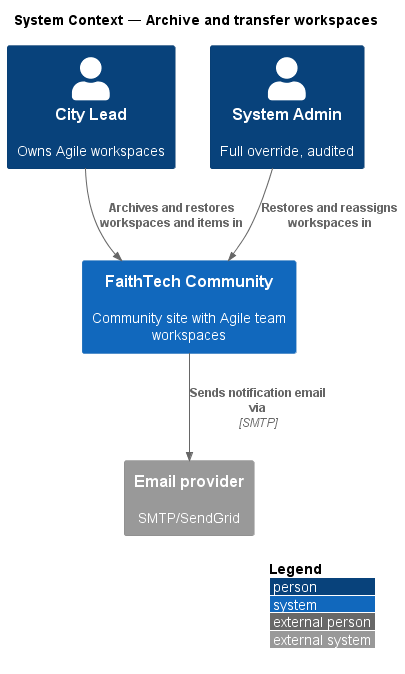
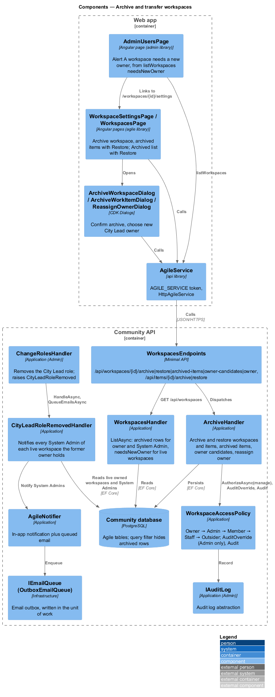
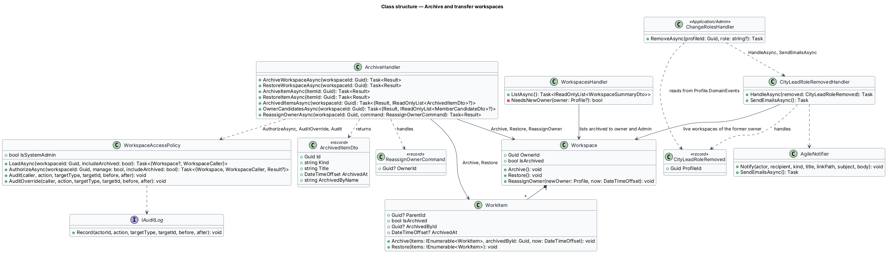
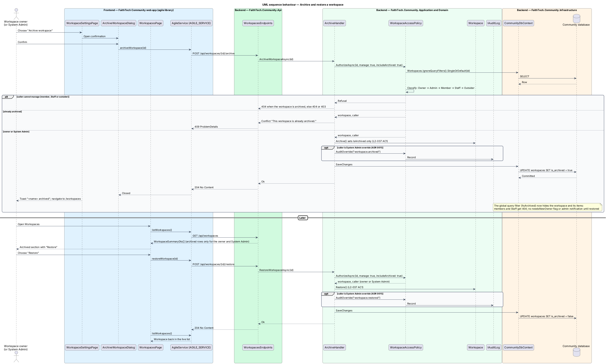
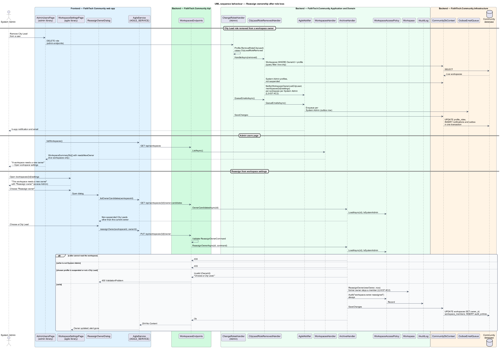

# Archive and transfer workspaces

## Overview

Workspaces and work items are never hard-deleted by their owners; they are archived.

> **archive** — soft delete that hides a workspace or work item from normal views while keeping it restorable
>
> **ownership transfer** — System Admin reassignment of a workspace to another City Lead

The workspace owner archives a workspace or an item and may restore it; System Admin may also archive and restore it, as an audited override. An archived workspace answers 404 to members and Staff; its owner and System Admin still list it under **Archived** so they can restore it. When an owner loses the City Lead role (see the role assignment feature), every System Admin is notified in-app and by email and reassigns ownership to another City Lead from the workspace settings. Reassignment is System Admin only and is always written to the audit log ([ADR 0011](../../../adr/0011-workspace-access-and-audit.md)).

## Description

- **`WorkspaceSettingsPage`** — for the owner and System Admin: **Archive workspace** (opens `ArchiveWorkspaceDialog`, then navigates to `/workspaces`) and the archived items list with **Restore** (`getArchivedItems`, `restoreWorkItem`; mock `docs/mocks/pages/workspace-settings`). When the workspace `needsNewOwner` and the caller's access is `Admin` it shows "This workspace needs a new owner" with **Reassign owner** (state `needs-owner`).
- **`WorkspacesPage`** — lists archived workspaces to their owner and System Admin under **Archived**, each with **Restore** (`restoreWorkspace`, state `archived`). Members and Staff do not see them.
- **`AdminUsersPage`** (`admin` library) — shows "A workspace needs a new owner" for each live workspace that `listWorkspaces()` marks `needsNewOwner`, linking to `/workspaces/{id}/settings`. The admin library may not depend on the agile library, so the dialog opens from settings.
- **`ArchiveWorkspaceDialog`** and **`ArchiveWorkItemDialog`** — CDK Dialogs confirming the archive (`archiveWorkspace`, `archiveWorkItem`; mocks `archive-workspace`, `archive-work-item`). The work item page offers Archive only when the item's `canManage` is true (`L2-037` AC3).
- **`ReassignOwnerDialog`** — CDK Dialog for System Admin to pick a new City Lead owner from `listOwnerCandidates` and call `reassignOwner` (mock `docs/mocks/dialogs/reassign-owner`). It opens from workspace settings, which the admin users alert and the notification link to.
- **`AgileService`** — `api` contract (`AGILE_SERVICE`, `HttpAgileService`): `archiveWorkspace`, `restoreWorkspace`, `getArchivedItems`, `archiveWorkItem`, `restoreWorkItem`, `listOwnerCandidates`, `reassignOwner`, plus `listWorkspaces` for `isArchived` and `needsNewOwner`.
- **`WorkspacesEndpoints`** — maps `POST /api/workspaces/{id}/archive` and `/restore`, `GET /api/workspaces/{id}/archived-items`, `GET /api/workspaces/{id}/owner-candidates`, `PUT /api/workspaces/{id}/owner`, and `POST /api/items/{id}/archive` and `/restore`, all to `ArchiveHandler`.
- **`ArchiveHandler`** — `ArchiveWorkspaceAsync`, `RestoreWorkspaceAsync`, `ArchiveItemAsync`, `RestoreItemAsync`, `ArchivedItemsAsync`, `OwnerCandidatesAsync` and `ReassignOwnerAsync`. Archive and restore authorize with `WorkspaceAccessPolicy.AuthorizeAsync(manage: true)` (owner or System Admin; the workspace routes load with `includeArchived`), answer 409 when already in the target state, and call `AuditOverride` so only a System Admin override is written to the audit log (`workspace.archived`, `workspace.restored`, `workitem.archived`, `workitem.restored`). Anyone who cannot manage an archived workspace gets 404, so only the owner and System Admin know it exists. `ArchivedItemsAsync` lists archived items whose parent is not archived, newest first, as `ArchivedItemDto`.
- **`Workspace.Archive()`** / **`Restore()`** — set only `IsArchived`; the workspace records no `ArchivedById` or `ArchivedAt`. **`WorkItem.Archive(items, archivedById, now)`** sets `IsArchived`, `ArchivedById` and `ArchivedAt` on the item and its whole subtree; `Restore(items)` reverses it. `CommunityDbContext` applies a global EF query filter (`!IsArchived`) to workspaces and items, so normal reads never see archived rows.
- **`ReassignOwnerCommand`** (`OwnerId`) / **`ArchiveHandler.ReassignOwnerAsync`** — System Admin only: 404 when the caller cannot read the workspace, 403 for anyone but a System Admin, 400 when the chosen profile is suspended or not a City Lead. `Workspace.ReassignOwner(newOwner, now)` rejects a profile without the City Lead role and keeps the former owner as a member. Always audited through `WorkspaceAccessPolicy.Audit` as `workspace.owner.reassigned`. `OwnerCandidatesAsync` offers non-suspended City Leads other than the current owner.
- **`CityLeadRoleRemovedHandler`** — Application handler for the `CityLeadRoleRemoved` domain event that `Profile.RemoveRole` raises when the City Lead role is removed. `ChangeRolesHandler` (`Application/Admin`) calls `HandleAsync` before `SaveChanges` and `SendEmailsAsync` after it. The handler reads the filtered `db.Workspaces`, so archived workspaces are skipped, and notifies every non-suspended System Admin, the acting one included, of each live workspace the former owner holds through `AgileNotifier` (`WorkspaceOwnerLostCityLead`, in-app and by email, linking to `/workspaces/{id}/settings`).
- **`WorkspacesHandler.ListAsync`** — lists archived workspaces only to their owner and System Admin and sets `NeedsNewOwner` only for a live workspace whose owner holds neither City Lead nor System Admin; an archived workspace is not flagged until it is restored.
- **`WorkspaceAccessPolicy`** — Application service shared by every agile handler. `Classify` resolves the caller as `Owner` → `Admin` (holds System Admin, even when also a member) → `Member` → `Staff` → `Outsider`; `CanManage` is Owner or Admin. Outsiders receive 404, Staff and non-owner members receive 403 on writes they lack. `AuditOverride` records only Admin writes to `IAuditLog`; the owner's own actions are not audited. `Audit` records actions only a System Admin may take, such as reassigning the owner (`L2-031`, `L2-042`, ADR 0011).
- **`AgileNotifier`** and **`IAuditLog`** — `AgileNotifier` adds the in-app `Notification` to the unit of work and, through `QueueEmailsAsync`, queues the emails in `IEmailQueue` (the email outbox) before the save, so they commit with the change; `IAuditLog` (`Application/Admin`) is the audit abstraction. There is no `INotificationService`.

## Requirements

The feature realizes the following level-2 (L2) requirements. Each L2 requirement refines a level-1 (L1) requirement, cited by identifier.

| L2 ID | Refines (L1) | Requirement |
|-------|--------------|-------------|
| `L2-037` | `L1-012` | Archive and ownership of workspaces |

### Acceptance criteria

**`L2-037` — Archive and ownership of workspaces**

1. Given the owner, when they archive a workspace or an item, then it is hidden from normal views and can be restored by the owner or a System Admin. Archiving a story also archives its tasks.
2. Given an owner who loses the City Lead role, when the role is removed, then System Admin is notified and can reassign ownership to another City Lead.
3. Given a member who is not the owner, when they view an item, then no Archive action is shown.

## Diagrams

### System context

The owner archives and restores; System Admin archives, restores and reassigns ownership. Notifications reach System Admin by email as well as in-app.

### Containers

The Web app calls the Community API, which updates archive flags and ownership in PostgreSQL and sends email through the provider from its outbox.

### Components

`ArchiveHandler` authorizes through `WorkspaceAccessPolicy` and audits only System Admin overrides and owner reassignment; `CityLeadRoleRemovedHandler`, called by `ChangeRolesHandler`, notifies every System Admin through `AgileNotifier`, and `WorkspacesHandler.ListAsync` feeds the admin users alert.

### Class structure

`Workspace` and `WorkItem` expose `Archive` and `Restore`; `ArchiveHandler` serves every archive, restore and ownership route, and `CityLeadRoleRemovedHandler` handles the `CityLeadRoleRemoved` event.

### Behaviour — archive and restore a workspace

`ArchiveHandler` flips `IsArchived`; the query filter then hides the workspace from members and Staff, while the owner or System Admin restores it from the Archived list (`L2-037`). Only a System Admin override is audited. Items follow the same flow through `/api/items/{id}/archive`.

### Behaviour — reassign ownership after role loss

Removing the City Lead role from an owner notifies every System Admin in-app and by email; a System Admin opens the workspace settings and reassigns it to another City Lead, and the action is always audited (`L2-037`).

## Open questions

Decisions recorded while building the feature:

- `WorkItem.Archive(items, archivedById, now)` archives the item and everything under it among `items`, so a story takes its tasks and an epic its stories and their tasks (`L2-037` AC1). `Restore(items)` brings back only what was archived at the same moment; an item archived earlier stays archived. Settings lists an archived item only when its parent is not archived.
- `Workspace.Archive()` and `Restore()` set only `IsArchived`; who archived a workspace and when is not recorded, unlike a work item's `ArchivedById` and `ArchivedAt`.
- Archive and restore reject an item or workspace already in the target state. Domain rule violations throw `InvalidOperationException` (a broken rule) or `ArgumentException` (invalid input); there is no shared domain exception type. Handlers check permissions and preconditions first and map any remaining violation to a `400` or `409` result.
- Archive, restore and ownership share one `ArchiveHandler`; `ReassignOwnerCommand` is the only request record. There are no separate archive or restore command types.
- Audit follows ADR 0011: an owner's archive or restore is not audited, a System Admin's is (`AuditOverride`), and `ReassignOwnerAsync` is System Admin only and always audited (`workspace.owner.reassigned`).
- An archived workspace is listed only to its owner and System Admin and answers 404 to everyone else. It is not flagged `needsNewOwner` and no System Admin is notified about it until it is restored: `CityLeadRoleRemovedHandler` reads the filtered `db.Workspaces` and `ListAsync` flags live workspaces only.
- When an owner loses City Lead, every non-suspended System Admin gets an in-app notification and an email (`AgileNotifier.Notify` then `SendEmailsAsync`, driven by `ChangeRolesHandler`), each linking to `/workspaces/{id}/settings`; there is no `INotificationService`.
- Reassignment happens from workspace settings through `ReassignOwnerDialog`, reached from the notification and from the admin users alert, so the `admin` library never depends on the `agile` library.
