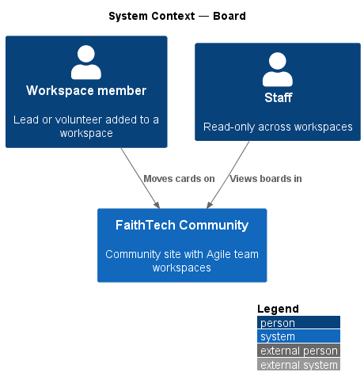
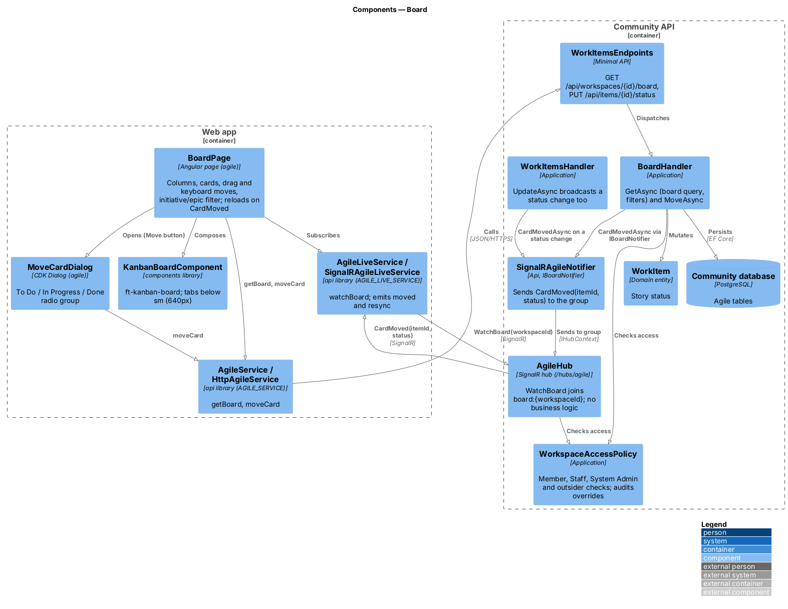
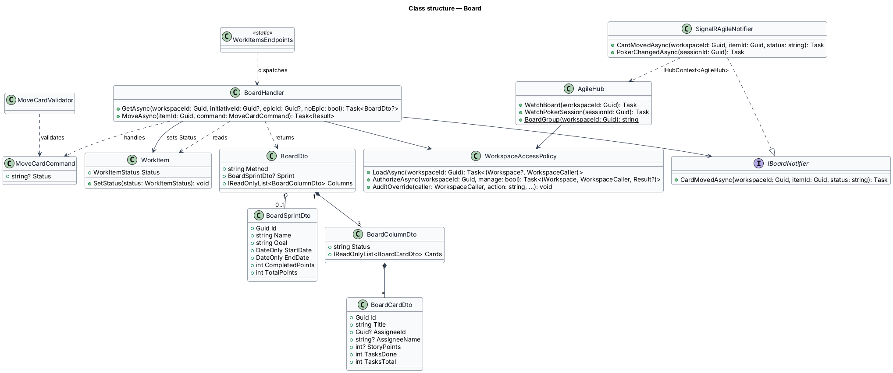
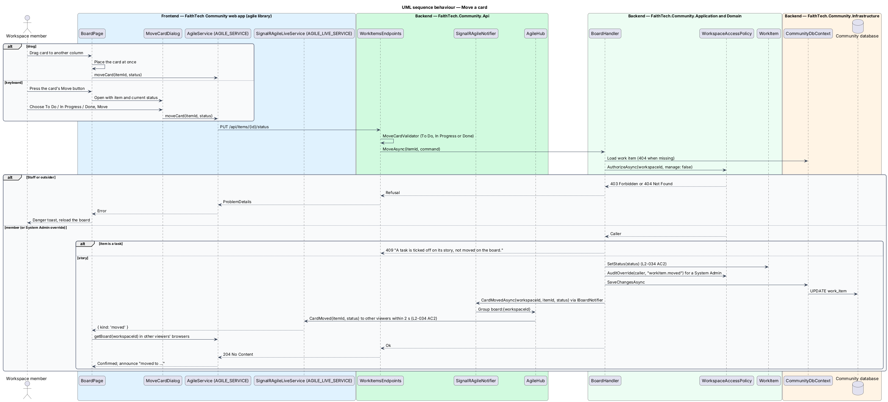

# Board

## Overview

The *board* is the visual view of a workspace's stories.

> **board** — three fixed columns, To Do, In Progress and Done, that show a workspace's stories as cards
>
> **card** — board representation of one story, showing its title, assignee, points and a task checklist count such as `2/5`
>
> **active sprint** — the one running sprint of a Scrum workspace (see `agile/sprints`)

In a Kanban workspace the board shows every non-archived story; it can be narrowed to one initiative, one epic or the stories with no epic (`initiativeId`, `epicId` and `noEpic` query parameters, the same filter the backlog takes). In a Scrum workspace it shows only stories in the active sprint and ignores the filter. The board has no work-in-progress (WIP) limits. A member moves a card by drag or by keyboard; the move changes the story's status, and other open viewers see the change within 2 seconds. Below the design system's `sm` breakpoint (640px) the columns become tabs with one column visible at a time.

The live transport for board updates is SignalR, the same hub Planning Poker uses (`AgileHub` at `/hubs/agile`, ADR 0012). Moves go over HTTP to `BoardHandler`, which saves and then broadcasts `CardMoved(itemId, status)` to the board's group `board:{workspaceId}`; a status change saved from the work item page broadcasts the same way.

## Description

- **`BoardPage`** — renders the workspace's board at `/workspaces/{id}` with the `components` library `KanbanBoardComponent` (`ft-kanban-board`, `ft-kanban-column`, `ft-kanban-card`), supports drag and keyboard moves, offers the initiative/epic filter, and loads the board again on each `CardMoved` or resync (mock `docs/mocks/pages/team-board`). `KanbanBoardComponent` switches the columns to tabs below `sm` using `BreakpointService`. A drop moves the card at once and announces the move; a failed move shows a danger toast and reloads the board. The keyboard path is each card's Move button, which opens **`MoveCardDialog`**, a CDK dialog with a To Do / In Progress / Done radio group that calls `moveCard` itself (mock `docs/mocks/dialogs/move-story`).
- **`AgileService`** — `api` contract (`AGILE_SERVICE`, `HttpAgileService`) with `getBoard(workspaceId, filter?)` and `moveCard(itemId, status)`.
- **`AgileLiveService`** — `api` contract for live updates (`AGILE_LIVE_SERVICE`), implemented by `SignalRAgileLiveService` over `@microsoft/signalr` with automatic reconnect (ADR 0012). `watchBoard(workspaceId)` invokes `AgileHub.WatchBoard`, emits `{ kind: 'moved', itemId, status }` on each `CardMoved` and `{ kind: 'resync' }` after a reconnect, when it re-joins the group.
- **`WorkItemsEndpoints`** — minimal API mapping for `GET /api/workspaces/{id}/board` (with the filter query parameters) and `PUT /api/items/{id}/status`, validated by `MoveCardValidator`.
- **`BoardHandler`** — Application handler. `GetAsync` returns `BoardDto` (`Method`, the active `BoardSprintDto` with completed and total points for Scrum, and the three `BoardColumnDto` columns of `BoardCardDto` cards with task counts), filtered to the active sprint for Scrum or by initiative/epic for Kanban; it returns null (404) when the caller may not see the workspace. `MoveAsync` takes `MoveCardCommand`, changes the story's status and publishes `CardMoved` through `IBoardNotifier`; a task is refused with 409 because tasks have a done flag instead.
- **`WorkItemsHandler`** — `UpdateAsync` also publishes `CardMoved` when an edit on the work item page changes the status, so open boards follow.
- **`AgileHub`** — the one SignalR hub, mapped at `/hubs/agile` in the Api. `WatchBoard(workspaceId)` joins `board:{workspaceId}` after `WorkspaceAccessPolicy` allows the caller (an outsider gets a `HubException`); it holds no business logic.
- **`WorkspaceAccessPolicy`** — Application service shared by every agile handler and the hub. It resolves the caller from `ICurrentUser` and classifies the caller as owner, member, System Admin, Staff or outsider for a workspace. Outsiders receive 404, Staff and non-owner members receive 403 on writes they lack, and System Admin actions pass and are written to the audit log (`L2-031`, `L2-042`); a System Admin's move is audited as `workitem.moved`.
- **`IBoardNotifier`** — Application abstraction, implemented in the Api by `SignalRAgileNotifier` over `IHubContext<AgileHub>`, that sends `CardMoved(itemId, status)` to `board:{workspaceId}` after the move is saved.
- **`WorkItem`** / **`WorkItemStatus`** — from `agile/work-items`.

## Requirements

The feature realizes the following level-2 (L2) requirements. Each L2 requirement refines a level-1 (L1) requirement, cited by identifier.

| L2 ID | Refines (L1) | Requirement |
|-------|--------------|-------------|
| `L2-034` | `L1-012` | Board |

### Acceptance criteria

**`L2-034` — Board**

1. Given a workspace, when the board is shown, then stories appear as cards in the fixed columns To Do, In Progress and Done, with a task checklist count on each card. There are no WIP limits.
2. Given a member, when they move a card by drag or keyboard, then its status changes, and other open viewers see the change within 2 seconds.
3. Given a Scrum workspace, when the board is shown, then only stories in the active sprint appear.
4. Given an XS viewport, when the board is shown, then the columns are shown as tabs with one visible at a time.

## Diagrams

### System context

Members move cards on the board; Staff view it. No external system takes part.

### Containers

The Web app reads the board and moves cards over HTTPS and receives `CardMoved` from the Community API over SignalR (`AgileHub`, ADR 0012).

### Components

`WorkItemsEndpoints` dispatch to `BoardHandler`, which checks access with `WorkspaceAccessPolicy`, updates the story and publishes `CardMoved` through `IBoardNotifier` (`SignalRAgileNotifier` on `AgileHub`); `AgileLiveService` hears it and `BoardPage` reloads the board through `AgileService`.

### Class structure

`BoardDto` composes exactly three `BoardColumnDto` columns of `BoardCardDto` cards and an optional `BoardSprintDto`. `BoardHandler` uses `WorkspaceAccessPolicy` and `IBoardNotifier`; `SignalRAgileNotifier` implements `IBoardNotifier` over `AgileHub`.

### Behaviour — move a card

A drag or keyboard move goes over HTTP to `BoardHandler.MoveAsync`, which changes the story's status, saves and broadcasts `CardMoved`; other viewers reload the board within 2 seconds (`L2-034`).

### Behaviour — load the board

`BoardHandler.GetAsync` returns the three fixed columns, filtered to the active sprint in a Scrum workspace or by initiative/epic in Kanban; the page then joins the board's group through `AgileHub.WatchBoard` (`L2-034`).

## Open questions

Decisions recorded while building the Domain layer (`FaithTech.Community.Domain`):

- `BoardHandler.MoveAsync` changes the status through `WorkItem.SetStatus`, which a task refuses (tasks have a done flag); the handler answers 409 before reaching the entity.

Decisions recorded while building the Application, Api and frontend:

- One `BoardHandler` holds both the board query (`GetAsync`) and the move (`MoveAsync`); the board routes live in `WorkItemsEndpoints` with the other work item routes, and there is no separate board endpoint class.
- The board takes the backlog's initiative/epic filter so a Kanban team can focus one slice; a Scrum board ignores it and shows the active sprint (`L2-034` AC3).
- `SignalRAgileNotifier` lives in the Api project (it needs `IHubContext<AgileHub>`), not Infrastructure, and implements `IBoardNotifier` and `IPokerBroadcaster` together (ADR 0012). The page reloads the whole board on `CardMoved` rather than patching one card, so a missed message is harmless.
- Columns become tabs below the design system's `sm` breakpoint (640px), decided by `KanbanBoardComponent` in `components` through `BreakpointService`, not by the page.
