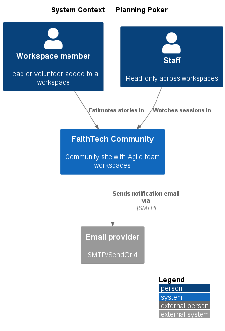
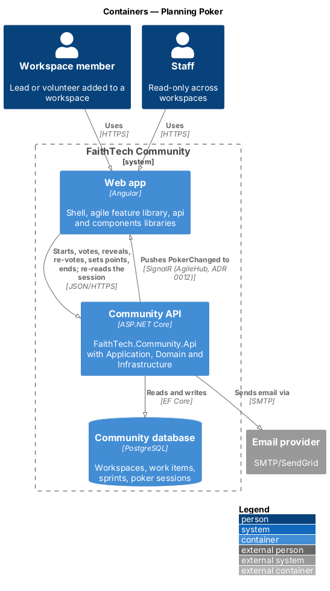
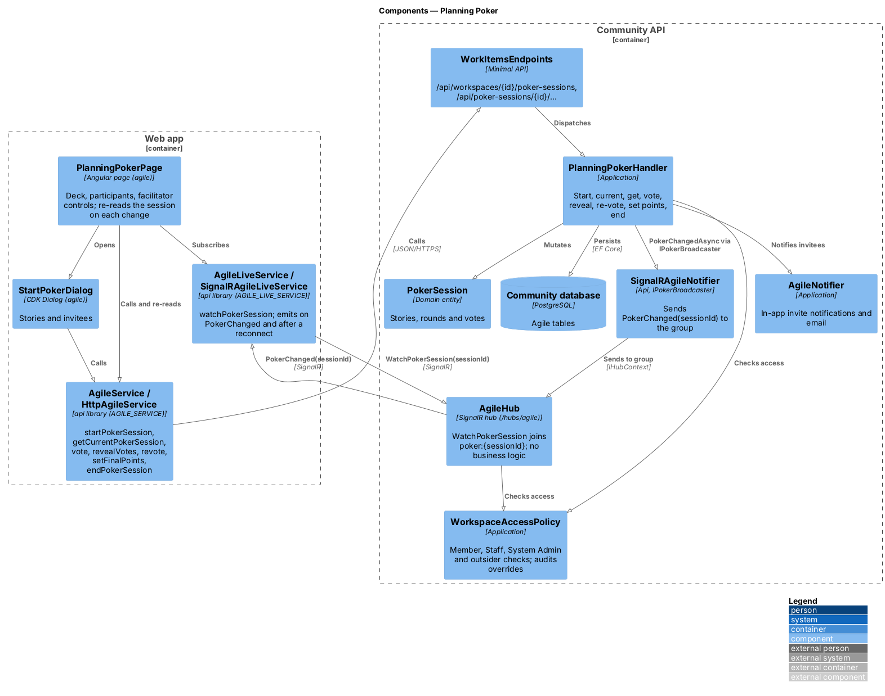
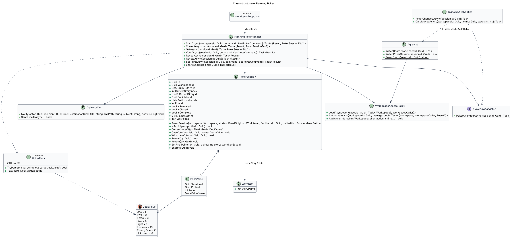
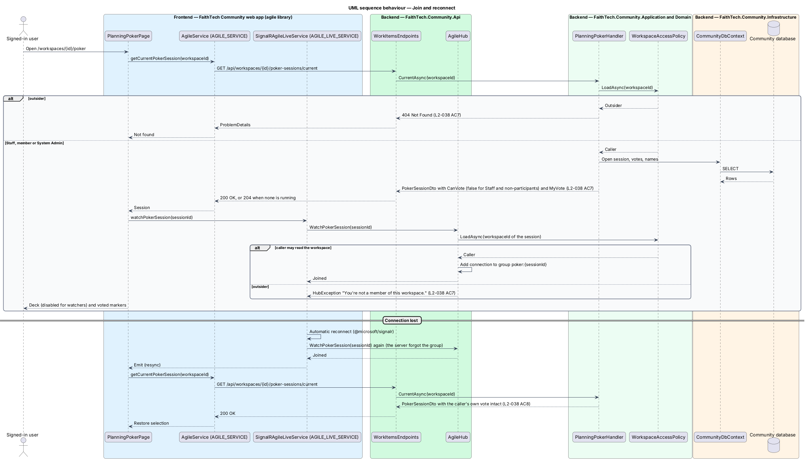

# Planning Poker

## Overview

*Planning Poker* is a live estimation game for one or more stories, estimated one at a time.

> **poker session** — live estimation of one or more stories, one at a time, by invited workspace members
>
> **facilitator** — the member who started the session and alone may reveal, start a re-vote, set the final points or end it
>
> **deck** — fixed set of vote values: 1, 2, 3, 5, 8, 13, 21 and ?

Any workspace member starts a session for one or more stories and becomes its facilitator; a System Admin may do the same as an audited override. Invited members are notified in-app and by email. While voting is open, participants see who has voted but not the values. The facilitator reveals all votes, may clear them for a re-vote, and saves the final points to the current story, which moves the session to the next one. Non-members cannot join. Staff may watch but not vote. Live updates travel over SignalR, as agreed in `decisions.txt`: every change goes over HTTP to `PlanningPokerHandler`, which saves it and then broadcasts a bare `PokerChanged(sessionId)` through `AgileHub` (ADR 0012); each client re-reads the session, so the change reaches every participant within 2 seconds and a participant whose connection drops rejoins with their vote intact.

## Description

- **`PlanningPokerPage`** — session view at `/workspaces/{id}/poker` with the story, deck (`ft-estimate-picker`), participant list with voted markers (`ft-estimate-card`), and facilitator controls: Reveal votes, End session, and after the reveal Final points, Set points and Re-vote (mock `docs/mocks/pages/planning-poker`). It loads the workspace's current session with `getCurrentPokerSession` and re-reads it after each of its own actions, on each `PokerChanged` and after a reconnect. Pressing the pressed card withdraws the vote (mock `withdrawn`); a vote refused with 409 after the reveal sets the deck's `error` (mock `invalid`); a vote that fails to send restores the saved vote and shows a danger alert above the deck (mock `vote-failed`).
- **`StartPokerDialog`** — CDK Dialog that picks one or more stories and the members to invite (mock `docs/mocks/dialogs/start-poker`). Field errors (`StoryIds`, `InvitedIds`) come from the 400 problem details; when a session is already running it shows the server's 409 detail.
- **`AgileService`** — `api` contract (`AGILE_SERVICE`, `HttpAgileService`) with `startPokerSession`, `getCurrentPokerSession`, `getPokerSession`, `vote`, `revealVotes`, `revote`, `setFinalPoints` and `endPokerSession`. Every change goes over HTTP (ADR 0012).
- **`AgileLiveService`** — `api` contract behind `AGILE_LIVE_SERVICE`, implemented by `SignalRAgileLiveService` over `@microsoft/signalr` with automatic reconnect. `watchPokerSession(id)` invokes `AgileHub.WatchPokerSession`, emits on each `PokerChanged` and again after a reconnect (when it re-joins the group), and the page re-reads the session.
- **`WorkItemsEndpoints`** — maps `POST /api/workspaces/{id}/poker-sessions` (201), `GET /api/workspaces/{id}/poker-sessions/current` (204 when none is running), `GET /api/poker-sessions/{id}`, `PUT /api/poker-sessions/{id}/vote` (a null value withdraws the vote) and `POST /api/poker-sessions/{id}/reveal`, `/revote`, `/points` and `/end`. Commands are validated by `StartPokerValidator`, `CastVoteValidator` and `SetPointsValidator` against `PokerDeck`.
- **`AgileHub`** — the one SignalR hub, mapped at `/hubs/agile` in the Api (ADR 0012). `WatchPokerSession(sessionId)` joins `poker:{sessionId}` after `WorkspaceAccessPolicy` allows the caller (Staff may watch, an outsider gets a `HubException`); it holds no business logic.
- **`PlanningPokerHandler`** — Application handler with `StartAsync`, `CurrentAsync`, `GetAsync`, `VoteAsync`, `RevealAsync`, `RevoteAsync`, `SetPointsAsync` and `EndAsync`. Any member starts a session and facilitates it. Every change is loaded through `WorkspaceAccessPolicy` (outsiders 404, Staff writes 403), then checks who may act before what state the round is in: facilitator-only actions are refused with 403 for others, an uninvited member's vote with 403, and a participant's vote after the reveal with 409 "Votes are already revealed. Wait for a re-vote.". A System Admin may do anything a member may, recorded by `policy.AuditOverride` as `poker.started`, `poker.voted`, `poker.revealed`, `poker.revoted`, `poker.points.set` and `poker.ended`. Reads build `PokerSessionDto`, withholding other participants' vote values until the reveal and always returning the caller's own vote.
- **`AgileNotifier`** — Application service that adds the `PlanningPokerInvite` in-app notification for each invitee to the unit of work and emails them after the save; nobody is notified about their own action.
- **`WorkspaceAccessPolicy`** — Application service shared by every agile handler and the hub. It resolves the caller from `ICurrentUser` and classifies the caller as owner, member, System Admin, Staff or outsider for a workspace. Outsiders receive 404, Staff and non-owner members receive 403 on writes they lack, and System Admin actions pass and are written to the audit log (`L2-031`, `L2-042`).
- **`PokerSession`** — Domain entity with `StoryIds`, `CurrentStoryIndex`, `CurrentStoryId`, `FacilitatorId`, `Round`, `IsRevealed`, `IsClosed`, `IsComplete`, `InvitedIds` and `Votes`. Its constructor takes the workspace and refuses non-story items, items of another workspace and an invitee who is not a member; who may facilitate is the Application's decision. `IsParticipant` covers the facilitator and invitees; `WithdrawVote` removes a participant's vote before the reveal; votes are fixed once revealed, so a late `CastVote` or `WithdrawVote` is refused; `Revote` clears them; `SetFinalPoints` updates the current story and moves to the next; `End` closes the session; persisting votes lets a reconnecting participant recover the current vote.
- **`PokerVote`** — value of one participant in one round; `DeckValue` restricts the value to the deck and `PokerDeck` parses the card text (`"1"` to `"21"` or `"?"`).
- **`IPokerBroadcaster`** — Application abstraction, implemented in the Api by `SignalRAgileNotifier` over `IHubContext<AgileHub>`, that sends `PokerChanged(sessionId)` to `poker:{sessionId}` after each saved change. It carries no votes.
- A workspace has at most one open session (`409` otherwise). A session closes after its last story gets its points or when the facilitator ends it; there is no automatic expiry in v1. Only the facilitator and invitees vote; other members, Staff and a System Admin who is not a participant watch.

## Requirements

The feature realizes the following level-2 (L2) requirements. Each L2 requirement refines a level-1 (L1) requirement, cited by identifier.

| L2 ID | Refines (L1) | Requirement |
|-------|--------------|-------------|
| `L2-038` | `L1-013` | Planning Poker sessions |

### Acceptance criteria

**`L2-038` — Planning Poker sessions**

1. Given a member, when they start a session for one or more stories and invite workspace members, then they become the facilitator, the invited members are notified in-app and by email, and the stories are estimated one at a time.
2. Given an open session, when members vote from the deck 1, 2, 3, 5, 8, 13, 21 or ?, then other participants see who has voted, but not the values, within 2 seconds, using SignalR.
3. Given the facilitator, when they reveal, then all votes are shown to everyone.
4. Given revealed votes, when the facilitator starts a re-vote, then the previous votes are cleared.
5. Given the facilitator sets the final points, when they save, then the story's points update.
6. Given a non-facilitator, when they try to reveal, re-vote or set the points, then the action is refused.
7. Given a user who is not a member, when they try to join, then they are refused. Staff can watch but not vote.
8. Given a lost connection, when it is restored, then the participant rejoins with their current vote intact.
9. Given a participant who has voted, when they press their chosen card again before the reveal, then their vote is withdrawn and other participants see them as still choosing.
10. Given a vote that reaches the server after the votes are revealed, when it is refused, then the voter sees why under the deck and the vote is not counted; a vote that fails to send leaves the previous vote standing and the voter is told so.

## Diagrams

### System context

Members estimate stories and Staff watch. The system emails invitees when a session starts.

### Containers

The Web app sends every session change to the Community API over HTTPS and receives `PokerChanged` from it over SignalR (`AgileHub`, ADR 0012).

### Components

`WorkItemsEndpoints` dispatch each HTTP call to `PlanningPokerHandler`, which checks access with `WorkspaceAccessPolicy`, mutates `PokerSession`, saves and broadcasts `PokerChanged` through `IPokerBroadcaster` (`SignalRAgileNotifier` on `AgileHub`); `AgileLiveService` hears it and `PlanningPokerPage` re-reads the session through `AgileService`.

### Class structure

`PokerSession` composes `PokerVote` values restricted to `DeckValue` and sets the story's points. `PlanningPokerHandler` uses `WorkspaceAccessPolicy`, `AgileNotifier` and `IPokerBroadcaster`; `SignalRAgileNotifier` implements `IPokerBroadcaster` over `AgileHub`.

### Behaviour — start a poker session

`StartPokerDialog` posts the stories and invitees; `PlanningPokerHandler.StartAsync` refuses a second open session with 409, makes the caller facilitator and notifies invitees in-app and by email through `AgileNotifier` (`L2-038`).

### Behaviour — vote, reveal and set points

Each change goes over HTTP to `PlanningPokerHandler`, which saves it and broadcasts a bare `PokerChanged`; every client re-reads the session, which withholds other participants' values until the reveal. Facilitator-only actions are refused for others, and a vote after the reveal gets 409 (`L2-038`).

### Behaviour — join and reconnect

Opening the page reads the workspace's current session, then `AgileHub.WatchPokerSession` joins the group after `WorkspaceAccessPolicy` allows it: Staff watch and outsiders are refused. After a dropped connection `SignalRAgileLiveService` re-joins and the page re-reads the session, which returns the caller's own vote (`L2-038`).

## Open questions

Decisions recorded while building the Domain layer (`FaithTech.Community.Domain`):

- `L2-038` AC1 starts a session for one or more stories estimated one at a time; the session holds `StoryIds` and a current story instead of a single `StoryId`, and is complete after the last story. Resolved.
- `PokerSession` also keeps `IsClosed`, `LastStoryId` and `LastPoints` so everyone sees the agreed estimate, and offers `WithdrawVote` (pressing the chosen card again) and `End`.
- `DeckValue.Points()` maps each card to its points; `?` (`Unknown`) has none.
- Domain rule violations throw `InvalidOperationException` (a broken rule) or `ArgumentException` (invalid input); there is no shared domain exception type. Handlers check permissions and preconditions first and map any remaining violation to a `400` or `409` result.

Decisions recorded while building the Application, Api and frontend:

- Who may facilitate is the Application's permission decision: any member, or a System Admin as an audited override. The `PokerSession` constructor only insists that invitees are members.
- `PlanningPokerHandler.ChangeAsync` settles who may act before what state the round is in, so an uninvited member gets 403 both before and after the reveal and only a participant's late vote gets 409 (`L2-038` AC6, AC7, AC10).
- There are no hub methods for changes and no per-event messages. `AgileHub` only joins groups; `SignalRAgileNotifier` lives in the Api project (it needs `IHubContext<AgileHub>`), not Infrastructure, and sends a bare `PokerChanged(sessionId)`; clients re-read the session (ADR 0012).
- The page re-reads the workspace's current session (`GET /api/workspaces/{id}/poker-sessions/current`) rather than the session by id, so it also learns when the session has ended; `GET /api/poker-sessions/{id}` exists for direct reads.
