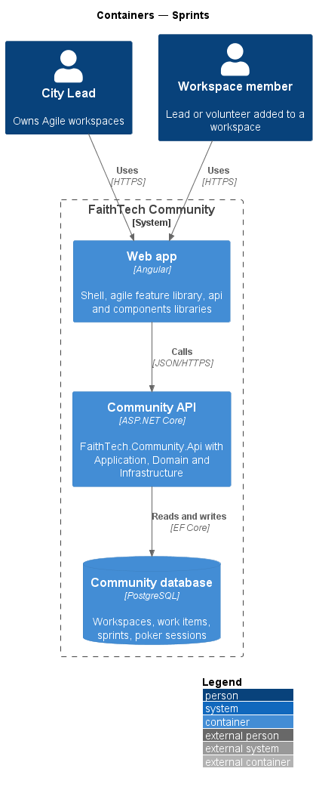
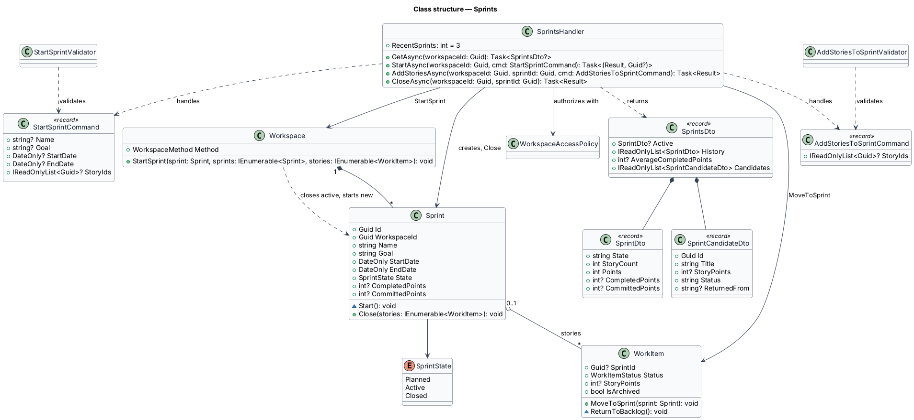
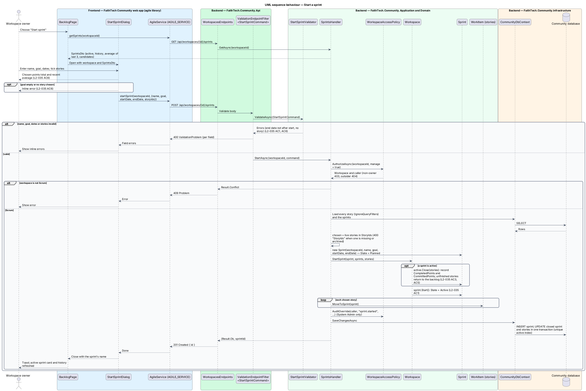
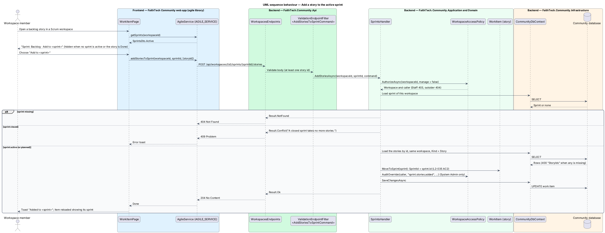
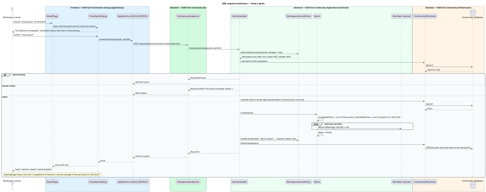

# Sprints

## Overview

Sprints apply only to workspaces that use the Scrum method.

> **sprint** — time-boxed iteration with a name, a goal, a start date and an end date after the start date
>
> **active sprint** — the one sprint of a workspace that is running; its stories are the board
>
> **committed story points** — sum of the story points of every story the sprint held when it closed, Done or not
>
> **completed story points** — sum of the story points of the stories that were Done when the sprint closed
>
> **recent average** — average completed points of the last three closed sprints, rounded half away from zero

The workspace owner starts and closes sprints; at most one sprint is active at a time. There is no separately "planned" sprint in v1: the owner chooses the sprint's stories in the Start sprint dialog, and the sprint is created and activated in the same request. Members add further stories to the active sprint from the work item page. When the owner closes the active sprint, every story that is not Done returns to the backlog and the sprint records its completed and committed story points. The sprint history on the backlog page lists "completed N of M points" per sprint and the recent average; there is no burndown chart.

## Description

- **`BacklogPage`** — shows the backlog tree, the active sprint card (name, goal, story count, points, end date) and, behind the "Sprint history" chip, the closed sprints newest first with the recent average; its "Start sprint" button (owner only) opens `StartSprintDialog` (mock `docs/mocks/pages/backlog`). There is no move-to-sprint control on the backlog page itself.
- **`WorkItemPage`** — on a story outside a sprint in a Scrum workspace, shows "Backlog · Add to <sprint>" while a sprint is active; any member can add the story (`addStoriesToSprint`). A story in a sprint shows its sprint name (mock `docs/mocks/pages/work-item`).
- **`BoardPage`** — shows the active sprint and its "Close sprint" button (owner only), which opens `CloseSprintDialog` with the unfinished cards; it can also open `StartSprintDialog` when no sprint runs (see `agile/board`).
- **`StartSprintDialog`** — CDK Dialog for name, goal, start date, end date and the stories to take (`SprintsDto.Candidates`: backlog stories and the unfinished stories of the active sprint, marked "returned from <sprint>"); it shows the chosen stories' points total and the recent average, and inline errors for an empty goal or no story chosen (mock `docs/mocks/dialogs/start-sprint`).
- **`CloseSprintDialog`** — CDK Dialog that confirms closing, states the completed-of-committed points and lists the unfinished stories that return to the backlog (mock `docs/mocks/dialogs/close-sprint`).
- **`AgileService`** — `api` contract (`AGILE_SERVICE`, `HttpAgileService`): `getSprints`, `startSprint`, `addStoriesToSprint`, `closeSprint`.
- **`WorkspacesEndpoints`** — minimal API mapping for `GET`/`POST /api/workspaces/{id}/sprints`, `POST /api/workspaces/{id}/sprints/{sprintId}/stories` and `POST /api/workspaces/{id}/sprints/{sprintId}/close`. `StartSprintValidator` and `AddStoriesToSprintValidator` run through `ValidationEndpointFilter<T>` before the handler.
- **`SprintsHandler`** — Application handler. `GetAsync` returns `SprintsDto` (`Active`, `History` newest first, `AverageCompletedPoints`, `Candidates`); `StartAsync` (owner only, Scrum only else `409`) loads every story with `IgnoreQueryFilters`, creates the `Sprint`, calls `Workspace.StartSprint(sprint, sprints, stories)` and moves the chosen live stories in with `WorkItem.MoveToSprint`; `AddStoriesAsync` (any member) moves stories into a non-closed sprint and answers `409` for a closed one; `CloseAsync` (owner only) loads the sprint's stories with `IgnoreQueryFilters` and calls `Sprint.Close`. `RecentSprints = 3` sets how far the recent average looks back.
- **`StartSprintCommand`** / **`StartSprintValidator`** — name (required, 100 chars), goal (required, 200 chars), start date, end date after the start date, at least one story (`L2-035` AC1, AC6).
- **`AddStoriesToSprintCommand`** / **`AddStoriesToSprintValidator`** — at least one story id; the handler requires stories of the same workspace.
- **`SprintsDto`**, **`SprintDto`**, **`SprintCandidateDto`** — DTO contracts in `Sprints.cs`.
- **`WorkspaceAccessPolicy`** — Application service shared by every agile handler. It resolves the caller from `ICurrentUser` and classifies the caller as owner, member, Staff, System Admin or outsider for a workspace. Outsiders receive 404, Staff and non-owner members receive 403 on writes they lack, and System Admin actions pass and are written to the audit log (`L2-031`, `L2-042`).
- **`Sprint`** — Domain entity with `Name`, `Goal`, `StartDate`, `EndDate`, `State`, `CompletedPoints` and `CommittedPoints`. The constructor requires a name, a goal and an end date after the start date; `Close(stories)` records the completed and committed points of the stories whose `SprintId` is the sprint's and returns the unfinished ones to the backlog; `Start()` (internal, called by `Workspace.StartSprint`) moves `Planned` to `Active`.
- **`SprintState`** — enumeration `Planned`, `Active`, `Closed`. `Planned` is the state a new `Sprint` is in before `Workspace.StartSprint` activates it inside the same request; no sprint is persisted as planned.
- **`Workspace.StartSprint(sprint, sprints, stories)`** — Domain method: Scrum only, closes the active sprint with `Sprint.Close` and starts the new one, so no second sprint is ever active (`L2-035` AC1, AC5).
- A partial unique index `IX_Sprints_WorkspaceId_Active` on `(WorkspaceId) WHERE State = 'Active'` in `CommunityDbContext` backs the one-active-sprint rule.

## Requirements

The feature realizes the following level-2 (L2) requirements. Each L2 requirement refines a level-1 (L1) requirement, cited by identifier.

| L2 ID | Refines (L1) | Requirement |
|-------|--------------|-------------|
| `L2-035` | `L1-012` | Sprints (Scrum) |

### Acceptance criteria

**`L2-035` — Sprints (Scrum)**

1. Given the owner of a Scrum workspace, when they start a sprint with a name, a goal, a start date and an end date after the start date, then it becomes active, and no second sprint can be active at the same time.
2. Given the backlog, when a member moves stories into the planned or active sprint, then they appear in that sprint.
3. Given the owner closes the active sprint, when the sprint closes, then stories that are not Done return to the backlog, and the sprint records its completed story points.
4. Given closed sprints, when the sprint history is viewed, then each sprint shows its goal, dates and "completed N of M points", with the average completed points per sprint.
5. Given an active sprint, when the owner starts the next sprint, then the active sprint is closed first (as in criterion 3) and the new sprint becomes active.
6. Given the start-sprint dialog, when the goal is empty or no story is chosen, then an inline error is shown. The dialog shows the chosen stories' points total and the recent average.

## Diagrams

### System context

The owner starts and closes sprints; members add stories to the active sprint.

### Containers

The `agile` library calls the Community API, which stores sprints and story assignments in PostgreSQL.

### Components

`WorkspacesEndpoints` runs `StartSprintValidator` or `AddStoriesToSprintValidator` through the validation filter, then calls `SprintsHandler`, which checks owner or member access with `WorkspaceAccessPolicy` and mutates `Workspace`, `Sprint` and the stories.

### Class structure

A `Workspace` composes its `Sprint` records and starts them; each sprint aggregates the stories whose `SprintId` points to it. `SprintsHandler` handles every sprint command and the sprints query.

### Behaviour — start a sprint

The owner starts a sprint with its stories; `StartSprintValidator` checks the fields, `Workspace.StartSprint` closes the active sprint first and activates the new one, then the chosen stories move in (`L2-035`).

### Behaviour — add a story to the active sprint

Any member adds a backlog story to the active sprint from the work item page; a closed sprint answers `409` (`L2-035`).

### Behaviour — close a sprint

From the board, the owner confirms in `CloseSprintDialog`; `Sprint.Close` returns unfinished stories to the backlog and records the completed and committed points shown in sprint history (`L2-035`).

## Open questions

Decisions recorded while building the feature:

- Starting a sprint is a `Workspace` operation so the one-active-sprint rule holds in the Domain as well as in the partial unique index. A planned sprint may also be closed (used by a switch to Kanban). Domain rule violations throw `InvalidOperationException` (a broken rule) or `ArgumentException` (invalid input); there is no shared domain exception type. Handlers check permissions and preconditions first and map any remaining violation to a `400` or `409` result.
- There is no separately planned sprint in v1. `SprintState.Planned` exists only as the state a new `Sprint` holds before `Workspace.StartSprint` activates it inside the same request. The owner chooses the stories in the Start sprint dialog; members add further stories to the active sprint from the work item page ("Add to <sprint>", `POST .../sprints/{id}/stories`, any member; a closed sprint answers `409`). The backlog page shows the tree, the active sprint card and the history, with no move-to-sprint control of its own. Resolved.
- `Sprint.Close` records `CompletedPoints` and `CommittedPoints`: the points of every story the sprint held, Done or not. The sprint history shows "completed N of M points".
- The recent average is the average completed points of the last three closed sprints (`SprintsHandler.RecentSprints`, rounded half away from zero), shown in the backlog history and in the Start sprint dialog. Resolved.
- When the owner starts the next sprint, the active sprint closes first and counts every story it held, archived stories included, exactly as a direct close does (both paths load with `IgnoreQueryFilters`); then the chosen stories, including any it left unfinished, join the new sprint, so the closing sprint's committed points do not include them. Only live stories can be chosen for the new sprint. Resolved.
