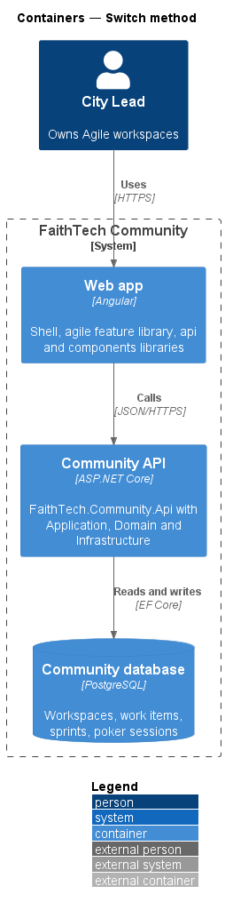
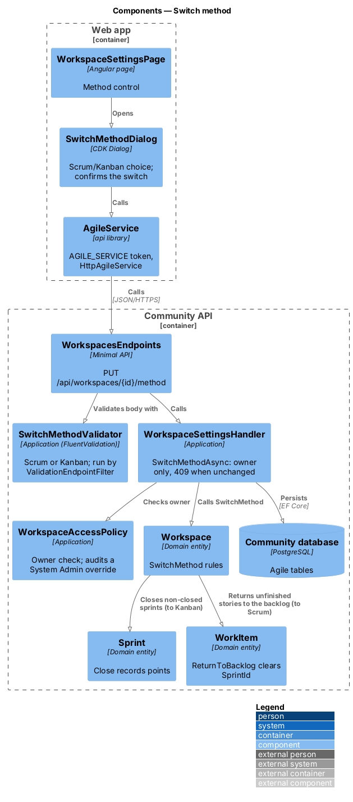
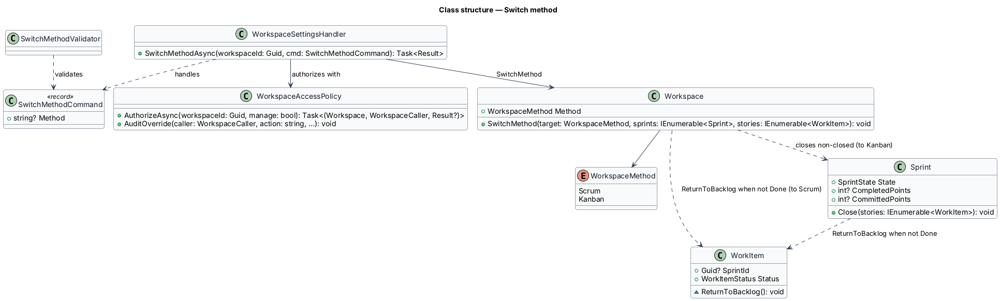
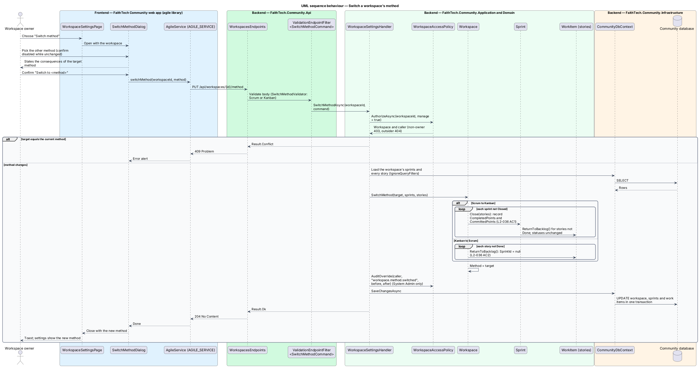

# Switch method

## Overview

Each Agile workspace runs with one *method*.

> **method** — way a workspace organizes work: Scrum, with sprints and a backlog, or Kanban, with a continuous board

The workspace owner chooses the method when creating the workspace (see `agile/workspaces-and-membership`) and may switch it later after confirming. Switching from Scrum to Kanban keeps every item's status and closes every sprint that is not closed, recording its points as a normal close does. Switching from Kanban to Scrum returns every story that is not Done to the backlog, ready for the next sprint (see `agile/sprints`). Switching to the method already in use is refused.

## Description

- **`WorkspaceSettingsPage`** — owner-only settings page with the method control, which opens `SwitchMethodDialog` (mock `docs/mocks/pages/workspace-settings`).
- **`SwitchMethodDialog`** — CDK Dialog with a Scrum/Kanban radio group that states the consequences of the target method and asks for confirmation; the confirm button is disabled while the chosen method is the current one (mock `docs/mocks/dialogs/switch-method`).
- **`AgileService`** — `api` contract (`AGILE_SERVICE`, `HttpAgileService`) with `switchMethod(id, method)`.
- **`WorkspacesEndpoints`** — maps `PUT /api/workspaces/{id}/method`, runs `SwitchMethodValidator` through `ValidationEndpointFilter<SwitchMethodCommand>` and answers `204` on success.
- **`SwitchMethodCommand`** / **`SwitchMethodValidator`** — request record with `Method`; the validator requires `Scrum` or `Kanban`.
- **`WorkspaceSettingsHandler.SwitchMethodAsync`** — owner only (`WorkspaceAccessPolicy.AuthorizeAsync(manage: true)`); answers `409` when the workspace already uses the target method; loads the workspace's sprints and every story, archived ones included (`IgnoreQueryFilters`), calls `Workspace.SwitchMethod` and saves in one unit of work. A System Admin's switch is audited as `workspace.method.switched` through `AuditOverride`.
- **`Workspace.SwitchMethod(target, sprints, stories)`** — Domain method. To Kanban: every sprint that is not closed is closed with `Sprint.Close`, which records `CompletedPoints` and `CommittedPoints`, returns unfinished stories to the backlog and leaves Done stories with their sprint id; no status changes. To Scrum: every story that is not Done has its `SprintId` cleared, including a story that was Done in a closed sprint and later reopened in Kanban.
- **`WorkspaceAccessPolicy`** — Application service shared by every agile handler. It resolves the caller from `ICurrentUser` and classifies the caller as owner, member, Staff, System Admin or outsider for a workspace. Outsiders receive 404, Staff and non-owner members receive 403 on writes they lack, and System Admin actions pass and are written to the audit log (`L2-031`, `L2-042`).
- **`WorkspaceMethod`** — enumeration `Scrum`, `Kanban`.

## Requirements

The feature realizes the following level-2 (L2) requirements. Each L2 requirement refines a level-1 (L1) requirement, cited by identifier.

| L2 ID | Refines (L1) | Requirement |
|-------|--------------|-------------|
| `L2-036` | `L1-012` | Switch method |

### Acceptance criteria

**`L2-036` — Switch method**

1. Given the owner, when they switch a workspace from Scrum to Kanban after confirming, then every item keeps its status, and any open sprint is closed.
2. Given the owner, when they switch from Kanban to Scrum, then all stories that are not Done are placed in the backlog.

## Diagrams

### System context

Only the workspace owner switches the method.

### Containers

The settings page calls the Community API, which updates the workspace, its sprints and its stories in PostgreSQL.

### Components

`WorkspacesEndpoints` runs `SwitchMethodValidator` through the validation filter, then `WorkspaceSettingsHandler.SwitchMethodAsync` checks ownership with `WorkspaceAccessPolicy`, calls `Workspace.SwitchMethod` and persists every change in one unit of work.

### Class structure

`Workspace.SwitchMethod` closes non-closed `Sprint` records through `Sprint.Close` or clears `WorkItem.SprintId` through `ReturnToBacklog`, depending on the target method. `WorkspaceSettingsHandler` handles `SwitchMethodCommand`.

### Behaviour — switch a workspace's method

The owner confirms the switch in `SwitchMethodDialog`; `WorkspaceSettingsHandler.SwitchMethodAsync` applies the Scrum-to-Kanban or Kanban-to-Scrum rule through `Workspace.SwitchMethod` in one unit of work (`L2-036`).

## Open questions

Decisions recorded while building the feature:

- Switching to Kanban closes every sprint that is not closed (planned or active) through `Sprint.Close`, so it records completed and committed points, returns unfinished stories to the backlog and leaves Done stories with their sprint id; statuses never change. Switching to the current method is rejected with `409`. Resolved.
- Switching to Scrum clears `SprintId` on every story that is not Done, including a story that was Done in a closed sprint and later reopened on the Kanban board, so it is a candidate for the next sprint. Done stories keep their sprint id and stay in that sprint's history. Resolved.
- The handler loads stories with `IgnoreQueryFilters`, so archived stories in a closing sprint count toward its points as a direct close counts them (see `agile/sprints`). Resolved.
- A System Admin's switch is an audited override (`workspace.method.switched`); the owner's own switch is not audited. Resolved.
