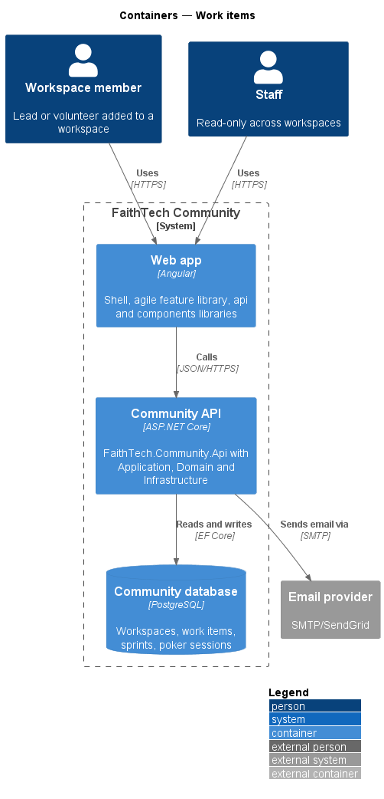
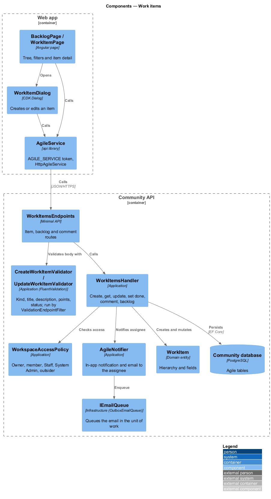
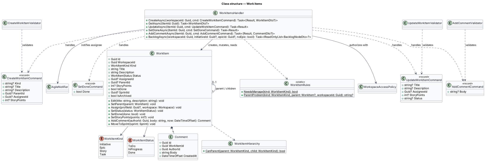
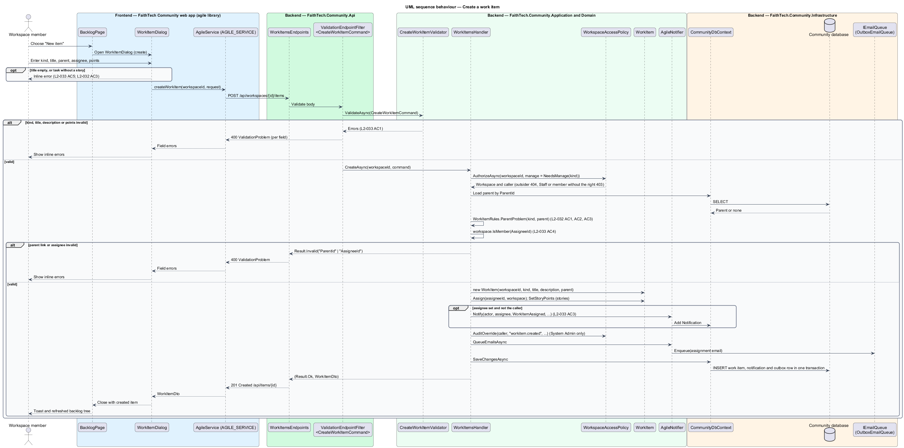

# Work items

## Overview

A *work item* is a unit of work inside an Agile workspace (see `agile/workspaces-and-membership`).

> **work item** — initiative, epic, story or task that belongs to one workspace
>
> **initiative** — top-level goal that groups epics
>
> **epic** — body of work that groups stories
>
> **story** — deliverable shown as a card on the board and estimated in story points
>
> **task** — checklist step inside a story, with a done flag
>
> **backlog** — every live initiative, epic and story of the workspace, shown with its parents as a tree; a story in the active sprint stays in the tree, carrying its `SprintId`

The hierarchy is strict: an epic may sit only under an initiative, a story only under an epic, and a task only under a story. Parents are optional except for tasks, which always belong to a story. The parent is chosen when an item is created and is not changed afterwards. Members create and edit stories and tasks, assign one workspace member to each and comment on them; only the owner (or a System Admin override) creates and edits initiatives and epics. An assignee is notified in-app and by email when assigned.

This feature owns the work item model, the work item dialog (create and edit), the work item detail page and the backlog tree. The board, sprints and Planning Poker read and update the same items.

## Description

- **`BacklogPage`** — shows initiatives, epics and stories as an expandable tree with an initiative/epic filter (`BacklogFilter`: one initiative's subtree, one epic's subtree, or the stories with no epic), and opens `WorkItemDialog` from "New item" (mock `docs/mocks/pages/backlog`). In a Scrum workspace it also shows the active sprint card and the sprint history (see `agile/sprints`).
- **`WorkItemPage`** — detail view of one item: fields, parent and grandparent, sprint, tasks checklist, assignee and comments; "Edit" opens `WorkItemDialog` with the item (mock `docs/mocks/pages/work-item`).
- **`WorkItemDialog`** — CDK Dialog that creates an item or edits one; it shows an inline error when the title is empty and when a task has no story. The parent field is shown only when creating (mock `docs/mocks/dialogs/new-work-item`). `BoardPage` opens it too.
- **`AgileService`** — `api` library contract behind the `AGILE_SERVICE` token, implemented by `HttpAgileService` (`getBacklog`, `createWorkItem`, `getWorkItem`, `updateWorkItem`, `setTaskDone`, `addComment`).
- **`WorkItemsEndpoints`** — minimal API mapping for `POST /api/workspaces/{id}/items`, `GET /api/workspaces/{id}/backlog`, `GET`/`PUT /api/items/{id}`, `PUT /api/items/{id}/done` and `POST /api/items/{id}/comments`. Each command route runs its validator through `ValidationEndpointFilter<T>` (`.Validate<T>()`) before the handler and answers `400` with per-field problem details.
- **`WorkItemsHandler`** — Application handler with `CreateAsync`, `GetAsync`, `UpdateAsync`, `SetDoneAsync`, `AddCommentAsync` and `BacklogAsync`. It asks `WorkspaceAccessPolicy` first (`manage` for initiatives and epics, `WorkItemRules.NeedsManage`), checks the parent link with `WorkItemRules.ParentProblem`, requires an assignee to be a workspace member, allows story points on stories only, and maps the outcome to a `Result`.
- **`CreateWorkItemCommand`**, **`UpdateWorkItemCommand`**, **`SetDoneCommand`**, **`AddCommentCommand`** — request records. `UpdateWorkItemCommand` carries title, description, assignee, story points and status but no `ParentId`: re-parenting is not offered in v1.
- **`CreateWorkItemValidator`**, **`UpdateWorkItemValidator`**, **`AddCommentValidator`** — FluentValidation validators: kind is one of the four, title required and at most 200 characters (`TitleRules.WorkItemTitle`), description at most 4000 characters, story points not negative, status one of `ToDo`/`InProgress`/`Done`, comment body required and at most 2000 characters.
- **`BacklogAsync`** — returns the initiative/epic/story tree as `IReadOnlyList<BacklogNodeDto>`: every live item of the workspace, children under their parent, each level sorted by kind then title, optionally only one initiative's or epic's subtree or only the stories with no epic. An archived parent hides its subtree.
- **`WorkItemDto`**, **`BacklogNodeDto`**, **`TaskDto`**, **`CommentDto`**, **`WorkItemRefDto`**, **`SprintRefDto`** — DTO contracts in `WorkItemDtos.cs`. `WorkItemDto.CanEdit` tells the page whether the caller may change the item; `CanManage` covers archiving.
- **`WorkspaceAccessPolicy`** — Application service shared by every agile handler. It resolves the caller from `ICurrentUser` and classifies the caller as owner, member, Staff, System Admin or outsider for a workspace. Outsiders receive 404, Staff and non-owner members receive 403 on writes they lack, and System Admin actions pass and are written to the audit log through `AuditOverride` (`L2-031`, `L2-042`).
- **`AgileNotifier`** — Application service that records the in-app `Notification` in the same unit of work and, after `SaveChanges`, sends the email through `IEmailSender`. The assignee is notified on create and on reassignment; nobody is notified about their own action.
- **`WorkItem`** — Domain entity with `Kind`, `Title`, `Description`, `Status`, `AssigneeId`, `ParentId`, `SprintId`, `StoryPoints` (stories only), `IsDone` (tasks only), `IsArchived` and `Comments`. The constructor requires a title of at most 200 characters and a story parent for a task; `SetParent` enforces `WorkItemHierarchy` and the same workspace; `Assign(profileId, workspace)` rejects a non-member (`L2-033` AC4); `SetStatus` applies to non-task items and `SetDone` to tasks only.
- **`WorkItemKind`** — enumeration `Initiative`, `Epic`, `Story`, `Task`; `WorkItemHierarchy.CanParent(parent, child)` encodes the allowed links.
- **`WorkItemStatus`** — enumeration `ToDo`, `InProgress`, `Done`. Initiatives and epics use the same status values as stories.

## Requirements

The feature realizes the following level-2 (L2) requirements. Each L2 requirement refines a level-1 (L1) requirement, cited by identifier.

| L2 ID | Refines (L1) | Requirement |
|-------|--------------|-------------|
| `L2-032` | `L1-012` | Work item hierarchy |
| `L2-033` | `L1-012` | Work item fields and editing |

### Acceptance criteria

**`L2-032` — Work item hierarchy**

1. Given a work item, when it is given a parent, then only these links are allowed: an epic under an initiative, a story under an epic, and a task under a story.
2. Given an initiative, epic or story, when it is created, then the parent is optional.
3. Given a task, when it is created, then it must belong to a story.
4. Given the backlog, when it is shown, then initiatives, epics and stories appear as an expandable tree that can be filtered by initiative or epic.

**`L2-033` — Work item fields and editing**

1. Given an initiative, epic or story, when it is saved, then it has a title (required, up to 200 characters), a description, one optional assignee who is a workspace member, a status and comments. Stories also have story points.
2. Given a task, when it is saved, then it has a title, a done flag and an optional assignee.
3. Given an item is assigned to a member, when it is saved, then the assignee receives an in-app and email notification.
4. Given an assignee who is not a member of the workspace, when the item is saved, then the API rejects it.
5. Given the new-work-item dialog, when the title is empty, then an inline error is shown.

## Diagrams

### System context

Members create and edit work items; Staff read them. The system emails an assignee when an item is assigned.

### Containers

The `agile` library calls the Community API, which stores items in PostgreSQL and sends assignment email through the provider.

### Components

`WorkItemsEndpoints` runs `CreateWorkItemValidator` or `UpdateWorkItemValidator` through the validation filter, then calls `WorkItemsHandler`, which checks access with `WorkspaceAccessPolicy`, mutates `WorkItem` and notifies the assignee through `AgileNotifier`.

### Class structure

`WorkItem` references its parent item and composes its comments. `WorkItemHierarchy` holds the allowed parent links for each `WorkItemKind`. `WorkItemsHandler` handles every command and the backlog query.

### Behaviour — create a work item

`WorkItemDialog` enforces a non-empty title on the client; `CreateWorkItemValidator` re-checks the kind and title, `WorkItemsHandler.CreateAsync` checks access, the parent link and the assignee, then `AgileNotifier` notifies the assignee in-app and by email (`L2-032`, `L2-033`).

### Behaviour — view the backlog tree

`WorkItemsHandler.BacklogAsync` returns every live initiative, epic and story as a tree sorted by kind then title, optionally one initiative's or epic's subtree (`L2-032`).

## Open questions

Decisions recorded while building the feature:

- Initiative and epic status values were open; they reuse `WorkItemStatus`. Resolved.
- Domain rule violations throw `InvalidOperationException` (a broken rule) or `ArgumentException` (invalid input); there is no shared domain exception type. Handlers check permissions and preconditions first and map any remaining violation to a `400` or `409` result.
- The parent is set at creation only. `UpdateWorkItemCommand` has no `ParentId` and `WorkItemDialog` hides the parent field when editing; re-parenting is not offered in v1. Resolved.
- The backlog tree is the whole live hierarchy, not only the stories outside a sprint: `BacklogAsync` includes stories in the active sprint (with their `SprintId`) so the tree never loses a story while a sprint runs. Resolved.
- Only the owner, or a System Admin override, creates and edits initiatives and epics (`WorkItemRules.NeedsManage`); members get `403`. Resolved.
- The assignee is notified in-app and by email on create and on reassignment through `AgileNotifier`; self-assignment sends nothing. Resolved.
