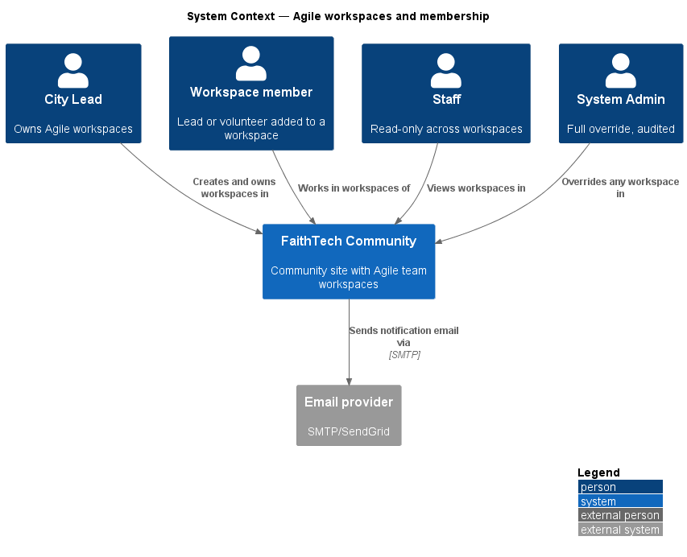
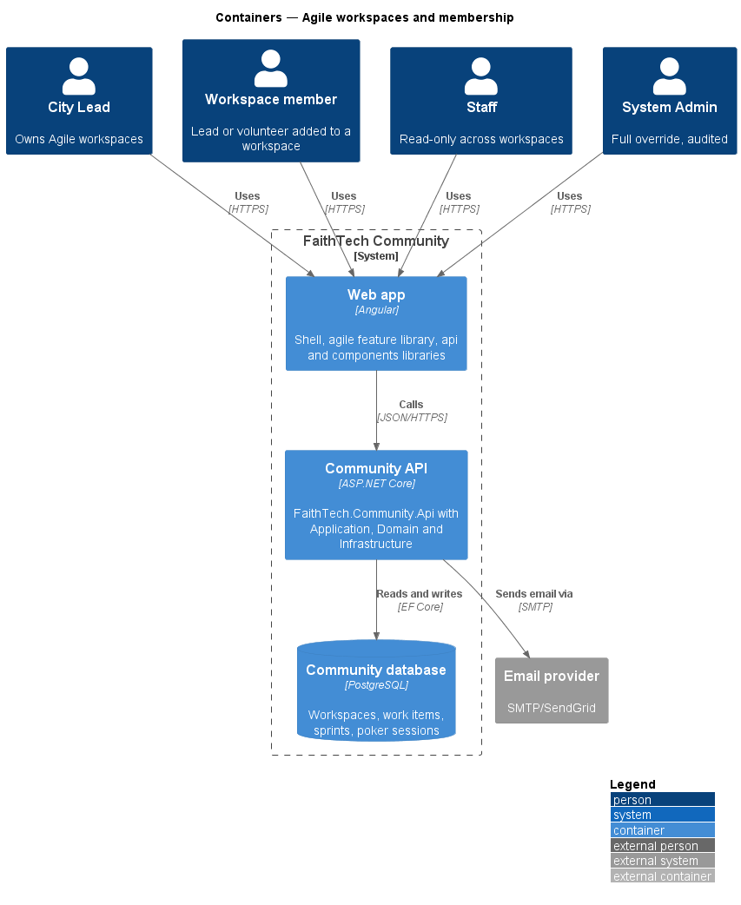
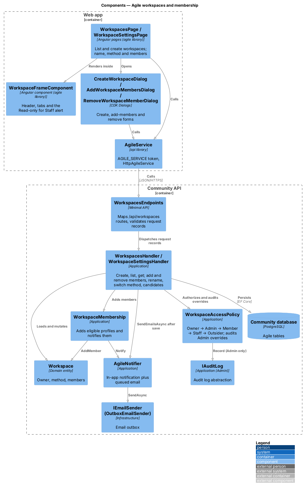
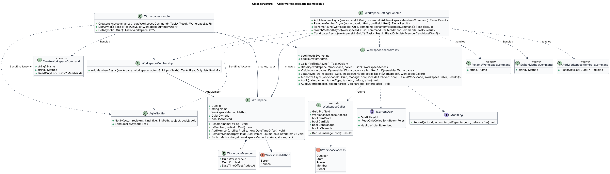
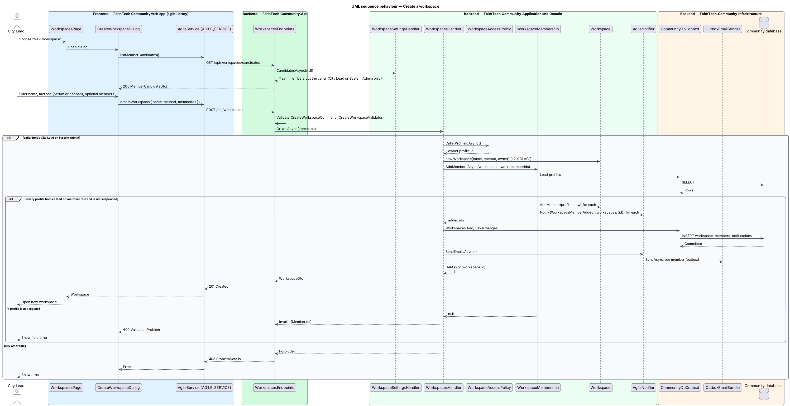
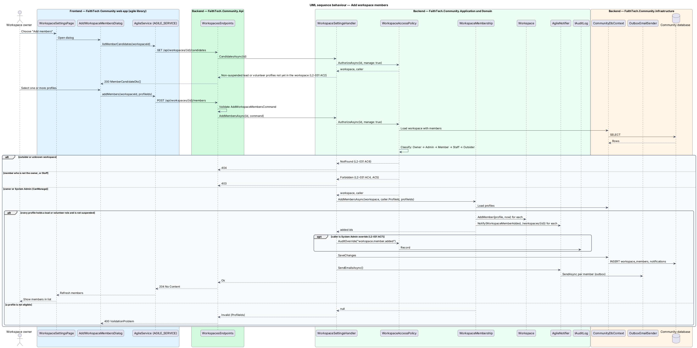
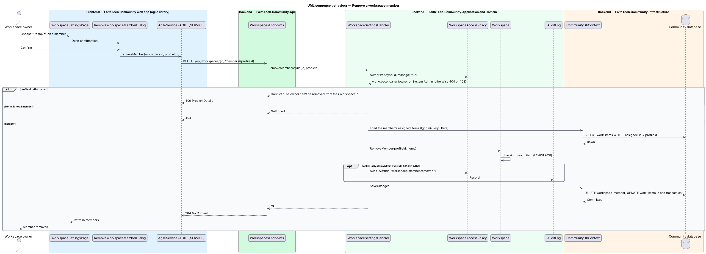
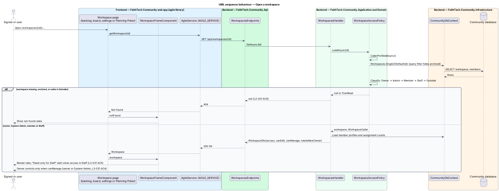

# Agile workspaces and membership

## Overview

FaithTech Community lets a City Lead run a team's work in an *Agile workspace*.

> **Agile workspace** — named container for a team's work items, run with either the Scrum or the Kanban method
>
> **workspace owner** — City Lead who created the workspace and manages its members, settings, sprints and archive state; System Admin may do the same on any workspace as an audited override
>
> **workspace member** — profile holding a lead or volunteer role, not suspended, that the owner has added to the workspace

Community data is global, but workspace access comes from membership. Members create and edit items, move cards, comment and vote in Planning Poker. Staff read every workspace and write nothing. System Admin may act on any workspace, and each such action is audited. Any other signed-in user receives 404 for the workspace and its items, and none of its content appears in that user's global search.

This feature is the entry point of the agile subsystem. Every other agile feature (work items, board, sprints, switch method, archive and transfer, Planning Poker) relies on the membership model and the access policy defined here ([ADR 0011](../../../adr/0011-workspace-access-and-audit.md)).

The repository layout in `AGENTS.md` lists the `Agile/` folders in `FaithTech.Community.Domain` and `FaithTech.Community.Application` and the `agile` feature library in `frontend/projects/` ([ADR 0010](../../../adr/0010-agile-feature-layout.md)).

## Description

The slice runs from the workspaces pages in the `agile` feature library to the Community database.

- **`WorkspacesPage`** — lists the live workspaces the caller may see and, for their owner and System Admin, archived ones under **Archived** with **Restore** (mock `docs/mocks/pages/workspaces`). Opens `CreateWorkspaceDialog`.
- **`CreateWorkspaceDialog`** — CDK Dialog that captures a name, a method (Scrum or Kanban) and optional first members from `listMemberCandidates()` (mock `docs/mocks/dialogs/create-workspace`).
- **`WorkspaceFrameComponent`** — frame around every workspace page (backlog, board, settings, Planning Poker): header, tabs and the "Read-only for Staff" alert when the caller's access is `Staff`.
- **`WorkspaceSettingsPage`** — name, method, members and archive for a caller who may manage the workspace (owner or System Admin; mock `docs/mocks/pages/workspace-settings`). Anyone else sees the empty state "Only the owner changes settings" with "<owner> owns this workspace."; a member also reads "You can still add stories, move cards and vote in Planning Poker.", while Staff see only the first sentence plus the frame's Read-only alert (`L2-031` AC4, AC5).
- **`AddWorkspaceMembersDialog`** and **`RemoveWorkspaceMemberDialog`** — CDK Dialogs for choosing one or more eligible profiles and confirming a removal (mocks `add-workspace-member`, `remove-workspace-member`).
- **`AgileService`** — API client contract in the `api` library, provided through the `AGILE_SERVICE` injection token and implemented by `HttpAgileService`: `listWorkspaces`, `createWorkspace`, `getWorkspace`, `renameWorkspace`, `switchMethod`, `listMemberCandidates`, `addMembers`, `removeMember`.
- **`WorkspacesEndpoints`** — minimal API group `/api/workspaces`: `GET`/`POST` `/`, `GET`/`PUT` `/{id}`, `PUT /{id}/method`, `GET /candidates`, `GET /{id}/candidates`, `POST /{id}/members`, `DELETE /{id}/members/{profileId}` (plus the sprint, archive and owner routes of the other agile designs). It validates the request record with `.Validate<T>()` and dispatches to a handler; it holds no business logic.
- **`CreateWorkspaceCommand`** / **`CreateWorkspaceValidator`** / **`WorkspacesHandler`** — `CreateAsync` accepts a City Lead or System Admin, records the caller as owner (a City Lead may own more than one), adds any `MemberIds` and returns the new `WorkspaceDto`; `ListAsync` returns `WorkspaceSummaryDto` rows (live ones through `WorkspaceAccessPolicy.Visible`, archived ones only to their owner and System Admin, `NeedsNewOwner` only for live ones); `GetAsync` returns the `WorkspaceDto` with members, `Access`, `CanEdit` and `CanManage`, or null for a 404.
- **`WorkspaceMembership`** — `AddMembersAsync(workspace, actor, profileIds)` shared by create and settings. It adds only profiles that hold a lead or volunteer role (`TeamRoles.IsTeamMember`) and are not suspended, otherwise adds nothing and the handler answers 400; each new member is notified through `AgileNotifier` (`WorkspaceMemberAdded`, linking to `/workspaces/{id}`).
- **`WorkspaceSettingsHandler`** — the owner's settings: `AddMembersAsync` (`AddWorkspaceMembersCommand`), `RemoveMemberAsync` (409 for the owner, 404 for a non-member; the member's assigned items in the workspace become unassigned in the same unit of work, `L2-031` AC8), `RenameAsync` (`RenameWorkspaceCommand`), `SwitchMethodAsync` (`SwitchMethodCommand`) and `CandidatesAsync` (non-suspended lead or volunteer profiles not yet in the workspace; without a workspace id, every team member but the caller, for the create dialog). Every write goes through `WorkspaceAccessPolicy.AuthorizeAsync(manage: true)` and `AuditOverride`.
- **`WorkspaceAccessPolicy`** — Application service shared by every agile handler and the SignalR hub. `Classify` resolves the caller (`ICurrentUser`, `ProfileAccess.CallerProfileIdAsync`) as `Owner` → `Admin` (holds System Admin, even when also a member) → `Member` → `Staff` → `Outsider`, in that order. `WorkspaceCaller` exposes `CanRead` (anyone but an outsider), `CanEdit` (Member, Owner, Admin), `CanManage` (Owner, Admin) and `IsOverride` (Admin); `Refuse` answers 404 to an outsider and 403 to a reader without the right. `LoadAsync` and `AuthorizeAsync(manage)` load the workspace with that access; `Visible` filters lists in the database. `AuditOverride` writes only an Admin's writes to `IAuditLog` (`workspace.*`, `workitem.*`, `sprint.*`, `poker.*`); the owner's own actions are not audited (`L2-031`, `L2-042`, ADR 0011).
- **`Workspace`** — Domain entity with `Name`, `Method`, `OwnerId`, `IsArchived` and a `Members` collection of `WorkspaceMember`. `AddMember(profile, now)` accepts only a profile on the team (`TeamRoles.IsTeamMember`) and rejects a duplicate; `RemoveMember(profileId, items)` unassigns that member's items (`L2-031` AC8); `IsMember` counts the owner as a member; `Rename` and `SwitchMethod` serve the settings page.
- **`WorkspaceMethod`** — enumeration `Scrum`, `Kanban`.
- **`AgileNotifier`** — Application service for in-app plus email notification. `Notify` adds a `Notification` to the unit of work and queues an email; `SendEmailsAsync`, called after `SaveChanges`, hands the emails to `IEmailSender`, whose Infrastructure implementation is the email outbox (`OutboxEmailSender`). Nobody is notified about their own action.
- **`IAuditLog`** — Application abstraction (`Application/Admin`) implemented in Infrastructure; `Record(actorId, action, targetType, targetId, before, after)`.
- **`CommunityDbContext`** — EF Core context in Infrastructure that persists workspaces and members to PostgreSQL; a global query filter hides archived workspaces and items.

## Requirements

The feature realizes the following level-2 (L2) requirements. Each L2 requirement refines a level-1 (L1) requirement, cited by identifier.

| L2 ID | Refines (L1) | Requirement |
|-------|--------------|-------------|
| `L2-031` | `L1-012` | Agile workspaces and membership |

### Acceptance criteria

**`L2-031` — Agile workspaces and membership**

1. Given a City Lead, when they create a workspace with a name and a method (Scrum or Kanban), then they become its owner. A City Lead can own more than one workspace.
2. Given the owner, when they add members, then only profiles holding a lead or volunteer role can be chosen, and each added member is notified.
3. Given a member, when they open the workspace, then they can create and edit stories and tasks, move cards, comment and vote in Planning Poker. Only the owner creates and edits initiatives and epics.
4. Given a member who is not the owner, when they try to manage members, change settings, manage sprints, or archive the workspace, then the control is hidden and the API returns 403.
5. Given Staff, when they open any workspace, then they can view it but every write returns 403.
6. Given a non-member who is not Staff or System Admin, when they request the workspace or its items, then the response is 404, and nothing appears in their search.
7. Given a System Admin, when they act on any workspace, then the action succeeds and is audited.
8. Given a removed member, when the removal completes, then their assigned items become unassigned.

## Diagrams

### System context

City Leads own workspaces, members work in them, Staff read them and System Admin overrides them. The system emails members when they are added.

### Containers

The `agile` library in the Web app calls the Community API, which persists workspaces in PostgreSQL and sends email through the provider from its outbox.

### Components

`WorkspacesEndpoints` dispatches to `WorkspacesHandler` and `WorkspaceSettingsHandler`, which ask `WorkspaceAccessPolicy` before loading or changing a `Workspace`. Both add members through `WorkspaceMembership`, which notifies them through `AgileNotifier`; an Admin override is written to `IAuditLog`.

### Class structure

`Workspace` composes its `WorkspaceMember` rows. `WorkspacesHandler` and `WorkspaceSettingsHandler` each handle the request records of one concern and depend on `WorkspaceAccessPolicy`, which classifies the caller as a `WorkspaceAccess` value wrapped in `WorkspaceCaller`.

### Behaviour — create a workspace

`WorkspacesHandler.CreateAsync` accepts the command only from a City Lead or System Admin, records the caller as owner and adds any first members through `WorkspaceMembership` (`L2-031`).

### Behaviour — add workspace members

Only the owner or System Admin may add members, and only non-suspended profiles holding a lead or volunteer role are eligible; each new member is notified in-app and by email, and an Admin override is audited (`L2-031`).

### Behaviour — remove a workspace member

`WorkspaceSettingsHandler.RemoveMemberAsync` clears that member as assignee from every item in the workspace within the same unit of work (`L2-031`).

### Behaviour — open a workspace

Reads resolve the caller's access first through `WorkspaceAccessPolicy.LoadAsync`; outsiders receive 404 so the workspace's existence is not revealed, and the `WorkspaceDto` carries `access`, `canEdit` and `canManage` for the page (`L2-031`).

## Open questions

Decisions recorded while building the feature:

- Domain types for the agile subsystem live in `FaithTech.Community.Domain/Agile/`, the folder name these designs use; `AGENTS.md` lists it.
- `AddMember` takes the `Profile` so the Domain enforces the lead-or-volunteer rule itself; the owner cannot be removed as a member.
- Domain rule violations throw `InvalidOperationException` (a broken rule) or `ArgumentException` (invalid input); there is no shared domain exception type. Handlers check permissions and preconditions first and map any remaining violation to a `400` or `409` result.
- Handlers are grouped by concern (`WorkspacesHandler`, `WorkspaceSettingsHandler`) rather than one class per command. Request records (`CreateWorkspaceCommand`, `AddWorkspaceMembersCommand`, `RenameWorkspaceCommand`, `SwitchMethodCommand`) are validated by FluentValidation at the endpoint; there are no separate query types, `ListAsync` and `GetAsync` are handler methods.
- `WorkspaceAccessPolicy.Classify` runs Owner → Admin → Member → Staff → Outsider. A System Admin who owns the workspace is its owner and is not audited; a System Admin who merely belongs to it is still `Admin`, so every action succeeds and is audited (`L2-031` AC7, ADR 0011). `AuditOverride` records only Admin writes; the owner's and members' own actions are never audited.
- Eligible members are non-suspended profiles holding a lead or volunteer role; `CandidatesAsync` and `WorkspaceMembership.AddMembersAsync` apply the same rule, and the create dialog may add first members in the same request.
- Notifications go through `AgileNotifier` (in-app `Notification` plus email through the outbox after the save); there is no `INotificationService`.
- Search (L2-031 AC6, L2-026 AC2) is deferred: global search is not built yet. When work items are indexed, the search query applies the same member, Staff or System Admin filter as `WorkspaceAccessPolicy.Visible` and leaves out archived items (ADR 0011).
- `WorkspaceMemberDto.IsYou` marks the caller, so the web app can show "(you)" and leave the facilitator out of Planning Poker invites without knowing its own profile id.
