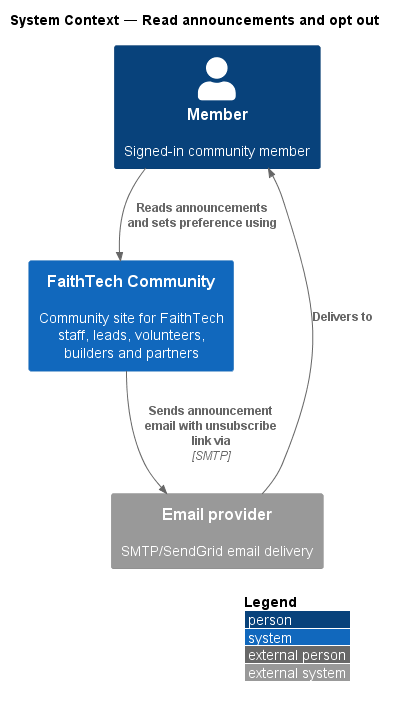
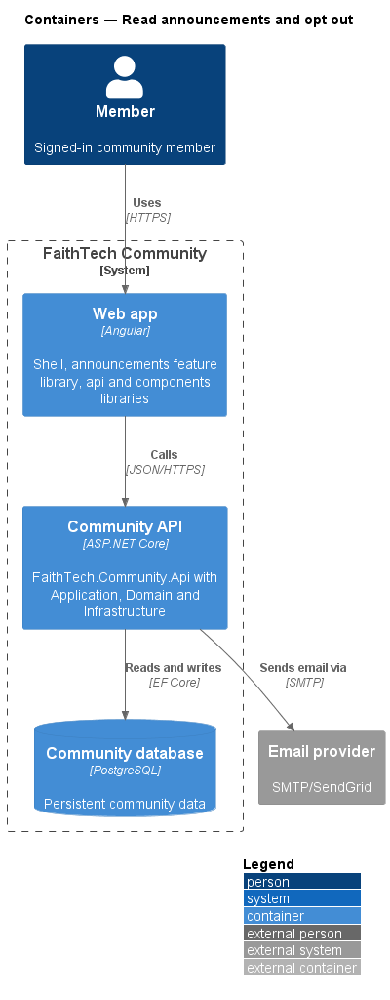
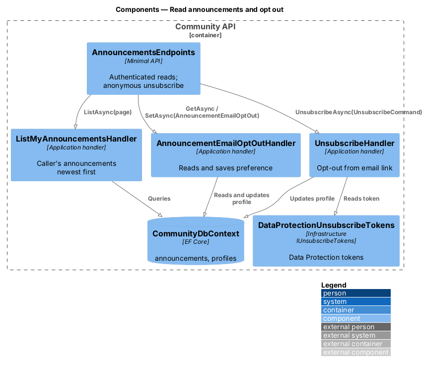
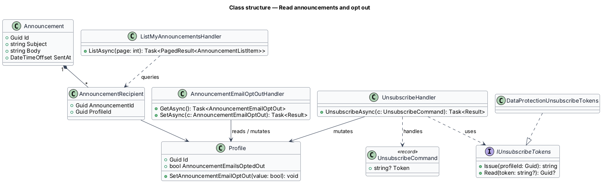
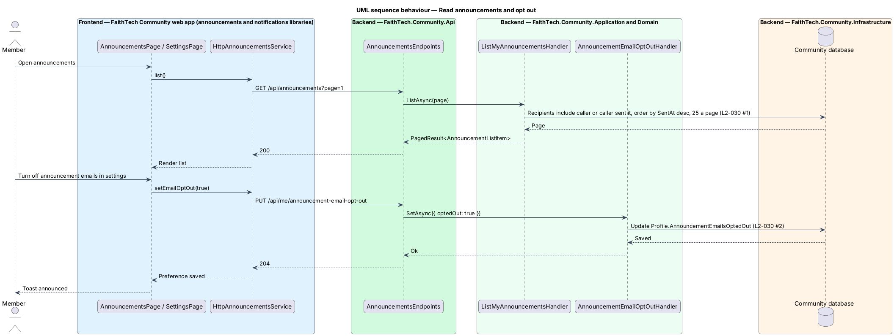
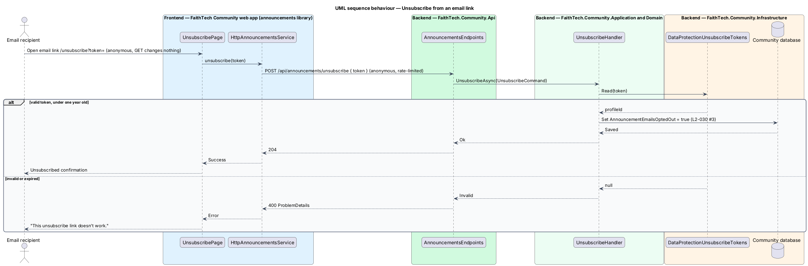

# Read announcements and opt out

## Overview

Members read the announcements sent to them on the announcements page and decide whether announcements also arrive by email. This feature covers the reading list, the settings preference and the one-click unsubscribe link in each announcement email.

- **announcement email opt-out** — profile preference that stops announcement emails and leaves every other notification email in place
- **unsubscribe token** — signed, single-purpose value embedded in an announcement email link that identifies the recipient without a sign-in

The unsubscribe endpoint is one of the anonymous endpoints listed in `L2-042`.

## Description

- **`AnnouncementsPage`** — page in the `announcements` library (mock `pages/announcements`) listing the caller's announcements newest first, 25 at a time: those sent to them and those they sent, each with its message, audience, sender, date and recipient count. Communications Leads and System Admins also get **New announcement**.
- **`SettingsPage`** "Email me when" card — the "Email me announcements" switch on the settings screen (mock `pages/settings`, in the `notifications` library) reads `AnnouncementsService.getEmailOptOut` and saves through `setEmailOptOut` when it is flipped, as the theme does; a failed save puts the switch back and says so. The `components` library provides the switch.
- **`UnsubscribePage`** — anonymous page in the `announcements` library at `/unsubscribe?token=` (mock `pages/unsubscribe`: default, success, error), outside the signed-in shell. It posts the link's token; a `GET` never changes anything.
- **`AnnouncementsService`** / **`ANNOUNCEMENTS_SERVICE`** / **`HttpAnnouncementsService`** — client contract, token and implementation in the `api` library.
- **`AnnouncementsEndpoints`** — maps `GET /api/announcements?page=`, `GET` and `PUT /api/me/announcement-email-opt-out`, and the anonymous, rate-limited `POST /api/announcements/unsubscribe` (`204`, or `400` for a token that does not work).
- **`ListMyAnnouncementsHandler`** — the announcements whose recipients include the caller, or that the caller sent, ordered by `SentAt` descending.
- **`AnnouncementEmailOptOutHandler`** — reads and sets `Profile.AnnouncementEmailsOptedOut` for the caller.
- **`UnsubscribeHandler`** — reads the token through `IUnsubscribeTokens` and sets the opt-out for the profile it names.
- **`IUnsubscribeTokens`** / **`DataProtectionUnsubscribeTokens`** — Application contract and Infrastructure implementation with ASP.NET Data Protection under its own purpose; the payload is the profile id and the time of issue.

The token works for one year (ADR 0016). It can do nothing but turn one member's announcement emails off.

## Requirements

The feature realizes the following level-2 (L2) requirements. Each L2 requirement refines a level-1 (L1) requirement, cited by identifier.

| L2 ID | Refines (L1) | Requirement |
|-------|--------------|-------------|
| `L2-030` | `L1-011` | Read announcements and opt out |

### Acceptance criteria

**`L2-030` — Read announcements and opt out**

1. Given a member, when they open announcements, then they see the announcements sent to them, newest first.
2. Given settings, when a member turns off announcement emails, then the preference is saved and applies to the next send.
3. Given an announcement email, when the recipient follows its unsubscribe link, then they are opted out without signing in.

## Diagrams

### System context

A member reads announcements in FaithTech Community and receives announcement email, with an unsubscribe link, through the email provider.

### Containers

The announcements page and settings live in the web app. The unsubscribe link reaches the Community API without a session.

### Components

`AnnouncementsEndpoints` routes authenticated reads and preference changes to their handlers, and routes the anonymous unsubscribe to a handler that verifies the token first.

### Class structure

`Profile` holds the opt-out flag. `AnnouncementRecipient` joins announcements to the profiles that received them.

### Behaviour — read announcements and opt out in settings

The member reads announcements newest first, then turns off announcement emails in settings; the next send honours the change (`L2-030`).

### Behaviour — unsubscribe from an email link

The unsubscribe link carries a token that identifies the recipient, so the opt-out succeeds without a sign-in (`L2-030`).

## Open questions

Decisions recorded while building the Domain layer (`FaithTech.Community.Domain`):

- `Profile.SetAnnouncementEmailOptOut(bool)` stores the preference; it defaults to receiving announcement emails.
