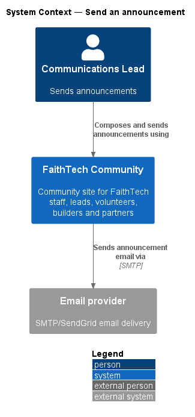
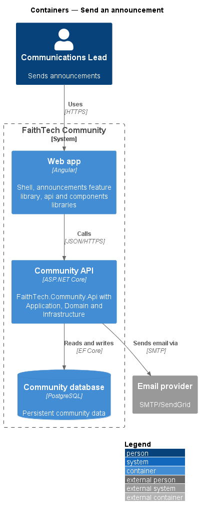
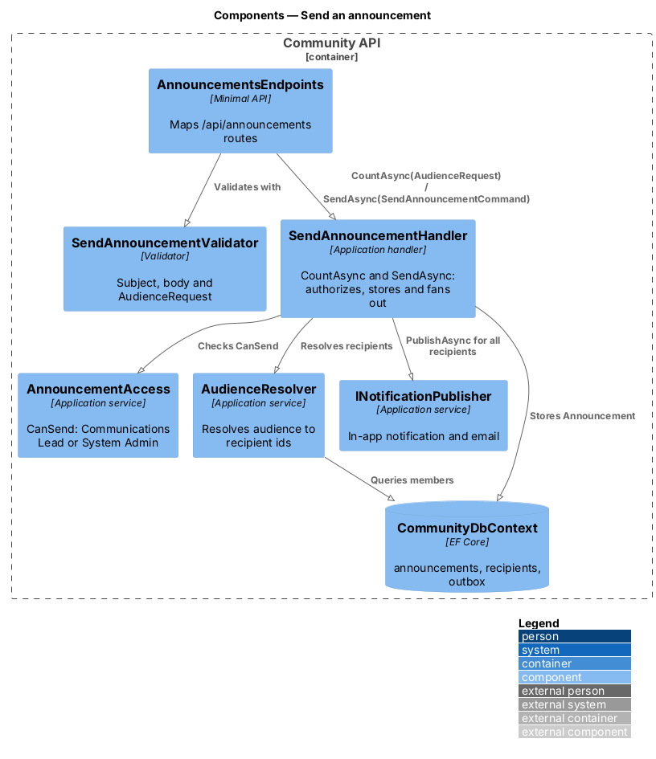
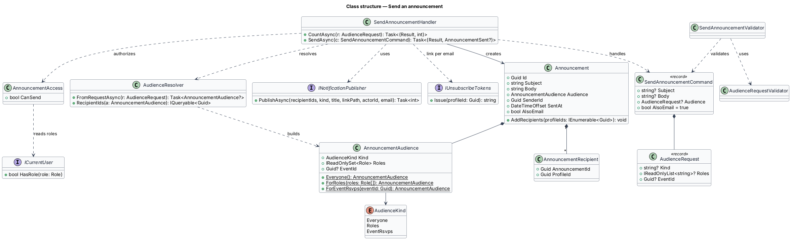

# Send an announcement

## Overview

An *announcement* is a message with a subject and a body that a Communications Lead or System Admin sends to a chosen audience. Announcements are the broadcast channel of FaithTech Community, distinct from notifications that the system raises automatically.

- **audience** — set of recipients chosen at compose time: everyone, the holders of one or more roles, or the RSVP list of one event
- **recipient count** — number of members the chosen audience resolves to at the moment of preview

Each recipient receives an in-app notification and, unless the recipient opted out of announcement emails, an email. Delivery reuses the notifications pipeline described in the in-app and email notification designs. The compose screen is the `compose-announcement` mock.

## Description

- **`ComposeAnnouncementPage`** — page in the `announcements` feature library (mock `pages/compose-announcement`). It collects the audience (Everyone; People with a role, chosen with a checkbox group; or an upcoming event's RSVP list), subject, message and "Also send by email" (on by default), shows the recipient count in the send button ("Send to 41 people"), shows inline field errors with an error summary, and after sending shows who it reached and how many by email. Anyone without Communications Lead or System Admin is sent to the forbidden page.
- **`AnnouncementsService`** / **`ANNOUNCEMENTS_SERVICE`** / **`HttpAnnouncementsService`** — API client contract, token and HTTP implementation in the `api` library.
- **`AnnouncementsEndpoints`** — minimal API mapping for `POST /api/announcements/recipient-count` (an `AudienceRequest`, answering `{ count }`) and `POST /api/announcements` (answering `201` with `{ id, recipientCount, emailCount }`).
- **`AudienceRequest`** / **`AudienceRequestValidator`** — the audience as sent: `kind` (`Everyone`, `Roles`, `EventRsvps`) with `roles` (at least one known role) or `eventId`.
- **`SendAnnouncementCommand`** / **`SendAnnouncementValidator`** — subject (1 to 200 characters), body (1 to 5,000), audience and `alsoEmail`; an empty subject or body answers `400` with "Add a subject so people know what it’s about." and "Write a message of at least one sentence."
- **`AnnouncementAccess`** — `CanSend` for `CommunicationsLead` or `SystemAdmin`; everyone else gets `403` for the count and the send.
- **`AudienceResolver`** — resolves an audience to the members who receive it, in the database: members with an account who are not suspended; for an RSVP list, the members who RSVP'd (guests have no account). An unknown event answers `400`.
- **`SendAnnouncementHandler`** — authorizes the caller, stores the `Announcement` with its `AnnouncementRecipient` rows, and publishes one notification per recipient through `INotificationPublisher.PublishAsync`, each email carrying that recipient's unsubscribe link, all in one save.
- **`AnnouncementAudience`** — value object with `Kind` (`Everyone`, `Roles`, `EventRsvps`) and the chosen `Roles` or `EventId`, built through `Everyone()`, `ForRoles(...)` (at least one role) or `ForEventRsvps(eventId)`.
- **`Announcement`** — Domain entity with `Subject`, `Body`, `Audience`, `SenderId`, `SentAt` and `AlsoEmail`, plus `AnnouncementRecipient` rows, added once each through `AddRecipients`, that record who received it.
- **`INotificationPublisher`** — creates the in-app notification and enqueues the email, honouring the opt-out (`L2-028`).

A send to a large audience runs in one request; the outbox worker delivers the emails, and a background fan-out job is deferred (ADR 0016).

## Requirements

The feature realizes the following level-2 (L2) requirements. Each L2 requirement refines a level-1 (L1) requirement, cited by identifier.

| L2 ID | Refines (L1) | Requirement |
|-------|--------------|-------------|
| `L2-029` | `L1-011` | Compose and send announcements |

### Acceptance criteria

**`L2-029` — Compose and send announcements**

1. Given a Communications Lead or System Admin, when they send an announcement with a subject and body to everyone, the holders of one or more chosen roles, or one event's RSVP list, then each recipient gets an in-app notification.
2. Given an empty subject or body, when they send, then inline errors are shown.
3. Given any other user, when they call the send API, then the response is 403.
4. Given the compose page, when the audience is chosen, then the number of recipients is shown before sending.
5. Given "Also send by email" is on (the default), when the announcement is sent, then recipients who have not opted out also receive it by email.

## Diagrams

### System context

A Communications Lead sends announcements through FaithTech Community, which delivers email through the email provider.

### Containers

The compose page in the web app calls the Community API, which stores the announcement and enqueues email for delivery.

### Components

`AnnouncementsEndpoints` validates the command and dispatches it. `SendAnnouncementHandler` authorizes the caller, stores the announcement and publishes through `INotificationPublisher`.

### Class structure

`Announcement` composes an `AnnouncementAudience` and its `AnnouncementRecipient` rows. The handler depends on `ICurrentUser` for the role check.

### Behaviour — send an announcement

The page previews the recipient count, then sends. Validation failures return 400, and callers without the Communications Lead or System Admin role receive 403 (`L2-029`).

## Open questions

Decisions recorded while building the Domain layer (`FaithTech.Community.Domain`):

- `L2-029` lets an announcement target one or more roles; the audience holds a set of roles (`AudienceKind.Roles`) instead of a single role. `AlsoEmail` records the "Also send by email" choice (`L2-029` AC5). Resolved.
- Domain rule violations throw `InvalidOperationException` (a broken rule) or `ArgumentException` (invalid input); there is no shared domain exception type. Handlers check permissions and preconditions first and map any remaining violation to a `400` or `409` result.
