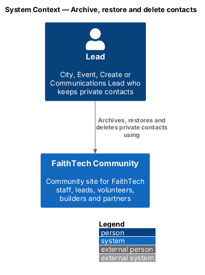
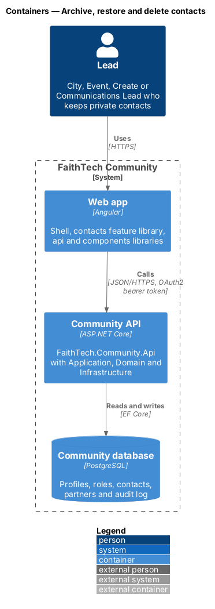
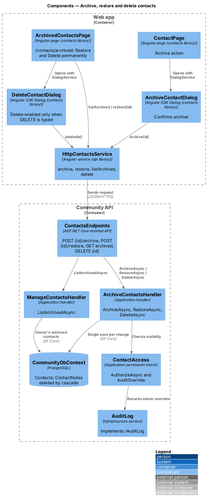
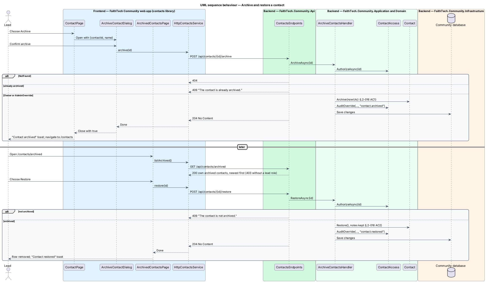
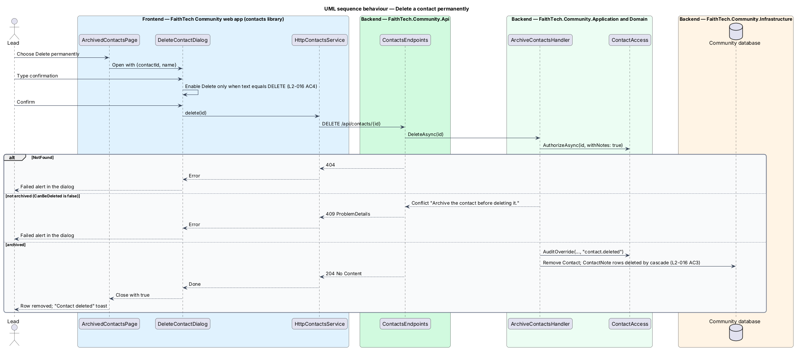

# Archive, restore and delete contacts

## Overview

Leads remove contacts they no longer track in two stages. **Archive** — soft delete that hides a contact from the main list while keeping it and its notes for restoration. **Permanent delete** — irreversible removal of an archived contact and all of its notes. Only an archived contact may be permanently deleted, and the lead confirms by typing `DELETE`.

The archived contacts page lists the caller's archived contacts and offers Restore and Delete permanently. All operations follow the private-contact visibility rule (`L2-012`).

## Description

- **`ArchiveContactDialog`** — CDK confirmation dialog in the `contacts` library, opened from `ContactPage` (mock `dialogs/archive-contact`). It calls `CONTACTS_SERVICE.archive` itself, shows busy and failed states, and closes with `true`; the page then shows a "Contact archived" toast and returns to `/contacts`.
- **`ArchivedContactsPage`** — page at `/contacts/archived` listing the caller's archived contacts, most recently archived first, with Restore and Delete permanently. Restore calls the service directly and shows a "Contact restored" toast; Delete permanently opens `DeleteContactDialog`. It shows empty, error and forbidden states.
- **`DeleteContactDialog`** — CDK dialog with a text field; the Delete button stays disabled until the input equals `DELETE` exactly (case-sensitive), and leaving the field with other text shows "Type DELETE in capitals to confirm." It calls `CONTACTS_SERVICE.delete` and closes with `true`.
- **`ContactsService`** / **`HttpContactsService`** — `archive`, `restore`, `listArchived` and `delete`, calling `POST /api/contacts/{id}/archive`, `POST /api/contacts/{id}/restore`, `GET /api/contacts/archived` and `DELETE /api/contacts/{id}`.
- **`ContactsEndpoints`** — archive, restore and delete answer `204`, `404` or `409`; the archived list answers `200` or `403`.
- **`ArchiveContactsHandler`** — Application handler in `Contacts/ArchiveContacts.cs` with `ArchiveAsync`, `RestoreAsync` and `DeleteAsync`. Each calls `ContactAccess.AuthorizeAsync` (`404` for anyone but the owner and System Admin), checks the contact's state (`409` "The contact is already archived.", "The contact is not archived." or "Archive the contact before deleting it."), applies the change, audits a System Admin override (`contact.archived`, `contact.restored`, `contact.deleted`) and saves once.
- **`ManageContactsHandler.ListArchivedAsync`** — the caller's own archived contacts as `ContactSummaryDto` rows, newest archive first; `null` (`403`) when the caller may not keep contacts.
- **`Contact.Archive(nowUtc)`** sets `ArchivedAtUtc`; **`Contact.Restore()`** clears it. Each rejects a contact already in the target state. **`Contact.CanBeDeleted`** is true only for an archived contact, and `DeleteAsync` checks it. Active queries filter on `ArchivedAtUtc IS NULL`.
- **Cascade** — `CommunityDbContext` maps `Contact.Notes` and `Contact.Photos` with `OnDelete(Cascade)`, so deleting a `Contact` deletes its `ContactNote` and `ContactPhoto` rows. After the save, `DeleteAsync` deletes each photo's blob through `IPhotoStorage`; a delete that fails, and the queued write of a photo still storing, are handled as in [contact photos](../contact-photos/README.md) (`L2-070` AC6, `L2-071` AC2). Archive and restore keep the photos (`L2-070` AC5).
- **Archive from a card** — the × on a contacts-list person card opens the same `ArchiveContactDialog`; confirming removes the card without a reload (`L2-073`).

Archived contacts do not expire automatically ([ADR 0014](../../../adr/0014-contacts-and-partners-access-and-open-questions.md)).

## Requirements

The feature realizes the following level-2 (L2) requirements. Each L2 requirement refines a level-1 (L1) requirement, cited by identifier.

| L2 ID | Refines (L1) | Requirement |
|-------|--------------|-------------|
| `L2-016` | `L1-005` | Archive, restore and delete contacts |

### Acceptance criteria

**`L2-016` — Archive, restore and delete contacts**

1. Given a contact, when the lead archives it after confirming, then it disappears from the main list and appears in archived contacts.
2. Given an archived contact, when the lead restores it, then it returns to the main list with its notes.
3. Given an archived contact, when the lead types DELETE and confirms permanent deletion, then the contact and its notes are removed permanently.
4. Given the delete dialog, when the typed text is not exactly DELETE, then the delete button stays disabled.

## Diagrams

### System context

The owning lead archives, restores and deletes contacts within FaithTech Community; no external system participates.

### Containers

The `contacts` feature library in the Angular web app calls the Community API through the `api` library over HTTPS with an OAuth2 bearer token. The API persists state in the PostgreSQL Community database.

### Components

`ArchiveContactsHandler` applies `ContactAccess` to all three changes, and each lifecycle change is a single save through `CommunityDbContext`. The archived list comes from `ManageContactsHandler.ListArchivedAsync`.

### Class structure

`Contact` exposes `Archive`, `Restore` and `CanBeDeleted`; deleting it removes the composed `ContactNote` entries. `ArchiveContactsHandler` depends on `ContactAccess`.

### Behaviour — archive and restore a contact

Archiving moves the contact to the archived list after confirmation; restoring returns it with its notes (`L2-016` AC1, AC2).

### Behaviour — delete a contact permanently

The dialog keeps Delete disabled until the input is exactly `DELETE`; `ArchiveContactsHandler.DeleteAsync` deletes only archived contacts and answers `409` otherwise.

## Open questions

Decisions recorded while building the Domain layer (`FaithTech.Community.Domain`):

- Domain rule violations throw `InvalidOperationException` (a broken rule) or `ArgumentException` (invalid input); there is no shared domain exception type. Handlers check permissions and preconditions first and map any remaining violation to a `400` or `409` result.

Decisions recorded while building the feature ([ADR 0014](../../../adr/0014-contacts-and-partners-access-and-open-questions.md)):

- Restoring shows the "Contact restored" toast without the mock's Undo action; archiving again from the contact page undoes a restore.
- Archive is offered from the contact page; the contacts list has no per-row archive action.
- A System Admin's archive, restore and delete of another lead's contact are audited (`contact.archived`, `contact.restored`, `contact.deleted`).
