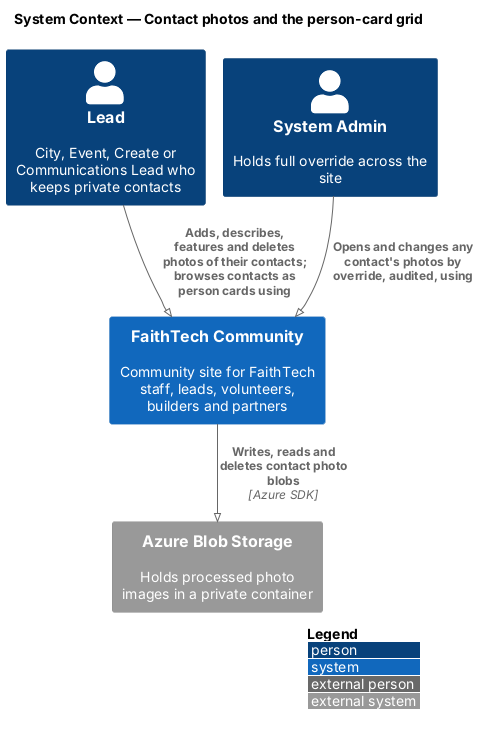
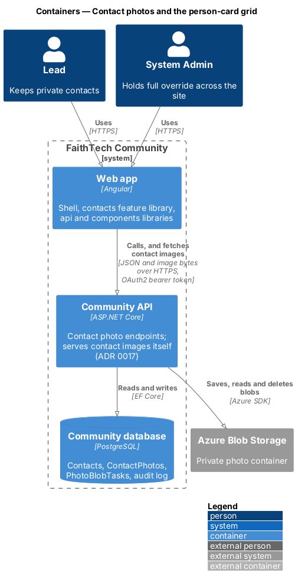
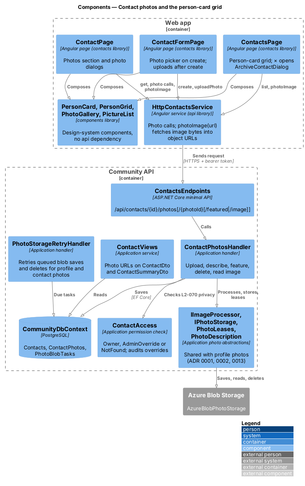
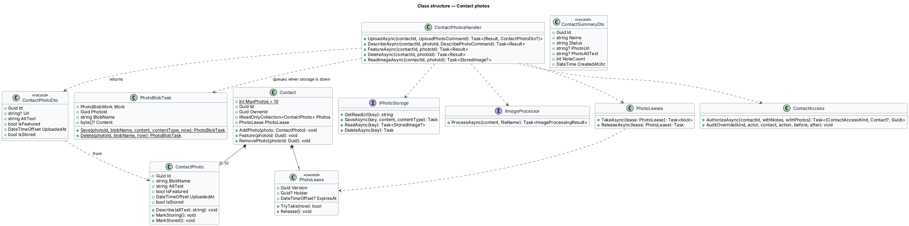
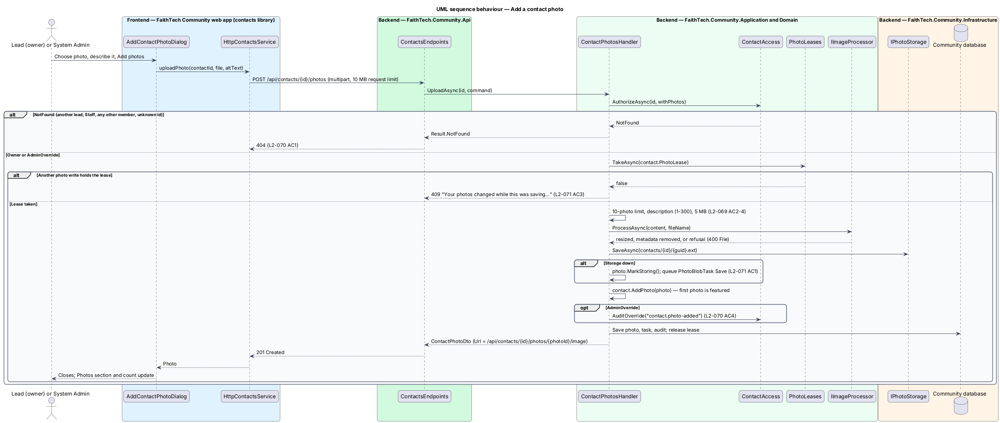
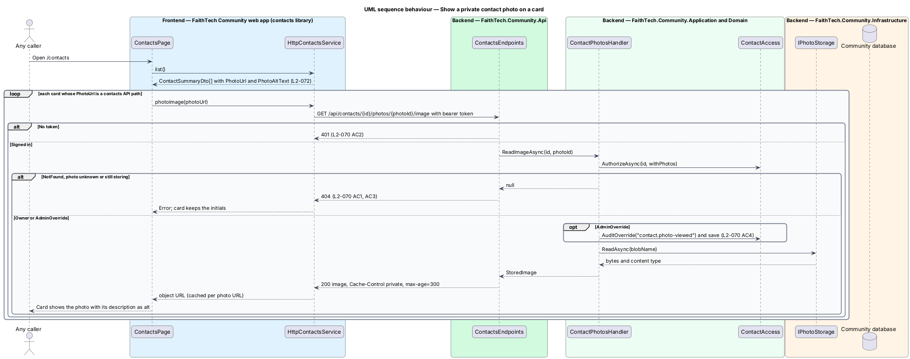
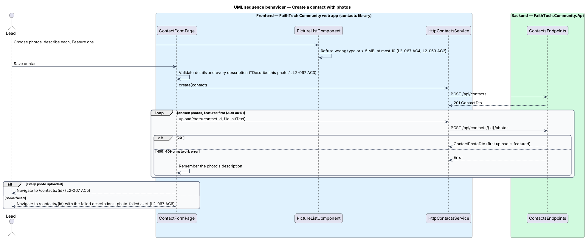

# Contact photos and the person-card grid

## Overview

A lead keeps private contacts for people they meet who have not joined FaithTech Community yet. Recognising someone at the next event is easier with a face, so a lead (any lead role) or a System Admin can add up to 10 photos of a contact, each with a description, and choose one to feature. The contacts list becomes a grid of **person cards**: a decorative cover band, the featured photo (or the person's initials) in a large circle, the name with its status badge, the organisation and city, a secondary line and a *View profile* link, plus a round × that opens the archive confirmation.

Contact photos are as private as the contact (`L2-012`, ADR 0014): only the owning lead and System Admin can see them, change them or fetch their images, and the server enforces it. This is stricter than profile photos, whose read URLs are one-hour SAS links ([ADR 0002](../../../adr/0002-photo-storage-abstraction-and-urls.md)); a contact photo is only ever served by the authenticated API ([ADR 0017](../../../adr/0017-contact-photos-private-images-and-person-cards.md)).

## Description

The slice runs from the contacts pages and the shared components to the `ContactPhotos` and `PhotoBlobTasks` tables and the photo blob container.

### Data

- **`ContactPhoto`** — Domain entity in `Domain/Contacts/`, owned by `Contact` (an owned collection keyed to the contact by a `ContactId` shadow key, as profile photos are): `Id`, `BlobName`, `AltText`, `IsFeatured`, `UploadedAt` and `IsStored` (false while its blob waits to be written, ADR 0013). `Describe(altText)` changes the description; `MarkStoring()` and `MarkStored()` follow storage.
- **`Contact`** gains `Photos`, `MaxPhotos = 10` and the same rules as `Profile`: `AddPhoto` refuses an 11th photo and features the first; `Feature(photoId)` leaves exactly one featured; `RemovePhoto(photoId)` features the most recently uploaded remaining photo when the featured one goes (`L2-068` AC3, AC6, `L2-069` AC5).
- **Concurrency guard** — `Contact` owns a `PhotoLease` (the same owned value type as `Profile.PhotoLease`, with its `Version` concurrency token). Every photo write takes the lease in a save that changes nothing else, changes the photos and releases the lease in one save, so overlapping writes cannot pass 10 photos or leave two featured; the loser gets `409` "Your photos changed while this was saving. Reload and try again." (`L2-071` AC3).
- **Migration** `ContactPhotos` (in `Infrastructure/Persistence/Migrations/`, applied by the Cli): a `ContactPhotos` table and a `ContactPhotoLeases` table (both cascade from `Contacts`, index on `ContactId`), with a lease row inserted for every existing contact. `PhotoBlobTasks` is reused unchanged: each task already names one photo id and one blob key.
- Blob keys are `contacts/{contactId}/{blobId}.{jpg|png|webp}` in the existing private photo container; a key is never reused.

### Backend

- **`ContactPhotosHandler`** — Application handler in `Contacts/` with `UploadAsync`, `DescribeAsync`, `FeatureAsync`, `DeleteAsync` and `ReadImageAsync`. Each starts with `ContactAccess.AuthorizeAsync(id, withPhotos: true)`: `NotFound` for anyone but the owner and System Admin, answered as `404` with the body of an unknown contact (`L2-070` AC1). A System Admin's access writes `contact.photo-added`, `contact.photo-featured`, `contact.photo-described`, `contact.photo-deleted` or `contact.photo-viewed` through `ContactAccess.AuditOverride` (`L2-070` AC4).
- **Upload** — the same checks and pipeline as a profile photo, in the same order: the lease, the 10-photo limit, the description (`PhotoDescription.Check`: 1 to 300 characters, "Describe this photo."), the 5 MB limit (`UploadPhotoHandler.MaxBytes`), then `IImageProcessor.ProcessAsync` (format from the bytes, extension match, EXIF orientation, fit in 1600 × 1600, metadata dropped, ADR 0001). The handler tries `IPhotoStorage.SaveAsync` once; when storage is down the photo is kept with `IsStored = false` and a `PhotoBlobTask` `Save` commits in the same save (ADR 0013, `L2-071` AC1). Errors are keyed `File` or `AltText`, as for profiles (`L2-069`).
- **Delete** — removes the photo and releases the lease in one save, then deletes the blob; a failed delete queues a `PhotoBlobTask` `Delete`. Deleting a photo that is still storing drops its queued write instead. **Permanent contact delete** (`ArchiveContactsHandler.DeleteAsync`) does the same for every photo of the contact after the cascade removes the rows (`L2-070` AC6, `L2-071` AC2). Archive and restore leave photos alone (`L2-070` AC5).
- **Read image** — `ReadImageAsync` returns the stored bytes and content type through the new `IPhotoStorage.ReadAsync(key)`, or null for a refused caller, an unknown photo or one still storing.
- **Sharing the profile pipeline** — Contacts uses the photo pipeline's Application abstractions and rules, never the profile handlers: `IImageProcessor`, `IPhotoStorage`, `PhotoDescription`, `UploadPhotoHandler.MaxBytes`, `PhotoLeases` (now taking a `PhotoLease` rather than a `Profile`) and `PhotoBlobTask` (its factories now take a photo id and blob key). `PhotoStorageRetryHandler` marks either a profile photo or a contact photo stored when a queued write succeeds. They stay in `Application/Profiles/`, where they were written; moving them is a rename with no behaviour change and is left out of scope.
- **Private URLs** — `ContactPhotoDto.Url` is the API path `/api/contacts/{id}/photos/{photoId}/image`, never a storage URL, and null while the photo is storing. The image endpoint needs the bearer token (`401` without it) and answers `404` to anyone but the owner and System Admin, so a copied URL lets nobody else fetch the image (`L2-070` AC2, AC3). Responses carry `Cache-Control: private, max-age=300`.
- **`ContactViews`** — `ContactDto` gains `Photos` (newest first). Its `PhotoUrl`/`PhotoAltText` are the linked member's featured photo once linked (`L2-015` AC2, a profile SAS URL), otherwise the contact's own stored featured photo. `ContactSummaryDto` gains the same `PhotoUrl`/`PhotoAltText` plus `NoteCount` and `CreatedAtUtc` for the cards, computed in the list query.

### API

| Method and route | Body | Answers |
|---|---|---|
| `POST /api/contacts/{id}/photos` | multipart `file`, `altText` (request limit 10 MB so an oversize photo still gets the inline 400) | `201` `ContactPhotoDto`, `400` (`File`, `AltText`), `401`, `404`, `409` (lease) |
| `PUT /api/contacts/{id}/photos/{photoId}` | `{ altText }` | `204`, `400` (`AltText`), `401`, `404` |
| `PUT /api/contacts/{id}/photos/{photoId}/featured` | — | `204`, `401`, `404`, `409` |
| `DELETE /api/contacts/{id}/photos/{photoId}` | — | `204`, `401`, `404`, `409` |
| `GET /api/contacts/{id}/photos/{photoId}/image` | — | `200` image bytes, `401`, `404` |

`GET /api/contacts` and `GET /api/contacts/{id}` keep their status codes and add the photo fields above.

### Frontend

- **`components`** (design system: `components/person-card.html`, `components/photo-gallery.html`, `components/picture-list.html`):
  - `PersonCardComponent` (`ft-person-card`, a list item): `name`, `photoSrc`, `photoAlt`, `color` (cover tint and initials colour), `subtitle`, `secondary`, `href`, `actionLabel` (default "View profile", named with the person through the button's visually hidden `object`), `dismissLabel` and the `dismissed` output; a `badge` slot. The initials are a new `2xl` `ft-avatar` (`--size-cover-lg`) and the pill is the button's new `outline` variant. `PersonCardSkeletonComponent` (`label`, `cards`) and `PersonGridComponent` (`ft-person-grid`, `label`; 1/2/4 columns, equal heights).
  - `PhotoGalleryComponent` (`ft-photo-gallery`): photos with captions, Featured badge, storing placeholder and note, and `featured`, `describe`, `remove` outputs.
  - `PictureListComponent` gains `subject: 'profile' | 'contact'` (the contact wording, "Describe this photo." for a missing description and *Feature* on pending photos), `featurable` (false in the add dialog, where the server features the first photo) and `pendingNote`.
- **`api`** — `ContactsService` (token `CONTACTS_SERVICE`) gains `uploadPhoto(contactId, file, altText)`, `describePhoto`, `setFeaturedPhoto`, `deletePhoto` and `photoImage(url): Observable<string>`. `photoImage` returns a storage URL as it is; for a contacts API path it GETs the image as a blob with the bearer token and returns an object URL, cached per URL for the session. The DTOs gain `ContactPhoto`, `photos`, and the summary's photo, note count and created date.
- **`contacts`** — `ContactsPage` renders the grid, with each card's colour from `avatarColorFor(contact.id)` (ADR 0008) and its photo through `photoImage`; the × opens `ArchiveContactDialog`, and on confirmation the card leaves the grid with a toast. `ContactFormPage` adds the picker on create, creates the contact, uploads the chosen photos featured first, and opens the contact page (with the failed descriptions in navigation state when an upload failed). `ContactPage` adds the Photos card (`ft-photo-gallery`, "{n} of 10", *Add photos* disabled at 10 with the reason; featuring is immediate, a delete reloads the contact so the server's new featured photo shows), loads its header photo through `photoImage`, and opens the new dialogs in `src/lib/dialogs/`: `AddContactPhotoDialog`, `EditPhotoDescriptionDialog` and `DeleteContactPhotoDialog` (confirmation).

## Requirements

| L2 ID | Refines (L1) | Requirement |
|-------|--------------|-------------|
| `L2-067` | `L1-005` | Add photos while creating a contact |
| `L2-068` | `L1-005` | Manage a contact's photos |
| `L2-069` | `L1-005` | Contact photo validation and processing |
| `L2-070` | `L1-005` | Contact photo privacy |
| `L2-071` | `L1-005`, `L1-018` | Contact photo reliability |
| `L2-072` | `L1-005` | Contacts as a grid of person cards |
| `L2-073` | `L1-005`, `L1-017` | Dismiss a person card and card accessibility |

The acceptance criteria are in [`docs/specs/L2.md`](../../../specs/L2.md). They refer to, rather than repeat, `L2-007` (profile photo rules), `L2-012` (visibility), `L2-013` (contacts list), `L2-015` (linking), `L2-016` (archive) and `L2-047` (outages).

## Diagrams

### System context

Leads and System Admin manage contact photos in FaithTech Community, which stores the images in Azure Blob Storage.

### Containers

The web app calls the Community API, and fetches contact images from it too, with the bearer token. The API alone talks to blob storage.

### Components

The pages compose the shared components and call `HttpContactsService`. `ContactPhotosHandler` checks `ContactAccess` and uses the shared photo abstractions; `PhotoStorageRetryHandler` finishes writes and deletes after an outage.

### Class structure

`Contact` composes up to 10 `ContactPhoto`s and its `PhotoLease`. `ContactPhotosHandler` depends on `ContactAccess`, `IImageProcessor`, `IPhotoStorage`, `PhotoLeases` and `PhotoBlobTask`.

### Behaviour — add a contact photo

### Behaviour — show a private contact photo on a card

### Behaviour — create a contact with photos

## Open questions

Decisions recorded while designing ([ADR 0017](../../../adr/0017-contact-photos-private-images-and-person-cards.md)):

- **Private image URLs**: contact images are served by the authenticated API, not by SAS links, because a SAS link would let anyone holding it fetch the image for an hour. Resolved.
- **Create with photos**: the contact is created first and the photos are uploaded one by one with the existing upload endpoint, featured first so the server features it; a failed upload leaves the contact saved and the contact page names what to add again. A single multipart create was rejected: it would duplicate the upload pipeline and make one bad photo fail the whole contact. Resolved.
- **Linked contact's card**: shows the member's featured photo and name (`L2-015` AC2); the lead's own photos stay on the contact page, private. Merging them into the profile is deferred. Resolved.
- **Cover band**: a token-based decorative tint from the person's avatar colour (ADR 0008), not a second upload. Uploaded covers are deferred. Resolved.
- **Audit of image fetches**: each admin fetch of another lead's contact image writes `contact.photo-viewed`, which can add several entries per visit; accepted, because the rule is that every override is audited.
- Deferred: the person card on the team page, people directory, search results and archived contacts; bulk upload, reordering and cropping.
