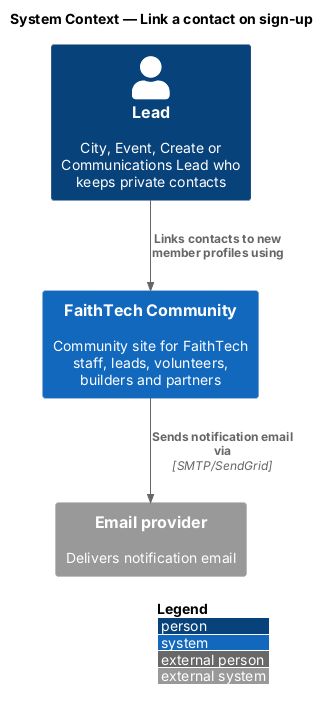
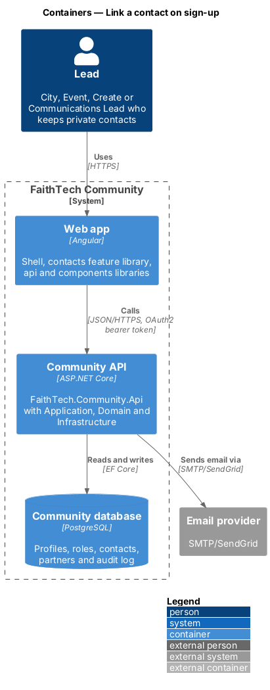
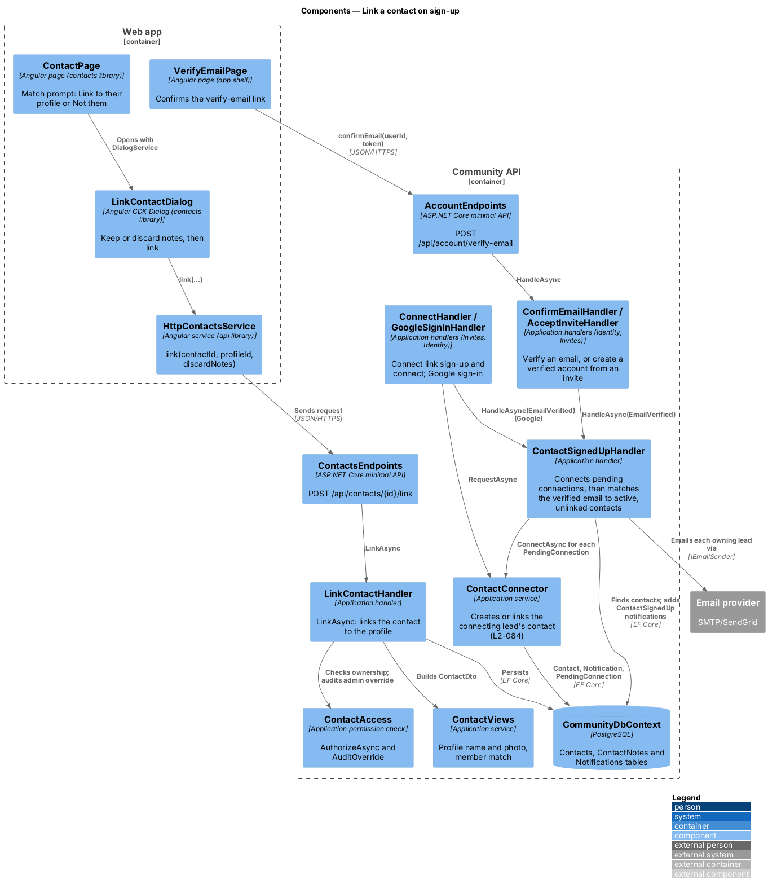
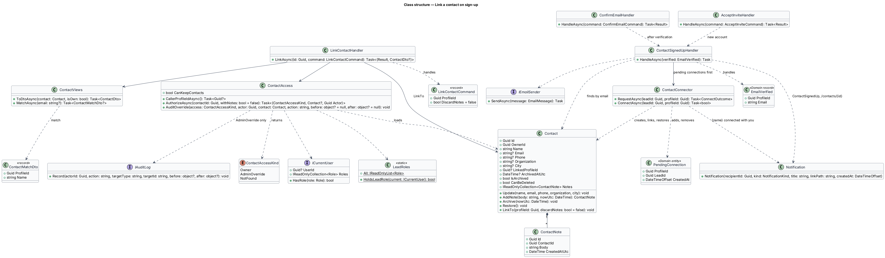
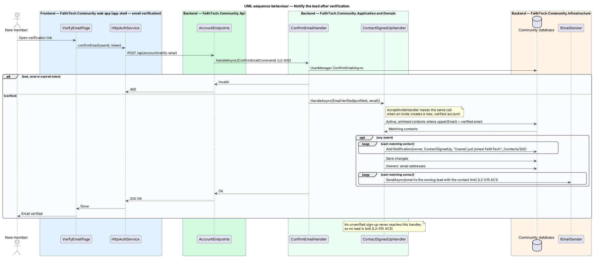
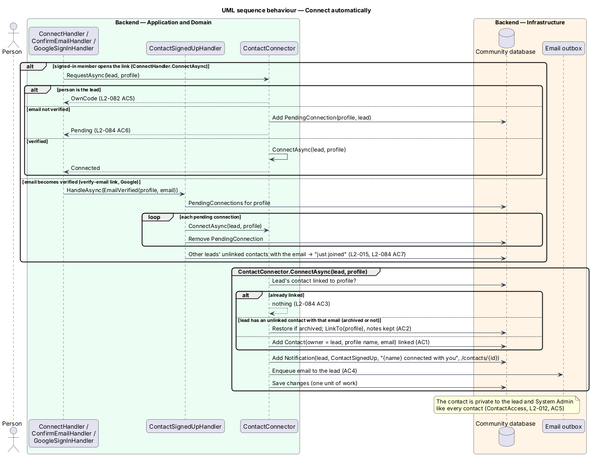
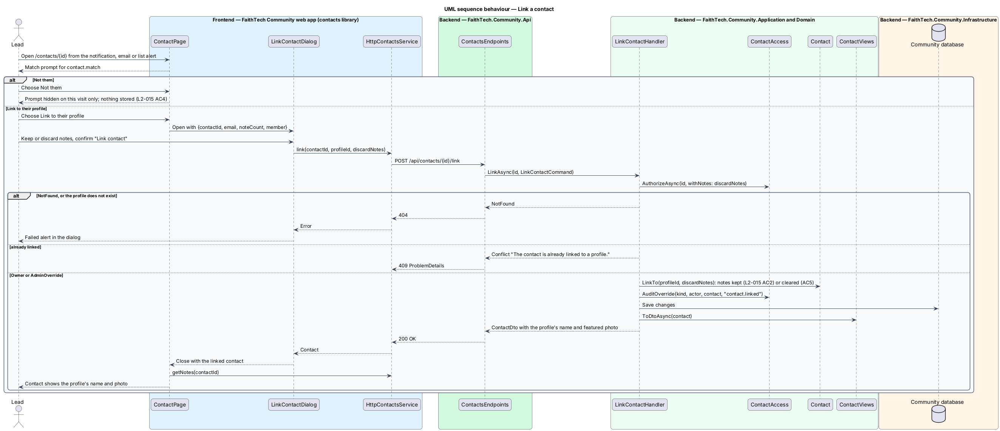

# Link a contact on sign-up

## Overview

When a person a lead has recorded as a private contact later joins FaithTech Community, the lead benefits from connecting the two records. **Contact link** — association from a private contact to the real profile of the same person. A linked contact shows the profile's name and photo while keeping the lead's private notes.

The trigger is email verification, not sign-up. Once a new account verifies an email that matches one or more contacts, each owning lead receives an in-app and email notification offering to link. The notification opens the contact page, where the lead links the contact or chooses "Not them" and can still link later. Linking never reveals the contact or its notes to the person.

**Automatic link** — when the person joined or connected through a City Lead's QR code ([connect by QR code](../../invites/connect-by-qr-code/README.md)), they have asked to be that lead's contact, so the link happens without the lead confirming (`L2-084`, [ADR 0022](../../../adr/0022-automatic-contact-link-on-connect.md)). Other leads' matching contacts still get the confirm flow above.

## Description

- **`EmailVerified`** — Domain record (`Identity/EmailVerified.cs`) with `ProfileId` and `Email`, passed when an account's email becomes verified (`L2-002`).
- **`ContactSignedUpHandler`** — Application handler in `Contacts/LinkContacts.cs`. `HandleAsync(EmailVerified)` is called by **`ConfirmEmailHandler`** (`Identity/EmailVerification.cs`) once the verify-email link succeeds, and by **`AcceptInviteHandler`** (`Invites/AcceptInvite.cs`) when accepting an invite creates a new, already verified account. It finds active, unlinked contacts whose `Email` matches the verified email case-insensitively and, for each, adds an in-app **`Notification`** of kind `ContactSignedUp` ("{name} just joined FaithTech", linking to `/contacts/{id}`) for the owning lead, saves, then emails each owner through **`IEmailSender`**. An unverified account is never passed in, so no notification is sent (`L2-015` AC3). There is no separate notification service yet.
- **`PendingConnection`** — Domain entity (`Domain/Contacts/PendingConnection.cs`): `ProfileId`, `LeadId`, `CreatedAt`, unique per pair. It is the "connecting lead attached" to an account whose email is not verified yet: added by `ConnectHandler` when an account is created through a connect link, or when a signed-in member with an unverified email opens one.
- **`ContactConnector`** — Application service (`Contacts/ConnectContacts.cs`):
  - `RequestAsync(leadId, profileId)` — `OwnCode` when the person is the lead; if the person's email is verified, connects now (`Connected`), otherwise adds a `PendingConnection` (`Pending`, `L2-084` AC6).
  - `ConnectAsync(leadId, profileId)` — if the lead already has a contact linked to the profile, does nothing (`L2-084` AC3); else links the lead's unlinked contact with the same email (case-insensitive, restoring it if archived, keeping notes, AC2); else creates a contact with the profile's name and the account email, linked. A new link adds a `ContactSignedUp` notification "{name} connected with you" (`/contacts/{id}`) and emails the lead (AC4). Saved in one unit of work with the notification and email (`L2-028`).
- **`ContactSignedUpHandler`** now starts by connecting every `PendingConnection` for the verified profile through `ContactConnector.ConnectAsync` and removing them, then runs the existing match, which no longer sees the contacts it just linked (AC7). `ConfirmEmailHandler`, `AcceptInviteHandler` and `GoogleSignInHandler` (ADR 0019) all reach it with **`EmailVerified`**; `EmailVerified` itself is unchanged.
- **`ContactViews`** — while a contact is unlinked, `MatchAsync` reports the verified member who uses its email as `ContactDto.Match` (**`ContactMatchDto`**: profile id and name), and the list shows the contact as `SignedUp`.
- **`ContactPage`** — shows the match prompt with "Link to their profile" and "Not them". "Not them" hides the prompt on this visit only. The notification, the email and the contacts list alert all lead here.
- **`LinkContactDialog`** — CDK dialog in the `contacts` feature library, opened from `ContactPage` with the contact id, email, note count and member. It offers keep (default) or discard notes, calls `CONTACTS_SERVICE.link` itself, shows busy and failed states, and closes with the linked `ContactDto`.
- **`ContactsService.link(contactId, profileId, discardNotes)`** — calls `POST /api/contacts/{id}/link`, which answers `200`, `404` or `409`.
- **`LinkContactCommand`** (`ProfileId`, `DiscardNotes`) / **`LinkContactHandler`** — `LinkAsync(id, command)` checks the caller through `ContactAccess.AuthorizeAsync` and that the profile exists (`404` otherwise), refuses an already-linked contact with `409`, calls `Contact.LinkTo(profileId, discardNotes)`, audits `contact.linked` on admin override and saves. Notes are kept unless the lead chose to discard them (`L2-015` AC5).
- **`ContactDto`** — when `LinkedProfileId` is set, the name and featured photo come from the profile, as do the contact's person card in the list (`ContactSummaryDto.PhotoUrl`, `L2-072` AC3). The photos the lead added to the contact stay on the contact page, private ([ADR 0017](../../../adr/0017-contact-photos-private-images-and-person-cards.md)).

Behaviour when two accounts share one contact email over time, or when a linked profile is deleted: deferred, because profiles are not deleted in v1 and a contact links once ([ADR 0014](../../../adr/0014-contacts-and-partners-access-and-open-questions.md)).

## Requirements

The feature realizes the following level-2 (L2) requirements. Each L2 requirement refines a level-1 (L1) requirement, cited by identifier.

| L2 ID | Refines (L1) | Requirement |
|-------|--------------|-------------|
| `L2-015` | `L1-005` | Contact signs up |
| `L2-084` | `L1-005` | Automatic contact link |

### Acceptance criteria

**`L2-015` — Contact signs up**

1. Given a contact with email X, when a person signs up and verifies email X, then the owning lead receives an in-app and email notification.
2. Given that notification, when the lead confirms "Link contact", then the contact is linked to the real profile, private notes are kept, and the contact shows the profile's name and photo.
3. Given an unverified email, when the person signs up, then no notification is sent until the email is verified.
4. Given the lead dismisses the match ("Not them"), when they view the contact later, then they can still link it.
5. Given the link dialog, when the lead chooses to discard their notes, then the contact is linked and the private notes are deleted.

**`L2-084` — Automatic contact link** — see [`docs/specs/L2.md`](../../../specs/L2.md); its criteria cover creating or linking the contact without confirmation, one contact per email, nothing on a repeat, the "connected with you" notification, privacy, waiting for verification, and other leads' notifications.

## Diagrams

### System context

The lead receives in-app and email notifications from FaithTech Community, which sends email through the email provider.

### Containers

The app shell's verify-email page and the `contacts` feature library in the Angular web app call the Community API through the `api` library over HTTPS with an OAuth2 bearer token. The API persists state in the PostgreSQL Community database and sends email through the email provider.

### Components

`ConfirmEmailHandler` and `AcceptInviteHandler` call `ContactSignedUpHandler`, which adds the notifications and emails the owners. `LinkContactHandler` performs the link on the lead's confirmation from `LinkContactDialog`.

### Class structure

`ContactSignedUpHandler` takes an `EmailVerified` and writes `Notification` rows and email through `IEmailSender`. `LinkContactHandler` depends on `ContactAccess` and `ContactViews` and calls `Contact.LinkTo`.

### Behaviour — notify the lead after verification

Only a verified email triggers matching, so unverified sign-ups notify no one (`L2-015` AC1, AC3).

### Behaviour — connect automatically

A person who used a lead's connect link is connected when their email is verified, or at once when it already is (`L2-084`).

### Behaviour — link a contact

The lead opens the contact from the notification, the email or the list alert and confirms in `LinkContactDialog`; the link keeps notes unless discarded and shows the profile's name and photo (`L2-015` AC2, AC4, AC5).

## Open questions

Decisions recorded while building the Domain layer (`FaithTech.Community.Domain`):

- `L2-015` AC5 lets the lead discard notes while linking; `LinkTo` takes a `discardNotes` flag. A contact links once: linking an already-linked contact is rejected. Resolved.
- "Not them" only hides the match prompt on the open page; nothing is stored, so the prompt returns on the next visit and the lead can still link (`L2-015` AC4).
- The contact reports a `match` (the member's profile id and name) while it is unlinked and a verified account uses its email; join dates are not stored, so the mocks no longer show one.
- The notification is saved before the emails are sent; a lead without an account email gets the in-app notification only.
- Automatic link (ADR 0022): the lead's earlier unlinked contact with the same email is linked rather than duplicated, even if archived (it is restored). The connect path does not ask the lead, because the person asked to connect by using the lead's own code; the page told them what connecting does.
