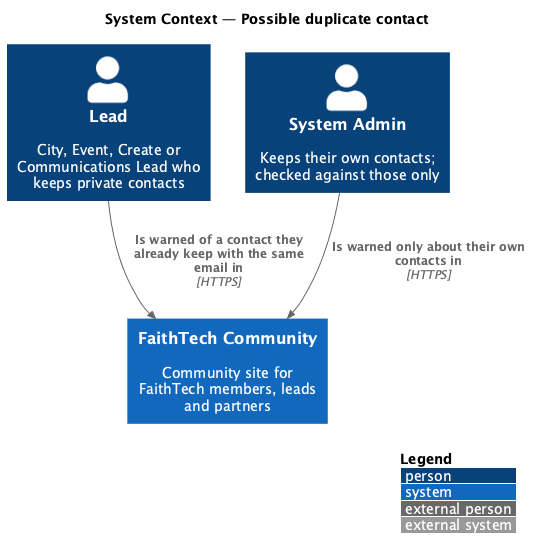
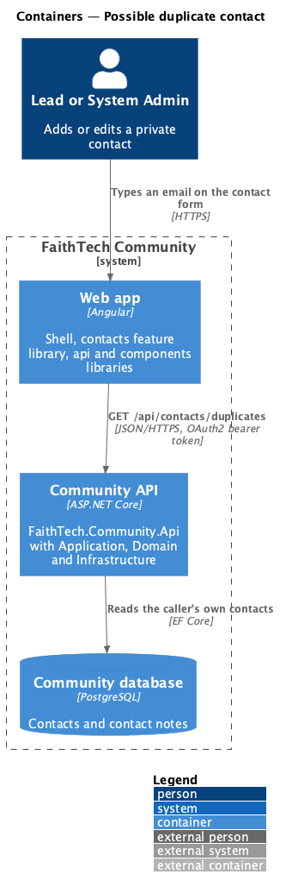
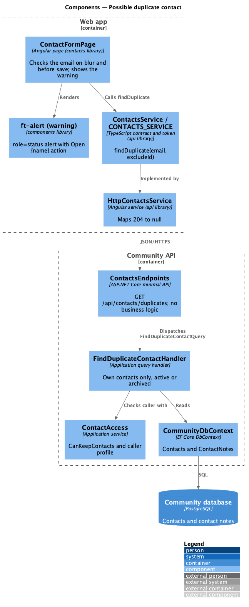
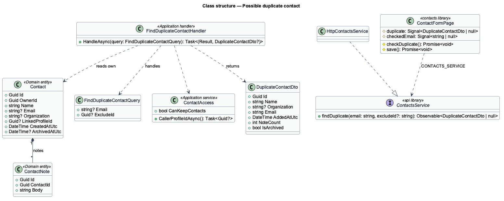
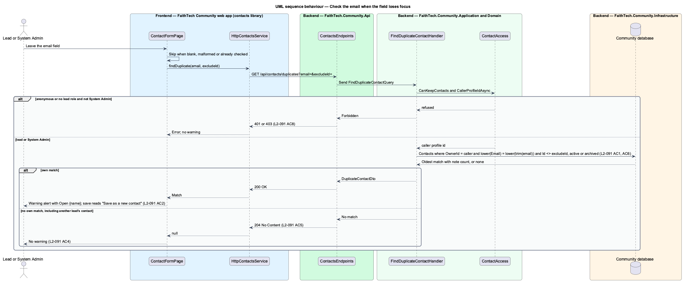
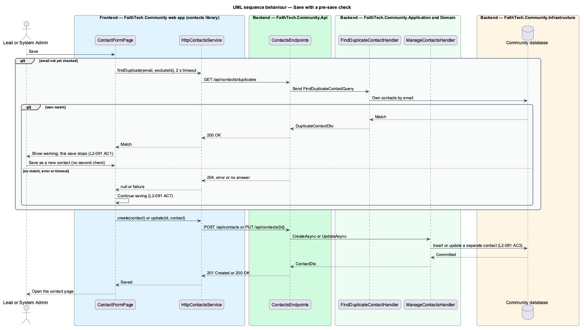

# Possible duplicate contact

## Overview

A *possible duplicate contact* is a contact the signed-in lead already keeps with the same email as the one being typed on the contact form. This feature warns the lead before a second contact for the same person is saved, so notes about one person stay in one place.

Key terms:

- **contact form** — the new and edit contact screen at `/contacts/new` and `/contacts/:id/edit` ([manage contacts](../manage-contacts/README.md), `L2-013`)
- **own contacts** — the contacts whose `OwnerId` is the caller's profile, active or archived
- **duplicate check** — a read-only lookup of the caller's own contacts by email, trimmed and compared case-insensitively

Contacts are private to the lead who created them and to System Admin (`L2-012`, [ADR 0014](../../../adr/0014-contacts-and-partners-access-and-open-questions.md)). The duplicate check keeps that rule strictly: it looks only at the caller's own contacts, System Admin included, so it never reveals that another lead holds a contact with the same email. The warning is advice, not a block: the lead may still save a separate contact, and a failed or slow check never stops a save.

The duplicate check is separate from the existing "Save and link" offer (`L2-013` AC6), which matches a *verified member's account* rather than a contact. Both may apply to the same email; each keeps its own alert.

## Description

The slice runs from the email field on the contact form to the `Contacts` and `ContactNotes` tables.

- **`ContactFormPage`** — existing page in the `contacts` feature library (mock `docs/mocks/pages/contact-form/possible-duplicate`). It gains:
  - a `(focusout)` listener on the email `ft-form-field`, which calls `checkDuplicate()` when the trimmed email is non-empty, well formed and different from the last value checked;
  - a `duplicate` signal holding the latest `DuplicateContactDto` or null, and `checkedEmail`, the email that answer belongs to; editing the email clears both;
  - a warning `ft-alert` (`status="warning"`, which renders `role="status"` with its icon) headed "You already have a contact with this email", with the text "{name} ({organisation}) is in your contacts with {email}, added {date} with {n} notes. Open it to add to those notes, or save this as a separate contact." and an `ftAlertActions` primary `ft-button` "Open {name}" linking to `/contacts/{id}`; an archived match reads "in your archived contacts" instead of "in your contacts";
  - while the warning shows, the save button reads "Save as a new contact" in the secondary variant, and choosing it saves the contact as a separate record (`L2-116` AC3);
  - a pre-save check: when the email has not been checked yet, `save()` runs the check first with a 2-second timeout (`DUPLICATE_CHECK_TIMEOUT_MS`). A match shows the warning and stops this save, so the lead sees it once; a timeout, an error or a `204` lets the save continue (`L2-116` AC7). A second save with the warning showing is "Save as a new contact" and is not checked again.
- **`ContactsService`** / **`CONTACTS_SERVICE`** / **`HttpContactsService`** — `api/src/lib/contacts` gains `findDuplicate(email: string, excludeId?: string): Observable<DuplicateContactDto | null>`, which calls `GET /api/contacts/duplicates?email=&excludeId=` and maps a `204` to `null`. The request carries `HANDLES_FORBIDDEN` and a new `HANDLES_SERVER_ERROR` context token, so `httpErrorInterceptor` does not leave the form for the error page when the check fails (`L2-116` AC7). The `DuplicateContactDto` interface carries `id`, `name`, `organization`, `email`, `addedAt`, `noteCount` and `isArchived`.
- **`ContactsEndpoints`** — maps `GET /api/contacts/duplicates` before the `/{id:guid}` routes; the guid constraint keeps the two apart. It answers `200` with `DuplicateContactDto`, `204` when there is no match, `401` for an anonymous caller and `403` for a caller who cannot keep contacts. It holds no business logic.
- **`FindDuplicateContactQuery`** (`Email`, `ExcludeId`) and **`FindDuplicateContactHandler`** — new file `Application/Contacts/FindDuplicateContact.cs`. The handler:
  1. returns `Result.Forbidden()` unless `ContactAccess.CanKeepContacts` and the caller has a profile (`L2-116` AC8);
  2. trims the email; a blank email answers no match;
  3. queries `db.Contacts` with `OwnerId == caller` (never widened for System Admin, `L2-116` AC5, AC6), `Email != null`, `Email.ToLower() == email.ToLower()` and `Id != ExcludeId`, archived or not (`L2-116` AC1);
  4. orders by `CreatedAtUtc` and takes the first match, projecting the linked profile's name when linked (as `ContactSummaryDto` does), the organisation, the email, `CreatedAtUtc`, `ArchivedAtUtc != null` and the note count from `db.ContactNotes`.
  The query is plain LINQ, so it runs on the in-memory provider in tests and on PostgreSQL in production. It writes no audit entry: it never reads another lead's contact.
- **`DuplicateContactDto`** — `Application/Contacts/ContactDto.cs` gains `record DuplicateContactDto(Guid Id, string Name, string? Organization, string Email, DateTime AddedAtUtc, int NoteCount, bool IsArchived)`.
- **`ContactAccess`** — unchanged. `CanKeepContacts` (a lead role or System Admin) and `CallerProfileIdAsync` decide who may call the check and whose contacts it reads.
- **`Contact`** — unchanged Domain entity. `Email` is stored trimmed by `ContactRules.Blank`, so the lookup trims only the query value.

**Fake backend.** `e2e/fixtures/mock-contacts.ts` answers `GET /api/contacts/duplicates` ahead of its `/api/contacts/{id}` pattern, which would otherwise read `duplicates` as an id. It applies the same rules: `401` without a caller, `403` without a lead role or System Admin, the caller's own contacts only, `excludeId` honoured, `200` with the DTO or `204`. A fixture option makes the check fail or delay, so the save-not-blocked case can be driven.

**Tests.**

- `backend/tests/QuinntyneBrown.Community.Api.Tests/Contacts/FindDuplicateContactTests.cs` — own active and archived matches, case and whitespace differences, `excludeId`, another lead's contact with the same email answering `204` (`L2-116` AC5), a System Admin never matched against another lead's contact (AC6), and `401` and `403` (AC8).
- `e2e/tests/contacts/possible-duplicate.spec.ts` with page object additions in `e2e/pages/contact-form.page.ts` — the warning on blur with Open {name} (AC2), "Save as a new contact" (AC3), no warning for no match or another lead's contact (AC4, AC5), the edit form excluding itself, a failed or slow check not blocking save (AC7), and an axe check of the warning state.

### Organization hierarchy

The organization hierarchy changes this design as follows; the rules are in [hierarchy and permissions](../../organizations/hierarchy-and-permissions/README.md) and [org-owned data and context](../../organizations/org-owned-data-and-context/README.md), and the binding decisions in [ADR 0033](../../../adr/0033-permission-codes-and-role-catalogues.md) and [ADR 0034](../../../adr/0034-org-owned-data-and-the-access-resolver.md). Where this section and the text above differ, this section applies. Requests for records outside the caller's coverage, or in an org whose type has the feature off, answer `404` ([feature flags](../../organizations/feature-flags/README.md)).

- `Contact` and `PendingConnection` carry a required `OrganizationId`; notes and photos belong to the contact. Contacts are created in the active org and require `contacts.private` there (the four FaithTech leads, or a tier).
- Private contacts and their notes stay visible only to their owner and to System Admin, audited. The Portfolio Lead, Org Lead and cross-org roles never see them, by id, list or search (`L2-148` AC6). This check is explicit in `ContactAccess` and does not go through `CallerAccess.Has`.
- Lists are scoped to the owner's contacts in the active org, or in every covered org under "All orgs", with org labels; the `contacts` feature switched off answers `404` ([feature flags](../../organizations/feature-flags/README.md)).
- Duplicate detection compares the caller's contacts within the same org only.

## Requirements

The feature realizes the following level-2 (L2) requirement. It refines a level-1 (L1) requirement, cited by identifier.

| L2 ID | Refines (L1) | Requirement |
|-------|--------------|-------------|
| `L2-116` | `L1-005` | Possible duplicate contact. A lead is warned before adding a second contact for the same person. The check never reveals another lead's contacts (`L2-012`). |

### Acceptance criteria

**`L2-116` — Possible duplicate contact**

1. Given a lead on the new or edit contact form (`L2-013`), when the email field loses focus, and again before save, then `GET /api/contacts/duplicates?email=&excludeId=` compares the email, trimmed and case-insensitively, with the signed-in lead's own contacts, active or archived, excluding the contact being edited.
2. Given a match, when the check answers, then a warning alert (`role="status"`, with its icon) names the existing contact with its organisation, the date it was added and its note count, and offers "Open {name}".
3. Given the warning, when the lead chooses "Save as a new contact", then the contact is saved as a separate contact.
4. Given no match, when the check answers (204), then no warning is shown.
5. Given another lead owns a contact with the same email, when the lead checks, then no warning is shown and the response is 204, so the other contact's existence is not revealed.
6. Given a System Admin, when they add or edit a contact, then only the System Admin's own contacts are checked; another lead's contact with the same email never triggers the warning.
7. Given the check fails or is slow, when the lead saves, then saving is not blocked.
8. Given an anonymous visitor, or a member who cannot hold contacts, when they call the duplicates endpoint, then the response is 401 or 403.

## Diagrams

### System context

Leads and System Admins add contacts in QuinntyneBrown.Community. The check involves no external system.

### Containers

The contact form in the web app calls the Community API, which reads the caller's own contacts from the Community database.

### Components

`ContactFormPage` calls `findDuplicate` on `CONTACTS_SERVICE`. `FindDuplicateContactHandler` asks `ContactAccess` who the caller is and reads only that caller's contacts.

### Class structure

The query carries the email and the contact being edited. The handler returns a `DuplicateContactDto` or no match.

### Behaviour — check the email when the field loses focus

The server filters by owner before it compares emails, so another lead's contact never answers `200` (`L2-116` AC1, AC5, AC6).

### Behaviour — save with a pre-save check

An unchecked email is checked before save. A match stops that save and shows the warning; a failure or timeout lets the save continue (`L2-116` AC3, AC7).

## Open questions

Decisions recorded while designing the feature:

- The check answers `204` rather than `404` for no match, so the browser console shows no error on the common path. Resolved by the decisions brief.
- A blank email answers `204` without a query. A malformed email is not sent: the page checks only a well-formed email, and the server compares the value it receives without validating it, since a lookup cannot leak anything.
- An archived match is reported with `isArchived`, and the alert says "in your archived contacts". Its Open link goes to the contact page, which shows archived contacts ([archive and restore](../archive-restore-delete-contacts/README.md)).
- When several own contacts share the email, the oldest is named. The alert does not say "and N more"; one link is enough to find the person.
- The pre-save timeout is 2 seconds. A check that answers after the save has started is ignored.
- The mock's alert action "Open {name}" is the primary button and the save button becomes the secondary "Save as a new contact" (mock `possible-duplicate`). No component change is needed: `ft-alert` already supports `warning` and `ftAlertActions`.
- Implementation notes: the e2e spec is `e2e/tests/contacts/possible-duplicate.spec.ts` (the name the implementation brief gave). `httpErrorInterceptor` routes every 500 to the error page, which would block the save after a failed check, so `api/src/lib/errors` gains `HANDLES_SERVER_ERROR`, set only on the duplicate check.
