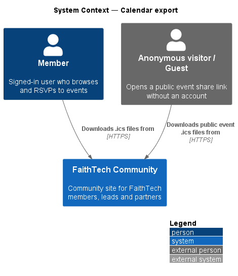
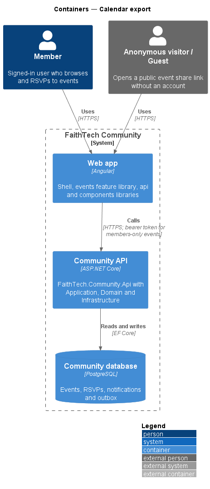
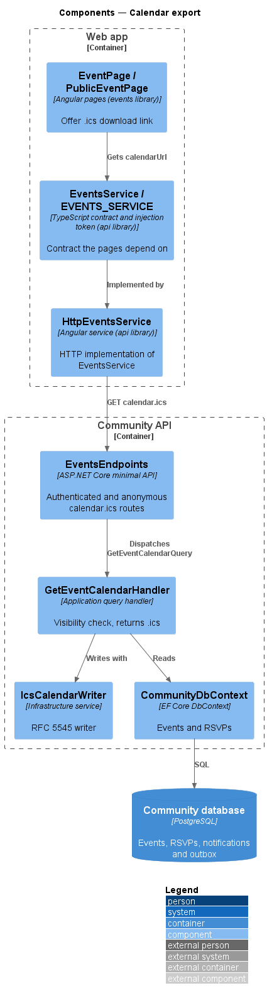
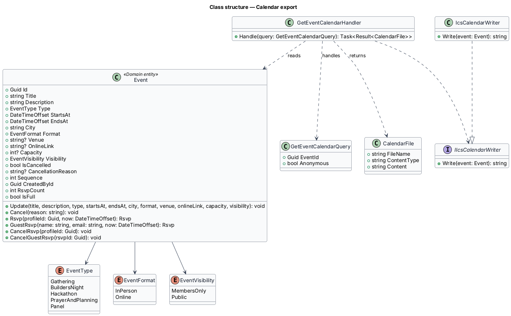
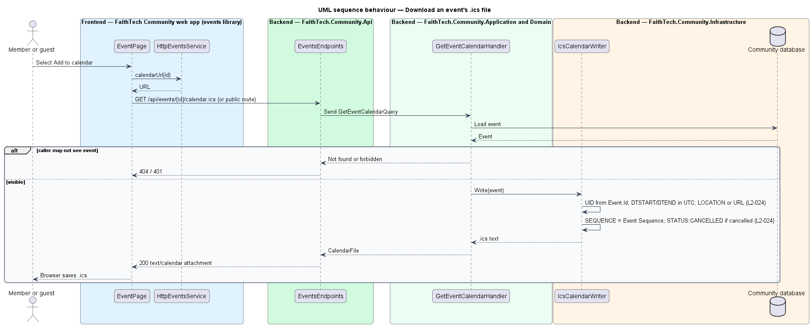

# Calendar export

## Overview

Every event offers a calendar file so attendees can add it to their own calendar. The file uses the iCalendar format.

Key terms:

- **`.ics` file** — iCalendar document defined by RFC 5545
- **UID** — iCalendar property that identifies an event across downloads; it stays the same for the life of the event
- **SEQUENCE** — iCalendar revision number; a calendar client replaces an entry when it receives a higher value
- **STATUS:CANCELLED** — iCalendar status that tells a client the event no longer takes place

A user may download the `.ics` of any event that user may see: members-only events require sign-in, and public events are available anonymously. The same writer produces the attachments on RSVP confirmation emails.

## Description

- **`EventPage`** and **`PublicEventPage`** — pages in the `events` library that offer the download link.
- **`EventsService` / `EVENTS_SERVICE`** — `downloadCalendar(id)` fetches a member's copy with their sign-in, and `calendarUrl(id, { isPublic: true })` returns the public download URL that the browser opens directly.
- **`EventsEndpoints`** — maps `GET /api/events/{id}/calendar.ics` (authenticated) and `GET /api/public/events/{id}/calendar.ics` (explicit `AllowAnonymous`, public events only). Both return `text/calendar`.
- **`GetEventCalendarHandler`** — Application handler that checks the caller may see the event, then asks `IIcsCalendarWriter` for the file.
- **`IcsCalendarWriter`** — Infrastructure implementation of `IIcsCalendarWriter`. It writes one `VEVENT` with `UID` derived from `Event.Id`, `DTSTART`/`DTEND` in UTC, `SUMMARY`, `LOCATION` (venue) or `URL` (online link), `SEQUENCE` from `Event.Sequence`, and `STATUS:CANCELLED` when the event is cancelled.
- **`Event.Sequence`** — integer that the edit and cancel handlers increment.

The UID is `{event id}@faithtech.community`.

## Requirements

The feature realizes the following level-2 (L2) requirements. Each L2 requirement refines a level-1 (L1) requirement, cited by identifier.

| L2 ID | Refines (L1) | Requirement |
|-------|--------------|-------------|
| `L2-024` | `L1-008` | Calendar export |

### Acceptance criteria

**`L2-024` — Calendar export**

1. Given any event a user can see, when they download its .ics, then the file is valid RFC 5545 with the title, times in UTC, location or link, and a stable UID.
2. Given an event that is changed or cancelled, when the .ics is downloaded again, then it carries a higher SEQUENCE number, and STATUS:CANCELLED if cancelled.

## Diagrams

### System context

Members and anonymous visitors download `.ics` files for events they may see.

### Containers

The browser fetches the `.ics` file from the Community API, which reads the event from the Community database.

### Components

`GetEventCalendarHandler` enforces visibility and delegates formatting to `IcsCalendarWriter` in Infrastructure.

### Class structure

`IcsCalendarWriter` realizes `IIcsCalendarWriter` and reads `Event.Sequence` and `Event.IsCancelled` for revision and status.

### Behaviour — download an event's .ics file

The handler checks visibility before writing the file. The writer emits a stable UID, UTC times, the current SEQUENCE and, for cancelled events, STATUS:CANCELLED (`L2-024`).

## Open questions

Decisions recorded while building the Domain layer (`FaithTech.Community.Domain`):

- `Event.Update` and `Event.Cancel` each increment `Sequence` once; the writer reads it unchanged.

Decisions recorded while building the slice:

- A member's download needs their access token, which a plain link cannot carry, so the event page fetches the file through `downloadCalendar` and saves it as `{event-slug}.ics`. The public page links `GET /api/public/events/{id}/calendar.ics` directly.
- The public copy's `URL` is the public event page, and an online event's joining link is left out of it: the link is for people who RSVP, whose confirmation `.ics` carries it.
- A cancelled event keeps its download, labelled *Update your calendar (.ics)*, so a calendar that already holds the event can take the higher `SEQUENCE` and `STATUS:CANCELLED` (`L2-024` AC2). The cancelled mocks show it.
- `IcsCalendarWriter` writes CRLF lines folded at 75 octets without splitting a character, escapes text values, and stamps `DTSTAMP` from the clock.
