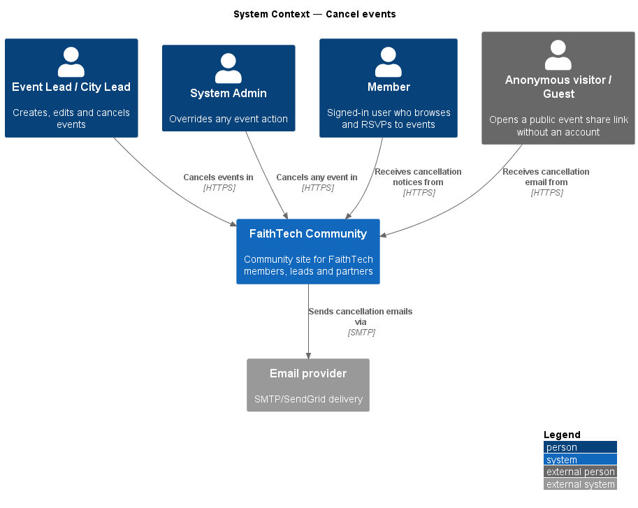
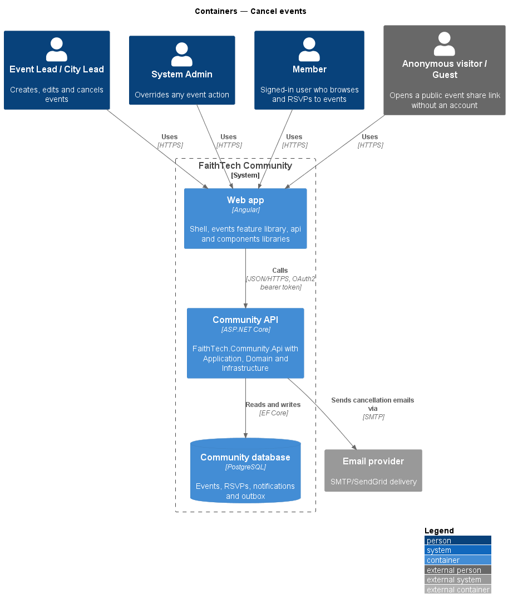
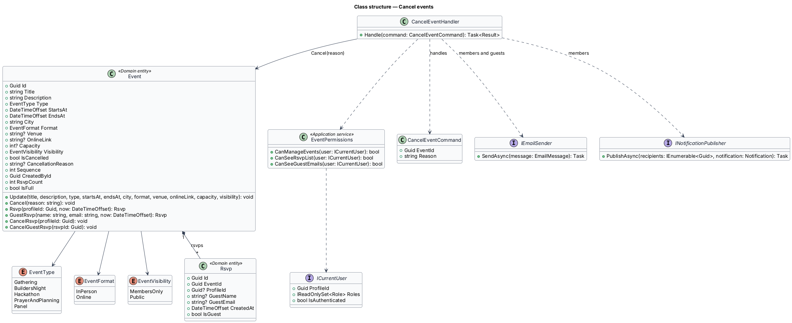
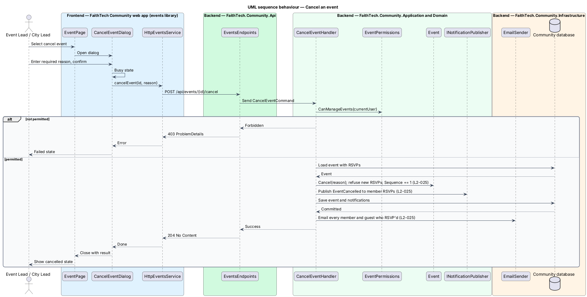

# Cancel events

## Overview

An event manager may cancel an event that no longer takes place. Cancelling is a state change, not a deletion: the event stays visible, marked cancelled, and refuses new RSVPs.

Key terms:

- **event manager** — holder of the Event Lead, City Lead or System Admin role
- **cancellation reason** — required free text explaining why the event was cancelled (`L2-025` AC1, AC3)

Cancelling notifies everyone who RSVP'd: members by email and in-app notification, guests by email. The event's `.ics` SEQUENCE increases and its status becomes cancelled (`L2-024`).

## Description

- **`EventPage`** — offers the cancel action to event managers (mock state `lead`).
- **`CancelEventDialog`** — Angular CDK Dialog in the `events` library (mock: `docs/mocks/dialogs/cancel-event/`, states `default`, `busy`, `invalid`, `failed`) with a required reason, a safe *Keep event* button and a danger *Cancel event* button.
- **`EventsService` / `EVENTS_SERVICE`** — `cancelEvent(id, reason)`, implemented by `HttpEventsService`.
- **`EventsEndpoints`** — maps `POST /api/events/{id}/cancel`.
- **`CancelEventCommand` / `CancelEventHandler`** — checks `EventPermissions.CanManageEvents`, calls `Event.Cancel(reason)`, records in-app notifications for member RSVPs, and queues emails to every member and guest who RSVP'd.
- **`Event.Cancel(reason)`** — rejects an empty reason and an event already cancelled, then sets `IsCancelled`, stores the reason and increments `Sequence`. The RSVP handlers refuse cancelled events.
- **`IEmailSender`** — Infrastructure email service. Delivery is asynchronous through the email outbox (`OutboxEmailSender` queues, `EmailOutboxDispatcher` sends and retries).
- **`INotificationPublisher`** — records in-app notifications.

The cancellation reason is at most 500 characters.

## Requirements

The feature realizes the following level-2 (L2) requirements. Each L2 requirement refines a level-1 (L1) requirement, cited by identifier.

| L2 ID | Refines (L1) | Requirement |
|-------|--------------|-------------|
| `L2-025` | `L1-008` | Cancel events |

### Acceptance criteria

**`L2-025` — Cancel events**

1. Given an Event Lead, City Lead or System Admin, when they cancel an event with a required reason after confirming, then the event is marked cancelled and new RSVPs are refused.
2. Given a cancelled event, when the cancellation completes, then every member and guest who RSVP'd receives an email, and members also receive an in-app notification.
3. Given an empty reason, when they confirm, then an inline error asks them to tell attendees why.

## Diagrams

### System context

Event managers cancel events. Members and guests who RSVP'd receive notice; email leaves through the email provider.

### Containers

The `CancelEventDialog` calls the Community API, which updates the event and sends emails through the email provider.

### Components

`CancelEventHandler` authorizes through `EventPermissions`, cancels the `Event`, and fans out notifications and emails to RSVPs.

### Class structure

`Event` composes `Rsvp` records; `CancelEventHandler` reads them to address notifications and emails.

### Behaviour — cancel an event

The manager confirms in `CancelEventDialog`. The handler marks the event cancelled, closes RSVPs, and notifies every member and guest who RSVP'd (`L2-025`).

## Open questions

Decisions recorded while building the Domain layer (`FaithTech.Community.Domain`):

- The reason is required, as `L2-025` states; the earlier "optional reason" wording is corrected. Resolved.

Decisions recorded while building the slice:

- `POST /api/events/{id}/cancel` takes `{ reason }`. The validator runs first: an empty reason is 400 on `Reason` with "Tell attendees why, so they aren’t left guessing." (AC3), and over 500 characters is 400. Then a caller who may not manage events gets 403, an unknown event 404 and an event already cancelled 409 "This event is already cancelled."; success is 204.
- `Event.Cancel(reason, cancelledById, cancelledAt)` also records who cancelled and when, so the event page reads "Esther Nakamura cancelled it on Tue 20 Oct: “…” Everyone who RSVP’d was emailed." (`EventDetailDto.cancelledByName`, `cancelledAt`).
- Members who RSVP'd get an `EventCancelled` in-app notification through `INotificationPublisher`, the notifications feature's seam (not the person who cancelled, ADR 0011). Every member and guest who RSVP'd gets an email, "Cancelled: {title}", with the reason and the cancelled `.ics` attached, which carries `STATUS:CANCELLED` and the higher `SEQUENCE` so calendars drop the event.
- A System Admin who holds neither Event Lead nor City Lead is audited (`event.cancelled`).
- The dialog's description counts who will hear: "All {n} people who RSVP’d get an email; the {m} members also get an in-app notification", or "No one has RSVP’d yet". After cancelling, the page shows a success toast, "Event cancelled", and the cancelled state; Edit and Cancel event go away and the calendar download becomes *Update your calendar (.ics)*.
