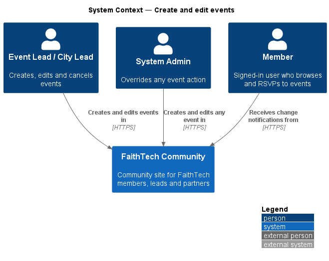
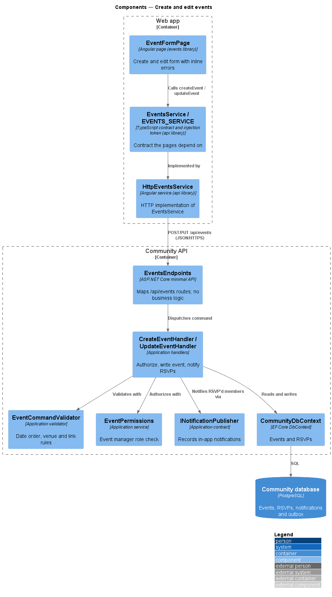
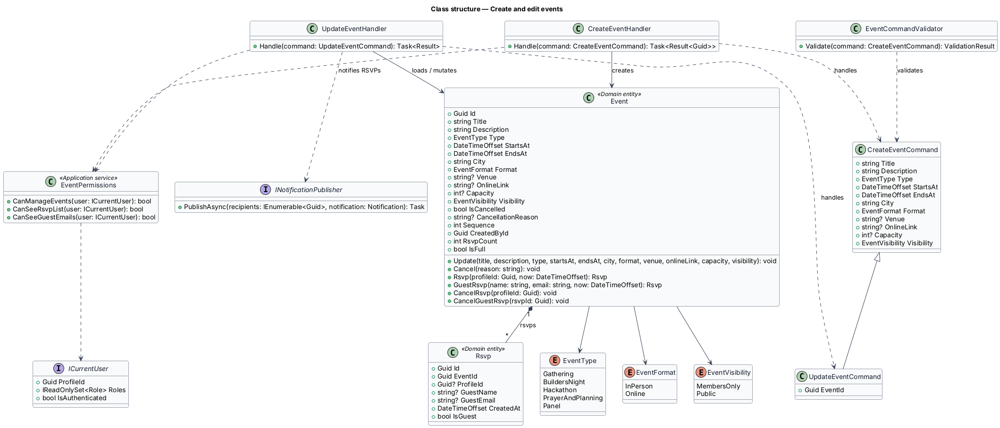
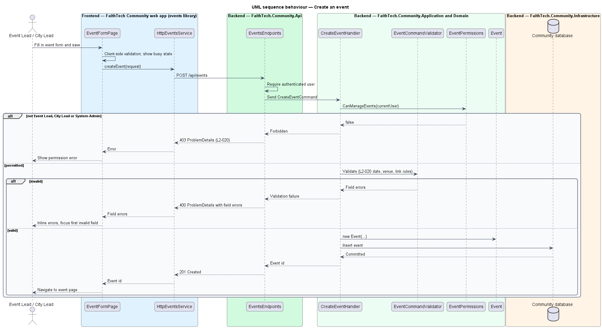
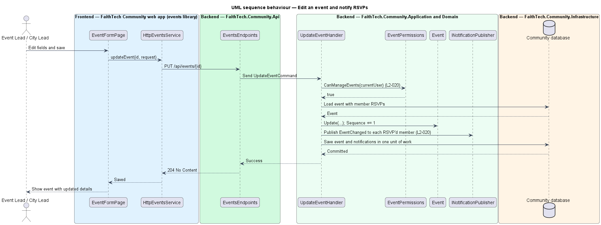

# Create and edit events

## Overview

FaithTech Community is a community site for FaithTech staff, leads, volunteers, builders, event attendees and partners. An *event* is a dated gathering, held in person or online, that members can attend. Data is global, so every event is visible across cities, subject to its visibility.

This feature covers authoring an event: creating a new one and editing an existing one. It belongs to the events subsystem, which also covers listing, RSVP, public pages, calendar export and cancellation.

Key terms:

- **event type** — category of an event: `Gathering`, `BuildersNight`, `Hackathon`, `PrayerAndPlanning` or `Panel`; hackathon teams, projects and judging are out of scope for v1
- **format** — whether an event is held in person, at a venue, or online, at a link
- **visibility** — audience setting of an event, either members-only or public
- **event manager** — holder of the Event Lead, City Lead or System Admin role, the roles permitted to create, edit and cancel events

Only event managers may create or edit events. Editing an event notifies every member who RSVP'd that the event changed.

## Description

The slice runs from the event form page to the database.

- **`EventFormPage`** — routed page in the `events` feature library (mock: `docs/mocks/pages/event-form/`). It hosts the create and edit form, shows inline validation errors and a busy state while saving. It composes form fields, date-time inputs and buttons from the `components` library.
- **`EventsService` / `EVENTS_SERVICE`** — API client contract and injection token in the `api` library. `HttpEventsService` implements it with `createEvent(request)` and `updateEvent(id, request)`.
- **`EventsEndpoints`** — minimal API mapping in `FaithTech.Community.Api` for `POST /api/events` and `PUT /api/events/{id}`. Both require authentication and dispatch to the Application layer.
- **`CreateEventCommand` / `UpdateEventCommand`** — request objects carrying title, description, type, start, end, city, format, venue or link, optional capacity, and visibility.
- **`EventCommandValidator`** — validator that rejects an end before the start, an in-person event without a venue and an online event without a link (`L2-020`).
- **`CreateEventHandler` / `UpdateEventHandler`** — Application handlers. Each checks `EventPermissions.CanManageEvents` and returns 403 for any other role, then writes the `Event` entity. `UpdateEventHandler` increments `Event.Sequence` and raises an `EventChanged` notification for each member RSVP.
- **`Event`** — Domain entity holding the event state; `Update(...)` applies edits and increments `Sequence` for calendar export (`L2-024`). The constructor and `Update` reject a blank title or city, an end before the start, an in-person event without a venue, an online event without a link and a capacity below 1, so an invalid edit changes nothing.
- **`EventPermissions`** — Application service that reads roles from `ICurrentUser`.
- **`INotificationPublisher`** — Application contract from the notifications subsystem that records in-app notifications. Its implementation lives in Infrastructure.
- **`CommunityDbContext`** — EF Core context in Infrastructure that persists events and RSVPs.

The city is free text, trimmed; the events list offers every city that has an event as its filter.

## Requirements

The feature realizes the following level-2 (L2) requirements. Each L2 requirement refines a level-1 (L1) requirement, cited by identifier.

| L2 ID | Refines (L1) | Requirement |
|-------|--------------|-------------|
| `L2-020` | `L1-008` | Create and edit events |

### Acceptance criteria

**`L2-020` — Create and edit events**

1. Given an Event Lead, City Lead or System Admin, when they create an event with a title, description, type (Gathering, Builders night, Hackathon, Prayer & planning or Panel), start and end, city, an in-person or online flag, a venue or link, an optional capacity, and members-only or public visibility, then the event is saved.
2. Given an end before the start, an in-person event with no venue, or an online event with no link, when the form is saved, then inline errors are shown.
3. Given any other role, when it calls the create or edit API, then the response is 403.
4. Given an event, when it is edited, then everyone who RSVP'd receives an in-app notification of the change.
5. Given an event at capacity, when anyone tries to RSVP, then the RSVP is refused with a "this event is full" message.

## Diagrams

### System context

Event managers author events in FaithTech Community. Members who RSVP'd receive change notifications in the app.

### Containers

The `EventFormPage` in the web app calls the Community API with a bearer token. The API persists events in the Community database.

### Components

`EventsEndpoints` dispatches commands to the handlers. The handlers validate input, authorize the caller through `EventPermissions`, write the `Event`, and publish change notifications.

### Class structure

`UpdateEventCommand` extends `CreateEventCommand` with the target identifier. Both handlers depend on `EventPermissions`; `UpdateEventHandler` also depends on `INotificationPublisher`. `Event` composes its `Rsvp` records.

### Behaviour — create an event

The validator rejects invalid date order, venue and link combinations before the handler writes anything. Callers without an event manager role receive 403 (`L2-020`).

### Behaviour — edit an event and notify RSVPs

An edit increments the event's `Sequence` and records an in-app notification for every member who RSVP'd, in the same unit of work (`L2-020`).

## Open questions

Decisions recorded while building the Domain layer (`FaithTech.Community.Domain`):

- Event types follow `L2-020`: Gathering, Builders night, Hackathon, Prayer & planning and Panel, replacing the earlier `Standard`/`Hackathon` pair. Resolved.
- Capacity: `L2-020` AC1 and AC5 define an optional capacity; `Event.Capacity` is nullable and `Event.IsFull` refuses RSVPs at capacity. Resolved.
- Domain rule violations throw `InvalidOperationException` (a broken rule) or `ArgumentException` (invalid input); there is no shared domain exception type. Handlers check permissions and preconditions first and map any remaining violation to a `400` or `409` result.

Decisions recorded while building the slice:

- The endpoints run `SaveEventValidator` (one validator for `SaveEventCommand`, used by create and edit) before the handler, so an invalid request is 400 for anyone signed in; a valid request from a role that may not manage events is 403. The validator's words are the form's inline errors: "The end time must be after the start time.", "Enter a venue address, or choose Online.", "Enter the joining link, or choose In person.", "Give the event a title people will recognise.", "Enter the city the event is in." and "Capacity must be at least 1, or leave it empty for no limit.". A joining link must be an `http` or `https` address.
- The venue is kept only for in-person events and the link only for online ones. On the form, choosing Online swaps the Venue address field for a Joining link field.
- `POST /api/events` answers 201 with `{ id }` and the event's location; `PUT /api/events/{id}` answers 204, 404 for an unknown event and 409 for a cancelled one. `GET /api/events/{id}` returns `EventDetailDto` (every field, RSVP count, cancelled state and `canManage`) for any signed-in member; the edit form loads from it, and the RSVP slice extends it.
- `INotificationPublisher` is the notifications subsystem's seam: `DbNotificationPublisher` adds a `Notification` row to the unit of work, which the bell will read when the notifications feature is built. Members are not notified of their own edit (ADR 0011). The "event changed" email of `L2-028` arrives with the notifications feature.
- A System Admin who holds neither Event Lead nor City Lead is acting on admin authority, so their create and edit are audited (`event.created`, `event.updated`).
