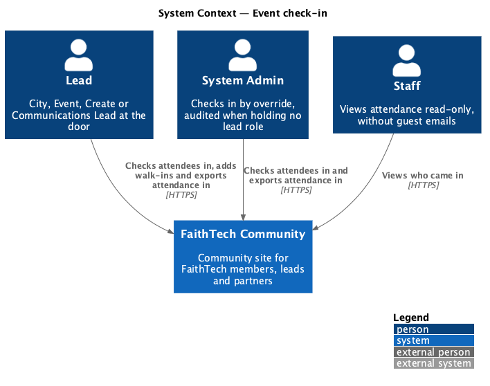
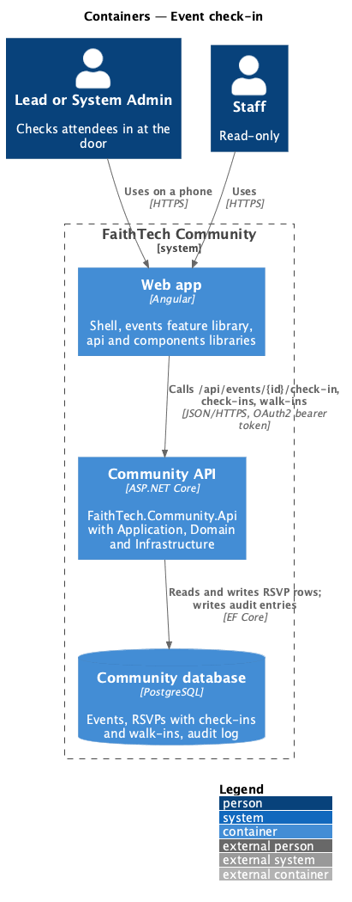
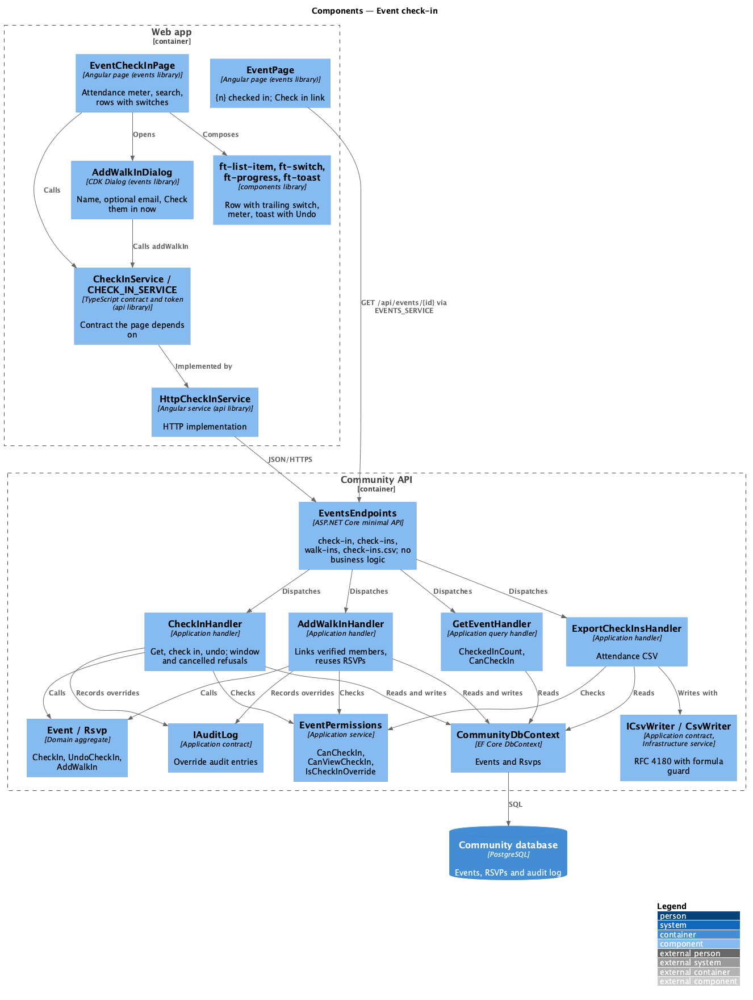
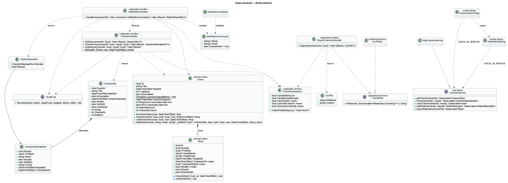
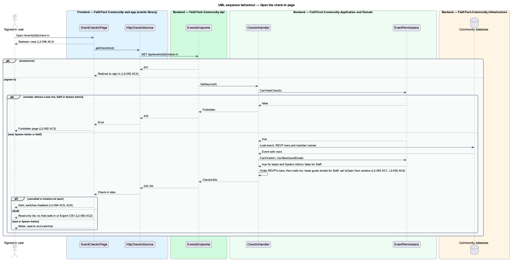
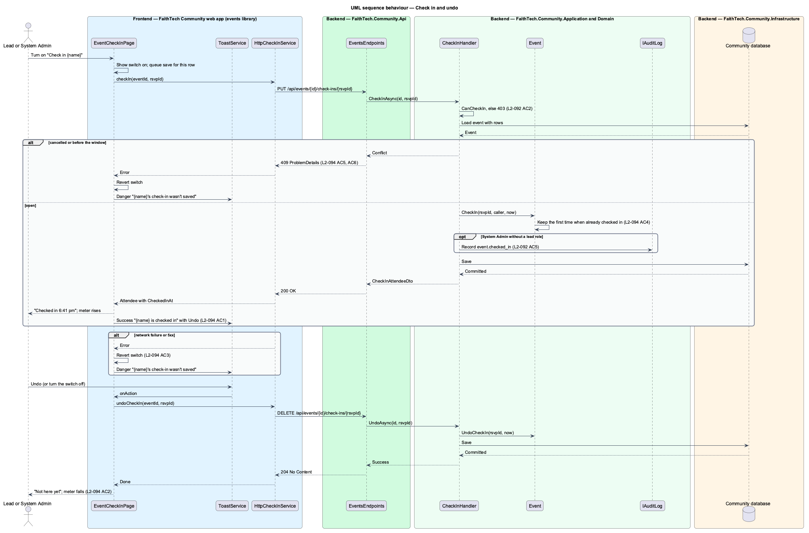
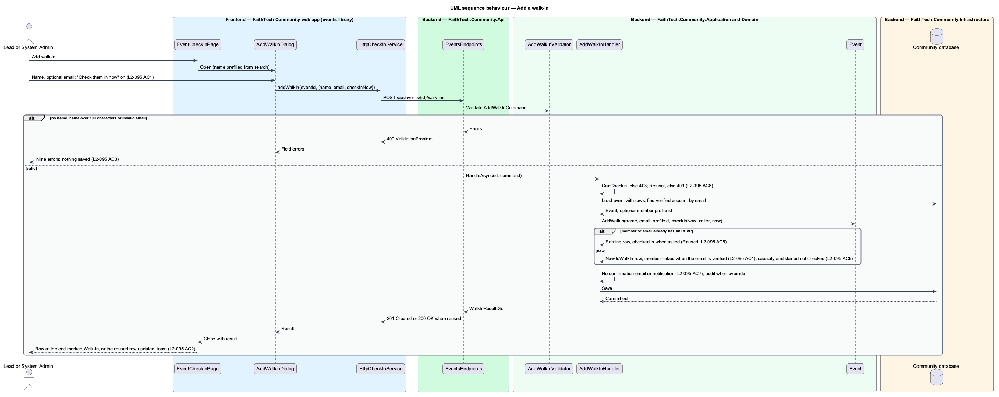
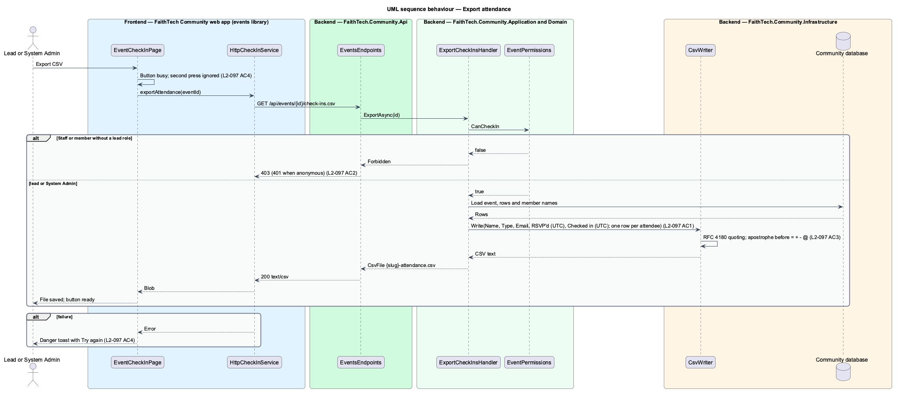

# Event check-in

## Overview

*Check-in* records who actually came to an event. At the door, a lead opens the event's check-in page on a phone, finds each attendee and turns on the switch beside their name. People who turn up without an RSVP are added as *walk-ins*. After the event, the lead exports the attendance as CSV, and the event page and Reports show how many came.

Key terms:

- **attendee** — anyone on the check-in list: a member or guest who RSVP'd ([RSVP](../rsvp/README.md), [public events and guest RSVP](../public-events-and-guest-rsvp/README.md)), or a walk-in
- **check-in** — the time an attendee was marked present and who marked them, stored on their RSVP row
- **walk-in** — an RSVP row created at the door by a lead; it skips the capacity and has-started rules that close RSVPs, its email is optional, and it sends no confirmation
- **check-in window** — check-in opens 24 hours before the event starts and does not close; a cancelled event has no window
- **lead roles** — City Lead, Event Lead, Create Lead and Communications Lead (`LeadRoles`, ADR 0014)
- **admin override** — a System Admin without a lead role writing a check-in; each such write is audited (`L2-041`)

Lead roles and System Admin check attendees in, undo, add walk-ins and export. Staff open the same page read-only and never see guest emails, matching the RSVP list rule (`L2-022` AC4). Other members get `403` and the forbidden page; anonymous visitors get `401` and sign in.

The check-in is stored on the `Rsvp` row rather than in a separate table ([ADR 0029](../../../adr/0029-check-in-storage-on-the-rsvp.md)). One row per attendee carries both "said they would come" and "came", so the check-in list, the attendance export and the Reports check-in rate (`L2-125`) read one table.

## Description

The slice runs from the check-in page in the `events` feature library to the `Rsvps` table.

### Domain (`QuinntyneBrown.Community.Domain/Events/`)

- **`Rsvp`** gains:
  - `DateTimeOffset? CheckedInAt` and `Guid? CheckedInById` (the profile that checked them in), both null until checked in;
  - `bool IsWalkIn`, false for every existing and every RSVP'd row;
  - `bool IsCheckedIn => CheckedInAt is not null`;
  - `internal void CheckIn(Guid byId, DateTimeOffset at)`, which keeps the original time and person when already checked in (`L2-119` AC4);
  - `internal void UndoCheckIn()`, which clears both fields.
  The internal constructor gains `isWalkIn`. `GuestEmail` stays nullable; only `Event.GuestRsvp` requires it.
- **`Event`** gains:
  - `static readonly TimeSpan CheckInOpensBefore = TimeSpan.FromHours(24)` and `DateTimeOffset CheckInOpensAt => StartsAt - CheckInOpensBefore`;
  - `bool IsCheckInOpen(DateTimeOffset now) => !IsCancelled && now >= CheckInOpensAt`;
  - `int CheckedInCount` and `int AttendeeCount` (every row, walk-ins included);
  - `Rsvp CheckIn(Guid rsvpId, Guid byId, DateTimeOffset now)` and `Rsvp UndoCheckIn(Guid rsvpId, DateTimeOffset now)`, which throw `InvalidOperationException` when the event is cancelled, when `now` is before `CheckInOpensAt`, or when the RSVP is not on this event;
  - `(Rsvp Rsvp, bool Reused) AddWalkIn(string name, string? email, Guid? profileId, bool checkInNow, Guid byId, DateTimeOffset now)`. It enforces the cancelled and window rules but not capacity or has-started (`L2-120` AC6). It reuses an existing row when `profileId` matches a member RSVP or `email` matches a guest RSVP case-insensitively (`L2-120` AC5); a reused row keeps `IsWalkIn = false`. Otherwise it adds a row with `IsWalkIn = true`: a member row (`ProfileId`, no guest name or email) when `profileId` is set, else a guest row with the trimmed name and optional email. It checks the row in when `checkInNow` is true.
  - `RsvpCount` and `IsFull` now count rows that are not walk-ins. Walk-ins did not RSVP and skip capacity, so the event list, the event page count and the public page are unchanged by check-in (`L2-121` AC3).

### Persistence (`QuinntyneBrown.Community.Infrastructure`)

- `CommunityDbContext` maps `CheckedInAt` (`timestamptz`, null), `CheckedInById` (`uuid`, null, no foreign key, like `CancelledById`) and `IsWalkIn` (`boolean`, not null, default `false`) on `Rsvps`. `GuestEmail` is already nullable in the schema; no column change is needed for email-less walk-ins.
- Migration `Infrastructure/Persistence/Migrations/{timestamp}_EventCheckIn.cs` adds the three columns. Existing rows become not-walk-in and not checked in. The Cli project applies it; the API never does.
- The existing indexes (`EventId, ProfileId` unique for members, `EventId, GuestEmail`) serve the walk-in reuse lookups. Reports adds its own index on `Rsvp.EventId` if needed (`L2-129`).

### Application (`QuinntyneBrown.Community.Application/Events/`)

- **`EventPermissions`** gains:
  - `CanCheckIn` — a lead role or System Admin (the same set as `CanSeeGuestEmails`);
  - `CanViewCheckIn` — `CanCheckIn` or Staff (the same set as `CanSeeRsvpList`);
  - `IsCheckInOverride` — System Admin holding no lead role. The existing `IsAdminOverride` checks only Event and City Lead, because only they manage events; check-in is open to every lead role, so it needs its own rule.
- **`CheckInHandler`** (`CheckIn.cs`):
  - `GetAsync(eventId)` returns `Result.Forbidden()` unless `CanViewCheckIn`, `NotFound` for an unknown event, else `CheckInDto` (`L2-117` AC6, `L2-118` AC1). Attendees are ordered by `CreatedAt` with walk-ins after every RSVP'd row. Guest emails are filled in only when `CanSeeGuestEmails`.
  - `CheckInAsync(eventId, rsvpId)` and `UndoAsync(eventId, rsvpId)` return `Forbidden` unless `CanCheckIn`, `NotFound` for an unknown event or an RSVP on another event, and `Conflict` from `Refusal(e, now)` before calling the domain (`L2-119` AC5, AC6). When `IsCheckInOverride`, each write records an audit entry (`event.checked_in` or `event.check_in_undone`, target `Event`, with the RSVP id and name, `L2-117` AC5). The check-in answers the updated `CheckInAttendeeDto`, so the row shows the server's time.
  - `static string? Refusal(Event e, DateTimeOffset now)` returns `"This event was cancelled."` or `"Check-in hasn't opened yet."`; the opening conflict carries an `opensAt` extension through `Result.Conflict(detail, extensions)`.
- **`AddWalkInCommand`** (`Name`, `Email`, `CheckInNow = true`), **`AddWalkInValidator`** and **`AddWalkInHandler`** (`WalkIns.cs`):
  - The validator requires a name ("Enter their name so the list shows who came."), at most 100 characters after trimming ("Use 100 characters or fewer for the name."), and an optional well-formed email of at most 256 characters ("Enter an email like name@example.com, or leave it empty.") (`L2-120` AC3).
  - The handler returns `Forbidden` unless `CanCheckIn` (Staff `403`, `L2-120` AC8) and `Conflict` from `CheckInHandler.Refusal`. It looks up a verified account by email (`db.Users` where `EmailConfirmed` and `NormalizedEmail` equals the upper-cased email, as `ContactViews.MatchAsync` does) and passes its `ProfileId` to `Event.AddWalkIn` (`L2-120` AC4). It sends no RSVP confirmation and publishes no notification (`L2-120` AC7). An override is audited as `event.walk_in_added`.
  - It answers `WalkInResultDto` with the attendee and `Reused`.
- **`ExportCheckInsHandler`** (`ExportCheckIns.cs`) returns `Forbidden` unless `CanCheckIn` (Staff `403`, `L2-122` AC2) and builds `CsvFile("{event-slug}-attendance.csv", ...)` through `ICsvWriter` with the header `Name, Type, Email, RSVP'd (UTC), Checked in (UTC)`. Type is `Walk-in` for a walk-in, else `Member` or `Guest`. Email is the guest email; members have none. Times use `yyyy-MM-dd HH:mm`; an attendee not checked in leaves the last cell empty (`L2-122` AC1).
- **`GetEventHandler`** — `EventDetailDto` gains `int? CheckedInCount` (set when `CanSeeRsvpList`, else null), `bool CanCheckIn` and `bool CanViewCheckIn`. Its `Rsvps` list leaves walk-ins out, keeping the RSVP list as it was (`L2-022`).
- **`ListEventsHandler`** — the list's count projects `e.Rsvps.Count(r => !r.IsWalkIn)`.
- **`RsvpHandler.ExportAsync`** — leaves walk-ins out and writes through `ICsvWriter`; see below.

DTOs (records in `CheckIn.cs`):

- `CheckInDto(Guid EventId, string Title, DateTimeOffset StartsAt, string City, string Format, string? Venue, bool IsCancelled, string? CancellationReason, DateTimeOffset CheckInOpensAt, bool IsOpen, bool CanEdit, bool CanExport, int Going, int CheckedIn, int WalkIns, IReadOnlyList<CheckInAttendeeDto> Attendees)` — `Going` counts every attendee, walk-ins included, so "36 of 36" reads true when everyone is in.
- `CheckInAttendeeDto(Guid RsvpId, Guid? ProfileId, string Name, bool IsGuest, bool IsWalkIn, string? Email, DateTimeOffset RsvpedAt, DateTimeOffset? CheckedInAt)`.
- `WalkInResultDto(CheckInAttendeeDto Attendee, bool Reused)`.

### CSV writing (`Application/Common/ICsvWriter.cs`, `Infrastructure/Csv/CsvWriter.cs`)

- **`ICsvWriter`** — `string Write(IEnumerable<IReadOnlyList<string?>> rows)`; the header is the first row. It is shared with the Reports export (`L2-128`, `docs/detailed-designs/reports/reports-dashboard/`), which writes its sections as consecutive rows through the same method.
- **`CsvWriter`** — writes RFC 4180 CSV: CRLF line ends; a cell holding a comma, a double quote, CR or LF is quoted with inner quotes doubled; a null cell is empty. A cell starting with `=`, `+`, `-` or `@` is prefixed with an apostrophe so spreadsheets do not run it (`L2-122` AC3). Registered as a singleton in `Infrastructure/DependencyInjection.cs`.
- `RsvpHandler.ExportAsync` already applies these exact rules in a private `Cell` method. It moves to `ICsvWriter` as a refactoring step with `RsvpTests` green, so the RSVP export's bytes do not change. `CsvFile` stays in `Rsvps.cs`.

### API (`QuinntyneBrown.Community.Api/Endpoints/EventsEndpoints.cs`)

| Method and route | Handler | Answers |
|------------------|---------|---------|
| `GET /api/events/{id}/check-in` | `CheckInHandler.GetAsync` | `200` `CheckInDto`, `401`, `403`, `404` |
| `PUT /api/events/{id}/check-ins/{rsvpId}` | `CheckInHandler.CheckInAsync` | `200` `CheckInAttendeeDto`, `401`, `403`, `404`, `409` |
| `DELETE /api/events/{id}/check-ins/{rsvpId}` | `CheckInHandler.UndoAsync` | `204`, `401`, `403`, `404`, `409` |
| `POST /api/events/{id}/walk-ins` | `AddWalkInHandler` | `201` new or `200` reused `WalkInResultDto`, `400`, `401`, `403`, `404`, `409` |
| `GET /api/events/{id}/check-ins.csv` | `ExportCheckInsHandler` | `200` `text/csv`, `401`, `403`, `404` |

Every route requires authentication (the default), so an anonymous caller gets `401` (`L2-117` AC4, `L2-122` AC2). `POST /walk-ins` runs the `Validate<AddWalkInCommand>()` filter. The endpoints hold no business logic.

### Frontend `api` library (`api/src/lib/events/`)

- **`CheckInService`** / **`CHECK_IN_SERVICE`** (`check-in.service.ts`) — `getCheckIn(eventId)`, `checkIn(eventId, rsvpId)`, `undoCheckIn(eventId, rsvpId)`, `addWalkIn(eventId, request: WalkInRequest)` and `exportAttendance(eventId): Observable<Blob>`, with the `CheckInDto`, `CheckInAttendeeDto`, `WalkInRequest` and `WalkInResultDto` interfaces. A separate contract keeps `EventsService` from growing further, follows the precedent of several services in one folder (`admin`, `agile`), and matches the token named in the decisions brief.
- **`HttpCheckInService`** (`http-check-in.service.ts`) — HTTP implementation, provided in `provide-api.ts`.
- **`EventDetailDto`** (`events.service.ts`) gains `checkedInCount: number | null`, `canCheckIn` and `canViewCheckIn`.

### Frontend `events` library

- **`EventCheckInPage`** (`pages/event-check-in/`, route `:id/check-in`, title "Check-in"; mocks `docs/mocks/pages/event-check-in/*`). It composes:
  - `ft-breadcrumb` (Events, event title, Check-in) and `ft-page-header` "Check-in · {title}" with the date, time and venue, plus "Add walk-in" (primary) and "Export CSV" (ghost, `loading` while downloading, with a danger toast and "Try again" on failure, `L2-122` AC4) when `canEdit`/`canExport` (`L2-117` AC2);
  - an `ft-card` with `ft-progress` as the attendance meter: leading label "Checked in", value `checkedIn`, max `going`, caption "{n} of {total}", `aria-label` "{n} of {total} checked in"; it turns to the complete variant when everyone is in;
  - an `ft-alert` when the event is cancelled ("This event was cancelled, so no one can be checked in", danger, `polite`) or the window has not opened ("Check-in opens {day} at {time}, 24 hours before the event.", info), with every switch disabled (`L2-119` AC5, AC6);
  - a search form (`role="search"`) with `ft-text-field type="search"` labelled "Find an attendee", filtering on each input event by name, or name or email, case-insensitively (`L2-118` AC2);
  - `ft-list` of `ft-list-item` rows: `ft-avatar` leading, the name as label, meta "Member", "Guest · {email}" or "Walk-in", then "Checked in {time}" or "Not here yet"; `ft-switch` trailing, bound with `[ngModel]`, `[disabled]` when not `canEdit` or not open, and a visually hidden label "Check in {name}" (`L2-118` AC5, AC6);
  - `ft-empty-state` for no RSVPs ("Nobody has RSVP'd yet", with "Add walk-in" for leads, `L2-118` AC4), for no matches ("Nobody called “{term}” has RSVP'd", with "Add “{term}” as a walk-in" and "Clear search", `L2-118` AC3), and a success `ft-alert` "Everyone's here" naming the walk-in count, with no promise of a follow-up email (`L2-119` AC7);
  - `ft-list-skeleton` while loading, `ft-empty-state` with "Try again" and "Back to the event" on error, `ft-error-page` on `403` and the not-found page on `404` (`L2-121` AC4, `L2-117` AC3).
  Toggling a switch updates the row at once and sends `checkIn` or `undoCheckIn`. Saves for one row run in order (a promise chain per RSVP id); both endpoints are idempotent, so repeats are harmless. On success the row takes the server's time and a success toast says "{name} is checked in" with "{time} · {n} of {total} here." and an "Undo" action (`ToastService.show({ actionLabel, onAction })`, `L2-119` AC1, AC2). On failure the switch returns to its previous state and a danger toast says "Couldn’t save {name}’s check-in. Try again." with "The switch is back {on|off}; nothing was saved." and a *Try again* action (`L2-119` AC3). Times are shown in the browser's time zone with the date helpers in `components` (`format/dates.ts`).
- **`AddWalkInDialog`** (`dialogs/add-walk-in/`, mock `docs/mocks/dialogs/check-in-walk-in/*`) — `ft-dialog` opened through the CDK `DialogService` with title "Add a walk-in", a required name (prefilled from the search term when opened from no results), an optional email with the help "A member's email links the check-in to their profile.", and an `ft-switch` "Check them in now" on by default, described by "Adds them to the attendance list as present." (its `description` input, joined with `aria-describedby`). The primary button reads "Add and check in", or "Add walk-in" when the switch is off. It shows inline errors and an error summary for `400` (`invalid`), a busy button (`busy`) and a danger alert "Walk-in not added" with "Try again" on failure (`failed`). It closes with the `WalkInResultDto`; the page appends a new row or updates a reused one and toasts "{name} is checked in" or "{name} already RSVP'd and is checked in".
- **`EventPage`** — shows "{n} checked in" beside the RSVP count when `checkedInCount > 0` (`L2-121` AC1, AC2), and a "Check in" button when `canCheckIn`, or a "View check-in" link when only `canViewCheckIn` (Staff).
- **`EVENTS_ROUTES`** gains `{ path: ':id/check-in', component: EventCheckInPage, title: 'Check-in' }`.

### Components (`frontend/projects/components/`)

The page composes existing components. Three need small extensions, made in `components` first:

- **`ft-switch`** — a `labelHidden` input that keeps the projected text as the accessible name but hides it visually, for a switch trailing a list row. The row height already meets `--target-min`, above the 24x24 CSS pixel minimum (`L2-118` AC5). A `description` input shows a caption under the switch, outside the label, joined to it with `aria-describedby` (the walk-in dialog).
- **`ft-progress`** — a `heading` input for a leading label ("Checked in"). The complete variant already exists.
- **`ft-list-item`** — no change: its `[trailing]` slot holds the switch. No separate "check-in row" component is needed.

`ft-toast` with an action, `ft-alert`, `ft-empty-state`, `ft-list-skeleton`, `ft-error-page`, `ft-dialog`, `ft-text-field`, `ft-avatar`, `ft-button` and `ft-breadcrumb` exist and are used unchanged.

### Fake backend (`e2e/fixtures/mock-events.ts`)

- `MockRsvp` gains `checkedInAt`, `checkedInById` and `isWalkIn`; `EventsProfile` gains an optional verified `email` so walk-ins can link to members.
- `MockEvents.handle` answers the five routes above with the same permission, window, reuse and validation rules, and adds `checkedInCount`, `canCheckIn` and `canViewCheckIn` to the event detail. Counts and the RSVP list leave walk-ins out, as the server does.
- `failNextCheckIn()` makes the next check-in write answer `500`, to drive the revert and danger toast.
- `attendanceCsv(eventId)` returns what the export wrote, for assertions.

### Tests

- `backend/tests/QuinntyneBrown.Community.Application.Tests/Domain/Events/EventCheckInTests.cs` — check in keeps the first time; undo clears; cancelled and early writes throw; walk-ins skip capacity and has-started; reuse by member and by guest email; `RsvpCount` and `IsFull` ignore walk-ins.
- `backend/tests/QuinntyneBrown.Community.Api.Tests/Events/CheckInTests.cs`, `WalkInTests.cs` and `CheckInExportTests.cs` — every role (each lead role, System Admin with and without a lead role, Staff, member, anonymous) against every route; Staff see no emails; `409` for cancelled and early; the audit entry for an override; walk-in linking, reuse, validation and no confirmation email; CSV columns, quoting and the formula guard.
- `backend/tests/QuinntyneBrown.Community.Infrastructure.Tests/Csv/CsvWriterTests.cs` — quoting, doubled quotes, line breaks, nulls and the four guarded prefixes. The existing `RsvpTests` prove the RSVP export is unchanged.
- `e2e/tests/events/check-in.spec.ts` and `walk-ins.spec.ts`, with page objects `e2e/pages/event-check-in.page.ts` and `e2e/pages/add-walk-in.dialog.ts` and additions to `e2e/pages/event.page.ts` — access per role, list order, search, check in and undo with toast, failed save, cancelled and not-open states, everyone's here, empty, no results, loading and error, walk-in dialog states, export, the event page count, the XS layout and an axe check on each state.

## Requirements

The feature realizes the following level-2 (L2) requirements. Each refines a level-1 (L1) requirement, cited by identifier.

| L2 ID | Refines (L1) | Requirement |
|-------|--------------|-------------|
| `L2-117` | `L1-008` | Check-in access. Check-in at the door is on `/events/{id}/check-in` and stores the check-in on the RSVP (ADR 0029). |
| `L2-118` | `L1-008` | Check-in list and search |
| `L2-119` | `L1-008` | Check in and undo |
| `L2-120` | `L1-008` | Add a walk-in |
| `L2-121` | `L1-008` | Attendance on the event page and check-in states |
| `L2-122` | `L1-008` | Export attendance |

### Acceptance criteria

**`L2-117` — Check-in access**

1. Given a City Lead, Event Lead, Create Lead, Communications Lead or System Admin, when they open an event, then it offers "Check in", and the check-in page lets them check attendees in, undo and add walk-ins.
2. Given Staff, when they open the check-in page, then they see the attendees and counts read-only: the switches are disabled, "Add walk-in" and "Export CSV" are not shown, guest emails are not shown (`L2-022` AC4), and every check-in write answers 403.
3. Given a signed-in member without one of those roles, Staff or System Admin, when they open the check-in page or call a check-in endpoint, then the response is 403 and the forbidden page is shown (`L2-048` AC2).
4. Given an anonymous visitor, when they open the check-in page or call a check-in endpoint, then the response is 401 and they are sent to sign in.
5. Given a System Admin without a lead role, when they check in, undo or add a walk-in, then each write is recorded in the audit log (`L2-041`).
6. Given `GET /api/events/{id}/check-in`, when it answers, then it carries whether the caller can edit, and guest emails only for callers who may see them.

**`L2-118` — Check-in list and search**

1. Given an event with RSVPs, when the check-in page loads, then it lists every member and guest who RSVP'd, in RSVP order, then walk-ins in the order they were added, with the event's title, date, and counts of going and checked in.
2. Given a search term, when the lead types, then the list narrows to attendees whose name or email contains it, case-insensitively, without pressing a button; Staff match on name only.
3. Given a search with no matches, when the list is shown, then it says no one matches and offers "Add walk-in" to leads.
4. Given an event with no RSVPs, when the page loads, then an empty state says no one has RSVP'd yet and offers "Add walk-in" to leads.
5. Given an XS viewport, when the check-in page is shown, then each attendee is one row with the name and a trailing switch with a touch target of at least 24x24 CSS pixels, the search stays at the top, and there is no horizontal page scroll (`L2-045` AC1).
6. Given a keyboard or screen-reader user, when they reach a switch, then it is labelled "Check in {name}" and announces whether it is on.

**`L2-119` — Check in and undo**

1. Given a lead or System Admin, when they turn on an attendee's switch, then `PUT /api/events/{id}/check-ins/{rsvpId}` saves the check-in at once with the time and who checked them in, the row shows "Checked in {time}" (for example "Checked in 6:41 pm"), the checked-in count rises, and a success toast offers "Undo" (`L2-054` AC2).
2. Given a checked-in attendee, when the lead turns the switch off or chooses "Undo", then `DELETE /api/events/{id}/check-ins/{rsvpId}` clears the check-in, the time is removed and the count falls.
3. Given a check-in or undo that fails to save, when the API answers with an error or cannot be reached, then the switch returns to its previous state and a danger toast says it was not saved.
4. Given an attendee already checked in, when the check-in is saved again, then the original time is kept.
5. Given a cancelled event (`L2-025`), when a lead opens its check-in page, then it says the event is cancelled and the switches are disabled, and any check-in write answers 409.
6. Given an event that starts more than 24 hours from now, when a lead tries to check someone in, then the response is 409, the switches are disabled, and the page says when check-in opens ("Check-in opens {day} at {time}, 24 hours before the event.").
7. Given every attendee is checked in, when the list renders, then it shows "Everyone's here", without promising any follow-up email.

**`L2-120` — Add a walk-in**

1. Given a lead or System Admin on the check-in page, when they choose "Add walk-in", then a dialog asks for a name (required) and an optional email, with "Check them in now" on by default.
2. Given a name, when the lead saves, then `POST /api/events/{id}/walk-ins` adds the walk-in to the end of the list marked as a walk-in, checked in with the time when "Check them in now" is on, and not checked in when it is off.
3. Given no name, a name over 100 characters after trimming, or an invalid email, when the lead saves, then the field shows an inline error and nothing is saved.
4. Given an email that belongs to a verified member's account, when the walk-in is saved, then the row is linked to that member's profile and shows as a member, not a guest.
5. Given the member or email already has an RSVP for the event, when the walk-in is saved, then that RSVP is reused, and checked in when "Check them in now" is on, rather than a second row being created.
6. Given an event at capacity (`L2-020` AC5) or one that has started, when a walk-in is added, then it is still added: walk-ins skip the capacity and has-started rules.
7. Given a walk-in is added, when it is saved, then no RSVP confirmation email is sent (`L2-022` AC1), and the walk-in is left out of the Reports RSVPs figure and check-in rate (`L2-125` AC3).
8. Given Staff or a cancelled event, when a walk-in is submitted, then the response is 403 or 409 respectively.

**`L2-121` — Attendance on the event page and check-in states**

1. Given an event with at least one check-in, when a lead, Staff or System Admin opens the event page, then "{n} checked in" is shown beside the RSVP count.
2. Given an event with no check-ins, or a member without those roles, when the event page is shown, then no check-in count is shown.
3. Given the event list (`L2-021`) and the public event page (`L2-023`), when they render, then they are unchanged by check-in.
4. Given the check-in page is loading, when data has not arrived, then skeleton rows are shown; when the load fails, then an error offers "Try again".
5. Given another lead checks someone in, when this lead reloads the page, then the check-in is shown.

**`L2-122` — Export attendance**

1. Given a lead or System Admin on the check-in page, when they choose "Export CSV", then `GET /api/events/{id}/check-ins.csv` downloads one row per attendee with name, type (Member, Guest or Walk-in), email, RSVP'd at and checked in at (empty when not checked in).
2. Given Staff, a member without a lead role, or an anonymous visitor, when they request the export, then the response is 403, or 401 for the anonymous visitor.
3. Given a cell that starts with `=`, `+`, `-` or `@`, when the CSV is written, then the cell is guarded so spreadsheets do not run it as a formula, and values are quoted per RFC 4180 (`L2-128` AC3).
4. Given an export in progress, when the file is being prepared, then "Export CSV" is busy and cannot be pressed again; when it fails, a danger toast offers "Try again".

## Diagrams

### System context

Leads and System Admins check attendees in at the door; Staff view attendance read-only. Check-in involves no external system: walk-ins receive no email.

### Containers

The check-in page in the web app calls the Community API, which reads and writes RSVP rows in the Community database.

### Components

`EventCheckInPage` and `AddWalkInDialog` depend on `CHECK_IN_SERVICE`. The three Application handlers share `EventPermissions` and the `Event` aggregate; the export writes through `ICsvWriter`, and overrides are audited through `IAuditLog`.

### Class structure

`Event` owns its `Rsvp` rows and enforces the check-in window and walk-in rules. The handlers return `CheckInDto`, `CheckInAttendeeDto` and `WalkInResultDto`.

### Behaviour — open the check-in page

The server decides who may open the page, whether they may edit and whether guest emails leave the API (`L2-117`, `L2-118`).

### Behaviour — check in and undo

The switch saves at once. A refused or failed save reverts the switch; a success offers Undo, which calls the same `DELETE` as turning the switch off (`L2-119`).

### Behaviour — add a walk-in

A verified member's email links the row to their profile, and an existing RSVP is reused rather than duplicated (`L2-120`).

### Behaviour — export attendance

Only lead roles and System Admin may export, because the file carries guest emails (`L2-122`).

## Open questions

Decisions recorded while designing the feature ([ADR 0029](../../../adr/0029-check-in-storage-on-the-rsvp.md)):

- **Walk-ins and RSVP counts.** `RsvpCount`, `IsFull`, the event list count, the event page's RSVP list and the RSVP CSV leave walk-ins out, so check-in changes none of them (`L2-121` AC3) and a walk-in never takes a seat that closes RSVPs. The check-in page's "going" counts every attendee, walk-ins included, as the `done` mock shows ("36 of 36"). `CallerHasRsvp` still sees a member's own walk-in row, so a member who walked in can cancel it like an RSVP.
- **Window for walk-ins.** Adding a walk-in obeys the same 24-hour window as a check-in, so a lead cannot add walk-ins days ahead. `L2-120` AC8 names only the cancelled `409`; the window `409` follows from `L2-119` AC6.
- **No closing time.** Check-in stays open after the event ends, so a lead can correct the record the next day.
- **Member emails.** Only guest emails appear on the page and in the CSV; a member row has no email, as on the RSVP list. Searching by email therefore finds guests only. A walk-in linked to a member uses the member's profile name, not the typed name.
- **CSV type column.** A walk-in reads `Walk-in` whether it is linked to a member or not; the type column has one value per row. The CSV has no "checked in by" column; `CheckedInById` is kept for the audit trail and future use.
- **Switch label.** `L2-118` AC6 says "Check in {name}"; the mocks and the design system's switch page say "Checked in: {name}". The requirement wins; the design system page should be updated.
- **Progress colour.** The `done` mock leaves the meter accent; the design system marks that as drift. The page uses the complete variant.
- **Mock "Showing 10 of 34".** The `checked-in` mock caption implies paging; `L2-118` AC1 lists every attendee. The page lists all rows with no paging; an event's RSVPs are small enough to filter in the browser.
- **Staff entry point.** The mocks show no way for Staff to reach the read-only page. The event page offers Staff a "View check-in" link. The `event-check-in/read-only`, `cancelled`, `save-failed` and `forbidden` mocks and `event/attendance` cover these states; a not-yet-open state is added as `event-check-in/not-open`.
- **Concurrency.** Two leads toggling the same row converge on the last write; `PUT` keeps the first time. A walk-in race on the same member is caught by the unique `(EventId, ProfileId)` index and answered `409`, after which the page reloads.
- **Event attendees as an announcement audience.** `SendAnnouncement` selects members by RSVP row, so a member walk-in now receives event announcements. That is left as is: they attended.
- **Walk-in without a check-in.** Neither the design nor the mocks name the toast for a walk-in added with *Check them in now* off. It reads "{name} is on the list" ("{name} already RSVP'd" when reused) with "Turn on their switch when they're here."
- **Walk-in linking in the fake.** The e2e fake looks verified members up by account email (`MockEvents`' `verifiedMember` callback) rather than adding an email to `EventsProfile`.
- **Forbidden and not found.** The page shows its own `forbidden` empty state ("Check-in is for event leads", as the mock and the screen composition say) rather than `ft-error-page`; the `403` carries no event, so the text says "Your RSVP is safe on the event page." without naming it. A `404` shows a "We couldn’t find that event" empty state with *Back to events* inside the page.
- **Event page attendance.** Following `event/attendance`, the Going fact reads "{n} people · {m} checked in", the RSVP card title "Going ({n}) · {m} checked in", and each RSVP row's meta "Checked in {time}" once checked in, so `RsvpDto` gains `CheckedInAt`. The "including {w} walk-ins" clause is left out: the event detail carries only `CheckedInCount`.
- **Not-open wording.** `L2-119` AC6 said "Check-in opens on {date}"; the page follows the `event-check-in/not-open` mock, "Check-in opens {day} at {time}, 24 hours before the event.", and the spec now quotes that line.
- **Mocks brought in line (2026-10-22).** The mocks now show the walk-in toast (`event-check-in/walk-in-added`), the in-page not-found state (`event-check-in/not-found`), the list caption without "Showing {n} of {total}" outside a search, the forbidden text without the event name, and the event page's Going fact without the walk-ins clause.
- **Not-open conflict detail.** The 409 detail is "Check-in hasn’t opened yet." with a typographic apostrophe, like the API's other messages.
- **CSV quoting and the RSVP export.** `CsvWriter` quotes every cell (not only cells holding a comma, quote or line break) and also guards cells starting with a tab or a carriage return, as agreed for the shared writer. Because of that, moving `RsvpHandler.ExportAsync` onto it would change the RSVP export's bytes (its header and plain cells are unquoted today, which `RsvpTests` assert), so the RSVP export keeps its own `Cell` method for now.
- **`ICsvWriter` signature.** Resolved: one `Write(rows)` method serves both exports; the Reports export writes its sections, separated by blank rows, through it.
