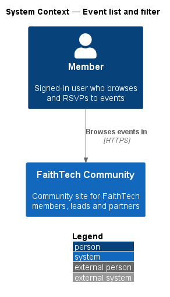
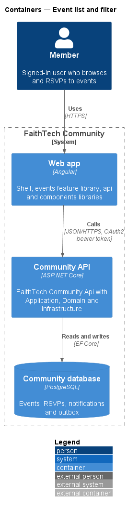
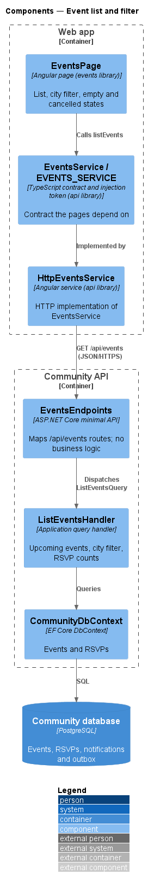
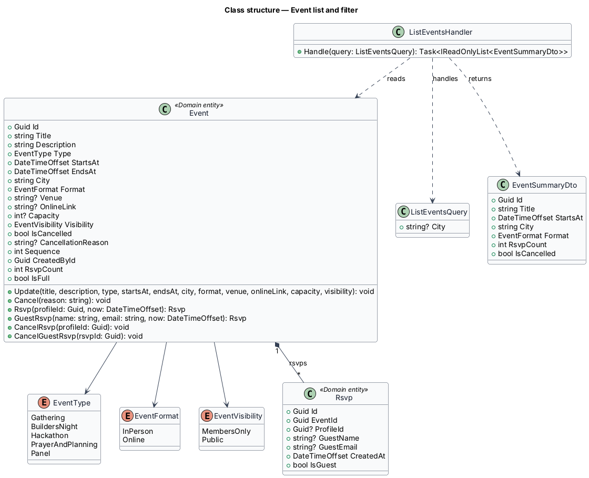
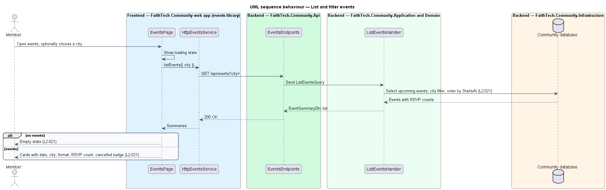

# Event list and filter

## Overview

FaithTech Community lists events for signed-in members. An *event* is a dated gathering, held in person or online, that members can attend. Data is global, so the list spans every city.

This feature covers the events list page: upcoming events in date order, filtered by city, with an empty state and a clear cancelled marker. It is the entry point to the rest of the events subsystem.

Key terms:

- **upcoming event** — event whose end time has not passed
- **RSVP count** — number of members and guests who have RSVP'd to an event
- **city filter** — list constraint that keeps only events held in the chosen city

## Description

- **`EventsPage`** — routed page in the `events` feature library (mock: `docs/mocks/pages/events/`). It renders the loading, empty, no-results and error states and the city filter, and lists event cards from the `components` library.
- **`EventsService` / `EVENTS_SERVICE`** — API client contract and token; `HttpEventsService.listEvents({ filter, city })` calls the API.
- **`EventsEndpoints`** — maps `GET /api/events?filter=&city=` with authentication required; an unknown filter is 400.
- **`ListEventsQuery`** — query carrying the chip filter (`Upcoming`, `Past`, `Hackathons`, `Online`; default `Upcoming`) and the optional city.
- **`ListEventsHandler`** — Application handler that selects upcoming events soonest first (past events newest first), applies the chip and city filters in the database, and projects each to `EventSummaryDto` with date, city, format, venue, visibility, RSVP count and cancelled flag.
- **`EventSummaryDto`** — read model returned to the page, inside `EventListDto { events, cities }`; `cities` lists every city that has an event, whatever the filters, for the city select.
- **`CommunityDbContext`** — EF Core context that reads events and RSVP counts.

The list is not paged in v1. Past events are reachable from this page through the Past chip.

## Requirements

The feature realizes the following level-2 (L2) requirements. Each L2 requirement refines a level-1 (L1) requirement, cited by identifier.

| L2 ID | Refines (L1) | Requirement |
|-------|--------------|-------------|
| `L2-021` | `L1-008` | Event list and filter |

### Acceptance criteria

**`L2-021` — Event list and filter**

1. Given a signed-in member, when they open events, then upcoming events are listed soonest first, with date, city, format and RSVP count.
2. Given a city filter, or one of the filters Upcoming, Past, Hackathons or Online, when it is applied, then only matching events are listed.
3. Given no matching events, when the list is shown, then an empty state is shown.
4. Given a cancelled event, when it is listed, then it is clearly marked as cancelled.

## Diagrams

### System context

Members browse events in FaithTech Community.

### Containers

The `EventsPage` calls the Community API, which reads events and RSVP counts from the Community database.

### Components

`EventsEndpoints` dispatches `ListEventsQuery` to `ListEventsHandler`, which projects events into summaries.

### Class structure

`ListEventsHandler` reads `Event` and its `Rsvp` records and returns `EventSummaryDto` rows.

### Behaviour — list and filter events

The handler orders upcoming events soonest first and applies the city filter on the server. The page shows an empty state when nothing matches and marks cancelled events (`L2-021`).

## Open questions

Decisions recorded while building the Domain layer (`FaithTech.Community.Domain`):

- `Event.RsvpCount` counts member and guest RSVPs; the list query computes the same count in the database.
- The chips are exclusive, like the team list's role chips: one is pressed at a time. Upcoming means the event has not ended, so an event in progress is still listed. Hackathons and Online list upcoming events only; Past lists ended events, newest first.
- The city filter compares trimmed city names without regard to case. Cities are a filter, never a permission boundary: every signed-in member sees every event, members-only or public.
- Each row's meta line is "date · time · city · venue or Online · N going" (`Fri 6 Nov · 6:30 pm · Toronto · Kestrel Labs, 220 King St W · 34 going`); events across several days show the day range (`Sat 14 – Sun 15 Nov`) and no time. Times are shown in the viewer's time zone. The mocks were aligned to carry the city and the RSVP count on every row. A cancelled event keeps its meta line and is marked by the Cancelled badge and the muted card.
- No-results states read "No upcoming events in {city}" (or "No past events", "No upcoming hackathons", "No upcoming online events"), with *Show all cities* when a city is chosen and *Show upcoming events* otherwise. *New event* shows only to Event Leads, City Leads and System Admins (`canManageEvents`).
