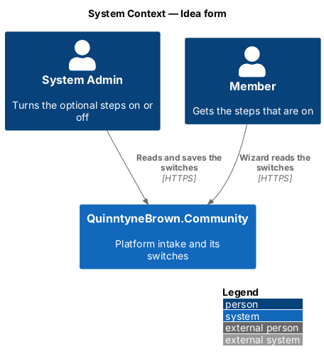
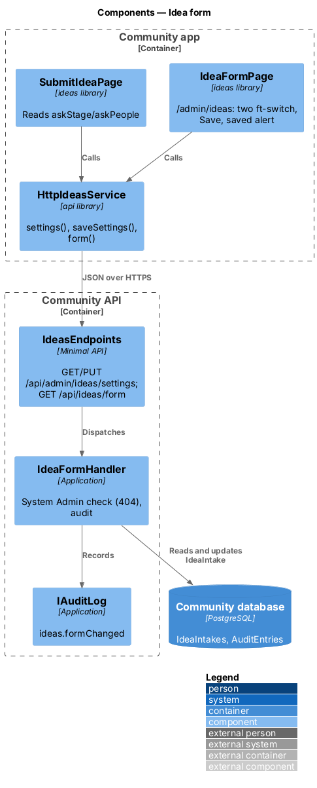
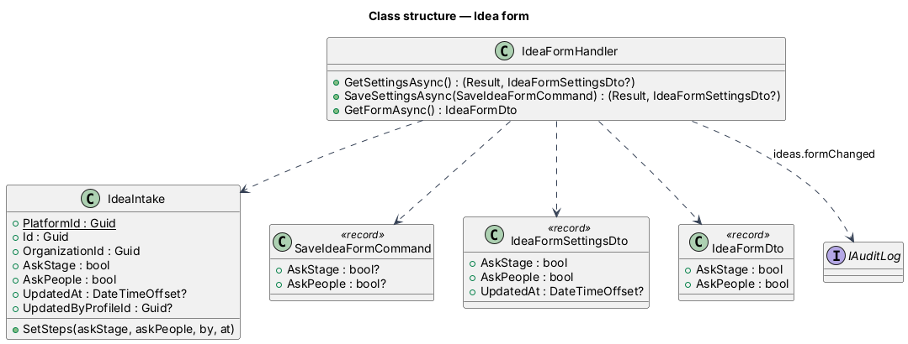
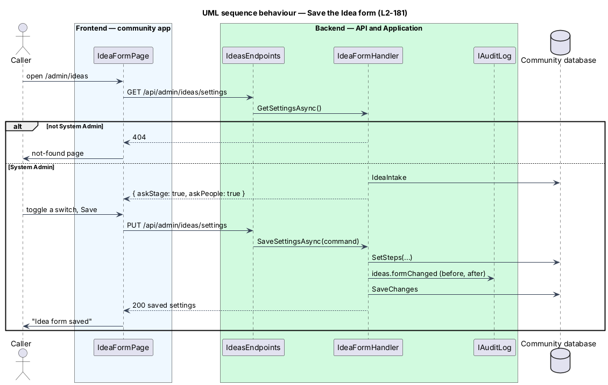

# Idea form

## Overview

The platform intake (`IdeaIntake`) owns every idea and holds the two switches that decide whether signed-in members are asked "How far along is it?" and "Who do you need?". System Admin turns them on or off on the Idea form page at `/admin/ideas`; both are on until someone turns them off. Anyone else gets not found. The wizard reads only the two booleans it needs ([ADR 0044](../../../adr/0044-ideas-platform-intake-and-anonymous-submit.md)).

- **intake** — the singleton row with a fixed id, the root organization's id and the switches
- **switch** — `AskStage` ("How far along is it?") or `AskPeople` ("Who do you need?")

## Description

### Domain and persistence

- **`IdeaIntake`** (`Domain/Ideas/IdeaIntake.cs`): `Id` (`IdeaIntake.PlatformId`, fixed), `OrganizationId`, `AskStage` and `AskPeople` (default `true`), `UpdatedAt?`, `UpdatedByProfileId?`; `SetSteps(askStage, askPeople, by, at)`.
- Table `IdeaIntakes`, created by the migration `Ideas`. **Seed** — `CommunitySeeder.SeedHierarchyAsync` adds the row for the portfolio's root organization (`HierarchySeed.TorontoId`) when it is missing, so `seed` and `reset` stay idempotent; it never changes an existing row's switches.

### Application (`Application/Ideas/IdeaForm.cs`)

**`IdeaFormHandler`** (`IApplicationDbContext`, `ICurrentUser`, `ProfileAccess`, `IAuditLog`, `TimeProvider`):

- `GetSettingsAsync()` — not System Admin → `NotFound`; no intake → `NotFound`; otherwise `IdeaFormSettingsDto(AskStage, AskPeople, UpdatedAt)`.
- `SaveSettingsAsync(SaveIdeaFormCommand(AskStage, AskPeople))` — not System Admin → `NotFound`; both values required (`400` keyed `askStage`/`askPeople` when missing); changes the row, records `ideas.formChanged` on target `IdeaIntake` with `{ AskStage, AskPeople }` before and after and the intake's organization, saves, returns the DTO. A save that changes nothing is still audited, because the admin pressed Save.
- `GetFormAsync()` — any signed-in caller → `IdeaFormDto(AskStage, AskPeople)`; no intake → both `false`.

### API (`Api/Endpoints/IdeasEndpoints.cs`)

| Method and path | Who | Answers |
|---|---|---|
| `GET /api/admin/ideas/settings` | System Admin | `200 { askStage, askPeople, updatedAt }`; anyone else `404` |
| `PUT /api/admin/ideas/settings` | System Admin | `200` with the saved settings; `400`; anyone else `404` |
| `GET /api/ideas/form` | any signed-in member | `200 { askStage, askPeople }`; anonymous `401` |

### Frontend

- **`api`** — `IdeasService.settings()`, `saveSettings({ askStage, askPeople })` and `form()` on `IDEAS_SERVICE`; the page shows its own failures (`HANDLES_SERVER_ERROR`), and a `404` goes to the not-found page.
- **`ideas` library** — `IdeaFormPage` (`IDEA_FORM_ROUTES`, mounted at `/admin/ideas` by the app shell before the `admin` routes). It composes `ft-breadcrumb` (Admin › Idea form), the page heading, `ft-tabs` (Users, Audit log, Idea form), an `ft-card` form with the "Optional steps" title and hint, two `ft-switch` controls and `ft-button` Save; on success an `ft-alert` "Idea form saved" (`role="status"`); on failure `TOAST_SERVICE` shows the app's error toast and the switches keep their last saved values. The `admin` library's Users and Audit log tabs gain the Idea form tab.

### E2E fake

`e2e/fixtures/mock-ideas.ts` holds the switches (default on), answers the three endpoints with the same `404` for non-System Admin roles, and records each save so specs assert the audit entry. Page object `e2e/pages/idea-form.page.ts`.

## Requirements

| L2 ID | Refines (L1) | Requirement |
|-------|--------------|-------------|
| `L2-171` | `L1-027` | The wizard's optional steps follow the saved switches. |
| `L2-181` | `L1-027` | System Admin reads and saves the two switches (default on), audited; everyone else gets 404. |

## Diagrams

### System context

Only System Admin changes the switches; members' wizards read them.

### Components

The Idea form page and the wizard call one handler through two endpoints with different access rules.

### Class structure

`IdeaFormHandler` reads and changes the singleton `IdeaIntake` and audits each save.

### Behaviour — save the switches

A System Admin's save is audited; anyone else is told the page does not exist.

## Open questions

- None. More switches (for example asking visitors the optional steps) would be new requirements.
