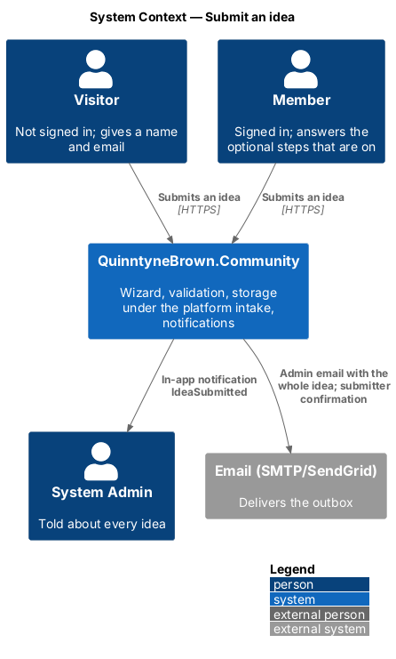
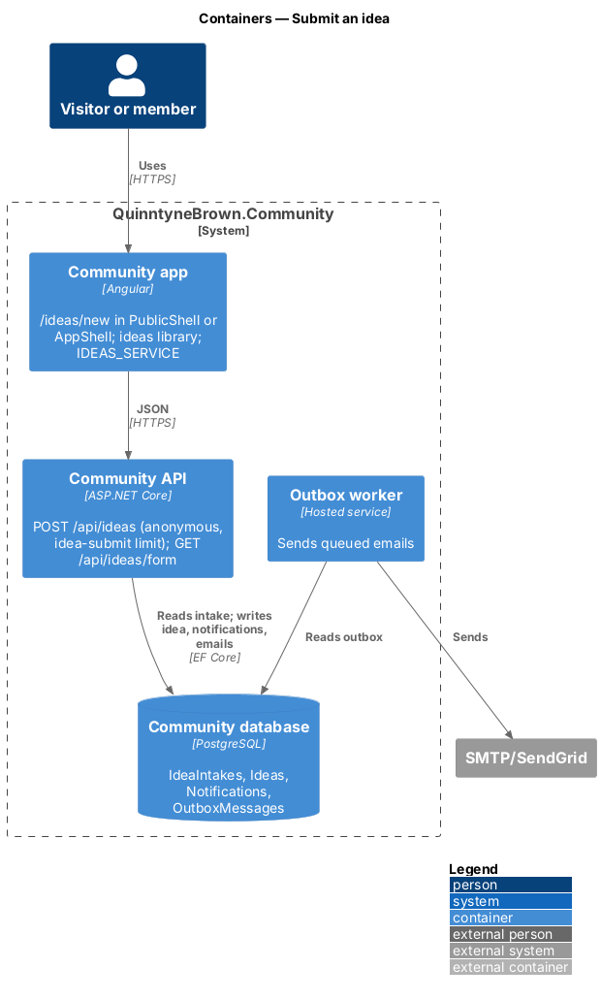
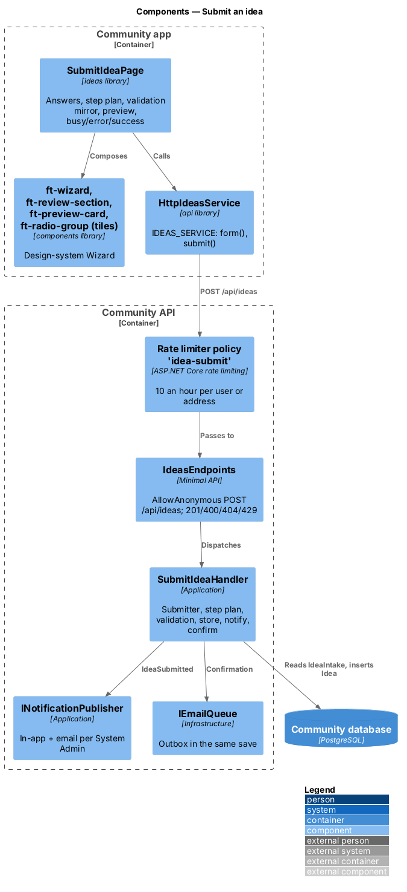
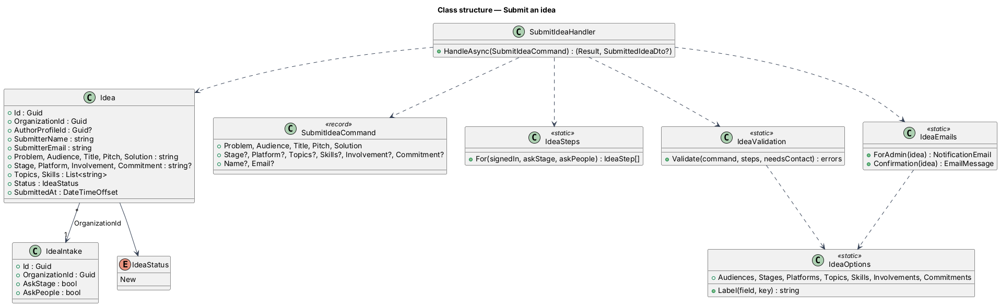
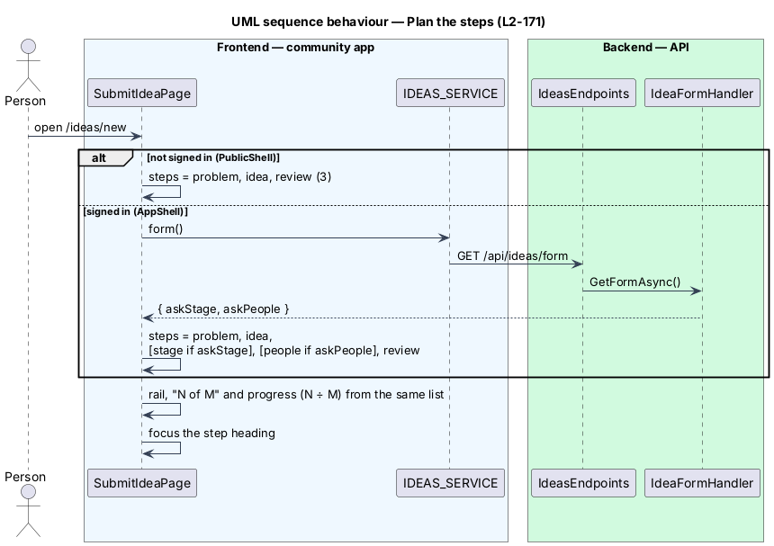
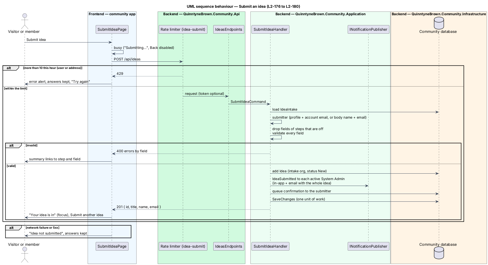

# Submit an idea

## Overview

A public wizard at `/ideas/new` in the community app ([ADR 0043](../../../adr/0043-submit-an-idea-lives-in-the-community-app.md)). A visitor who is not signed in answers three steps (The problem, Your idea, Review) and gives a name and email on Review; a signed-in member answers the same steps with their account's name and email, plus each optional step the Idea form switches on. A live preview shows the idea as it takes shape. Submitting posts to `POST /api/ideas`, an explicitly anonymous, rate-limited endpoint that validates everything on the server and stores the idea under the platform intake ([ADR 0044](../../../adr/0044-ideas-platform-intake-and-anonymous-submit.md)); the same save notifies every System Admin and queues the submitter's confirmation ([ADR 0045](../../../adr/0045-idea-delivery-by-notification-and-email.md)).

- **step plan** — the ordered list of steps for one person: `problem`, `idea`, then `stage` and `people` when signed in and switched on, then `review`
- **submitter** — the visitor (name and email from the form) or the signed-in member (profile name, account email, profile linked)
- **option key** — the stable value stored and sent for a choice (`nonprofits`, `sketches`, `Mental health`); the label is the UI's

## Description

### Options and limits (`Domain/Ideas/IdeaOptions.cs`)

One table, mirrored by `frontend/projects/ideas/src/lib/idea-options.ts` and the e2e fake:

| Field | Rule | Keys (label) |
|---|---|---|
| `problem` | 30–600 characters after trimming | |
| `audience` | required, one key | `churches` (Churches and ministries), `nonprofits` (Nonprofits and shelters), `families` (Families), `students` (Students and young adults), `newcomers` (Newcomers to Canada), `small-business` (Small businesses) |
| `title` | 1–60 | |
| `pitch` | 1–140 | |
| `solution` | 1–1,000 | |
| `stage` | optional, one key | `idea` (Just an idea), `sketches` (Sketches or notes), `prototype` (Working prototype), `live` (Already in use) |
| `platform` | optional, one key | `web` (Web app), `mobile` (Phone app), `both` (Both), `unsure` (Not sure yet) |
| `topics` | optional, at most 5, distinct | Accessibility, AI, Community, Education, Faith, Housing, Mental health, Prayer, Volunteering |
| `skills` | optional, distinct | Product Engineer, Designer, Product manager, Data and AI, Domain expert, Marketing and comms |
| `involvement` | optional, one key | `lead` (I want to lead it), `contribute` (I’ll help build it), `share` (I’m sharing it for others) |
| `commitment` | optional, one key | `monthly` (A few hours a month), `weekly` (A few hours a week), `part-time` (Part-time or more) |
| `name` | visitors only, 1–100 | |
| `email` | visitors only, valid, at most 254 | |

### API (`Api/Endpoints/IdeasEndpoints.cs`)

`MapPost("/api/ideas")` with `AllowAnonymous()` and `RequireRateLimiting("idea-submit")`; it dispatches a `SubmitIdeaCommand` to `SubmitIdeaHandler` and maps `Result`: `Ok` → `201 { id, title, name, email }` at `/api/ideas/{id}`, `Invalid` → `400` validation problem keyed by the camel-case field (`problem`, `audience`, `title`, `pitch`, `solution`, `stage`, `platform`, `topics`, `skills`, `involvement`, `commitment`, `name`, `email`), `NotFound` (no intake) → `404`. Authentication still runs on the anonymous endpoint, so a request with a token is a signed-in submission.

**Rate limit** (`WebProtectionSetup.IdeaSubmitRateLimitPolicy = "idea-submit"`): a fixed one-hour window of `RateLimits:IdeaSubmitPerHour` (default 10), partitioned by `idea:user:{sub}` for a signed-in caller and `idea:ip:{address}` otherwise; over the limit → `429`.

### Application (`Application/Ideas/SubmitIdea.cs`)

**`SubmitIdeaHandler`** (`IApplicationDbContext`, `ICurrentUser`, `INotificationPublisher`, `IEmailQueue`, `TimeProvider`):

1. **Load the intake.** `IdeaIntake` by its fixed id; missing → `NotFound`.
2. **Resolve the submitter.** Signed in (`current.UserId` with a profile) → the profile's name and the account email, `AuthorProfileId` set; the body's `name` and `email` are ignored. Otherwise the body's trimmed `name` and `email`.
3. **Plan the steps.** `IdeaSteps.For(signedIn, intake.AskStage, intake.AskPeople)` gives the optional steps that count; the fields of any other optional step are dropped before validation.
4. **Validate.** **`IdeaValidation.Validate(command, steps, needsContact)`** checks the table above and returns errors keyed by field (messages as in the mocks: "Add a little more detail, at least 30 characters", "Choose who feels this problem most", "Name your idea", "Add a one-line pitch", "Say how it would work", "Enter your name", "Enter an email like name@example.org", "Choose up to 5 topics", "Use N characters or fewer …", "Choose one of the options"). Any error → `Invalid`, nothing stored.
5. **Store.** `new Idea(intake.OrganizationId, …, submittedAt: time.GetUtcNow())` with status `New`.
6. **Notify** (`L2-179`). Recipients are the profiles with `IsSystemAdmin` and not `IsSuspended`. `PublishAsync(recipients, NotificationKind.IdeaSubmitted, "New app idea: {title}", "/admin/ideas", actorId: author, email: _ => IdeaEmails.ForAdmin(idea))`; no organization label.
7. **Confirm** (`L2-180`). `emails.Enqueue(IdeaEmails.Confirmation(idea))`: "We got your idea: {title}", "Thanks, {first name}." with the title and pitch, and the promise of an email if there are questions.
8. **Save once** (`SaveChangesAsync`), so the idea, notifications and emails commit together.

**`IdeaEmails`** composes both plain-text bodies, using `IdeaOptions` labels for keys.

### Domain and persistence

- **`Idea`** (`Domain/Ideas/Idea.cs`): `Id`, `OrganizationId`, `AuthorProfileId?`, `SubmitterName` (100), `SubmitterEmail` (254), `Problem` (600), `Audience` (32), `Title` (60), `Pitch` (140), `Solution` (1,000), `Stage?`, `Platform?`, `Involvement?`, `Commitment?` (32 each), `Topics` and `Skills` (string lists, `text[]` in PostgreSQL), `Status` (`IdeaStatus.New`, string), `SubmittedAt`.
- Index `(OrganizationId, SubmittedAt)` for the follow-up list. Migration `Ideas` (with `IdeaIntakes`, see [idea-form](../idea-form/README.md)), applied by the Cli.

### Frontend

- **`api`** — `IDEAS_SERVICE` (`IdeasService`): `form()` → `GET /api/ideas/form`, `submit(request)` → `POST /api/ideas` (the page handles 400, 429 and server errors itself: `HANDLES_SERVER_ERROR`), `settings()` and `saveSettings()` ([idea-form](../idea-form/README.md)). `HttpIdeasService` implements it; `provideApi` registers it.
- **`ideas` library** — `SubmitIdeaPage` (route `new` of `IDEAS_ROUTES`; `''` redirects to `new`). It holds one signal per answer and the current step key, derives the step plan from sign-in state (`AUTH_SERVICE.isAuthenticated()`) and, when signed in, the switches from `form()` and the member's name and email from `AUTH_SERVICE.currentUser()` (loaded from `/api/me`). It composes `ft-wizard` (rail, "N of M" label, progress, preview slot), a `form` holding `ft-wizard-card` per step (the focusable step heading, Back, Skip and Continue in its footer) with `ft-form-field`/`ft-text-field`/`ft-textarea` (with counts), `ft-radio-group` in its tile layout, `ft-chip-group` with `ft-chip` toggles (topics and skills), `ft-alert` summaries, `ft-review-section` with `ft-description-list` on Review, and `ft-preview-card`. Validation runs on Continue and mirrors the server; the summary takes focus when it appears, otherwise the step heading takes focus after each change. Submit sets `busy`, then shows the success view or the error alert with every answer kept; a 400 maps each field back to its step. Submit another idea resets every signal and returns to `problem`.
- **App** — `app.routes.ts` maps `ideas` under `PublicShellComponent` with `signedOutMatch`, and again inside the app shell (ADR 0043). The public shell's Sign in keeps `/ideas/new` as `returnUrl`.

### E2E fake (`e2e/fixtures/`)

`mock-ideas.ts` answers `GET /api/ideas/form`, `POST /api/ideas` (the same validation, signed-in name and email from the fake's current user, 10 per hour, failure switches for the error state) and the settings endpoints, holding ideas, notifications and queued emails in memory so specs can assert them. Page object `e2e/pages/submit-idea.page.ts` owns every selector.

## Requirements

| L2 ID | Refines (L1) | Requirement |
|-------|--------------|-------------|
| `L2-168` | `L1-027` | `/ideas/new` opens for anyone, in the public shell or the app shell, with focus on each step's heading and no saved draft. |
| `L2-169` | `L1-027` | The problem step asks for the problem (30–600) and who feels it, with the invalid state of the mocks. |
| `L2-170` | `L1-027` | Your idea asks for a name (60), pitch (140) and how it works (1,000), all required. |
| `L2-171` | `L1-027` | The steps are The problem, Your idea, each enabled optional step in order, then Review, for signed-in members; visitors get three; the rail, label and bar agree. |
| `L2-172` | `L1-027` | How far along is it? asks stage, platform and up to five topics, all optional, and can be skipped. |
| `L2-173` | `L1-027` | Who do you need? asks skills, involvement and time, all optional, and can be skipped. |
| `L2-174` | `L1-027` | The preview shows the name and pitch as they are typed, captioned You or the member's name. |
| `L2-175` | `L1-027` | Review summarises each step with Edit; visitors give a valid name and email; members see "Submitting as". |
| `L2-176` | `L1-027` | Submitting shows busy, then the success page or an error that keeps the answers; Submit another idea starts again. |
| `L2-177` | `L1-027` | The server validates and stores each idea under the platform intake, links a signed-in author and ignores steps that are off. |
| `L2-178` | `L1-027` | At most 10 submissions an hour per address, or per account when signed in. |
| `L2-179` | `L1-027` | Every System Admin gets `IdeaSubmitted` in the app and by email with the whole idea. |
| `L2-180` | `L1-027` | The submitter gets a confirmation email. |

## Diagrams

### System context

Visitors and members submit ideas; System Admins are told by notification and email.

### Containers

The community app serves the wizard in either shell; the API stores the idea and queues the emails in the database's outbox, which the worker delivers over SMTP.

### Components

The rate limit runs before the anonymous endpoint, which hands the command to `SubmitIdeaHandler`; the handler plans the steps, validates, stores and publishes in one save.

### Class structure

`SubmitIdeaHandler` turns a `SubmitIdeaCommand` into an `Idea` owned by the `IdeaIntake`, using `IdeaSteps`, `IdeaValidation` and `IdeaEmails`.

### Behaviour — the step plan

The page and the server derive the same steps from sign-in state and the two switches.

### Behaviour — submit an idea

Validation, storage, notifications and emails happen in one request and one save.

## Open questions

- A per-email limit for anonymous submissions, spam scoring and a CAPTCHA are deferred; the per-address limit and the private-preview wall cover the preview period.
