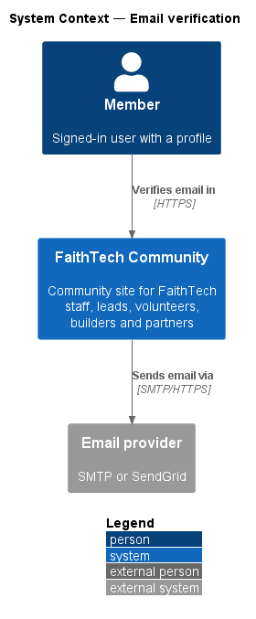
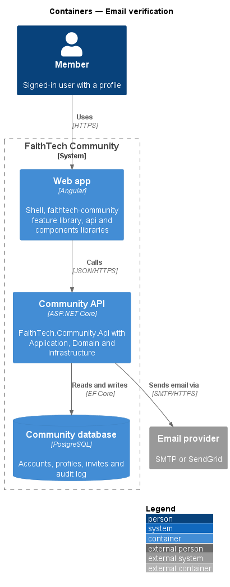
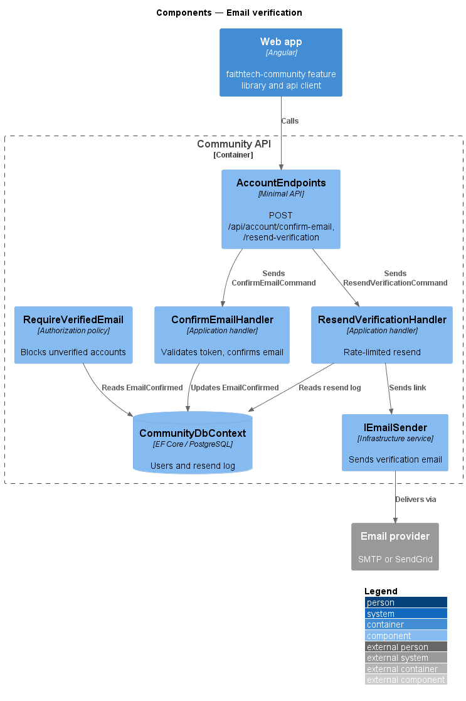
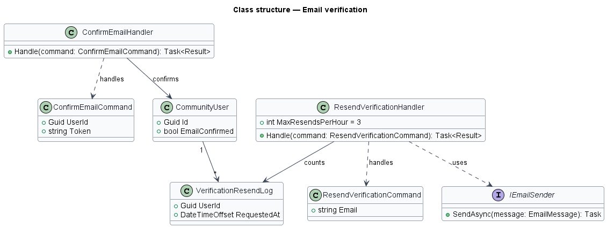
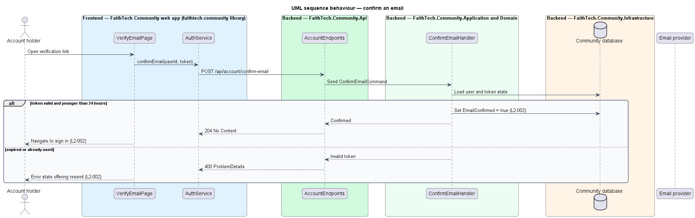
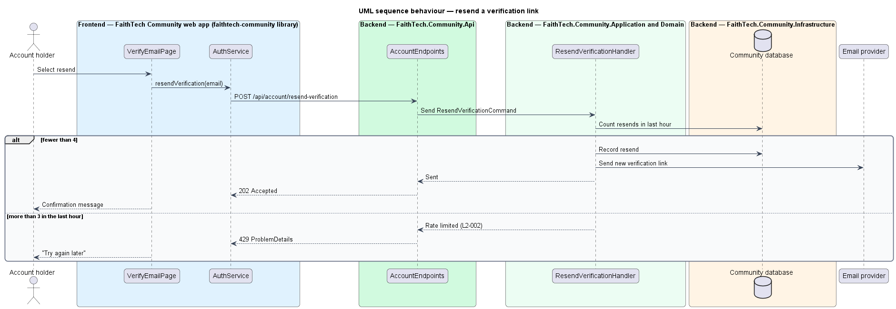

# Email verification

## Overview

Every account created through sign-up shall prove ownership of its email before it is used. *Email verification* covers opening the verification link, rejecting stale links and resending a link on request.

**verification link** — single-use URL carrying an ASP.NET Identity email-confirmation token, valid for 24 hours

**unverified account** — account whose `EmailConfirmed` flag is false

An unverified account that signs in sees only the verify-email page with a resend action. Resends are limited to 3 per hour per account. Invite acceptance verifies the email by a different route (see the accept-invite feature).

## Description

- **`VerifyEmailPage`** — Angular page in the app shell, matching the `verify-email` mock. It shows the pending, success and expired-link states and offers a resend button.
- **`AuthService`** — contract in the `api` library, provided through the `AUTH_SERVICE` injection token and implemented by `HttpAuthService`. It wraps the account endpoints and the OIDC + PKCE client.
- **`AccountEndpoints`** — minimal API route group in `FaithTech.Community.Api`. It maps the account routes, opts each one into anonymous access explicitly, and forwards the request to the Application handler. It holds no business logic.
- **`CommunityDbContext`** — EF Core context in `FaithTech.Community.Infrastructure`. It stores ASP.NET Identity users alongside community data in PostgreSQL.
- **`ConfirmEmailCommand`** / **`ConfirmEmailHandler`** — Application request and handler. The handler validates the token through `UserManager.ConfirmEmailAsync`, rejects tokens older than 24 hours or already used, and sets `EmailConfirmed`.
- **`ResendVerificationCommand`** / **`ResendVerificationHandler`** — Application request and handler. The handler counts resends in the last hour and rejects the fourth with a "try again later" result.
- **`VerificationResendLog`** — Infrastructure record of resend timestamps per account. Its storage form (table or cache) is `<TO SUPPLY>`.
- **`EmailVerified`** — Domain event (`Domain/Identity`) naming the profile and the verified email. `ConfirmEmailHandler` raises it once the email is confirmed; the contacts subsystem handles it (`contacts/link-contact-on-sign-up`).
- **`RequireVerifiedEmail`** — authorization policy applied by default to API endpoints. It refuses any call from an unverified account except the resend endpoint.

## Requirements

The feature realizes the following level-2 (L2) requirements. Each L2 requirement refines a level-1 (L1) requirement, cited by identifier.

| L2 ID | Refines (L1) | Requirement |
|-------|--------------|-------------|
| `L2-002` | `L1-001` | Email verification |

### Acceptance criteria

**`L2-002`**

1. Given a valid, unexpired verification link, when the user opens it, then the email is marked verified and the user is taken to set up their profile.
2. Given a verification link older than 24 hours or already used, when the user opens it, then an error page offers to resend the link.
3. Given an unverified account, when the user signs in, then they can browse, but a banner asks them to verify their email and offers a resend, and RSVPing, creating content and sending invites are refused until the email is verified.
4. Given a resend request, when more than 3 resends have been requested in the last hour, then the request is rejected with a "try again later" message.

## Diagrams

### System context

The account holder confirms an email address in FaithTech Community, which sends verification links through the email provider.

### Containers

The web app sends the token and resend requests to the Community API, which reads and updates accounts in the Community database.

### Components

`AccountEndpoints` dispatches confirm and resend requests to their handlers. The `RequireVerifiedEmail` policy guards every other endpoint.

### Class structure

Both handlers depend on `UserManager<CommunityUser>`. `ResendVerificationHandler` reads `VerificationResendLog` and uses `IEmailSender`.

### Behaviour — confirm an email

A valid link younger than 24 hours confirms the email and sends the user to sign in. An expired or used link shows an error with a resend offer (`L2-002`).

### Behaviour — resend a verification link

The handler sends a fresh link unless more than 3 resends occurred in the last hour, in which case it returns 429 and the page shows "try again later" (`L2-002`).

## Open questions

Decisions recorded while building the Domain layer (`FaithTech.Community.Domain`):

- `EmailVerified` is a Domain record because `CommunityUser` is an Infrastructure Identity type; the Application handler raises it rather than an entity.
