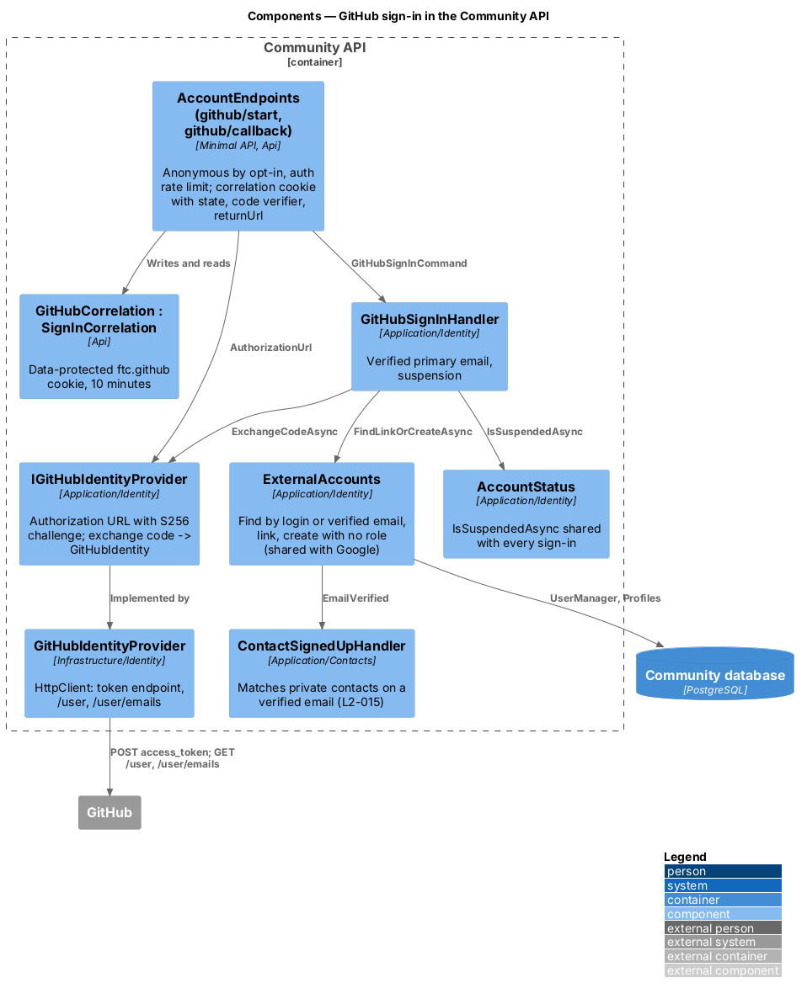
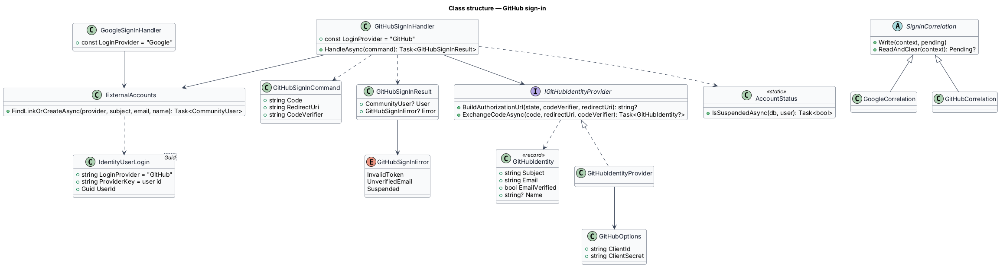
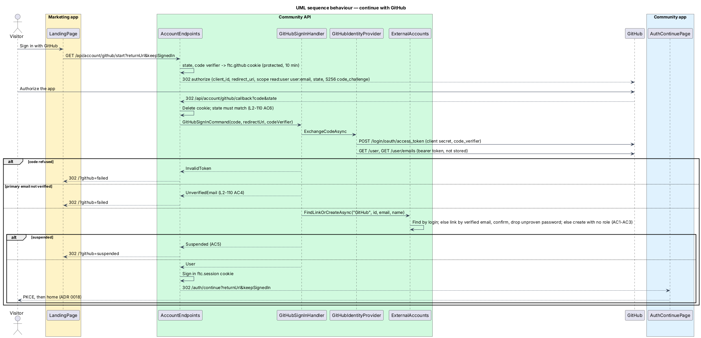

# GitHub sign-in

## Overview

"Sign in with GitHub" and "Sign up with GitHub" are one button and one flow on the marketing page, below the Google button. GitHub is QuinntyneBrown.Community's second external sign-in method (ADR 0032). It follows Google's rules (ADR 0019): a GitHub account whose verified primary email matches an existing account signs into that account; a new GitHub account creates an account with no role and a verified email. The result is the same short-lived `ftc.session` cookie, followed by the community app's authorization code + PKCE flow.

**Access token** — the bearer token GitHub's token endpoint returns; used once to read `/user` and `/user/emails`, never stored

**Code verifier** — a 32-byte random PKCE secret; its S256 challenge goes to GitHub with the authorization request and the verifier with the code exchange, so a code only works for the browser that started the sign-in

**Correlation cookie** — `ftc.github`, a data-protected, `HttpOnly`, `Secure`, `SameSite=Lax` cookie on path `/api/account/github` holding the `state`, the code verifier, the return URL and "keep me signed in" for 10 minutes; it is deleted on the callback, so a replayed callback fails

**External login** — a row in `AspNetUserLogins` (provider `GitHub`, key = GitHub's numeric user id) linking a GitHub account to a `CommunityUser`

## Description

### Endpoints (Api, `AccountEndpoints`, group `/api/account`, auth rate limit, anonymous by explicit opt-in)

- **`GET /api/account/github/start?returnUrl=&keepSignedIn=&from=`** — `from=app` marks a sign-in started on the community app's own pages (L2-131); anything else is the marketing page. When `GitHub:ClientId` or `GitHub:ClientSecret` is missing, redirects to `<Marketing:Origin>/?github=failed`. Otherwise creates a random `state` and code verifier, writes the correlation cookie (only an app-relative `returnUrl` is kept, otherwise `/`), and redirects to `IGitHubIdentityProvider.BuildAuthorizationUrl(state, codeVerifier, redirectUri)` with `redirectUri = <WebApp:Origin>/api/account/github/callback`.
- **`GET /api/account/github/callback?code=&state=` (or `error=`)** — reads and deletes the correlation cookie, refuses a missing cookie, a missing code or a `state` that does not match (fixed-time comparison), sends `GitHubSignInCommand` and maps the result: success signs in `IdentityConstants.ApplicationScheme` and redirects to `<WebApp:Origin>/auth/continue?returnUrl=…&keepSignedIn=1|0`, or, when `returnUrl` is an identity-server `/connect/…` path, straight to `<WebApp:Origin>{returnUrl}` to resume that authorization request. `Suspended` redirects to `<Marketing:Origin>/?github=suspended`, anything else to `<Marketing:Origin>/?github=failed`; for `from=app` these are `<WebApp:Origin>/sign-in?github=suspended|failed&returnUrl=…`. A callback without a readable cookie goes to the marketing page.

### Application (`Application/Identity/`)

- **`IGitHubIdentityProvider`** (`GitHubSignIn.cs`) — the port: `BuildAuthorizationUrl` (null when not configured) and `ExchangeCodeAsync(code, redirectUri, codeVerifier)`, which returns a `GitHubIdentity` (user id, primary email, its verified flag, name or login) or null.
- **`GitHubSignInHandler`** — no identity → `InvalidToken`; unverified primary email → `UnverifiedEmail`, nothing created or linked; otherwise `ExternalAccounts.FindLinkOrCreateAsync("GitHub", …)`, then `AccountStatus.IsSuspendedAsync` → `Suspended`.
- **`ExternalAccounts`** (`ExternalAccounts.cs`) — the linking rule shared with `GoogleSignInHandler`: find by `FindByLoginAsync(provider, subject)`; else by `FindByEmailAsync(email)` and link with `AddLoginAsync`, confirming an unconfirmed email and removing its unproven password, then running `ContactSignedUpHandler`; else create a `Profile` (name trimmed to 100 characters, or the email's local part) and a `CommunityUser` with `EmailConfirmed = true`, no password, no role, and the login, then run `ContactSignedUpHandler`.

### Infrastructure (`Infrastructure/Identity/GitHubIdentityProvider.cs`)

- **`GitHubIdentityProvider`** — builds `https://github.com/login/oauth/authorize?client_id=…&redirect_uri=…&scope=read:user%20user:email&state=…&code_challenge=…&code_challenge_method=S256`; posts the code, client secret, redirect URI and code verifier to `https://github.com/login/oauth/access_token` (`Accept: application/json`); reads `https://api.github.com/user` and `https://api.github.com/user/emails` with the bearer token, a `User-Agent` and `X-GitHub-Api-Version`. The identity's email is the primary entry of `/user/emails`; the name is `name`, else `login`. Any HTTP, protocol or JSON failure, an `error` in the token response, or no primary email returns null.
- **`GitHubOptions`** — `GitHub:ClientId`, `GitHub:ClientSecret` from configuration or environment variables (`GitHub__ClientId`, `GitHub__ClientSecret`); never in the repository.

### Data

No schema change; `AspNetUserLogins` already exists. No migration.

### Frontend

- `AuthService.signInWithGitHub(returnUrl?, keepSignedIn?)` in `api` — full-page navigation (`BROWSER_REDIRECT`) to `${API_BASE_URL}/account/github/start`.
- `ButtonComponent` gains `variant="github"` in `components`: GitHub's mark in the button's foreground colour on GitHub's dark fill (light theme) or light fill (dark theme), read from `--color-social-github-*`.
- `SignInFormFailure` gains `github_failed`: "GitHub sign-in didn’t finish — We couldn’t confirm your GitHub account. Try again, or sign in with your email and password."
- The marketing page shows "Sign in with GitHub" and "Sign up with GitHub" below the Google button; it is busy until the browser leaves and shows the failure or "This account is suspended" when it comes back with `?github=`.
- The community app's `/sign-in` and `/sign-up` pages show the Google and GitHub buttons above their forms ("Sign in with …" / "Sign up with …", `divider="or"`) and call `signInWithGoogle`/`signInWithGitHub` with `from: 'app'`; `/sign-in` reads `?google=` and `?github=` and shows the failure or suspension alert (L2-131).
- The e2e fake (`e2e/fixtures/mock-github.ts`) answers the start endpoint, routes `github.com` and the callback, and applies the same rules to a GitHub account the test arranges.

## Requirements

| L2 ID | Refines (L1) | Requirement |
|-------|--------------|-------------|
| `L2-130` | `L1-001` | GitHub sign-in: create, link, unverified, suspended, bad state or code, configuration. |
| `L2-079` | `L1-015`, `L1-021` | Rate limit, no enumeration difference between the GitHub, Google and password paths. |
| `L2-131` | `L1-001` | Google and GitHub buttons on the community app's sign-in and sign-up pages; outcomes return there. |

### Acceptance criteria

See [`docs/specs/L2.md`](../../../specs/L2.md#l2-110-github-sign-in). Backend criteria are traced by `backend/tests/QuinntyneBrown.Community.Api.Tests/Identity/GitHubSignInTests.cs` and `backend/tests/QuinntyneBrown.Community.Infrastructure.Tests/Identity/GitHubIdentityProviderTests.cs`; the page's behaviour by `e2e/tests/marketing/github-sign-in.spec.ts`.

## Diagrams

### Components

Endpoints handle the browser plumbing, the handler owns the GitHub rules, `ExternalAccounts` owns the linking rule every provider shares.

### Class structure

### Behaviour — continue with GitHub

State and the code verifier are checked before any account is touched (`L2-130`).

## Open questions

1. Unlinking a provider from Settings is deferred.
