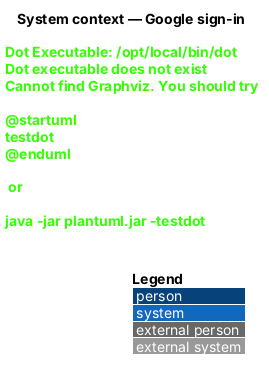
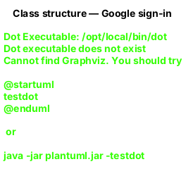
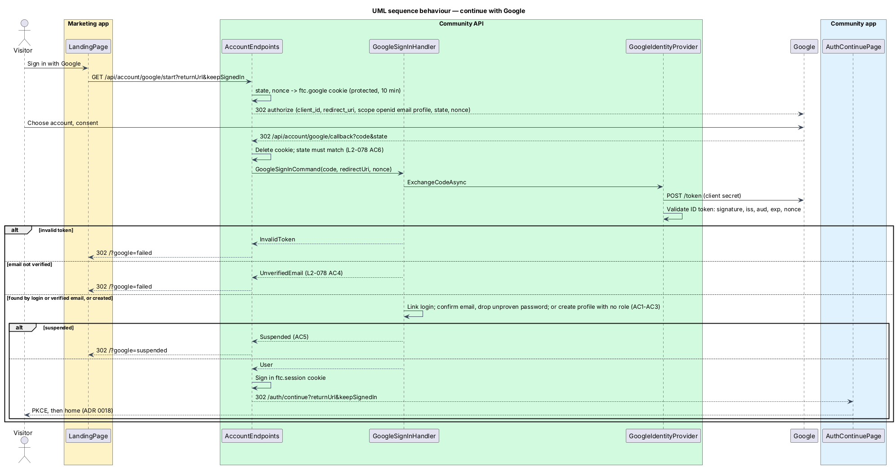

# Google sign-in

## Overview

"Sign in with Google" and "Sign up with Google" are one button and one flow on the marketing page. Google is FaithTech Community's first external sign-in method. A Google account whose verified email matches an existing account signs into that account; a new Google account creates an account with no role and a verified email, as any sign-up does. The result is the same short-lived `ftc.session` cookie the password path sets, followed by the community app's authorization code + PKCE flow.

**ID token** — the signed JWT Google returns from its token endpoint, carrying `sub`, `email`, `email_verified`, `name`, `aud`, `iss`, `exp` and the `nonce` FaithTech sent

**Correlation cookie** — `ftc.google`, a data-protected, `HttpOnly`, `Secure`, `SameSite=Lax` cookie holding the `state`, the nonce, the return URL and "keep me signed in" for 10 minutes; it is deleted on the callback, so a replayed callback fails

**External login** — a row in ASP.NET Identity's `AspNetUserLogins` (provider `Google`, key = `sub`) linking a Google account to a `CommunityUser`

## Description

### Endpoints (Api, `AccountEndpoints`, group `/api/account`, auth rate limit, anonymous by explicit opt-in)

- **`GET /api/account/google/start?returnUrl=&keepSignedIn=`** — when `Google:ClientId` or `Google:ClientSecret` is missing, redirects to `<Marketing:Origin>/?google=failed`. Otherwise creates a 32-byte random `state` and nonce, writes the correlation cookie (only an app-relative `returnUrl` is kept, otherwise `/`), and redirects to `IGoogleIdentityProvider.BuildAuthorizationUrl(state, nonce, redirectUri)` with `redirectUri = <WebApp:Origin>/api/account/google/callback` (the API sits behind the community origin's proxy).
- **`GET /api/account/google/callback?code=&state=` (or `error=`)** — reads and deletes the correlation cookie, refuses a missing cookie, a missing code or a `state` that does not match (fixed-time comparison), sends `GoogleSignInCommand` and maps the result: success signs in `IdentityConstants.ApplicationScheme` exactly as `POST /api/account/sign-in` does and redirects to `<WebApp:Origin>/auth/continue?returnUrl=…&keepSignedIn=1|0`; `Suspended` redirects to `<Marketing:Origin>/?google=suspended`; anything else to `<Marketing:Origin>/?google=failed`.

### Application (`Application/Identity/GoogleSignIn.cs`)

- **`IGoogleIdentityProvider`** — the port: `BuildAuthorizationUrl` (null when not configured) and `ExchangeCodeAsync(code, redirectUri, nonce)`, which returns a validated `GoogleIdentity` or null.
- **`GoogleSignInHandler`** — the rules:
  1. No identity → `InvalidToken`.
  2. `EmailVerified` false → `UnverifiedEmail`; nothing is created or linked.
  3. Find by `FindByLoginAsync("Google", sub)`; else by `FindByEmailAsync(email)`, which links with `AddLoginAsync`. If the matching account had not confirmed its email, it is confirmed and its password removed (it was never proven to belong to the email's owner, ADR 0019), and `ContactSignedUpHandler` runs as after a verification link.
  4. Otherwise create a `Profile` named from Google's `name` (trimmed to 100 characters, or the email's local part), a `CommunityUser` with `EmailConfirmed = true` and no password, and the login; no role is ever granted; `ContactSignedUpHandler` matches private contacts.
  5. `AccountStatus.IsSuspendedAsync` (shared with `SignInHandler`) → `Suspended`.
- Lockout is a password rule; it does not block Google sign-in. Sign-up does not write an audit entry, so neither does a Google account creation.

### Infrastructure (`Infrastructure/Identity/`)

- **`GoogleIdentityProvider`** — builds `https://accounts.google.com/o/oauth2/v2/auth?response_type=code&scope=openid%20email%20profile&…`, posts the code with the client secret to `https://oauth2.googleapis.com/token` through a named `HttpClient`, and hands the `id_token` to the validator. Any HTTP or protocol failure returns null.
- **`GoogleIdTokenValidator`** — validates with `JsonWebTokenHandler` against signing keys from an `IConfigurationManager<OpenIdConnectConfiguration>` (Google's discovery document in production): issuer `https://accounts.google.com` or `accounts.google.com`, audience = `Google:ClientId`, lifetime against `TimeProvider` with 5 minutes of skew, and `nonce` equal to the expected nonce. Tests use a local RSA key and a static configuration.
- **`GoogleOptions`** — `Google:ClientId`, `Google:ClientSecret` from configuration or environment variables (`Google__ClientId`, `Google__ClientSecret`); never in the repository.

### Data

No schema change: `CommunityDbContext` derives from `IdentityDbContext<CommunityUser, IdentityRole<Guid>, Guid>`, so `AspNetUserLogins` already exists and `CommunityUser` is unchanged. No migration.

### Frontend

- `AuthService.signInWithGoogle(returnUrl?, keepSignedIn?)` in `api` — full-page navigation (`BROWSER_REDIRECT`) to `${API_BASE_URL}/account/google/start`.
- The marketing page's Google button is `ButtonComponent` `variant="google"`; it is busy until the browser leaves and shows "Google sign-in didn't finish" or "This account is suspended" when it comes back with `?google=`.
- The e2e fake (`e2e/fixtures/mock-google.ts`) answers the start endpoint, routes `accounts.google.com` and the callback, and applies the same rules to a Google account the test arranges.

## Requirements

| L2 ID | Refines (L1) | Requirement |
|-------|--------------|-------------|
| `L2-078` | `L1-001` | Google sign-in: create, link, unverified, suspended, bad state or token, configuration. |
| `L2-079` | `L1-015`, `L1-021` | Rate limit, no enumeration difference between the Google and password paths. |

### Acceptance criteria

See [`docs/specs/L2.md`](../../../specs/L2.md#l2-059-google-sign-in). Backend criteria are traced by `backend/tests/FaithTech.Community.Api.Tests/Identity/GoogleSignInTests.cs` and `backend/tests/FaithTech.Community.Infrastructure.Tests/Identity/GoogleIdTokenValidatorTests.cs`; the page's behaviour by `e2e/tests/marketing/google-sign-in.spec.ts`.

## Diagrams

### System context

Google is an external identity provider; FaithTech Community keeps its own accounts.

### Containers

The API owns the flow; the browser moves between the marketing app, Google and the community app.

### Components

Endpoints handle the browser plumbing, the handler owns the rules, Infrastructure owns Google.

### Class structure

The handler depends on the provider port and the shared suspension rule; logins are Identity's own rows.

### Behaviour — continue with Google

State and nonce are checked before any account is touched (`L2-078`).

## Open questions

1. Microsoft and Apple sign-in, and the Google button on the community app's own sign-in page, are deferred.
2. A member cannot yet unlink Google or add a password to a Google-created account from Settings; they can use "Forgot your password?" to set one.
