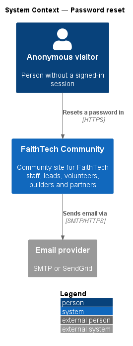
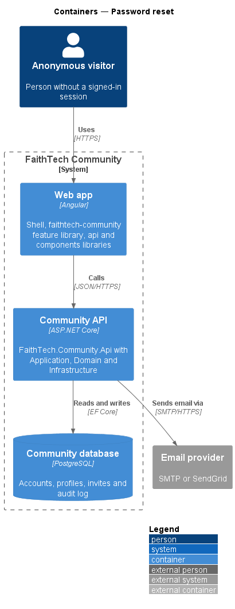
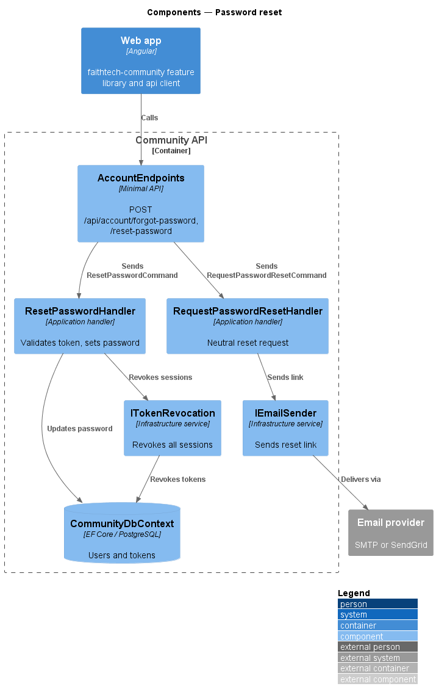
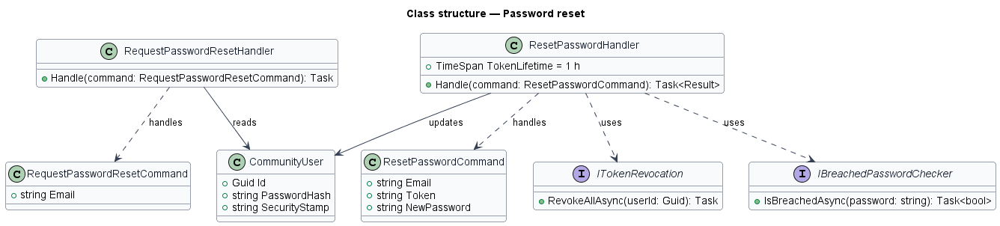
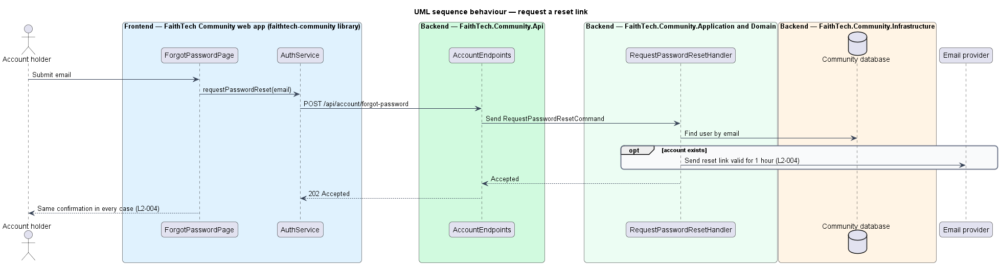
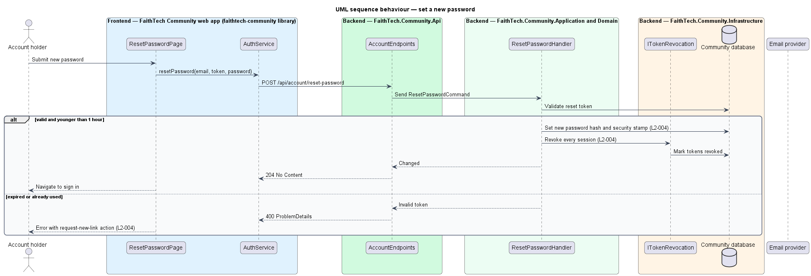

# Password reset

## Overview

A person who forgets a password shall regain access without staff help. *Password reset* covers requesting a reset link, setting a new password and handling stale links.

**reset link** — single-use URL carrying an ASP.NET Identity password-reset token, valid for 1 hour

The request step shows the same confirmation whether or not the email belongs to an account, so it does not disclose which emails are registered. A successful reset revokes every existing session for the account.

## Description

- **`ForgotPasswordPage`** — Angular page in the app shell, matching the `forgot-password` mock. It collects an email and shows the neutral confirmation.
- **`ResetPasswordPage`** — Angular page matching the `reset-password` mock. It collects the new password and shows the expired-link state with a request-new-link action.
- **`AuthService`** — contract in the `api` library, provided through the `AUTH_SERVICE` injection token and implemented by `HttpAuthService`. It wraps the account endpoints and the OIDC + PKCE client.
- **`AccountEndpoints`** — minimal API route group in `FaithTech.Community.Api`. It maps the account routes, opts each one into anonymous access explicitly, and forwards the request to the Application handler. It holds no business logic.
- **`CommunityDbContext`** — EF Core context in `FaithTech.Community.Infrastructure`. It stores ASP.NET Identity users alongside community data in PostgreSQL.
- **`RequestPasswordResetCommand`** / **`RequestPasswordResetHandler`** — Application request and handler. The handler generates a reset token and sends the email only when the account exists, and returns the same result either way.
- **`ResetPasswordCommand`** / **`ResetPasswordHandler`** — Application request and handler. The handler rejects tokens older than 1 hour or already used, applies the sign-up password rules (12 characters minimum, breached-password check), changes the password, updates the security stamp and revokes every OpenIddict token for the account.
- **`ITokenRevocation`** — Infrastructure service that revokes all stored tokens for a user.

## Requirements

The feature realizes the following level-2 (L2) requirements. Each L2 requirement refines a level-1 (L1) requirement, cited by identifier.

| L2 ID | Refines (L1) | Requirement |
|-------|--------------|-------------|
| `L2-004` | `L1-001` | Password reset |

### Acceptance criteria

**`L2-004`**

1. Given any email, when the user requests a reset, then the same confirmation message is shown whether or not an account exists, and an email is sent only if it does.
2. Given a valid reset link younger than 1 hour, when the user sets a new valid password, then the password is changed, every existing session for that account is revoked, and the user can sign in.
3. Given an expired or already-used reset link, when the user opens it, then an error offers to request a new link.

## Diagrams

### System context

The account holder requests and completes a reset in FaithTech Community, which sends reset links through the email provider.

### Containers

The web app posts reset requests to the Community API, which updates the user and token stores in the Community database and sends email.

### Components

`AccountEndpoints` dispatches to the two handlers. `ResetPasswordHandler` uses `ITokenRevocation` to end every existing session.

### Class structure

Both handlers act on `CommunityUser`. `ResetPasswordHandler` also depends on `IBreachedPasswordChecker` and `ITokenRevocation`.

### Behaviour — request a reset link

The handler sends a reset link only when an account exists, and the page shows the same confirmation either way (`L2-004`).

### Behaviour — set a new password

A valid link changes the password and revokes every session. An expired or used link shows an error that offers a new link (`L2-004`).

