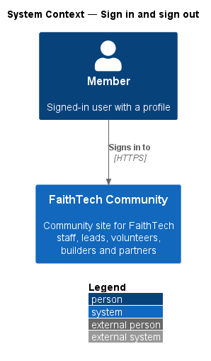
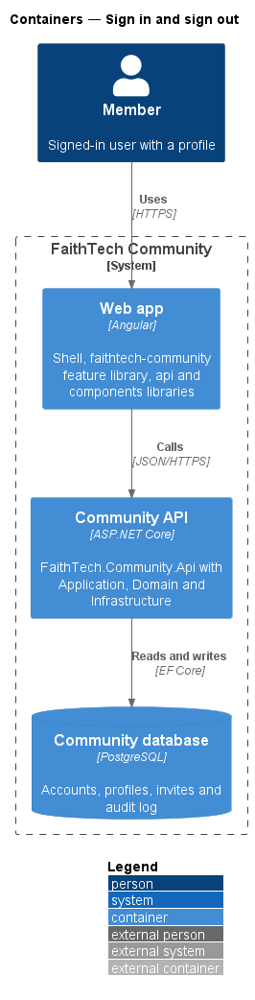
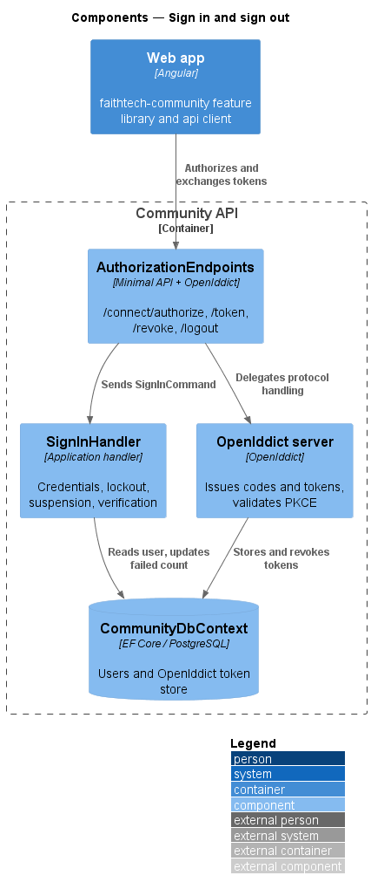
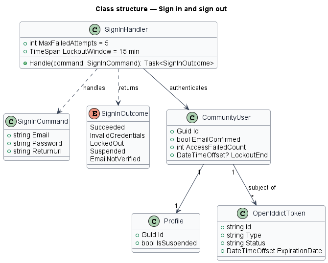
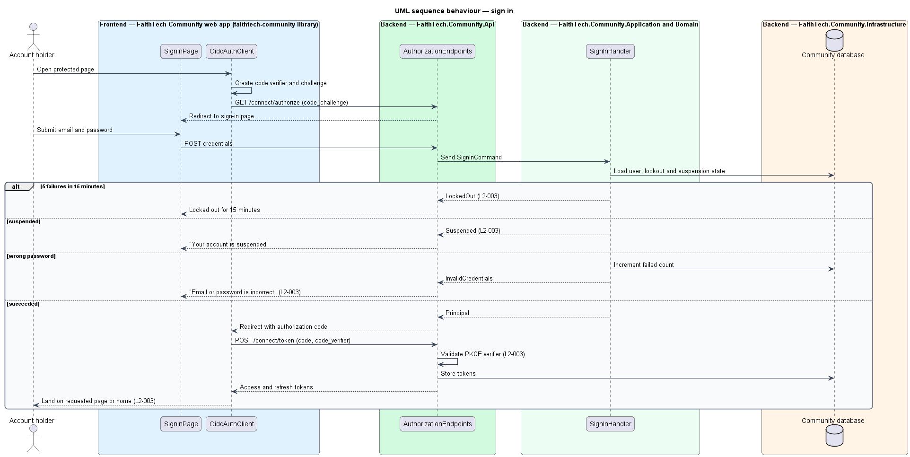
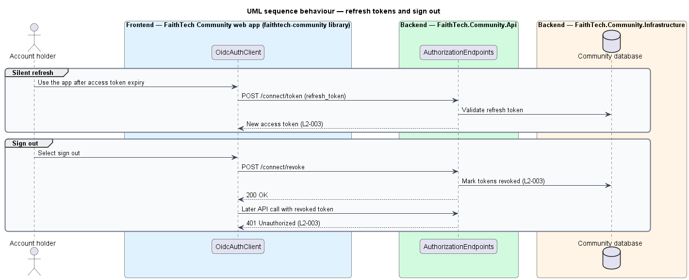

# Sign in and sign out

## Overview

Every page except public events requires a signed-in session. *Sign in and sign out* covers how the Angular web app obtains, refreshes and revokes tokens against the identity server hosted in the Community API.

**OpenIddict** — OAuth2 and OpenID Connect server library for ASP.NET Core, used here as the identity server

**PKCE** — Proof Key for Code Exchange; the client sends a hash of a secret code verifier with the authorization request and the verifier itself with the token request

**lockout** — ASP.NET Identity state that refuses sign-in for 15 minutes after 5 failed attempts within 15 minutes

**failure window** — the 15 minutes starting at the first counted failed attempt, stored as `CommunityUser.FailedAccessWindowStartedAt`; a failure at or after the window's end starts a new window with a count of one

The web app redirects to the sign-in page, which posts credentials to the identity server. On success, the server issues an authorization code that the app exchanges, with its PKCE verifier, for an access token and a refresh token. Sign-out revokes those tokens so that any later API call returns 401.

## Description

- **`SignInPage`** — Angular page in the app shell, matching the `sign-in` mock. It posts credentials, shows a generic "email or password is incorrect" error, the lockout message, the suspended-account message and the unverified-email notice.
- **`AppShellComponent` account menu** — the top-bar avatar in the app shell is an `ft-menu` (`MenuComponent` from `components`) named "Account menu for {name}" at every width, holding *Your profile* (`/people/me`), *Settings* (`/settings`) and *Sign out*, which calls `AUTH_SERVICE.signOut()` (mock: every signed-in page, design system `components/menu`).
- **`authGuard`** — Angular route guard in the app shell. It stores the requested URL and starts the authorization code + PKCE flow when no valid session exists.
- **`OidcAuthClient`** — `api` library class behind `AUTH_SERVICE`. It generates the code verifier and challenge, exchanges the code, stores tokens, refreshes silently on 401 or expiry and calls the revocation endpoint on sign-out.
- **`authInterceptor`** — `api` library HTTP interceptor. It attaches the access token and triggers a silent refresh.
- **`AuthorizationEndpoints`** — Api route group that hosts the OpenIddict `/connect/authorize`, `/connect/token`, `/connect/revoke` and `/connect/logout` passthrough endpoints.
- **`SignInCommand`** / **`SignInHandler`** — Application request and handler. The handler checks the password through `UserManager`, refuses suspended accounts and unverified emails, and returns a principal for code issuance. It owns the lockout rule itself, reading the clock from `TimeProvider` (Identity's own lockout checks read the system clock): each wrong password adds to `AccessFailedCount` inside the failure window, or starts a new window when the old one has ended; the fifth failure inside one window sets `LockoutEnd` 15 minutes ahead and clears the count. A successful sign-in, a password reset or a new window after an elapsed lockout starts counting from zero, so failures older than the window never lead to a lockout.
- **OpenIddict stores** — Infrastructure EF Core stores for applications, authorizations and tokens. Token revocation marks the stored tokens as revoked.
- **`SignInFormComponent`** — the form itself lives in the `components` library and is shared with the marketing page (`docs/detailed-designs/marketing/landing-page`). `SignInPage` keeps the heading and the hand-off.
- **`AuthContinuePage`** (`/auth/continue`) — starts PKCE for a session created on the marketing page or by Google sign-in (ADR 0018).
- **Session hint** — when a kept ("Keep me signed in") refresh token is stored, `OidcAuthClient` writes the non-secret `ftc.signed-in` cookie so the marketing page can send the member to the app; sign-out and a failed restore clear it.
- **Token lifetimes** — access-token and refresh-token lifetimes are `<TO SUPPLY>`.

## Requirements

The feature realizes the following level-2 (L2) requirements. Each L2 requirement refines a level-1 (L1) requirement, cited by identifier.

| L2 ID | Refines (L1) | Requirement |
|-------|--------------|-------------|
| `L2-003` | `L1-001` | The Angular app signs in with OAuth2 authorization code + PKCE against OpenIddict. |

### Acceptance criteria

**`L2-003`**

1. Given a verified account and correct credentials, when the user signs in, then an authorization code is exchanged with PKCE for tokens, and the user lands on the page they first requested, or the home page.
2. Given incorrect credentials, when the user signs in, then a generic "email or password is incorrect" error is shown.
3. Given 5 failed attempts within 15 minutes, when a 6th is made, then the account is locked out for 15 minutes; failed attempts older than 15 minutes, or made before a successful sign-in, a password reset or an elapsed lockout, do not count.
4. Given a suspended account, when the user signs in, then sign-in is refused with a "your account is suspended" message.
5. Given a token request without a valid PKCE code verifier, when it reaches the token endpoint, then it is rejected.
6. Given a signed-in user, when they sign out, then their tokens are revoked, and any further API call with those tokens returns 401.
7. Given an expired access token and a valid refresh token, when the app calls the API, then the token is refreshed silently.
8. Given "Keep me signed in on this device" is not ticked, when the browser session ends, then the refresh token is discarded and the user must sign in again.
9. Given a signed-in user on any page and at any width, when they open the account menu from their avatar in the top bar, then it offers "Your profile", "Settings" and "Sign out", and "Sign out" ends the session on this device as in criterion 6.

## Diagrams

### System context

The account holder signs in to FaithTech Community. Identity is hosted inside the system, so no external identity provider appears.

### Containers

The web app runs the authorization code + PKCE flow against the Community API, which stores users and OpenIddict tokens in the Community database.

### Components

`AuthorizationEndpoints` hosts the OpenIddict server endpoints. `SignInHandler` validates credentials, lockout and suspension. The OpenIddict stores persist tokens for revocation.

### Class structure

`SignInHandler` uses `SignInManager<CommunityUser>`. A `CommunityUser` holds a `Profile` whose suspension state the handler checks. OpenIddict tokens belong to one user.

### Behaviour — sign in

The app starts the PKCE flow, the handler applies lockout, suspension and credential checks, and the token endpoint rejects any exchange without a valid verifier (`L2-003`).

### Behaviour — refresh tokens and sign out

An expired access token is refreshed silently with the refresh token. Sign-out revokes the stored tokens so that any later call with them returns 401 (`L2-003`).

