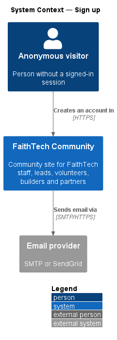
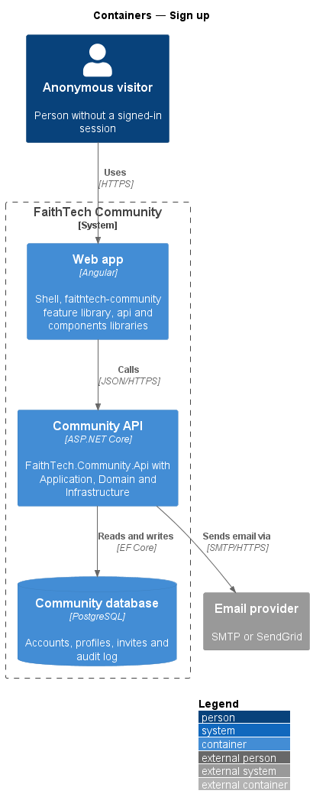
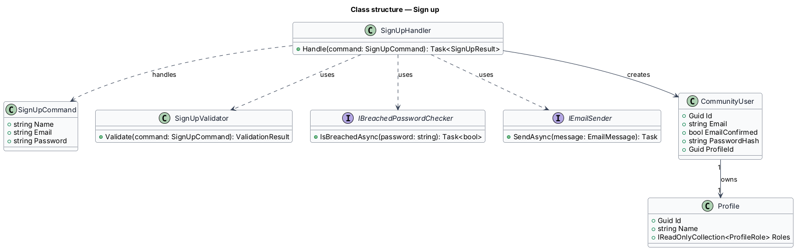
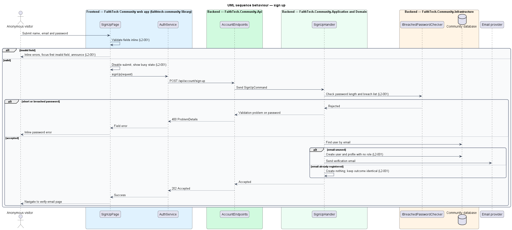

# Sign up

## Overview

FaithTech Community is open: anyone can create an account and a profile. *Sign up* is the first step for every person who has not been invited, and the entry point that turns an anonymous visitor into a member.

**account** — ASP.NET Identity user record holding a name, an email and a hashed password

**role** — global permission grant held by a profile; a new account holds none

A visitor submits a name, an email and a password. The system creates the account with no role, sends an email-verification message and shows the verify-email page. The outcome is the same whether or not the email is already registered, so the form does not disclose which emails hold accounts. The account cannot be used until the email is verified (see the email-verification feature).

## Description

- **`SignUpFormComponent`** — the form lives in the `components` library and `signUpFieldErrors` (in `api`) maps the API's validation problem onto it; the community app's `SignUpPage` and the marketing page share both (`docs/detailed-designs/marketing/landing-page`). A Google sign-up follows `docs/detailed-designs/identity/google-sign-in`.
The slice runs from the `sign-up` mock page to the database and the email provider. The sign-up page belongs to the app shell (`frontend/projects/faithtech-community`) because it precedes any feature library.

- **`SignUpPage`** — Angular page built from `components` form fields and buttons. It validates fields inline, moves focus to the first invalid field, announces errors through a live region and shows a busy state on the submit button while the request is in flight.
- **`AuthService`** — contract in the `api` library, provided through the `AUTH_SERVICE` injection token and implemented by `HttpAuthService`. It wraps the account endpoints and the OIDC + PKCE client.
- **`AccountEndpoints`** — minimal API route group in `FaithTech.Community.Api`. It maps the account routes, opts each one into anonymous access explicitly, and forwards the request to the Application handler. It holds no business logic.
- **`CommunityDbContext`** — EF Core context in `FaithTech.Community.Infrastructure`. It stores ASP.NET Identity users alongside community data in PostgreSQL.
- **`SignUpCommand`** — request carrying `Name`, `Email` and `Password`.
- **`SignUpValidator`** — validator in the Application `Profiles/` folder `<TO SUPPLY: final folder for account handlers>`. It requires every field, limits the trimmed name to the profile editor's 100 characters (`UpdateProfileValidator.MaxName`, "Use 100 characters or fewer for your name."), checks the email format and requires a password of at least 12 characters. The sign-up page applies the same name rule before submitting.
- **`IBreachedPasswordChecker`** — Application abstraction implemented in Infrastructure. It reports whether a password appears in a breached-password list. The source of the list is `<TO SUPPLY>`.
- **`SignUpHandler`** — Application handler. It creates the account through `UserManager<CommunityUser>` with no role, creates the empty `Profile`, issues a verification token and queues the verification email. When the email already exists, it returns the same result without creating anything.
- **`CommunityUser`** — ASP.NET Identity user extended with `ProfileId`.
- **`Profile`** — Domain entity holding `Name` and the role collection, empty at creation.
- **`IEmailSender`** — Application abstraction implemented in Infrastructure over SMTP or SendGrid.

## Requirements

The feature realizes the following level-2 (L2) requirements. Each L2 requirement refines a level-1 (L1) requirement, cited by identifier.

| L2 ID | Refines (L1) | Requirement |
|-------|--------------|-------------|
| `L2-001` | `L1-001` | Anyone can create an account with a name, email and password. New accounts have no role. |

### Acceptance criteria

**`L2-001`**

1. Given an unused email and a valid password, when the visitor submits the sign-up form, then the account is created with no role, an email-verification message is sent, and the visitor sees the verify-email page.
2. Given an email already registered, when the visitor submits, then the system shows the same "check your email" outcome without revealing that the email exists.
3. Given a password shorter than 12 characters or found in a breached-password list, when the visitor submits, then the form shows an inline error on the password field and no account is created.
4. Given an empty or malformed field, when the visitor submits, then each invalid field shows an inline error, focus moves to the first invalid field, and the error is announced to screen readers.
5. Given the form is submitting, when the request is in flight, then the submit button is disabled and shows a busy state.
6. Given a name longer than 100 characters after trimming, when the visitor submits, then the name field shows "Use 100 characters or fewer for your name." and no account is created, so every new name can be saved unchanged in the profile editor (`L2-006`).

## Diagrams

### System context

A visitor creates an account in FaithTech Community, which sends the verification message through the email provider.

### Containers

The web app posts the sign-up form to the Community API, which writes the account to the Community database and sends email through the email provider.

### Components

`AccountEndpoints` forwards a `SignUpCommand` to `SignUpHandler`, which validates, checks the breached-password list, creates the user and profile, and sends the verification email.

### Class structure

`SignUpHandler` depends on `SignUpCommand`, `SignUpValidator`, `IBreachedPasswordChecker` and `IEmailSender`, and creates a `CommunityUser` linked one-to-one to a `Profile`.

### Behaviour — sign up

The page validates inline before sending. The handler rejects weak passwords, creates the account with no role only when the email is unused, and returns the same outcome either way (`L2-001`).

## Open questions

Decisions recorded while building the Domain layer (`FaithTech.Community.Domain`):

- `Profile` requires a non-blank name and starts with an empty `ProfileRole` collection (`L2-001`, `L2-008`).
