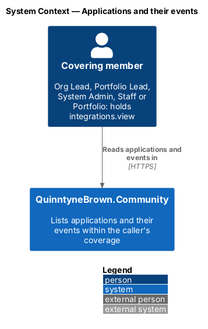
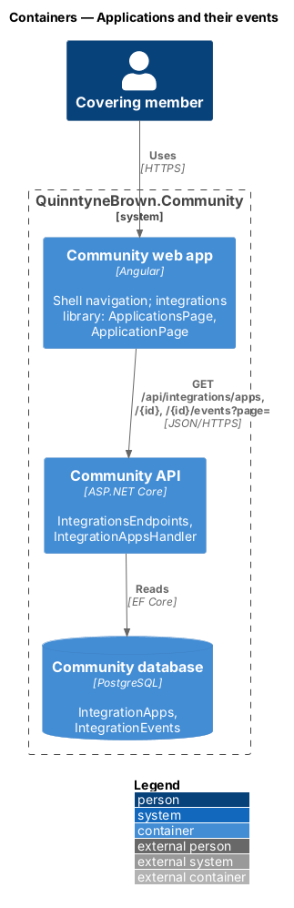
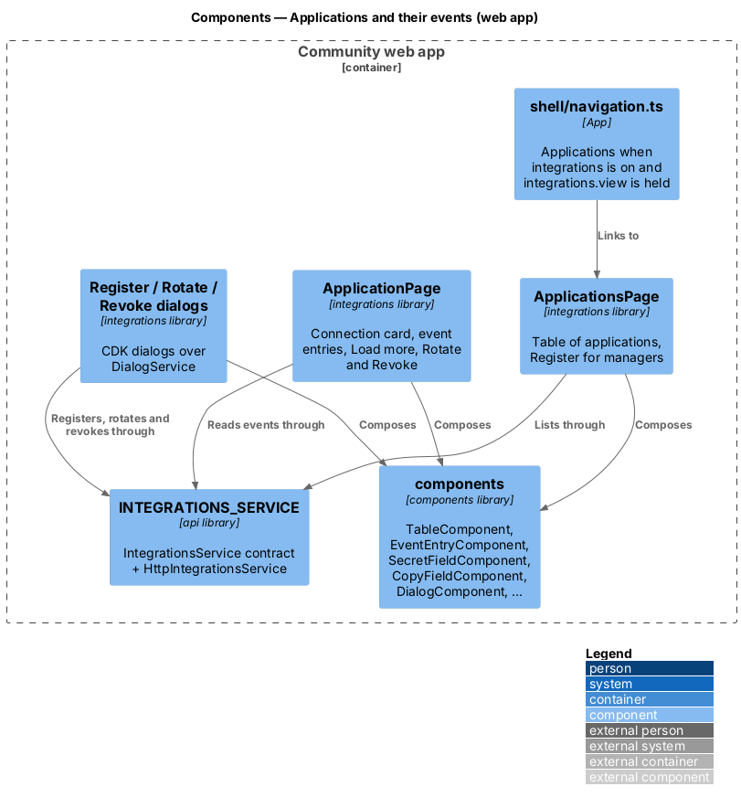
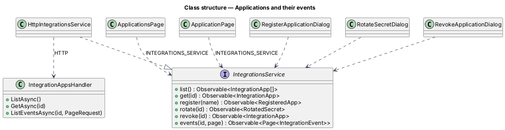
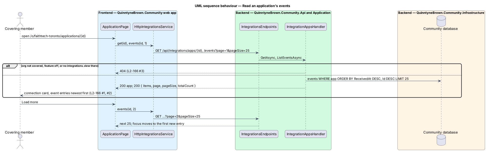

# Applications and their events

## Overview

People whose coverage includes an organization (`L1-025`) and who hold `integrations.view` there see its **Applications**: a list of the registered applications and, for each one, its events, newest first. Contact requests show name, email, message and received time and expand to the rest of their fields; event types without a view of their own show their data as JSON, so a publisher can ship a new type before the dashboard knows it.

The screens follow the mocks `pages/applications`, `pages/application` and the three integration dialogs, composed as listed in `docs/screen-composition.md` (Integrations).

## Description

### Application (`Application/Integrations/IntegrationApps.cs`)

- **Visibility** — an application is visible when its org is covered with the `integrations` feature on (`CallerAccess.CoveredWith`) and the caller holds `integrations.view` there. Anything else is `404`, by id.
- `ListAsync()` — `404` when `X-Org` names an org that is missing, uncovered or has the feature off (`CallerAccess.ActiveOrgUnavailable`); otherwise the read scope (`ReadScope(integrations)`) narrowed to orgs where the caller holds `integrations.view`; `403` when that leaves none. Ordered by name; each with `lastEventAt` and `eventCount`.
- `GetAsync(id)` — the application's DTO, `404` when not visible.
- `ListEventsAsync(id, PageRequest)` — `404` when not visible; events ordered by `ReceivedAt` then `Id`, descending; `PagedResult<IntegrationEventDto>` with page size 25 by default (at most 100). `IntegrationEventDto` is `{ id, eventId, eventType, occurredAt, receivedAt, data }`, `data` being the stored JSON.

| Method and route | Success | Failures |
|------------------|---------|----------|
| `GET /api/integrations/apps` | `200 IntegrationAppDto[]` | `403`, `404` |
| `GET /api/integrations/apps/{id}` | `200 IntegrationAppDto` | `404` |
| `GET /api/integrations/apps/{id}/events?page=&pageSize=` | `200 { items, page, pageSize, totalCount }` | `404` |

### Angular `api` library

- `IntegrationsService` contract and `INTEGRATIONS_SERVICE` injection token (`projects/api/src/lib/integrations/`), with `HttpIntegrationsService` registered in the app's providers. Types: `IntegrationApp`, `RegisteredApp`, `RotatedSecret`, `IntegrationEvent`, `ContactRequestData`, `IntegrationEventsPage`. The `X-Org` header comes from the existing org interceptor.

### Angular `integrations` feature library (`projects/integrations/`)

- `INTEGRATIONS_ROUTES`: `''` → `ApplicationsPageComponent`, `':id'` → `ApplicationPageComponent`, lazy-loaded by the app shell at `/o/:orgSlug/applications` behind `featureGuard('integrations')`.
- `ApplicationsPage` — the table of applications; *Register application* only when `canManage` holds for the org (`ACCESS_SERVICE.can('integrations.manage')`); forbidden on `403`.
- `ApplicationPage` — the route's `:id` through component input binding; the connection card (`DescriptionListComponent` with `mono` values and a masked `SecretFieldComponent`), `EventEntryComponent` per event (a contact request's fields with `multiline` for the message, or `json` for any other type), *Load more* while `items.length < totalCount` with focus moved to the first new entry, *Rotate secret* and *Revoke* in a `ClusterComponent` beside the status badge for managers on active applications, not-found on `404`.
- Dialogs: `RegisterApplicationDialog`, `RotateSecretDialog`, `RevokeApplicationDialog` (CDK dialogs through `DialogService`).
- Depends only on `components` and `api`.

### Shell navigation

`shell/navigation.ts` adds **Applications** (secondary, icon `applications`, after Reports) when the active org has the `integrations` feature and the caller holds `integrations.view` there. It is not shown under "All orgs".

### e2e fake (`e2e/fixtures/`)

`mock-integrations.ts` answers the five management routes and the events route from an in-memory set seeded per test, with the same status codes and shapes, and enforces coverage and the two permission codes through the fake's access model. `api.integrations.deliver(...)` adds an event as an accepted webhook would. Page objects: `e2e/pages/applications.page.ts`, `e2e/pages/application.page.ts` and `e2e/pages/integration.dialogs.ts` (register, rotate, revoke and the secret field). Specs: `e2e/tests/integrations/` (applications, application events, rotate and revoke), each screen checked with axe.

## Requirements

| L2 ID | Refines (L1) | Requirement |
|-------|--------------|-------------|
| `L2-165` | `L1-026` | Holders of `integrations.view` shall list the org's applications; others get 403, or 404 outside coverage or with the feature off. |
| `L2-166` | `L1-026` | They shall read an application's events newest first, 25 at a time; outside coverage it is 404. |

## Diagrams

### System context

Covering members read applications and events; nothing else is exposed.

### Containers

The web app calls the three read endpoints with `X-Org`.

### Components

The shell links to the feature library's pages, which compose library components and reach the API only through `INTEGRATIONS_SERVICE`.

### Class structure

Pages and dialogs depend on the `IntegrationsService` contract; the HTTP adapter implements it against `IntegrationAppsHandler`.

### Behaviour — read events

Coverage, the feature and the permission are checked on every request; events come back 25 at a time, newest first.

## Open questions

- Notifying people when an event arrives, and marking contact requests handled, are deferred.
