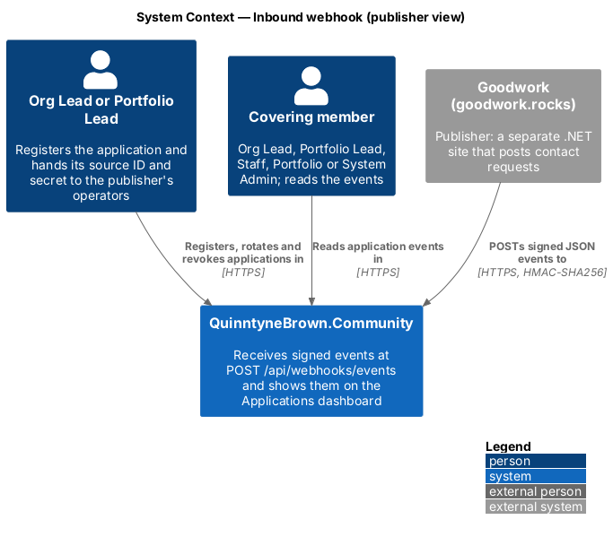
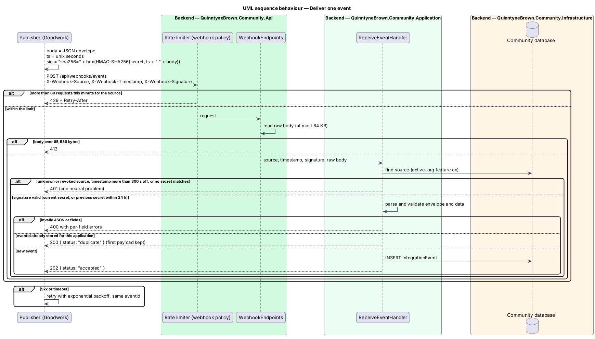
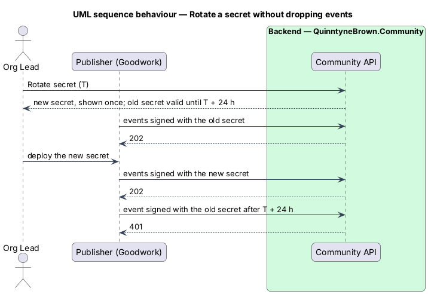

# Interface Control Document — Inbound webhook

- Interface: `POST /api/webhooks/events`
- Version: 1 (`eventType` values are versioned by name; the envelope is stable)
- Provider: QuinntyneBrown.Community (`https://app.quinntynebrown.com`)
- First publisher: Goodwork (`goodwork.rocks`)
- Requirements: `L2-159` to `L2-164` (`docs/specs/L2.md`)
- Decisions: [ADR 0042](../../../adr/0042-inbound-webhooks-for-integrations.md)

## Overview

QuinntyneBrown.Community receives events from other applications so the people who run an organization see them in one place. An **application** (`IntegrationApp` in code) is registered to exactly one organization by its Org Lead or the Portfolio Lead, which yields two values for the publisher's operators:

- **source ID** — a public identifier, `src_` followed by 32 lowercase hex characters, for example `src_6f1c2a9e0b4d4f7a8c3e5d2b1a0f9e8d`.
- **signing secret** — `whsec_` followed by 43 base64url characters (32 random bytes). It is shown once, when the application is registered or its secret is rotated, and cannot be read back. Treat it as a password: keep it in a secret store, never in source control or logs.

The publisher signs each request with the secret and sends it to one endpoint. The interface is push-only: QuinntyneBrown.Community never calls the publisher, and nothing in a response asks the publisher to do anything other than retry.

## Description

### Transport

| Item | Value |
|------|-------|
| Method and path | `POST /api/webhooks/events` |
| Scheme | HTTPS only (TLS 1.2 or later). Plain HTTP is never accepted in production. |
| Request body | One JSON object (UTF-8), at most 65,536 bytes |
| `Content-Type` | `application/json` (a `charset=utf-8` parameter is allowed) |
| Authentication | HMAC-SHA256 signature headers; no cookies, no bearer token |

### Headers

| Header | Required | Value |
|--------|----------|-------|
| `X-Webhook-Source` | Yes | The source ID, for example `src_6f1c2a9e0b4d4f7a8c3e5d2b1a0f9e8d` |
| `X-Webhook-Timestamp` | Yes | The time of signing in Unix seconds (an integer, for example `1793462400`) |
| `X-Webhook-Signature` | Yes | `sha256=` followed by the lowercase hex HMAC-SHA256 of `timestamp + "." + rawBody` |

The signature is computed over the **exact bytes sent** as the body: the decimal timestamp string, one full stop (`.`), then the raw UTF-8 body. The HMAC key is the UTF-8 bytes of the whole secret string, `whsec_` prefix included. Hex digits may be sent in either case; the provider compares the decoded bytes in constant time.

The timestamp shall be within 300 seconds (5 minutes) of the provider's clock, in either direction. A request outside that window answers `401`, which limits replay of a captured request. Publishers should keep their clock synchronised with NTP.

### Envelope

```json
{
  "eventId": "0b1f7c5e-8a43-4f0e-9d0e-7a2b8c1d3e4f",
  "eventType": "contact-request.created",
  "occurredAt": "2026-10-23T14:05:00Z",
  "data": { }
}
```

| Field | Type | Rules |
|-------|------|-------|
| `eventId` | string (UUID) | Required. Unique per event, chosen by the publisher. A retry of the same event shall reuse the same `eventId`. |
| `eventType` | string | Required. 1 to 100 characters of lowercase letters, digits, `.` and `-`, starting and ending with a letter or digit (`^[a-z0-9]+([.-][a-z0-9]+)*$`). |
| `occurredAt` | string | Required. ISO 8601 date and time with a UTC offset (`Z` or `±hh:mm`), when the event happened at the publisher. |
| `data` | object | Required. A JSON object. Its shape depends on `eventType`. |

Fields other than these four are ignored and not stored.

### Event type `contact-request.created` (v1)

Someone filled in the publisher's contact form.

```json
{
  "name": "Ada Lovelace",
  "email": "ada@example.com",
  "message": "We'd like to talk about volunteering at the next hackathon.",
  "organization": "Analytical Engines Ltd",
  "phone": "+1 416 555 0100"
}
```

| Field | Type | Rules |
|-------|------|-------|
| `name` | string | Required. 1 to 200 characters after trimming. |
| `email` | string | Required. A valid email address, at most 254 characters. |
| `message` | string | Required. 1 to 5,000 characters after trimming. |
| `organization` | string or null | Optional. At most 200 characters. |
| `phone` | string or null | Optional. At most 40 characters. |

Other fields inside `data` are kept as sent but not shown.

### Other event types (forward compatibility)

An `eventType` the provider does not know is **accepted** (`202`) and stored with its `data` object as sent, so a publisher can ship a new event type before the dashboard has a view for it. Such events appear on the dashboard as a generic card showing the type and the raw JSON. Only `contact-request.created` has its `data` validated; for any other type `data` must only be a JSON object.

### Responses

Every response is JSON. Error responses are RFC 9457 problem details (`application/problem+json`).

| Status | When | Body |
|--------|------|------|
| `202 Accepted` | The event was verified, valid and stored. | `{ "status": "accepted", "eventId": "<uuid>" }` |
| `200 OK` | An event with the same `eventId` was already stored for this application. Nothing is stored; the first payload is kept even if this one differs. | `{ "status": "duplicate", "eventId": "<uuid>" }` |
| `400 Bad Request` | The signature is valid but the body is not a JSON object, the envelope or `contact-request.created` data breaks a rule above, or `Content-Type` is not JSON. | Problem details with `errors`, keyed by field path (`body`, `contentType`, `eventId`, `data.email`, …) |
| `401 Unauthorized` | A header is missing or malformed; the source is unknown or revoked; the timestamp is more than 300 seconds off; or the signature matches no valid secret. | One neutral problem: `"The request could not be authenticated."` The reason is never given. |
| `413 Payload Too Large` | The body is over 65,536 bytes. | Empty |
| `429 Too Many Requests` | More than 60 requests in the current one-minute window for this `X-Webhook-Source`. | Empty; `Retry-After` gives the seconds to wait |
| `5xx` | The provider failed. | Problem details or empty |

Checks run in this order: rate limit (`429`), size (`413`), authentication (`401`), body (`400`), duplicate (`200`), store (`202`). An unauthenticated request never learns whether its body was valid.

### Rate limit

Each source may send 60 requests per fixed one-minute window. Requests over the limit answer `429` with `Retry-After` in whole seconds until the window resets. The limit counts every request that names the source, including rejected ones. The provider's general per-address limit (100 requests a minute) also applies.

### Retries

- On `5xx`, a timeout, or a lost connection: retry with exponential backoff and jitter, for example 1 s, 2 s, 4 s, 8 s … up to 1 hour between attempts, for up to 24 hours. Re-sign each attempt with a fresh timestamp, and **keep the same `eventId`** so a delivery that did succeed is answered `200` rather than stored twice.
- On `429`: wait at least `Retry-After` seconds, then retry as above.
- On any other `4xx` (`400`, `401`, `413`): do not retry. The request will fail the same way; log it and alert an operator.
- Treat `200` and `202` as delivered.

### Secret rotation

An Org Lead or the Portfolio Lead may rotate the secret at any time. Rotation returns a new secret once; the **previous secret stays valid for 24 hours** from the moment of rotation, so the publisher can deploy the new one without dropping events. During those 24 hours a request signed with either secret is accepted. After them, only the new secret works. Rotating again within the 24 hours replaces the previous secret with the one being rotated out.

### Revocation

Revoking an application is permanent. From that moment every request naming its source answers `401`, whichever secret signs it. Events already received stay visible on the dashboard. There is no un-revoke; register a new application to resume.

### Versioning

- The envelope (`eventId`, `eventType`, `occurredAt`, `data`) and the signing scheme are version 1 and will not change incompatibly. A future signing scheme would use a new prefix in `X-Webhook-Signature` (for example `sha512=`).
- A change to the shape of an event type's `data` is published as a new `eventType` name (for example `contact-request.created.v2`); the old name keeps its rules.
- New optional fields may be added to an existing event type's `data`; publishers may send them before the provider shows them.

### Sample publisher in C#

A minimal .NET publisher that Goodwork can copy. It reads the source ID and secret from configuration (never from source), signs the exact bytes it sends, and retries per the rules above.

```csharp
using System.Net;
using System.Net.Http.Headers;
using System.Security.Cryptography;
using System.Text;
using System.Text.Json;

public sealed record ContactRequest(string Name, string Email, string Message, string? Organization, string? Phone);

public sealed class CommunityWebhookPublisher(HttpClient http, string sourceId, string secret, TimeProvider time)
{
    private static readonly JsonSerializerOptions Json = new(JsonSerializerDefaults.Web);

    /// <summary>Sends one contact request; true when delivered (202 or 200).</summary>
    public async Task<bool> SendContactRequestAsync(ContactRequest request, CancellationToken cancellationToken = default)
    {
        var envelope = new
        {
            eventId = Guid.NewGuid(),          // keep this value for every retry of the event
            eventType = "contact-request.created",
            occurredAt = time.GetUtcNow(),
            data = request,
        };
        var body = JsonSerializer.SerializeToUtf8Bytes(envelope, Json);

        var delay = TimeSpan.FromSeconds(1);
        for (var attempt = 1; attempt <= 12; attempt++)
        {
            HttpResponseMessage? response = null;
            try
            {
                response = await http.SendAsync(Sign(body), cancellationToken);
                if (response.StatusCode is HttpStatusCode.Accepted or HttpStatusCode.OK)
                {
                    return true;
                }

                if (response.StatusCode == HttpStatusCode.TooManyRequests && response.Headers.RetryAfter?.Delta is { } wait)
                {
                    delay = wait > delay ? wait : delay;
                }
                else if ((int)response.StatusCode < 500)
                {
                    return false;              // 400, 401, 413: retrying cannot help
                }
            }
            catch (HttpRequestException) { }  // network failure: retry
            catch (TaskCanceledException) when (!cancellationToken.IsCancellationRequested) { } // timeout: retry
            finally
            {
                response?.Dispose();
            }

            await Task.Delay(delay + TimeSpan.FromMilliseconds(Random.Shared.Next(250)), cancellationToken);
            delay = TimeSpan.FromSeconds(Math.Min(delay.TotalSeconds * 2, 3600));
        }

        return false;
    }

    private HttpRequestMessage Sign(byte[] body)
    {
        var timestamp = time.GetUtcNow().ToUnixTimeSeconds().ToString(System.Globalization.CultureInfo.InvariantCulture);
        var signed = Encoding.UTF8.GetBytes(timestamp + ".").Concat(body).ToArray();
        var signature = Convert.ToHexStringLower(HMACSHA256.HashData(Encoding.UTF8.GetBytes(secret), signed));

        var message = new HttpRequestMessage(HttpMethod.Post, "/api/webhooks/events")
        {
            Content = new ByteArrayContent(body),
        };
        message.Content.Headers.ContentType = new MediaTypeHeaderValue("application/json") { CharSet = "utf-8" };
        message.Headers.Add("X-Webhook-Source", sourceId);
        message.Headers.Add("X-Webhook-Timestamp", timestamp);
        message.Headers.Add("X-Webhook-Signature", "sha256=" + signature);
        return message;
    }
}

// Registration, for example in Program.cs:
// builder.Services.AddHttpClient<CommunityWebhookPublisher>(c =>
// {
//     c.BaseAddress = new Uri("https://app.quinntynebrown.com");
//     c.Timeout = TimeSpan.FromSeconds(10);
// }).AddTypedClient((http, sp) => new CommunityWebhookPublisher(
//     http,
//     builder.Configuration["Community:WebhookSourceId"]!,
//     builder.Configuration["Community:WebhookSecret"]!,   // from a secret store
//     TimeProvider.System));
```

### Sample request on the wire

```http
POST /api/webhooks/events HTTP/1.1
Host: app.quinntynebrown.com
Content-Type: application/json; charset=utf-8
X-Webhook-Source: src_6f1c2a9e0b4d4f7a8c3e5d2b1a0f9e8d
X-Webhook-Timestamp: 1793462400
X-Webhook-Signature: sha256=<64 lowercase hex characters>

{"eventId":"0b1f7c5e-8a43-4f0e-9d0e-7a2b8c1d3e4f","eventType":"contact-request.created","occurredAt":"2026-10-23T14:05:00Z","data":{"name":"Ada Lovelace","email":"ada@example.com","message":"We'd like to talk about volunteering."}}
```

```http
HTTP/1.1 202 Accepted
Content-Type: application/json; charset=utf-8

{"status":"accepted","eventId":"0b1f7c5e-8a43-4f0e-9d0e-7a2b8c1d3e4f"}
```

## Requirements

| L2 ID | Refines (L1) | Requirement |
|-------|--------------|-------------|
| `L2-161` | `L1-026` | The system shall accept a signed event from an active application's publisher and store it once. |
| `L2-162` | `L1-026` | The system shall reject a webhook request that is unauthenticated, stale, oversized or invalid. |
| `L2-163` | `L1-026` | The system shall treat a repeated `eventId` from the same application as delivered without storing it again. |
| `L2-164` | `L1-026` | The system shall limit each webhook source to 60 requests per minute. |
| `L2-159` | `L1-026` | An Org Lead or the Portfolio Lead shall be able to rotate an application's signing secret, with the previous secret valid for 24 hours. |
| `L2-160` | `L1-026` | An Org Lead or the Portfolio Lead shall be able to revoke an application permanently. |

## Diagrams

### System context

The Org Lead registers the application and passes its source ID and secret to the publisher's operators; the publisher posts signed events; everyone whose coverage includes the org reads them.



### Behaviour — deliver one event

The rate limit, the size cap, authentication, validation and the duplicate check run in that order, and only a new, valid, authenticated event is stored. A `5xx` or timeout is retried with the same `eventId`.



### Behaviour — rotate a secret

Both secrets are accepted for 24 hours after rotation, so the publisher can deploy the new one without a gap; afterwards the old one answers `401`.



## Open questions

- None for version 1. Outbound webhooks, replay, a per-address webhook limit and `409` for a duplicate `eventId` with a different payload are deferred ([integrations README](../README.md)).
