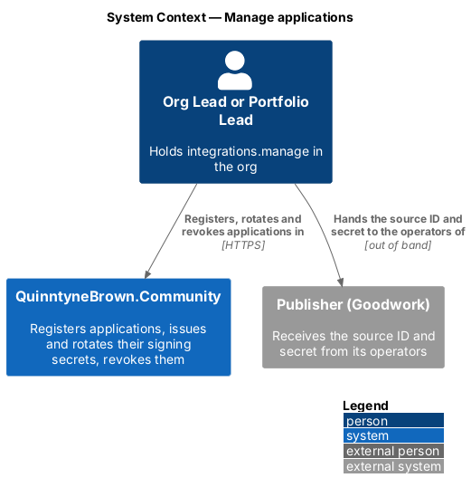
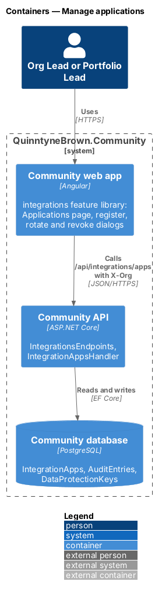
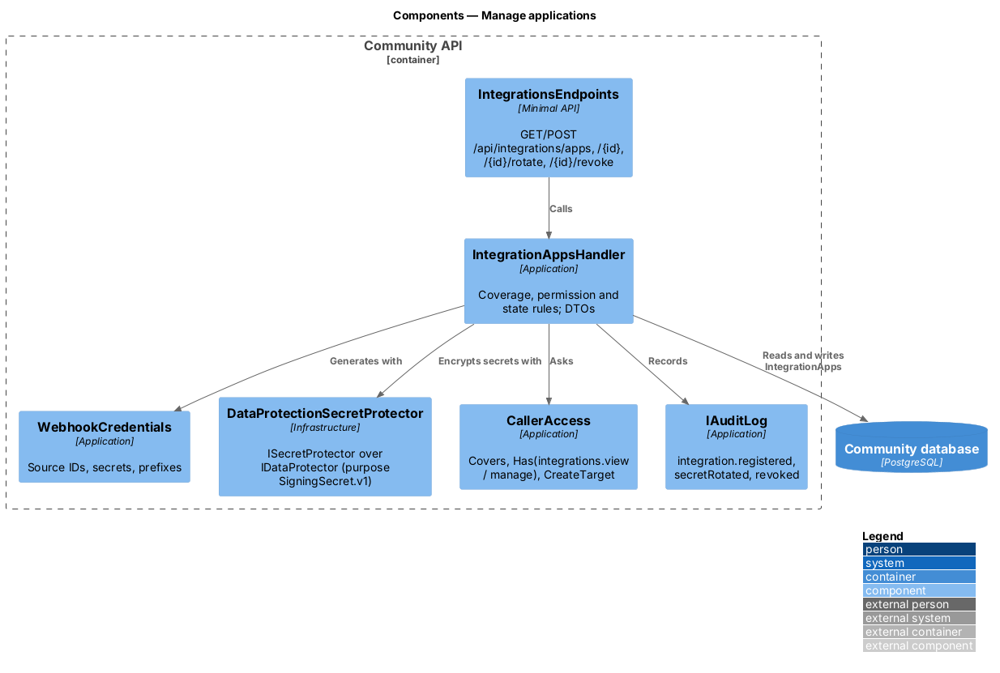
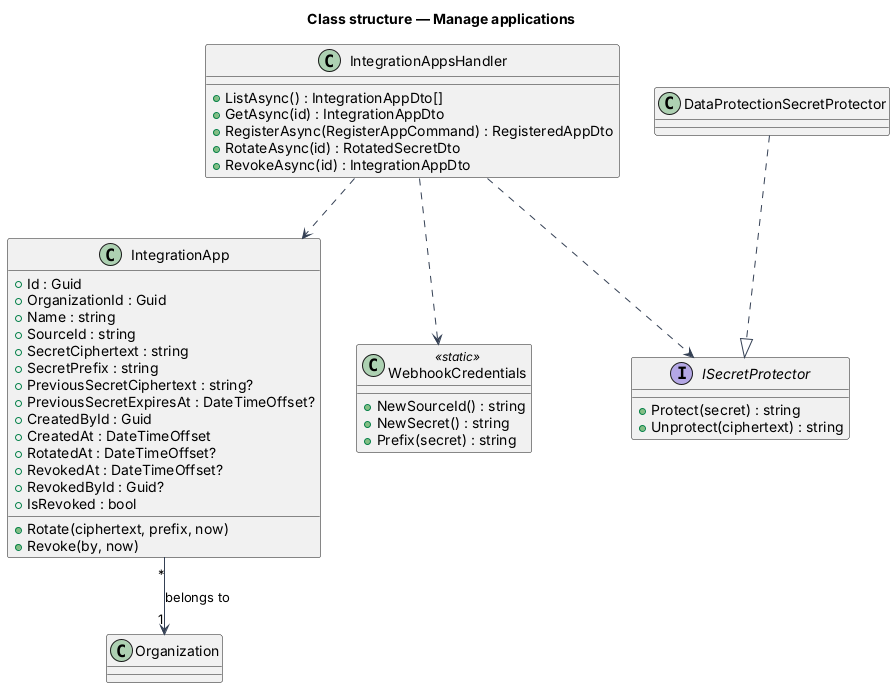
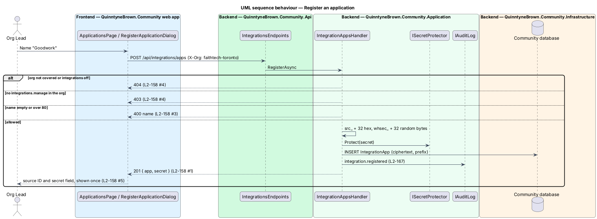
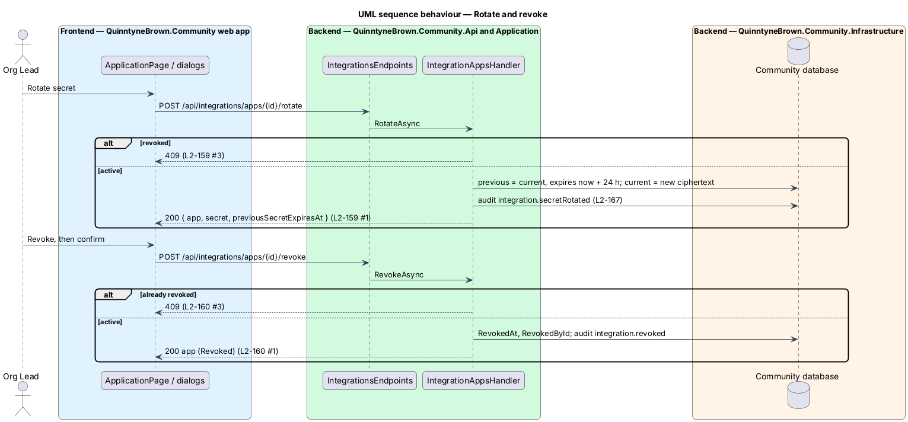

# Manage applications

## Overview

An Org Lead or the Portfolio Lead registers an application, such as Goodwork, in an organization and receives two values to hand to the application's developers: the **source ID** and the **signing secret** ([ICD](../icd/README.md)). The secret is shown once. Later they may **rotate** the secret, with a 24-hour overlap so the publisher can deploy the new one without dropping events, or **revoke** the application, permanently. Every register, rotate and revoke is audited.

An application belongs to exactly one organization (`L2-139`), like every other record. Who may do what is decided by two permission codes of the switchable feature `integrations` ([ADR 0033](../../../adr/0033-permission-codes-and-role-catalogues.md), [ADR 0038](../../../adr/0038-feature-flags-per-org-type.md)):

- **`integrations.view`** — read the org's applications and their events
- **`integrations.manage`** — register, rotate and revoke

## Description

### Domain (`Domain/Integrations/`)

- **`IntegrationApp`** (`Id`, `OrganizationId`, `Name` (1 to 80), `SourceId` (unique), `SecretCiphertext`, `SecretPrefix` (first 10 characters, `whsec_` and 4), `PreviousSecretCiphertext?`, `PreviousSecretExpiresAt?`, `CreatedById`, `CreatedAt`, `RotatedAt?`, `RevokedAt?`, `RevokedById?`). `IsRevoked` is `RevokedAt != null`.
  - `Rotate(ciphertext, prefix, now)` — moves the current ciphertext to `PreviousSecretCiphertext`, sets `PreviousSecretExpiresAt = now + 24h` (`RotationOverlap`), stores the new one and `RotatedAt`; throws when revoked.
  - `Revoke(by, now)` — sets `RevokedAt` and `RevokedById` once; throws when already revoked.
- **`Permissions.IntegrationsView`** (`integrations.view`) and **`Permissions.IntegrationsManage`** (`integrations.manage`), both mapped to **`Features.Integrations`** (`integrations`), which is switchable and on for both seeded Org Types (FaithTech City through `Features.Switchable`, Startup explicitly).

### Seed and migration

- `HierarchySeed`: the Startup type lists `Features.Integrations`; the Portfolio and Staff cross-org roles hold `integrations.view`. Org Lead, Portfolio Lead and System Admin hold both codes by tier; Member and the catalogue roles hold neither.
- Migration `Integrations` (`Infrastructure/Persistence/Migrations/`, applied by the Cli): creates `IntegrationApps` (unique `SourceId`, index on `OrganizationId`), `IntegrationEvents` (see [receive events](../receive-events/README.md)) and `DataProtectionKeys`; and, because the seed only inserts what is missing, appends `integrations` to the seeded Org Types' `EnabledFeatures` and `integrations.view` to the seeded Staff and Portfolio roles' `Permissions` where absent. Running the seed again changes nothing.

### Secrets

- **`WebhookCredentials`** (`Application/Integrations/`) — `NewSourceId()` is `src_` and a new GUID in lowercase hex; `NewSecret()` is `whsec_` and 32 bytes from `RandomNumberGenerator` in base64url; `Prefix(secret)` is its first 10 characters.
- **`ISecretProtector`** (`Application/Integrations/`) with **`DataProtectionSecretProtector`** (`Infrastructure/Integrations/`) — an `IDataProtector` with the purpose `QuinntyneBrown.Community.Integrations.SigningSecret.v1`. `Unprotect` returns null when the ciphertext cannot be read.
- **Key ring** — `AddDataProtection().SetApplicationName("QuinntyneBrown.Community").PersistKeysToDbContext<CommunityDbContext>()`; `CommunityDbContext` implements `IDataProtectionKeyContext` ([ADR 0042](../../../adr/0042-inbound-webhooks-for-integrations.md)).

### Application (`Application/Integrations/IntegrationApps.cs`)

**`IntegrationAppsHandler`** (`IApplicationDbContext`, `ICurrentUser`, `ProfileAccess`, `ISecretProtector`, `IAuditLog`, `TimeProvider`):

- `RegisterAsync({ name })` — the org is `CallerAccess.CreateTarget(integrations.manage)`: the active org (`X-Org`), `404` when it is missing, uncovered or has the feature off, `403` without `integrations.manage` there. Name trimmed, 1 to 80 characters, else `400` `name`. Stores the ciphertext and prefix; audits `integration.registered` (`{ Name, SourceId }`, the org); returns `201` `{ app, secret }`.
- `RotateAsync(id)` — the application must be visible (`integrations.view` in its covered org with the feature on), else `404`; `403` without `integrations.manage`; `409` "This application is revoked." when revoked. Audits `integration.secretRotated` (`{ SecretPrefix }`, no secret); returns `200` `{ app, secret, previousSecretExpiresAt }`.
- `RevokeAsync(id)` — same visibility and permission; `409` "This application is already revoked." when revoked. Audits `integration.revoked`; returns `200` app.

Audit entries carry the org, so its Org Lead sees them (`L2-153`). Every action is audited, not only overrides, because a credential changes.

### Api contracts (`Api/Endpoints/IntegrationsEndpoints.cs`, authenticated by default)

| Method and route | Body | Success | Failures |
|------------------|------|---------|----------|
| `POST /api/integrations/apps` | `{ name }` | `201 { app: IntegrationAppDto, secret }` | `400`, `403`, `404` |
| `POST /api/integrations/apps/{id}/rotate` | — | `200 { app, secret, previousSecretExpiresAt }` | `403`, `404`, `409` |
| `POST /api/integrations/apps/{id}/revoke` | — | `200 IntegrationAppDto` | `403`, `404`, `409` |

`IntegrationAppDto` is `{ id, name, sourceId, secretPrefix, organization: OrgRef, status: "Active" | "Revoked", createdAt, createdBy: PersonRef, rotatedAt, previousSecretExpiresAt, revokedAt, revokedBy, lastEventAt, eventCount, canManage }`. It never carries a secret.

### Frontend

The `integrations` library's `RegisterApplicationDialog`, `RotateSecretDialog` and `RevokeApplicationDialog` (CDK dialogs through `DialogService`) call `INTEGRATIONS_SERVICE`. The register and rotate results show the secret in `SecretFieldComponent` (`components`), which masks itself to the prefix once copied; the source ID uses `CopyFieldComponent`. See [application events](../application-events/README.md) for the pages and the e2e fake.

## Requirements

| L2 ID | Refines (L1) | Requirement |
|-------|--------------|-------------|
| `L2-158` | `L1-026` | An Org Lead or the Portfolio Lead shall register an application in an org and receive its source ID and signing secret once. |
| `L2-159` | `L1-026` | They shall rotate an application's secret, with the previous secret valid for 24 hours. |
| `L2-160` | `L1-026` | They shall revoke an application permanently; its events stay visible. |
| `L2-167` | `L1-026` | Register, rotate and revoke shall be audited with the application's org and without the secret. |

## Diagrams

### System context

The Org Lead registers the application in QuinntyneBrown.Community and hands its source ID and secret to the publisher's operators outside the system.

### Containers

The web app calls the API with the active org in `X-Org`; the API stores applications, audit entries and the Data Protection key ring in the database.

### Components

`IntegrationAppsHandler` asks `CallerAccess` for coverage and permissions, generates credentials with `WebhookCredentials`, encrypts with `ISecretProtector` and audits every change.

### Class structure

An `IntegrationApp` belongs to one `Organization`; the handler depends on the protector abstraction, implemented over Data Protection in Infrastructure.

### Behaviour — register

Coverage and the feature give `404`, the permission `403`, the name `400`; a success stores only ciphertext, audits, and returns the secret once.

### Behaviour — rotate and revoke

Rotation keeps the previous secret for 24 hours; a revoked application refuses both actions with `409`.

## Open questions

- Wrapping the Data Protection key ring with Azure Key Vault is deferred ([ADR 0042](../../../adr/0042-inbound-webhooks-for-integrations.md)).
- Renaming an application and un-revoking are not offered.
