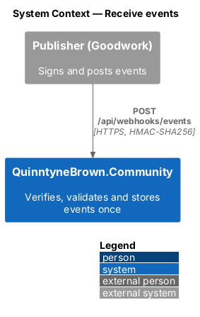
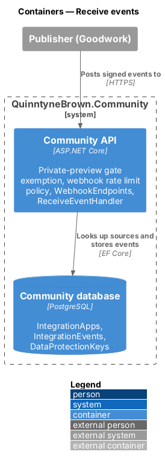
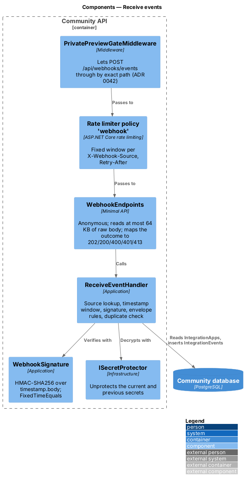
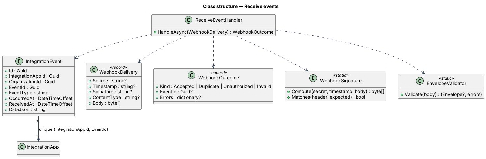
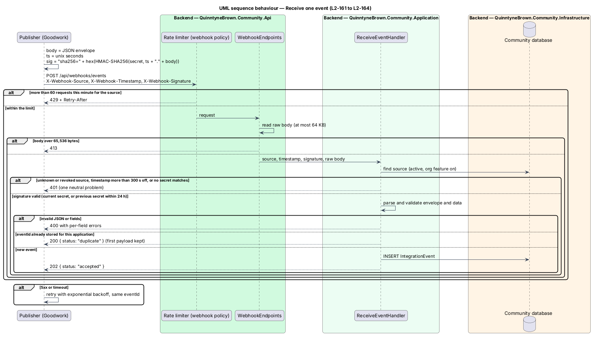

# Receive events

## Overview

A registered application posts signed events to `POST /api/webhooks/events`. This design is the server side of the [ICD](../icd/README.md): it lets the request past the private-preview wall, limits each source to 60 requests a minute, refuses bodies over 64 KB, authenticates the request by its HMAC signature and timestamp, validates the envelope and stores each event once per application.

- **delivery** — one HTTP request from a publisher
- **envelope** — the JSON body: `eventId`, `eventType`, `occurredAt`, `data`
- **duplicate** — a delivery whose `eventId` is already stored for the same application

## Description

### Pipeline (`Api/`)

1. **`PrivatePreviewGateMiddleware`** — while the wall is on, `POST /api/webhooks/events` passes by exact method and path, as `GET /health/live` does ([ADR 0042](../../../adr/0042-inbound-webhooks-for-integrations.md), [ADR 0026](../../../adr/0026-private-preview-wall-and-hosting.md)).
2. **Rate limiter** — the named policy `webhook` (`WebProtectionSetup.WebhookRateLimitPolicy`): a fixed one-minute window of `RateLimits:WebhookPerMinute` (default 60) partitioned by `webhook:{X-Webhook-Source}` (the header value, at most 100 characters, otherwise one shared partition). `OnRejected` copies the lease's `RetryAfter` metadata into `Retry-After` (whole seconds, rounded up) for this endpoint. The global per-user or per-address limiter still applies.
3. **`WebhookEndpoints.MapWebhookEndpoints`** — `MapPost("/api/webhooks/events")` with `AllowAnonymous()` and `RequireRateLimiting("webhook")`. It answers `413` when `Content-Length` exceeds 65,536, otherwise reads the body into memory and answers `413` as soon as it passes 65,536 bytes, then hands a **`WebhookDelivery`** (source, timestamp and signature headers, content type, raw bytes) to the handler and maps the outcome: `Accepted` → `202 { status: "accepted", eventId }`, `Duplicate` → `200 { status: "duplicate", eventId }`, `Unauthorized` → `401` problem "The request could not be authenticated.", `Invalid` → `400` validation problem.

### Application (`Application/Integrations/ReceiveEvent.cs`)

**`ReceiveEventHandler`** (`IApplicationDbContext`, `ISecretProtector`, `TimeProvider`, `ILogger`):

1. **Authenticate.** Missing or malformed headers, an unknown `SourceId`, a revoked application, an archived org, or an org whose type has `integrations` off → `Unauthorized`. The timestamp must parse as an integer within 300 seconds of `TimeProvider.GetUtcNow()` → else `Unauthorized`. The signature header must be `sha256=` and 64 hex characters. **`WebhookSignature.Compute(secret, timestamp, body)`** is `HMACSHA256(UTF8(secret), UTF8(timestamp + ".") + body)`; the handler compares it with the decoded header using `CryptographicOperations.FixedTimeEquals`, first against the current secret, then against the previous secret while `PreviousSecretExpiresAt > now`. No match → `Unauthorized`. The reason is logged at information level (never the body or signature).
2. **Validate.** `Content-Type` must be `application/json` (parameters allowed). **`WebhookEnvelope.Parse`** reads the body with `JsonDocument` and checks the envelope and, for `contact-request.created`, its data, with the ICD's limits; errors are keyed `body`, `eventId`, `eventType`, `occurredAt`, `data`, `data.name`, `data.email`, `data.message`, `data.organization`, `data.phone`. Email uses the same check as sign-up.
3. **Deduplicate and store.** If `(IntegrationAppId, EventId)` exists → `Duplicate`. Otherwise insert an **`IntegrationEvent`** and save; a `DbUpdateException` from the unique index (a racing delivery) → `Duplicate`.

### Domain and persistence

- **`IntegrationEvent`** (`Domain/Integrations/`): `Id`, `IntegrationAppId`, `OrganizationId` (copied from the application, so org scoping needs no join), `EventId`, `EventType` (max 100), `OccurredAt`, `ReceivedAt`, `DataJson` (the `data` object as sent, `jsonb` in PostgreSQL).
- Indexes: unique `(IntegrationAppId, EventId)`; `(IntegrationAppId, ReceivedAt)` for the newest-first list.

## Requirements

| L2 ID | Refines (L1) | Requirement |
|-------|--------------|-------------|
| `L2-161` | `L1-026` | The system shall accept a correctly signed, valid event from an active application and store it, including event types it does not know. |
| `L2-162` | `L1-026` | The system shall answer 401, 413 or 400 to a request that is not authentic, too large or not valid, and store nothing. |
| `L2-163` | `L1-026` | A repeated `eventId` from the same application shall answer 200 and store nothing. |
| `L2-164` | `L1-026` | Each source shall be limited to 60 requests a minute, answering 429 with `Retry-After`. |

## Diagrams

### System context

The publisher is the only actor; it posts signed events over HTTPS.

### Containers

The API receives the delivery and reads the application and its secrets from the database before storing the event.

### Components

The gate exemption, the `webhook` rate limit policy, the endpoint and the handler run in that order; the handler verifies with `WebhookSignature` over secrets decrypted by `ISecretProtector`.

### Class structure

`ReceiveEventHandler` turns a `WebhookDelivery` into a `WebhookOutcome`, storing an `IntegrationEvent` that is unique per application and `eventId`.

### Behaviour — receive one event

The rate limit, size, authentication, validation and duplicate checks run in order; only a new, valid, authentic event is stored.

## Open questions

- A per-address limit specific to the webhook, replay, and `409` for a conflicting duplicate are deferred.
