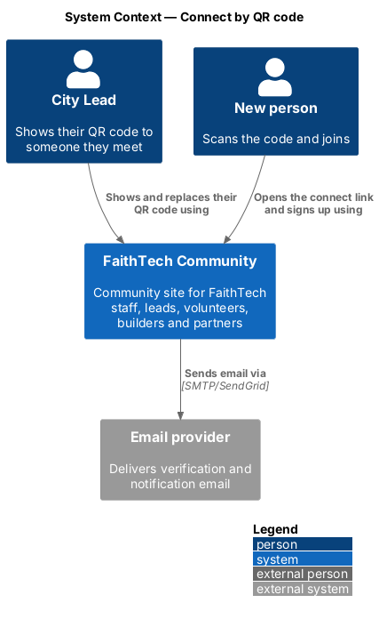
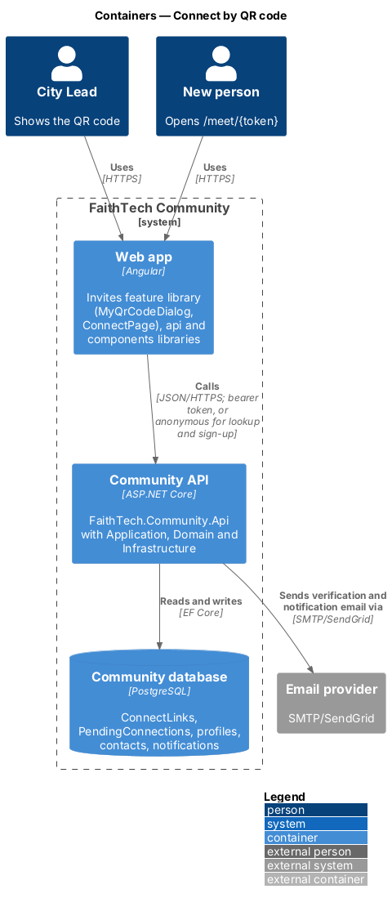
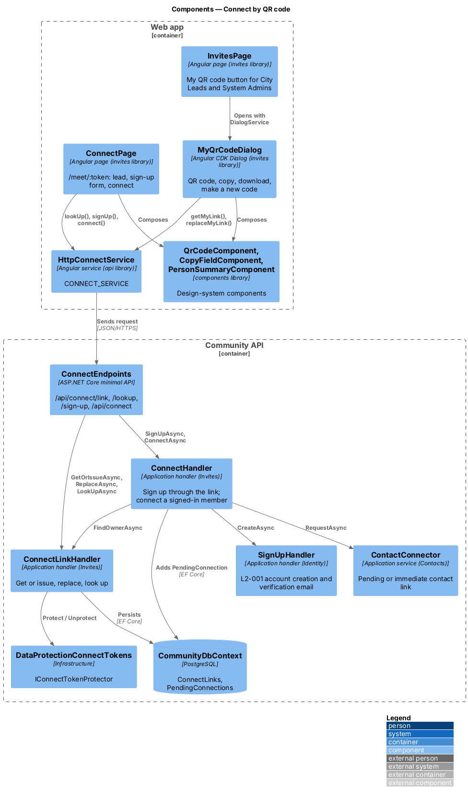
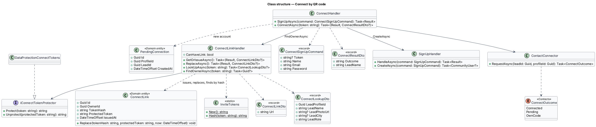
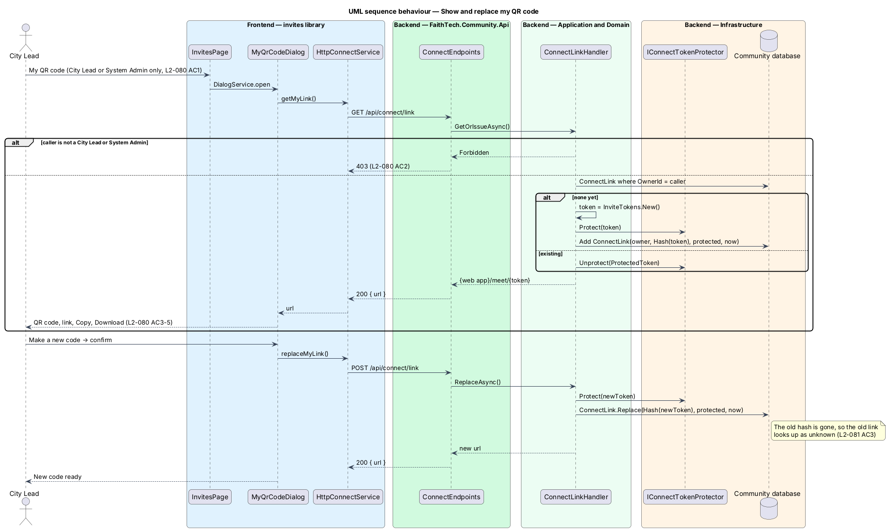
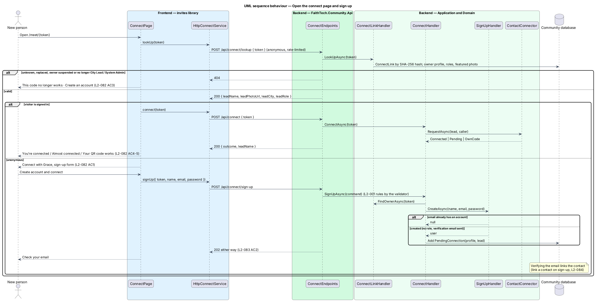

# Connect by QR code

## Overview

A City Lead meets someone new at an event and wants them in FaithTech Community, and in their own contacts, without typing an email into an invite. **Connect link** — a City Lead's personal, reusable link `{web app}/meet/{token}`, shown as a QR code. Anyone who opens it can join with email and a password; once their email is verified they become a private contact of that lead, linked to their profile, and the lead is notified.

A connect link is not an invite (`L2-010`, `L2-011`, [ADR 0006](../../../adr/0006-invite-tokens-and-acceptance.md)): no email is known, many people use the same code, it never expires, and it grants no role. The lead can replace it, which retires the old link at once ([ADR 0021](../../../adr/0021-connect-links.md)).

## Description

Backend (`FaithTech.Community.*`):

- **`ConnectLink`** — Domain entity (`Domain/Invites/ConnectLink.cs`): `OwnerId` (the lead's profile, unique), `TokenHash` (SHA-256, hex, unique), `ProtectedToken` (the token encrypted with ASP.NET Data Protection) and `IssuedAt`. `Replace(hash, protectedToken, now)` swaps in a new token on the same row, so the old hash no longer exists.
- **`IConnectTokenProtector`** — Application abstraction (`Application/Invites/ConnectLinks.cs`), implemented by **`DataProtectionConnectTokens`** in `Infrastructure/Invites/` under its own purpose. Only the owner's own `GET` unprotects it, to show the code again; lookups use the hash. Backend tests use a reversible fake.
- **`ConnectLinkHandler`** — Application handler (`Application/Invites/ConnectLinks.cs`):
  - `GetOrIssueAsync()` — City Lead or System Admin only (`403` otherwise); returns the caller's link, issuing one on first use with **`InviteTokens.New()`** and **`InviteTokens.Hash()`** (32 random bytes, base64url).
  - `ReplaceAsync()` — same check; replaces the token. Acts only on the caller's own link; there is no way to name another lead's link, so nothing is audited (`L2-081` AC4).
  - `LookUpAsync(token)` — anonymous; hashes the token and returns **`ConnectLookupDto`** (lead profile id, name, featured photo URL, home city, role label) when the owner still holds City Lead or System Admin and is not suspended, otherwise `null` (`404`).
  - `FindOwnerAsync(token)` — the same check, returning the owner's profile id, for sign-up and connect.
- **`ConnectHandler`** — Application handler (`Application/Invites/ConnectSignUp.cs`):
  - `SignUpAsync(ConnectSignUpCommand)` — anonymous; `404` for an unknown link; otherwise **`SignUpHandler.CreateAsync`** applies the `L2-001` rules and sends the verification email. When a new account was created, a **`PendingConnection`** (`Domain/Contacts/`) records the person and the lead. An existing email gets the same `202` and nothing else (`L2-083` AC2).
  - `ConnectAsync(token)` — signed-in member; returns **`ConnectOutcome`** `Connected`, `Pending` (email not verified yet) or `OwnCode`, through **`ContactConnector.RequestAsync`** ([link a contact on sign-up](../../contacts/link-contact-on-sign-up/README.md)).
- **`ConnectSignUpValidator`** — the `L2-001` name, email and password rules (shared through `SignUpRules`), plus a token.
- **`ConnectEndpoints`** (`Api/Endpoints/ConnectEndpoints.cs`):
  - `GET /api/connect/link` → `200 { url }` · `403`
  - `POST /api/connect/link` (make a new code) → `200 { url }` · `403`
  - `POST /api/connect/lookup` `{ token }` → `200 ConnectLookupDto` · `404` — anonymous, rate-limited
  - `POST /api/connect/sign-up` `{ token, name, email, password }` → `202` · `400` · `404` — anonymous, rate-limited
  - `POST /api/connect` `{ token }` → `200 { outcome, leadName }` (`Connected`, `Pending` or `OwnCode`) · `404` · `401`
  - Tokens always travel in the body, never the path, so they cannot reach request logs (`L2-043`).

Frontend:

- **`ConnectService`** contract and **`CONNECT_SERVICE`** token, implemented by **`HttpConnectService`** in the `api` library (`api/src/lib/invites/`).
- **`QrCodeComponent`**, **`CopyFieldComponent`**, and **`PersonSummaryComponent`** in `components` (design system pages `qr-code`, `copy-field`, `person-summary`). `QrCodeComponent` encodes the value itself (`qrcode-generator`, error correction M) and offers `downloadPng(fileName)`.
- **`MyQrCodeDialog`** (`invites/src/lib/dialogs/my-qr-code/`) — CDK dialog opened from **`InvitesPage`**'s *My QR code* button, which shows only for City Leads and System Admins. It loads the link, shows the QR code and the copy field, downloads `faithtech-qr-code.png`, and has a second confirm step for *Make a new code*.
- **`ConnectPage`** (`invites/src/lib/pages/connect/`) — routed at `/meet/:token` by **`CONNECT_ROUTES`**, lazy-loaded from the app shell outside the auth guard. `/meet` is used because `/connect/*` already belongs to the identity server on the same origin. Anonymous visitors see the lead and the form; signed-in members are connected on arrival; *Sign in to connect* returns to the page after sign-in. Someone who signed up with Google from the marketing page ([Google sign-in](../../identity/google-sign-in/README.md), ADR 0019) and then opens the link is connected like any signed-in member.

## Requirements

| L2 ID | Refines (L1) | Requirement |
|-------|--------------|-------------|
| `L2-080` | `L1-004` | My QR code |
| `L2-081` | `L1-004` | Connect link and new code |
| `L2-082` | `L1-004` | Connect page |
| `L2-083` | `L1-001`, `L1-004` | Sign up through a connect link |

The acceptance criteria are in [`docs/specs/L2.md`](../../../specs/L2.md). The automatic contact link (`L2-084`) is designed in [link a contact on sign-up](../../contacts/link-contact-on-sign-up/README.md).

## Diagrams

### System context

A City Lead shows their QR code; a new person opens it on their phone and joins. FaithTech Community emails the verification link and the lead's notification.

### Containers

The `invites` feature library in the Angular web app calls the Community API through the `api` library. The API stores the link's hash and protected copy in PostgreSQL.

### Components

`MyQrCodeDialog` and `ConnectPage` call `ConnectEndpoints`, which delegate to `ConnectLinkHandler` and `ConnectHandler`; `ConnectHandler` reuses `SignUpHandler` and `ContactConnector`.

### Class structure

### Behaviour — show and replace my QR code

### Behaviour — open the connect page and sign up

## Open questions

Resolved while designing (ADR 0021):

- **Where "My QR code" lives** — the invites page, beside *Invite someone*. City Leads already go there to bring people in; the profile page stays about the person.
- **Showing the code again** — a hash alone cannot be shown again, and the lead must see the same code on every visit (printed or shared copies must keep working). The token is therefore stored twice: the SHA-256 hash for lookups, and a Data Protection-encrypted copy that only the owner's own request decrypts. A database read alone still cannot be replayed as a link.
- **Route** — `/meet/:token`, because the reverse proxy sends `/connect/*` to the identity server.
- **System Admin and other leads' codes** — not allowed; each person manages only their own code, so there is no admin action to audit.
- **Owner loses the role or is suspended** — the link answers as unknown until they hold City Lead or System Admin again; the row is kept.
- **Seed data** — none. A link is issued the first time a City Lead opens "My QR code", so there is nothing to seed; the seeder holds only reference data (ADR 0014), and the Cli has no access to the API's Data Protection key ring that the protected copy needs. The e2e fake seeds links per test (`api.connect.addLink`).
- **Google** — Google sign-in lives on the marketing page (ADR 0019); it raises `EmailVerified` through `ContactSignedUpHandler`, so pending connections complete for Google accounts too. A *Continue with Google* button on the connect page needs that flow to return failures to the connect page and to say whether Google is configured; it is deferred.
- **Deferred** — a role on the connect link, a Google button on the connect page, a QR code per event, printable posters, other identity providers, scan counts, and the person choosing not to be linked (the page says what connecting does, which is the consent).
