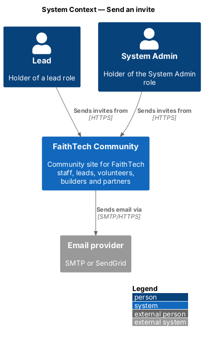
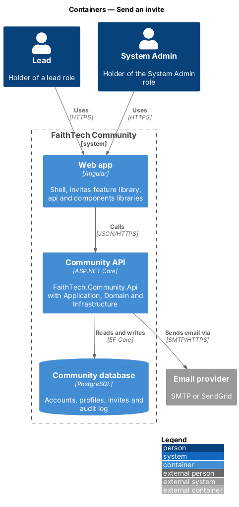
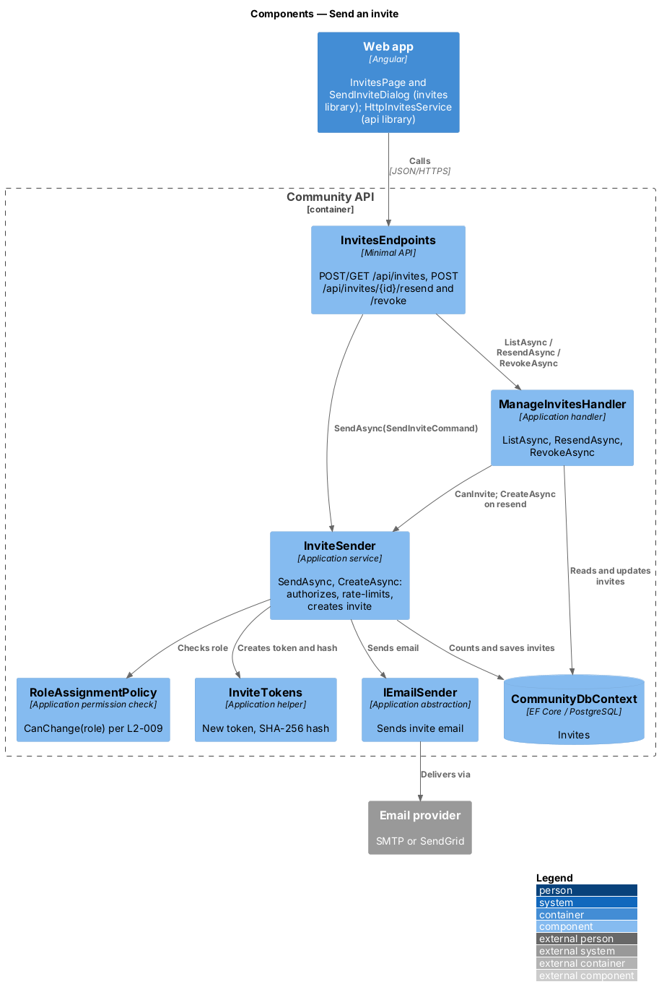
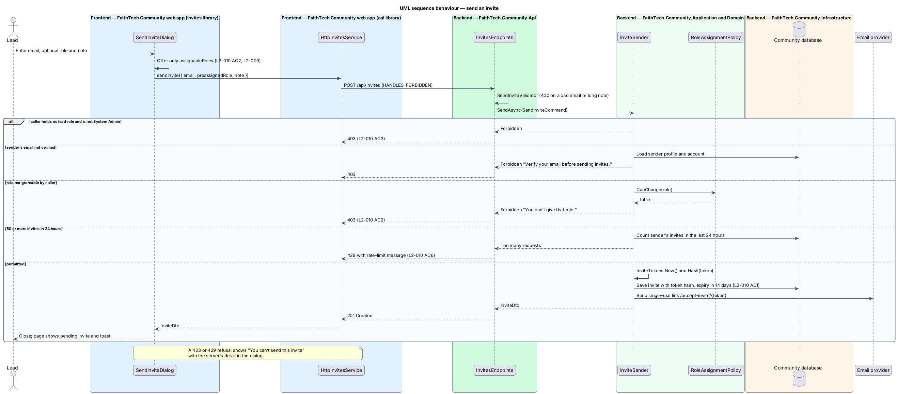

# Send an invite

## Overview

Leads grow the community by inviting people directly. An *invite* is an email carrying a single-use link that lets the recipient join, optionally with a role already granted.

**lead** — holder of any lead role: City Lead, Event Lead, Create Lead or Communications Lead

**pre-assigned role** — role recorded on the invite and granted when the invite is accepted

Any lead or System Admin may send invites. A City Lead may pre-assign only the roles a City Lead may grant under the role-assignment limits (`L2-009`). Each invite expires 14 days after it is sent, may be revoked while pending, and each inviter may send at most 50 invites in 24 hours.

## Description

- **`InvitesPage`** — page in the `invites` feature library at `/invites`, matching the `invites` mock. It lists every lead's invites, newest first, with status badges from `components` (Pending, Accepted, Expired, and Revoked shown as "Withdrawn"), opens `SendInviteDialog`, and offers **Resend** on an expired invite. `ListSkeletonComponent` shows the loading state. A sent or resent invite is added to the top of the list with a success toast.
- **`SendInviteDialog`** — Angular CDK dialog in the `invites` library, matching the `send-invite` mock. It collects an email, an optional role and an optional note, and offers only the roles `assignableRoles(callerRoles)` returns. A `403` or `429` refusal (role not allowed, unverified sender, rate limit) shows the server's `detail` in the dialog; an unreachable server shows an *Invite not sent* alert. While sending, the email and note are read-only and the role select is disabled. It closes with the new `InviteDto`.
- **`InvitesService`** — contract in the `api` library, provided through the `INVITES_SERVICE` injection token and implemented by `HttpInvitesService`. `sendInvite`, `listInvites(after?)`, `resendInvite` and `revokeInvite` call the four routes below. `InvitesPage` shows "Showing N of M invites" (`role="status"`) under the list. While `next` is set it offers "Show more invites", which appends the next page. A failed continuation keeps the list and shows a danger `ft-alert`, "We couldn’t load more invites. Try again.", and the button tries again. Sent and resent invites go to the top and add one to the total (mock states `more` and `more-error`). Send and resend carry the `HANDLES_FORBIDDEN` `HttpContextToken`, so a `403` reaches the dialog or page instead of the global `/forbidden` redirect.
- **`InvitesEndpoints`** — minimal API route group in `FaithTech.Community.Api` under `/api/invites`: `POST /api/invites`, `GET /api/invites?after=&pageSize=`, `POST /api/invites/{id}/resend` and `POST /api/invites/{id}/revoke`. It validates the send body with `SendInviteValidator` and holds no business logic.
- **`Invite`** — Domain entity holding `Email`, `TokenHash`, optional `PreassignedRole`, `InvitedBy`, `CreatedAt`, `ExpiresAt` (14 days after creation), optional `Note`, `AcceptedAt`, `AcceptedBy`, `RevokedAt` and a derived `Status(now)`. `MarkAccepted(by, now)` and `Revoke(now)` act only on a pending invite.
- **`InviteStatus`** — `Pending`, `Accepted`, `Expired`, `Revoked`.
- **`SendInviteCommand`** (`Email`, `PreassignedRole`, `Note`) and **`SendInviteValidator`** — the request and its checks: a valid email up to 256 characters and a note up to 500 characters.
- **`InviteSender`** — Application service. `CanInvite` is true for any lead role or System Admin. `SendAsync(command)` parses the role and calls `CreateAsync(email, role, note)`, which resend also uses. `CreateAsync` requires `CanInvite` and a verified sender email, checks the pre-assigned role with `RoleAssignmentPolicy.CanChange`, enforces the 50-per-24-hours limit, stores the `Invite` with only the token hash, and then sends the email through `IEmailSender`.
- **`InviteTokens`** — `New()` creates 32 random bytes encoded as base64url; `Hash(token)` returns the SHA-256 hash stored as `TokenHash` (ADR 0006).
- **`ManageInvitesHandler`** — Application handler with `ListAsync()`, `ResendAsync(id)` and `RevokeAsync(id)`, each allowed only when `InviteSender.CanInvite`. `ListAsync(after, pageSize)` returns one `InvitePageDto` (`Items`, `Next`, `TotalCount`) of every inviter's invites as `InviteDto`, newest first with ties broken by id (L2-010 AC4, AC7, ADR 0006). Pages hold 50 by default and at most 100 (`L2-046` AC3). `Next` is a keyset continuation, the last invite's creation time and id (`InviteCursor`), so invites sent while a lead is reading never shift later pages. A malformed `after` answers `400`. In PostgreSQL the id tie-break `Id.CompareTo(c.Id) < 0` translates to a `uuid` comparison. `ResendAsync` accepts only an expired invite and creates a new one through `InviteSender.CreateAsync` with the same email, role and note. `RevokeAsync` accepts only a pending invite.
- **`InviteDto`** — `Id`, `Email`, `PreassignedRole`, `Status`, `InvitedByName`, `CreatedAt`, `ExpiresAt`, `AcceptedAt`, `RevokedAt`.
- **`RoleAssignmentPolicy`** — concrete Application class shared with role assignment (`admin/assign-roles`); `CanChange(role)` answers which roles the caller may grant.

## Requirements

The feature realizes the following level-2 (L2) requirements. Each L2 requirement refines a level-1 (L1) requirement, cited by identifier.

| L2 ID | Refines (L1) | Requirement |
|-------|--------------|-------------|
| `L2-010` | `L1-004` | Send invites |

### Acceptance criteria

**`L2-010`**

1. Given a lead or System Admin, when they send an invite to a valid email with an optional personal note, then an invite email is sent with a single-use link that expires after 14 days.
2. Given a pre-assigned role, when the inviter is a City Lead, then only the roles a City Lead is permitted to grant (L2-009) can be chosen.
3. Given a user without a lead role or System Admin, when they call the invite API, then the response is 403.
4. Given the invites page, when a lead or System Admin views it, then it lists the invites sent by every lead, each with its status: pending, accepted or expired.
5. Given an expired invite, when a lead chooses "Resend", then a new invite with a new 14-day link is sent.
6. Given more than 50 invites from one user in 24 hours, when another is sent, then it is rejected with a rate-limit message.
7. Given more than 50 invites, when a lead opens the invites page, then it shows the newest 50 with "Showing 50 of N invites", and "Show more invites" loads the next 50 (pages hold at most 100, `L2-046`) without repeating or skipping any invite, even when invites are sent meanwhile; when loading more fails, the invites already shown stay and "We couldn’t load more invites. Try again." is shown.

## Diagrams

### System context

Leads and System Admins send invites from FaithTech Community, which delivers them through the email provider.

### Containers

The web app sends invite commands to the Community API, which stores invites in the Community database and sends email.

### Components

`InvitesEndpoints` calls `InviteSender` to send and `ManageInvitesHandler` to list, resend and revoke. `InviteSender` consults `RoleAssignmentPolicy` and sends through `IEmailSender`.

### Class structure

`InviteSender` creates `Invite` entities and depends on `RoleAssignmentPolicy`, `ICurrentUser` and `IEmailSender`. `ManageInvitesHandler` reuses `InviteSender` for its permission check and for resend. `Invite` derives its `InviteStatus`.

### Behaviour — send an invite

`InviteSender` refuses non-leads, unverified senders and roles the caller may not grant, rate-limits at 50 per 24 hours, and otherwise stores the invite and sends a single-use link that expires after 14 days (`L2-010`).

### Behaviour — list, resend and revoke invites

The invites page shows each invite's status and resends an expired invite as a new one (`L2-010` AC4, AC5). Revoke is API-only in v1: revoking a pending invite marks it revoked so its link no longer works.

## Open questions

Decisions recorded while building the Domain layer (`FaithTech.Community.Domain`):

- `Invite.Status(now)` is derived, never stored: revoked wins over accepted, accepted over expired, and an invite is expired from exactly 14 days after creation. Domain rule violations throw `InvalidOperationException` (a broken rule) or `ArgumentException` (invalid input); there is no shared domain exception type. Handlers check permissions and preconditions first and map any remaining violation to a `400` or `409` result.
- Routes: `POST /api/invites` (`Email`, optional `PreassignedRole`, optional `Note` up to 500 characters), `GET /api/invites`, `POST /api/invites/{id}/resend`, `POST /api/invites/{id}/revoke`. Revoke is API-only in v1; the invites mock has no revoke control.
- `Invite` gains an optional `Note`, kept so a resend repeats it.
- A refused send (rate limit, unverified sender, role not allowed) shows the dialog's `limited` state, an alert headed "You can’t send this invite", with the server's message. Resend and revoke answer `409` for an invite in the wrong state ("Only an expired invite can be resent.", "Only a pending invite can be withdrawn.").
