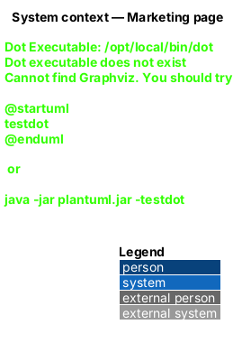
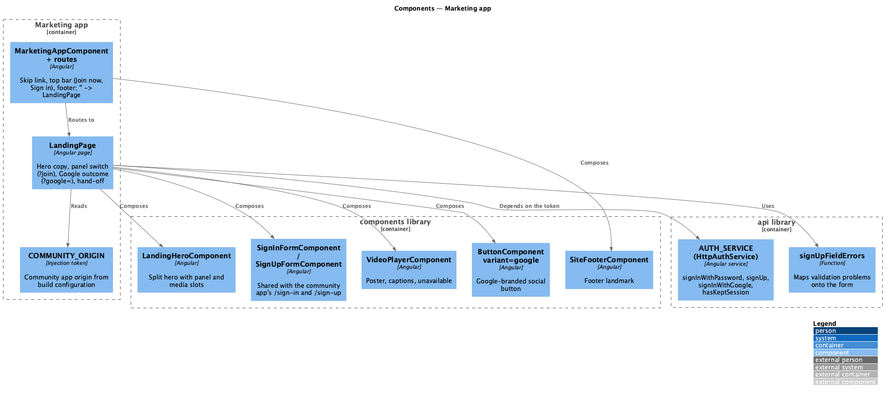
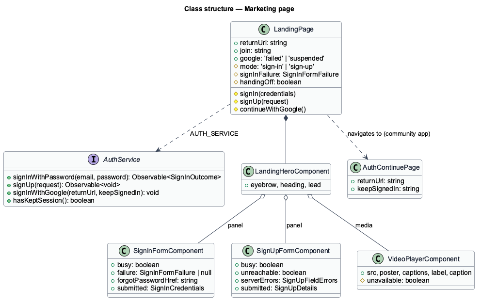
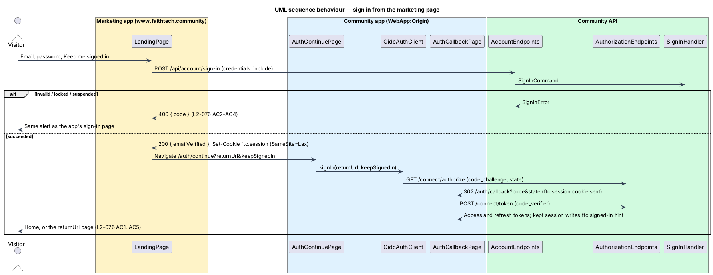

# Landing page

## Overview

The marketing page is FaithTech Community's public front door at `www.faithtech.community`. A visitor learns what the community is from a split hero and a 21-second brochure video, then signs in, signs up or continues with Google without leaving the page, and lands in the community app with a real authorization code + PKCE session.

**Marketing app** — the second Angular application in the workspace, `frontend/projects/marketing/`, served on its own host (ADR 0018)

**Community app** — the existing application, `frontend/projects/faithtech-community/`, on `WebApp:Origin` behind the same proxy as the API and the identity server

**Hand-off** — the step where the marketing page, after the API has accepted the credentials and set the short-lived `ftc.session` cookie, sends the browser to the community app's `/auth/continue`, which starts PKCE

**Session hint** — the non-secret `ftc.signed-in=1` cookie the community app writes for the shared parent domain while it keeps a "Keep me signed in" session; it only decides a redirect

Composition follows a split product hero (headline and video beside the sign-in form at desktop, stacked on phones, short benefit sections, one call to action, one footer). Every colour, type and spacing value comes from `docs/design-system/tokens/`.

## Description

### Hosting shape

- The marketing app is a static Angular build served at `www.faithtech.community`. Its own dev server runs on port 4300 (`npm run start:marketing`); Playwright starts it next to the community app.
- The community origin is the `COMMUNITY_ORIGIN` injection token in `app.config.ts`, `http://localhost:4200` in development and replaced through `fileReplacements` (`src/environments/community-origin.production.ts`) for production. `provideApi(`${COMMUNITY_ORIGIN}/api`)` points `AUTH_SERVICE` at the API on the community host.
- The API adds `Marketing:Origin` to its CORS policy and allows credentials, so the marketing page's `POST /api/account/sign-in` can set `ftc.session` on the API host. `www` and the community host are the same site, so the `SameSite=Lax` cookie is sent on the community app's `/connect/authorize` navigation.
- No second OpenIddict client and no new redirect URI: PKCE starts and ends on the community origin with the seeded `web` client, so the tokens live in the community app's storage (ADR 0018). The seeder is unchanged.
- The marketing host serves a Content-Security-Policy of `default-src 'self'; connect-src 'self' <community origin>; img-src 'self' data:; media-src 'self'; style-src 'self' 'unsafe-inline'; frame-ancestors 'none'; base-uri 'none'` (L2-079 AC5). DNS, certificates and the host are deferred.

### Marketing app

- **`MarketingAppComponent`** — the shell: `SkipLinkComponent`, `TopBarComponent` `anonymous` with *Join now* and *Sign in*, the router outlet and `SiteFooterComponent`. Routes: `''` → `LandingPage`; `'**'` → redirect to `''`.
- **`LandingPage`** — composes `LandingHeroComponent` with the panel (`CardComponent` holding `SignInFormComponent` or `SignUpFormComponent`, the Google button in `ftAuthAlternatives`) and the media (`VideoPlayerComponent`), three `BenefitComponent`s and the `CtaBandComponent`. Query parameters drive its state: `join` shows the sign-up form, `google=failed|suspended` shows the Google outcome, `returnUrl` is carried into the hand-off. On init it calls `AUTH_SERVICE.hasKeptSession()` and replaces the location with the community app home when it is true (L2-074 AC6).
- **Sign in** — the page posts through `AUTH_SERVICE.signInWithPassword`, shows the same failures as the app's sign-in page through `SignInFormComponent`, and on success shows "Signing you in…" (with the unverified notice when `emailVerified` is false) and navigates to `${COMMUNITY_ORIGIN}/auth/continue?returnUrl=…&keepSignedIn=1|0`. Only app-relative `returnUrl`s (`/…`, not `//…`) are carried.
- **Sign up** — `AUTH_SERVICE.signUp`, `signUpFieldErrors` from `api` for server validation, "Check your inbox" with a link to `${COMMUNITY_ORIGIN}/verify-email?email=…` to send it again.
- **Google** — `AUTH_SERVICE.signInWithGoogle(returnUrl, keepSignedIn)` navigates to `${api}/account/google/start`; the button shows busy until the browser leaves (`docs/detailed-designs/identity/google-sign-in`).
- **No inline-form exception elsewhere** — the in-page forms are the page's purpose, as the mock shows; the page opens no other editing UI.

### Community app

- **`AuthContinuePage`** (`/auth/continue`) — calls `AUTH_SERVICE.signIn(returnUrl, keepSignedIn === '1')`, showing "Signing you in…". An unsafe `returnUrl` becomes `/`.
- **`OidcAuthClient`** — writes the session hint when it stores a kept refresh token, removes it when it stores a session-only token, signs out, or fails to restore a session. `AuthConfig.sessionHintDomain` sets the cookie's `Domain`: `faithtech.community` in the community app's production build (`src/environments/session-hint-domain.production.ts`), unset (host-only) on `localhost`, where cookies are shared across ports.
- **`SignInPage`, `SignUpPage`** — now compose `SignInFormComponent` and `SignUpFormComponent`; behaviour and copy are unchanged.

### Brochure video

- Source in `eng/videos/brochure/`: `script.md` (the narration, 21 seconds), `deck.html` (a timed slide deck using the design-system tokens and mock photos) and `build.mjs` (Kokoro-82M `af_heart` narration and WebVTT captions, Playwright frame capture, ffmpeg mux) (ADR 0020). `node eng/videos/brochure/build.mjs` fails when the result is longer than 30 seconds.
- Shipped assets: `frontend/projects/marketing/public/brochure/brochure.webm`, `brochure-poster.jpg` and `brochure.en.vtt`. The captions are the script; the page shows no transcript.
- `VideoPlayerComponent` renders `<video controls preload="none" poster>` with a default English captions track and no `autoplay`; on the media `error` event it swaps to the poster image with a warning alert.

### Security and privacy

- Every request goes to the marketing origin, the community origin or, during Google sign-in, Google; there is no analytics, tracker or third-party frame (L2-079 AC4). The e2e suite fails any request it does not recognise.
- The account endpoints keep the auth rate limit (20 a minute per IP) and are anonymous by explicit opt-in; all rules run on the server.

## Requirements

The feature realizes the following level-2 (L2) requirements. Each L2 requirement refines a level-1 (L1) requirement, cited by identifier.

| L2 ID | Refines (L1) | Requirement |
|-------|--------------|-------------|
| `L2-074` | `L1-021`, `L1-016` | Marketing page: what an anonymous visitor sees, responsive, themed, accessible, signed-in redirect. |
| `L2-075` | `L1-021`, `L1-016` | Brochure video: 30 seconds or less, poster, captions, controls, no autoplay, reduced motion, unavailable. |
| `L2-076` | `L1-001`, `L1-021` | Sign in from the marketing page with every `L2-003` outcome. |
| `L2-077` | `L1-001`, `L1-021` | Sign up from the marketing page with every `L2-001` outcome. |
| `L2-079` | `L1-015`, `L1-021` | Rate limiting, no enumeration difference, CORS, CSP, no trackers. |

Google sign-in (`L2-078`) is designed in [`identity/google-sign-in`](../../identity/google-sign-in/README.md). The rules reused from `L2-001`, `L2-002`, `L2-003`, `L2-004`, `L2-039`, `L2-043`, `L2-044` and `L2-045` are cross-referenced, not repeated.

### Acceptance criteria

See [`docs/specs/L2.md`](../../../specs/L2.md#l2-055-marketing-page) for `L2-074`, `L2-075`, `L2-076`, `L2-077` and `L2-079`. Each is traced by a Playwright spec in `e2e/tests/marketing/` (`// Traces to:` header) against the fake backend.

## Diagrams

### System context

Visitors and members reach FaithTech Community through the marketing page; Google is the only external system.

### Containers

The marketing app talks to the API on the community host and hands the browser to the community app, which owns the PKCE session.

### Components

`LandingPage` composes shared components and depends only on `AUTH_SERVICE`.

### Class structure

The page's inputs come from the URL; the forms are presentation only.

### Behaviour — sign in from the marketing page

The API sets the short-lived session cookie; the community app completes PKCE (`L2-076`).

### Behaviour — a member with a kept session

The session hint sends the member straight to the community app, which still validates the session (`L2-074` AC6).

## Open questions

1. A session that is not kept lives in one tab's session storage, so the marketing page cannot see it and shows the page; the visitor signs in again (consistent with `L2-003` AC8).
2. Hosting, DNS, certificates and the CSP header are deferred; the policy above is the requirement for whoever hosts it.
3. The Google button on the community app's own sign-in page, other providers, testimonials, pricing, analytics, cookie banners and further marketing pages are deferred.
