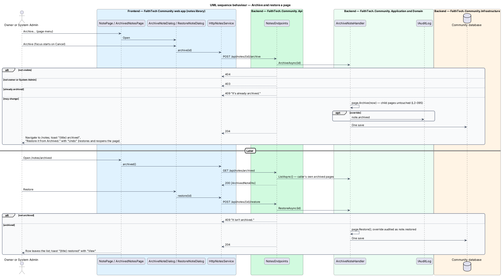
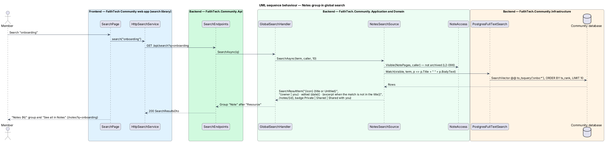

# Archive, restore and search pages

## Overview

Docs & notes (`L1-022`) never deletes a page in v1. **Archiving** is a soft delete: the page leaves every list, search result, backlink and suggestion for everyone except its owner and System Admin, and can be restored from **Archived pages**. Unlike resources, archived pages are not purged. Pages are also found through **global search**, which gains a **Notes** group matching titles and body text, with visibility applied inside the query.

Key terms:

- **archived page** — page with `ArchivedAt` set; read-only, openable only by its owner and System Admin
- **restore** — clearing `ArchivedAt`, which returns the page to every place its visibility allows
- **Notes group** — result group of global search built by `NotesSearchSource`, at most 10 pages, best match first
- **body text** — plain text of a page (`BodyText`), derived on save from the text of its text-bearing blocks (without page-link spans) and link-card captions; the title is matched beside it and image alt text is not included ([ADR 0023](../../../adr/0023-notes-block-storage-ordering-and-concurrency.md))

Search follows the design of `search/global-search` and ADR 0016; archive follows the access rule of [ADR 0025](../../../adr/0025-notes-access-links-and-staff.md).

## Description

### Web app

- **Archive** — *Archive* in the "More actions" menu opens `ArchiveNoteDialog` (mock `dialogs/archive-note`): "Archive {title}?" with "It disappears for everyone who can see it today. Pages inside it stay where they are." and "You can restore it from Archived at any time.", *Cancel* (initial focus) and *Archive* ("Archiving…" in flight; the danger alert "Not archived", "We couldn’t reach FaithTech. Nothing changed — try again." with *Try again* on failure). On success `NotePage` cancels autosave, navigates to `/notes` and shows the info toast "{title} archived", "Restore it from Archived." with *Undo*, which restores the page and opens it again (a failed undo shows the danger toast "{title} wasn’t restored", "We couldn’t reach FaithTech. It’s still archived.").
- **`ArchivedNotesPage`** — page at `/notes/archived` (mock `pages/archived-notes`): breadcrumb "Notes › Archived", the header "Archived pages" with "Only you can see these. Restore a page to put it back where it was.", and an `ft-list` of the caller's archived pages, most recently archived first, each as its title with the meta "archived {date}" and a *Restore* button named "Restore {title}". *Restore* opens `RestoreNoteDialog` ("Restore {title}?", "It comes back to Notes with the same visibility, people and place as before.", *Cancel*, *Restore*, "Restoring…"; on failure the danger alert "Not restored", "We couldn’t reach FaithTech. It’s still archived — try again." with *Try again*). On success the row leaves the list and the success toast "{title} restored", "It’s back in Notes, with the same visibility as before." offers *View*. Empty: "Nothing archived", "When you archive a page it waits here until you restore it.", *Back to Notes*; loading: "Loading archived pages"; error: "We couldn’t load your archived pages", "Nothing has been deleted. Check your connection and try again.", *Try again*.
- **Archived page view** — opening an archived page (owner or System Admin) shows the breadcrumb "Notes › Archived › {title}", the read-only view and the warning banner "Archived {date}", "Only you can see it. Restore it to edit it or let others see it again." with *Restore*, which opens `RestoreNoteDialog` and reloads the page when it succeeds.
- **Search** — `SearchPage` in the `search` library renders the group "Notes ({N})" for `SearchResultKind.Note` (label map `Note → Notes`), each result as "{icon} {title}" with the snippet "{owner | you} · edited {date}[ · {excerpt}]", a "Private", "Shared" or "Shared with you" badge, and "See all in Notes" linking to `/notes?q={term}`, which fills the Notes search box.

### Community API

- **`NotePage.Archive(now)`** / **`Restore()`** — set and clear `ArchivedAt`. Archiving does not touch children, links, images, the audience, `UpdatedAt` or `Version`.
- **`ArchiveNoteHandler`** — `ArchiveAsync(id)` and `RestoreAsync(id)`: load through `NoteAccess.FindAsync`; `404` when not found (an archived page of someone else, for anyone but System Admin); `403` when the caller may see the page but not change it; `409` "It’s already archived." when archiving an archived page and "It isn’t archived." when restoring an active one. Otherwise `204`. A System Admin action on someone else's page writes `note.archived` or `note.restored`. `ListAsync()` returns the caller's own archived pages, most recently archived first (`ArchivedNoteDto { id, title ("Untitled" when empty), icon, archivedAt }`).
- **Effect of archive on reads** — `NoteAccess.Visible` excludes archived pages, so the list, global search, suggestions, children and backlinks drop them for everyone, the owner included. Links and breadcrumbs that point to an archived page read "Private page" for everyone (`notes/links-and-backlinks`). A child of an archived page keeps its `ParentId`, visibility and content.
- **`NotesSearchSource`** — `ISearchSource` with the new `SearchResultKind.Note`, appended after `Resource`. It starts from `NoteAccess.Visible(db.NotePages.AsNoTracking(), caller)`, calls `IFullTextSearch.Match(visible, term, ListNotesHandler.Document)` (`Title + " " + BodyText`), takes `limit` (10) best first, and builds `SearchResultItem(id, "{icon} {title or Untitled}", "{owner | you} · edited {ddd d MMM}[ · {excerpt}]", "/notes/{id}", Badge: "Private" | "Shared" | "Shared with you" | null)`. The excerpt is shown only when the term's first word is not in the title: up to 120 characters of `BodyText` starting 40 characters before the first match, with "…" where it is cut. It is registered beside the other sources in DI.
- **`SearchVectors`** — `Add<NotePage>(builder, "Title", "BodyText")` adds the generated, GIN-indexed `SearchVector`. Because the column is generated, a save is reflected at once with no reindex, and archive and restore act through `Visible`. The backend tests use the in-memory `IFullTextSearch`, which matches the same document.

### API contract

| Method and path | Request | Responses |
|-----------------|---------|-----------|
| `POST /api/notes/{id}/archive` | — | `204`, `401`, `403`, `404`, `409` already archived |
| `POST /api/notes/{id}/restore` | — | `204`, `401`, `403`, `404`, `409` not archived |
| `GET /api/notes/archived` | — | `200 [ArchivedNoteDto]`, `401` |
| `GET /api/search?q=` | — | `200 SearchResultsDto` with a `Note` group, `400` term under 2 or over 200 characters, `401` |

### End-to-end tests

`mock-notes.ts` answers archive, restore and the archived list, and contributes Note results to the search fake in the same shape as `NotesSearchSource`. `e2e/pages/archived-notes.page.ts` and `note.dialogs.ts` own the selectors. `archive.spec.ts` covers archive and restore through Archived, *Undo* on the toast, the archived page with its Restore banner, and the empty and failed archived list; `search-notes.spec.ts` covers the Notes group with its visibility filter. `ArchiveNotesTests.cs` and `SearchNotesTests.cs` in the API tests cover the status codes, children left in place, the archived list, visibility in search and the snippet.

### Accessibility

The archive and restore dialogs are `ft-dialog` confirmations; the archive dialog starts on *Cancel*. The toast's *Undo* and *View* are reachable by keyboard while the toast shows, and the toast is announced politely.

### Security

Search applies visibility before the text match in one SQL statement, so a hidden page is never ranked, counted or returned. Archive is reversible and leaves the audit trail intact.

## Requirements

The feature realizes the following level-2 (L2) requirements. Each L2 requirement refines a level-1 (L1) requirement, cited by identifier. The acceptance criteria are in `docs/specs/L2.md`.

| L2 ID | Refines (L1) | Requirement |
|-------|--------------|-------------|
| `L2-095` | `L1-022` | Archive and restore pages |
| `L2-096` | `L1-022` | Notes in global search |

`L2-096` extends the result groups of `L2-026` (global search).

## Diagrams

### System context

Owners and System Admin archive and restore pages; every member finds the visible pages through global search.

### Containers

The `notes` library calls the archive endpoints; the `search` library calls global search, which reads the generated search vector on `NotePages`.

### Components

`ArchiveNoteHandler` sets and clears `ArchivedAt`; `NotesSearchSource` plugs into `GlobalSearchHandler` and filters through `NoteAccess.Visible` before `IFullTextSearch`.

### Class structure

`NotesSearchSource` realizes `ISearchSource` with the new `SearchResultKind.Note`.

### Behaviour — archive and restore

Archiving answers `204` (or `409` when it is already archived) and leaves children untouched; the archived list shows only the caller's pages; restore returns the page everywhere.

### Behaviour — Notes in global search

The source filters by visibility, then matches title and body text, and returns at most 10 results.

## Open questions

- Archived pages are kept indefinitely; a purge like ADR 0017's is deferred. Resolved.
- A System Admin finds other members' archived pages by opening them directly; `/notes/archived` lists only the caller's own. An admin view of every archived page is deferred. Resolved.
- The search excerpt length (120 characters) matches the other groups' single-line snippets. Resolved.
- Archiving an archived page or restoring an active one answers `409` rather than a silent `204`, so a stale tab learns that the state changed. Resolved as built.
