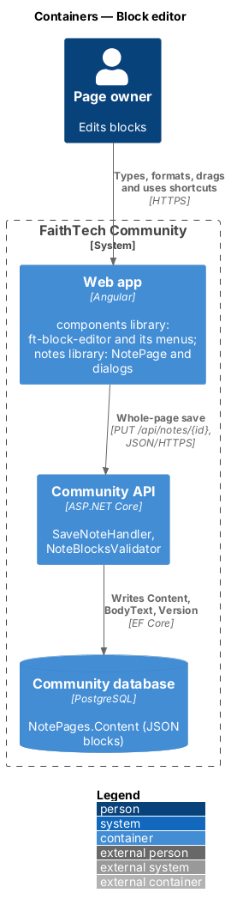
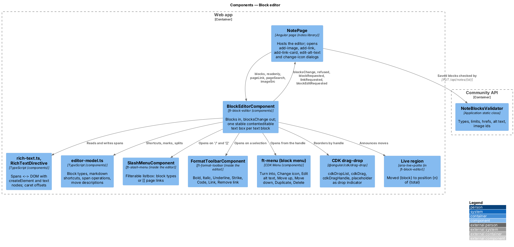
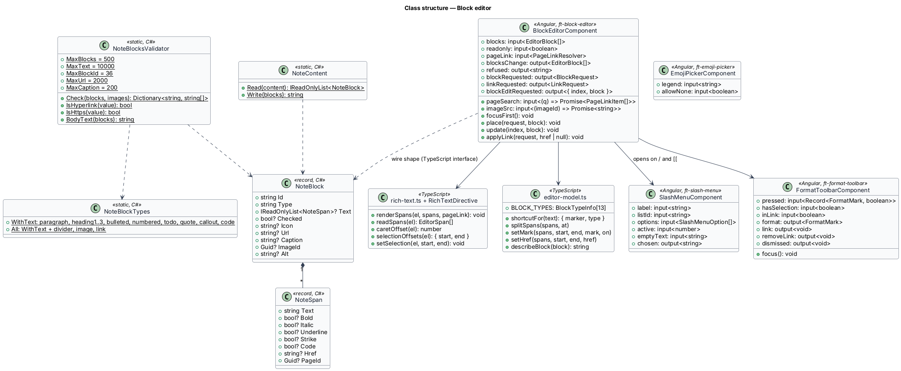
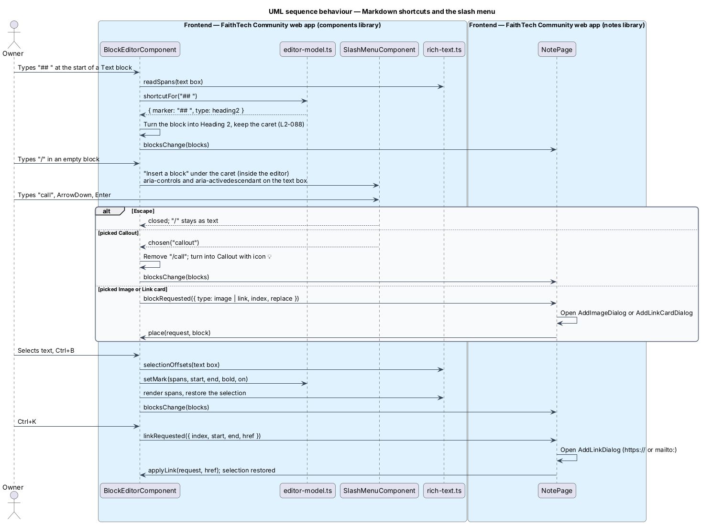
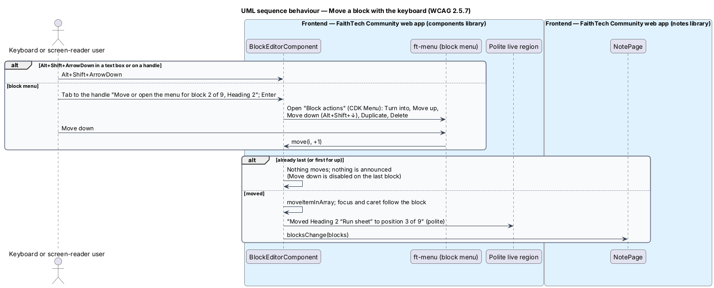

# Block editor

## Overview

The **block editor** is the editing surface of a Docs & notes page (`L1-022`). A page's content is an ordered list of blocks; the owner types into them, formats text, changes a block's type, inserts new blocks and reorders them by drag or by keyboard. Readers see the same blocks in a read-only view.

Key terms:

- **block** — one unit of page content with a stable client-generated `id` and a `type`
- **text block** — block that holds rich text: `paragraph`, `heading1`, `heading2`, `heading3`, `bulleted`, `numbered`, `todo` (with `checked`), `quote`, `callout` (with an emoji `icon`, default 💡) and `code` (plain text, monospace, no highlighting)
- **other block** — `divider`; `image` (`imageId` and required `alt`, `notes/images`); `link` (link card: an `https://` `url` and an optional `caption`)
- **span** — run of text in a text block with optional marks `bold`, `italic`, `underline`, `strike`, `code`, an `href` (`https://` or `mailto:`) or a `pageId` (page link, `notes/links-and-backlinks`)
- **markdown shortcut** — characters typed at the start of a block that turn it into another type: `# `, `## `, `### `, `- ` or `* `, `1. `, `[] `, `> `, ` ``` `, `---`
- **slash menu** — filterable list opened by `/` to insert a block or turn the current one into another type
- **block menu** — menu on each block's handle: *Turn into*, *Change icon* (callout), *Edit alt text* (image), *Move up*, *Move down*, *Duplicate*, *Delete*

The editor is built in `components` on `contenteditable` and the Angular CDK, with no third-party editor ([ADR 0024](../../../adr/0024-notes-editor-on-contenteditable-with-cdk.md)). The block JSON shape, limits and whole-page saves are recorded in [ADR 0023](../../../adr/0023-notes-block-storage-ordering-and-concurrency.md). Saving is described in `notes/pages-and-list`.

## Description

### Components library

- **`BlockEditorComponent`** — `ft-block-editor` (`components/src/lib/block-editor`). Inputs: `blocks` (`EditorBlock[]`, the same shape as `NoteBlock`), `readonly` (boolean), `pageLink` (a `PageLinkResolver` that turns a page-link span into `{ text, icon, href }`), `pageSearch` (`(q) => Promise<PageLinkItem[]>`, for `[[`) and `imageSrc` (`(imageId) => Promise<string>`, an object URL). Outputs: `blocksChange` (the full ordered block list after each edit), `refused` (a message, such as the 501st block), `blockRequested` (`{ type: 'link' | 'image', index, replace }`, from the slash menu), `linkRequested` (`{ index, start, end, href }`, from Ctrl+K or the toolbar) and `blockEditRequested` (`{ index, block }`, from *Change icon* or *Edit alt text*). Methods the host calls: `focusFirst()`, `place(request, block)` after a block dialog, `update(index, block)` after an icon or alt-text dialog, and `applyLink(request, href | null)` after the link dialog. The function inputs keep the component free of HTTP calls and of the `api` library. The editor keeps its own working copy of the blocks; an empty editable page starts with one empty Text block whose placeholder reads "Type / for blocks, or [[ to link a page".
- **Edit mode** — the block list is a `section` named "Page content". Each block is a `cdkDrag` row with a handle, an optional marker (bullet, number, to-do checkbox, callout icon) and, for a text block, one stable `contenteditable="true"` text box (`role="textbox"`, `aria-multiline="true"`, named by its type label: "Text", "Heading 1", "Bulleted list", "To-do", "Quote", "Callout", "Code" and so on). The text box is not re-rendered while typing: input is read back from the DOM into spans, so the caret never jumps. Headings stay text boxes in edit mode (not `h2`–`h4`). Dividers, images and link cards render their read-only form beside the handle. Enter splits the block at the caret (the text after it, with its marks, moves to a new block of the same type for lists and to-dos, Text otherwise); Enter in an empty list item or to-do turns it into Text; Shift+Enter, and Enter in a Code block, insert a line break. Backspace at the start of an empty block deletes it and moves to the end of the previous block (or the start of the next); at the start of a non-empty block it joins it to the previous one. Arrow keys at the edge of a block move to the neighbouring block. Paste inserts plain text only.
- **Read-only mode** — semantic HTML: `heading1`–`heading3` as `h2`–`h4` (the page title is the `h1`), consecutive `bulleted` and `numbered` blocks as one `ul` or `ol`, `quote` as `blockquote`, `callout` with a decorative icon, `code` as a focusable `pre` labelled "Code" (so a long line can be scrolled by keyboard), `divider` as `hr`, a to-do as a disabled checkbox named by its text, an image as `figure` with `img alt`, and a link card as an `a` named "{caption or host} (opens in a new tab)" with `target="_blank"` and `rel="noopener"`, the host shown but hidden from the name.
- **Rich text** — `rich-text.ts` and `RichTextDirective` (`[ftRichText]`). `renderSpans` builds a block's DOM with `createElement` and text nodes only (`strong`, `em`, `u`, `s`, `code`, `a`), never `innerHTML`; a hyperlink gets `rel="noopener"` and a visually hidden "(opens in a new tab)"; a page link renders through the `pageLink` resolver as a link with its icon, or as plain "Private page" text. `readSpans` reads the DOM back into spans; `caretOffset`, `selectionOffsets`, `setSelection` and `caretRect` work on character offsets. `editor-model.ts` holds the pure span operations (`splitSpans`, `setMark`, `hasMark`, `setHref`, `insertSpans`, `removeRange`, `normalise`), `BLOCK_TYPES` (the 13 types with labels, descriptions and shortcuts), `shortcutFor` (markdown shortcuts) and `describeBlock`. Marks are applied on these offsets; `document.execCommand` is not used in blocks.
- **Markdown shortcuts** — at the start of a Text block, `# `, `## `, `### `, `- `, `* `, `1. `, `[] `, `> `, ` ``` ` and `---` turn the block into Heading 1–3, Bulleted list, Numbered list, To-do, Quote, Code or a Divider followed by a new Text block, and the marker is removed.
- **`SlashMenuComponent`** — `ft-slash-menu` (inputs `label`, `listId`, `options`, `active`, `emptyText`; output `chosen`), a listbox positioned inside the editor under the caret. Typing `/` at the start of a block or after a space opens it as "Insert a block" with the 13 types, each with a glyph, a one-line description and its shortcut; the text after `/` filters by name ("No matching blocks"). The text box carries `aria-controls` and `aria-activedescendant` while it is open; ↑ and ↓ move, Enter or a click chooses, Escape closes and keeps the typed text, Tab closes it. A chosen type turns an otherwise empty block into it or inserts a new block below; *Image* and *Link card* emit `blockRequested`. The same component, labelled "Link to a page", serves `[[` (`notes/links-and-backlinks`).
- **`FormatToolbarComponent`** — `ft-format-toolbar` (`role="toolbar"`, "Formatting"; inputs `pressed`, `hasSelection`, `inLink`; outputs `format`, `link`, `removeLink`, `dismissed`), positioned inside the editor above a selection in a text block other than Code, or above the caret inside a link. Buttons: *Bold*, *Italic*, *Underline*, *Strikethrough*, *Inline code*, *Link* (or *Edit link* inside a link) and *Remove link* inside a link; mark buttons expose `aria-pressed` for the whole selection. Roving tabindex with ← and →; Alt+F10 moves focus into it; Escape returns to the text with the selection restored. Shortcuts: Ctrl+B, Ctrl+I, Ctrl+U, Ctrl+Shift+S, Ctrl+E and Ctrl+K (Cmd on macOS).
- **Block handle and block menu** — each block has a handle button labelled "Move or open the menu for block {n} of {total}, {type}" that is both the `cdkDragHandle` and the CDK menu trigger. The menu "Block actions" (`ft-menu-item` rows) offers *Turn into* (submenu "Turn into" of the text types, opened with Enter or →), *Change icon* (callout), *Edit alt text* (image), *Move up* and *Move down* (showing Alt+Shift+↑/↓, disabled at the ends), *Duplicate* and *Delete* (danger). *Duplicate* inserts a copy with a new id below and focuses it; *Delete* removes the block and focuses the previous one (or the next).
- **Reorder by drag** — the rows sit in a `cdkDropList` locked to the vertical axis; a drag starts only from the handle. The `cdkDragPlaceholder` is a drop-indicator line. `cdkDropListDropped` calls `moveItemInArray`, emits `blocksChange` and announces the move. Motion is turned off under `prefers-reduced-motion`.
- **Reorder by keyboard** — Alt+Shift+↑ and Alt+Shift+↓ in a text box or on a handle move the block one position and keep focus and caret in it; *Move up* and *Move down* do the same. At either end nothing moves and nothing is announced. A polite live region inside the editor announces "Moved {Type “first four words”} to position {n} of {total}" (an image uses its alt text), for example "Moved Heading 2 “Run sheet” to position 3 of 12" (`L2-089`, WCAG 2.5.7).
- **`EmojiPickerComponent`** — `ft-emoji-picker`, a radio group (legend input, default "Icon") of 16 named emoji with an optional "No icon" (`allowNone`), a form control used by *Page settings* and *Change icon*.
- **Design tokens** — the editor reads block typography, callout background, code font and drop-indicator colour by role; its design-system pages are `docs/design-system/components/block-editor.html`, `slash-menu.html`, `format-toolbar.html` and `page-links.html`. Features do not override its styles.

### Notes library

- **`NotePage`** hosts `ft-block-editor`. It supplies `pageLink` (titles from the page's `links` and every suggestion seen since), `pageSearch` (`NOTES_SERVICE.linkSuggestions(q, id)`) and `imageSrc` (`notes/images`), forwards `blocksChange` to `NoteAutosave`, shows a `refused` message as the warning toast "Block not added", and opens the feature dialogs through `DialogService` and `ft-dialog`: `AddLinkDialog` ("Add a link" or "Edit link"; Link hint "Starts with https:// or mailto:"; *Add link* or *Save*; *Remove link* when editing), `AddLinkCardDialog` ("Add a link card": Link hint "Must start with https://.", Caption optional, *Add link card*), `AddImageDialog` and `EditAltTextDialog` (`notes/images`) and `ChangeIconDialog` ("Change icon", the emoji picker without "No icon", *Save*).

### Community API

- **`NoteBlock`** / **`NoteSpan`** — C# records in `Domain/Notes/`, read and written by `NoteContent` with `System.Text.Json` web defaults (camelCase) and nulls omitted, so the stored JSON matches the TypeScript interfaces in `api`. `NoteBlockTypes` lists the 13 wire names and the 10 text-bearing ones.
- **`NoteBlocksValidator`** — static class run by `SaveNoteHandler`. `Check(blocks, images)` refuses with `400` and a field error per block: more than 500 blocks ("A page holds up to 500 blocks. Start a new page inside this one."); a missing, duplicate or longer than 36-character block `id`; an unknown `type`; a span without text; a span `href` that is not `https://` (absolute, with a host) or `mailto:`, or is over 2,000 characters ("Use a link that starts with https:// or mailto:"); more than 10,000 characters of text in one block; a link card `url` that breaks the same `https://` rule ("Use a link that starts with https://.") or a caption over 200 characters; an image block with empty `alt` ("Describe this image"), `alt` over 250 characters, or an `imageId` that was not uploaded to this page ("Add the image to this page first."); a callout `icon` that is not a single emoji. `BodyText(blocks)` joins each block's text without page-link spans, plus link-card captions, with line breaks; image alt text is not included.

### Wire shape

```json
{ "id": "b7", "type": "todo", "checked": false,
  "text": [ { "text": "Book the venue for " }, { "text": "Builders Night", "bold": true },
            { "text": "", "pageId": "3f2c…" } ] }
```

### End-to-end tests

`e2e/pages/note.page.ts` owns the editor's selectors and intent-level actions, and `e2e/pages/note.dialogs.ts` the link, link-card, image, alt-text and icon dialogs. `editor.spec.ts`, `block-types.spec.ts`, `formatting.spec.ts`, `reorder.spec.ts` and `page-settings.spec.ts` in `e2e/tests/notes/` cover typing and autosave, Enter and Backspace, every markdown shortcut, the slash menu, to-dos, link cards, each format and its shortcut, hyperlinks, drag reorder, keyboard reorder with its announcement, the block menu, callout icons, the read-only view and axe checks. Unit specs cover `editor-model.ts`, `rich-text.ts`, `ft-format-toolbar` and `ft-emoji-picker`.

### Accessibility

Every action has a keyboard path: shortcuts and the slash menu for block types, the toolbar and shortcuts for marks, Alt+Shift+arrows and the block menu for order. Focus is always visible; the handle is reachable by Tab from its block. Each block is named by type, and the live region reports moves. Colour is never the only signal of a mark. Touch targets meet 24 × 24 CSS pixels and handles are always visible on touch screens (`L2-099`).

### Security

Content never travels as HTML. The editor builds DOM from text nodes and a fixed set of elements; `href` values are checked in the link dialog and again on the server (`https:` and `mailto:` only), so a `javascript:` URL cannot be stored. External links open with `rel="noopener"`.

## Requirements

The feature realizes the following level-2 (L2) requirements. Each L2 requirement refines a level-1 (L1) requirement, cited by identifier. The acceptance criteria are in `docs/specs/L2.md`.

| L2 ID | Refines (L1) | Requirement |
|-------|--------------|-------------|
| `L2-087` | `L1-022` | Block types |
| `L2-088` | `L1-022` | Inline formatting, markdown shortcuts and the slash menu |
| `L2-089` | `L1-022` | Reorder blocks by drag and by keyboard |
| `L2-099` | `L1-022` | Notes accessibility |

## Diagrams

### System context

The owner writes, formats and reorders blocks with a mouse, a keyboard or a screen reader; readers see the formatted page.


### Containers

All editing happens in the web app. The API receives the whole ordered block list on each save and validates it before writing `Content`.



### Components

`BlockEditorComponent` composes the rich-text functions, the editor model, the slash menu, the formatting toolbar, the block menu, CDK drag-drop and its own live region. `NotePage` feeds it and opens the dialogs it asks for.



### Class structure

The C# `NoteBlock` and `NoteSpan` records and the TypeScript interfaces share one wire shape. The editor's inputs, outputs and methods keep it independent of `api`.



### Behaviour — markdown shortcuts, slash menu and formatting

A shortcut changes the block type in place; the slash menu inserts or turns a block, handing image and link card to the page's dialogs; marks toggle on the selection; Ctrl+K opens "Add a link".



### Behaviour — reorder by drag

Dragging starts from the handle only, shows a drop indicator, and saves the new array order through autosave.


### Behaviour — reorder by keyboard

Alt+Shift+arrows and the block menu move a block one position and announce the new position (nothing moves at either end); this is the single-pointer alternative to dragging that WCAG 2.5.7 asks for.



## Open questions

- Undo and redo rely on the browser's native history inside one block; undo across blocks (a moved or deleted block) is deferred. *Delete* in the block menu removes the block at once and autosaves. Resolved.
- Paste keeps text and line breaks only; pasted formatting and pasted images are dropped. Resolved.
- Nested list indentation (Tab to indent) is not part of `L2-087`; list items are flat. Resolved.
- The block `id` is generated in the browser (`crypto.randomUUID()`), so drag tracking and Angular's `track` do not depend on the server. Resolved.
- With a mouse, the CDK menu opens the *Turn into* submenu on hover and a click then toggles it closed; Enter and → open it reliably. Known limitation.
- The slash menu, the `[[` list and the formatting toolbar are positioned inside the editor rather than in a CDK Overlay, so they scroll with the page content. Resolved as built.
