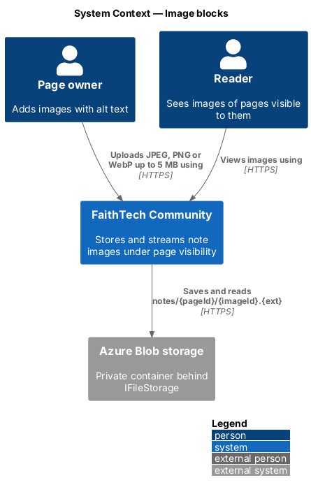
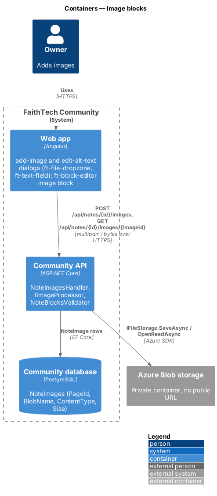
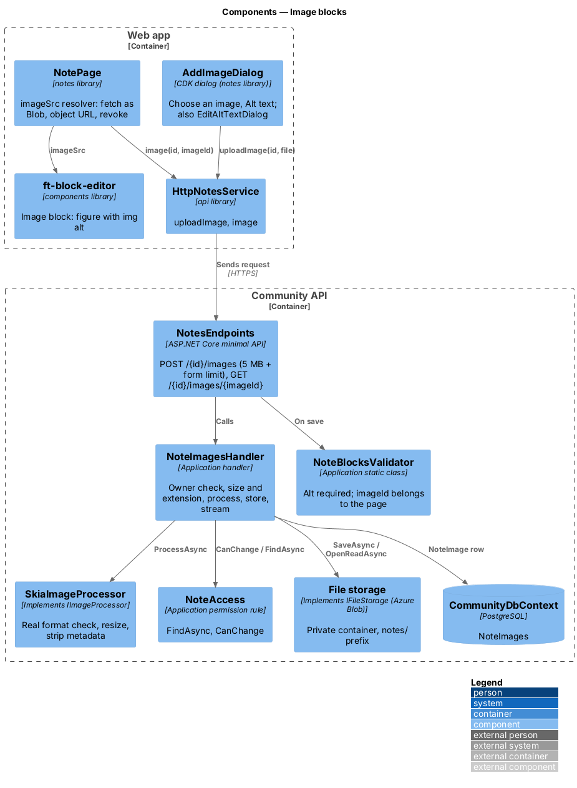
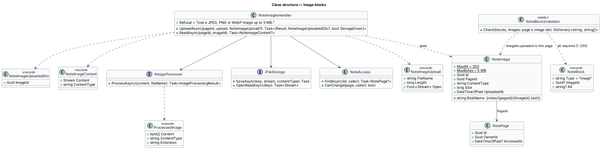
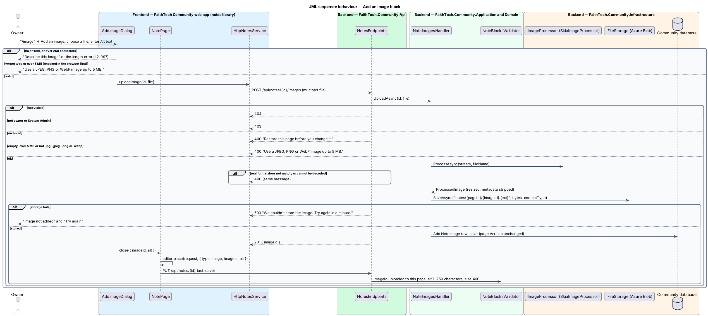
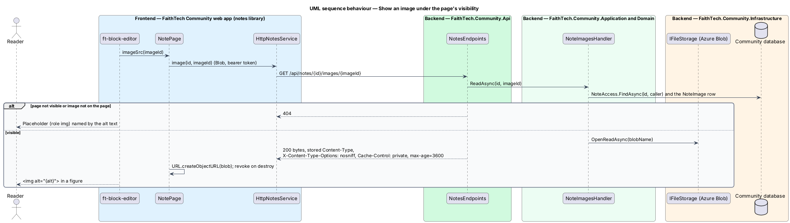

# Image blocks

## Overview

An **image block** shows a picture inside a Docs & notes page (`L1-022`): a screenshot in a how-to, a floor plan in a run sheet. Images follow the photos rule (`L2-007` AC3): every image carries alt text. Image files are stored privately behind the existing `IFileStorage` abstraction of ADR 0017 and are only ever read through the API under the page's visibility.

Key terms:

- **note image** — uploaded file attached to one page (`NoteImage`), referenced by `imageId` from an image block
- **alt text** — description of the image for people who cannot see it, required, 1 to 250 characters, held on the block
- **orphaned image** — note image no block references any more; its clean-up is deferred

## Description

### Web app

- **`AddImageDialog`** — CDK dialog in the `notes` library (mock `dialogs/add-image`) opened when *Image* is chosen in the slash menu. It reads "Add an image" and holds an `ft-file-dropzone` ("Choose an image", "JPEG, PNG or WebP, up to 5 MB."), the chosen file's name, and the required `ft-text-field` "Alt text" with the hint "Describe what’s in the image for someone who can’t see it.". The browser checks the type and size first; empty alt text shows "Describe this image" and alt text over 250 characters is refused inline, and nothing is uploaded. *Add image* ("Uploading…" in flight) uploads the file; a `400` shows "Use a JPEG, PNG or WebP image up to 5 MB." on the dropzone, and any other failure shows the danger alert "Image not added", "We couldn’t reach FaithTech. Nothing changed — try again." with *Try again*. On success it closes with `{ imageId, alt }` and `NotePage` places the image block through `place(request, block)`; autosave sends it.
- **`EditAltTextDialog`** — opened from *Edit alt text* in an image block's menu: "Edit alt text" with "Alt text" pre-filled, under the same rules, and *Save*; `NotePage` hands the new block back with `update(index, block)`. The file of an existing image block is not replaced.
- **Image block** — `ft-block-editor` renders a `figure` with an `img` whose `src` comes from the `imageSrc` input and whose `alt` is the block's alt text, at most the width of the page column. While the image loads, a placeholder with `role="img"` carries the alt text. Each image is requested once per editor.
- **`imageSrc`** — `NotePage` implements it with `NOTES_SERVICE.image(id, imageId)`, which fetches the bytes as a `Blob` with the bearer token; the page creates an object URL and revokes every URL it made when it is destroyed.
- **`HttpNotesService`** — `uploadImage(id, file)` posts multipart `file`; `image(id, imageId)` uses `responseType: 'blob'`.

### Community API

- **`NoteImage`** — entity in `Domain/Notes/`, its own `NoteImages` table (not part of the `NotePage` aggregate): `Id`, `PageId` (indexed), `BlobName` (`notes/{pageId}/{imageId}.{ext}`), `ContentType`, `Size`, `UploadedAt`. Adding an image does not change the page's `Version`, so an upload never causes an edit conflict.
- **`NoteImagesHandler`** — `UploadAsync(id, upload)`: `404` when the page is not visible; `403` when the caller may not change it; `400` "Restore this page before you change it." when the page is archived; `400` "Use a JPEG, PNG or WebP image up to 5 MB." when the file is missing, empty, over 5 MB or not named `.jpg`, `.jpeg`, `.png` or `.webp`. It then passes the file to the photo processor (`IImageProcessor`, ADR 0001, implemented by `SkiaImageProcessor`), which checks the real format against the extension, resizes the image and strips its metadata; a file it refuses answers the same `400`. The stored content type and extension come from the processor, never from the request. It writes the processed bytes with `IFileStorage.SaveAsync`, then adds the `NoteImage` and saves, answering `201 { imageId }`. A storage failure answers `503` "We couldn’t store the image. Try again in a minute." and adds no row; there is no retry queue. A System Admin upload to someone else's page is audited as `note.edited` with `ImageAdded`. `ReadAsync(id, imageId)` loads the page through `NoteAccess.FindAsync` and the image from that page only, and opens `IFileStorage.OpenReadAsync(blobName)`; anything not found answers `404`.
- **`NotesEndpoints`** — `POST /api/notes/{id}/images` reads the multipart field `file` with a request limit of 5 MB plus 1 MB for the form; `GET /api/notes/{id}/images/{imageId}` answers the bytes with the stored `Content-Type`, `X-Content-Type-Options: nosniff` and `Cache-Control: private, max-age=3600`. Image ids are immutable, so a cached copy never goes stale.
- **`NoteBlocksValidator`** (image part) — an image block shall have a non-empty `alt` ("Describe this image") of at most 250 characters and an `imageId` that was uploaded to this page ("Add the image to this page first."); a save that breaks either answers `400` (`L2-097`). An image id from another page is refused, so a block cannot show an image the page does not own. Alt text is not part of `BodyText`, so search does not match it.
- **Storage** — the configured `IFileStorage` (Azure Blob in production) writes to the same private container as resources under the `notes/` prefix (ADR 0017); there is no SAS or public URL.

### API contract

| Method and path | Request | Responses |
|-----------------|---------|-----------|
| `POST /api/notes/{id}/images` | multipart `file` | `201 { imageId }`, `400`, `401`, `403`, `404`, `503` storage unavailable |
| `GET /api/notes/{id}/images/{imageId}` | — | `200` image bytes, `401`, `404` |

### End-to-end tests

`mock-notes.ts` accepts uploads into memory and serves the bytes back under the same visibility rule. `images.spec.ts` adds an image with alt text, refuses an empty description, checks the rendered `alt` in the editor and for a reader. `ImageBlockTests.cs` in the API tests fakes `IFileStorage`, uploads real image bytes, and covers the type, size and content checks, the `503`, the owner-only upload, streaming under visibility, the headers, and the `400` on a missing alt or a foreign image id.

### Accessibility

Alt text is required at the point of upload and enforced on save. The dropzone is a labelled button with the accepted types in its description. The upload state is shown on the button ("Uploading…").

### Security

Images stream through the API with the page's visibility check. The processor decodes and re-encodes every image, its content type comes from that step, and `nosniff` stops the browser from reinterpreting it. SVG is not accepted, so no uploaded image can carry script.

## Requirements

The feature realizes the following level-2 (L2) requirements. Each L2 requirement refines a level-1 (L1) requirement, cited by identifier. The acceptance criteria are in `docs/specs/L2.md`.

| L2 ID | Refines (L1) | Requirement |
|-------|--------------|-------------|
| `L2-097` | `L1-022` | Image blocks and alt text |

## Diagrams

### System context

The owner uploads images; readers view them; files live in private Azure Blob storage and reach the browser only through the API.

### Containers

The web app uploads multipart files and fetches images as blobs; the API stores bytes through `IFileStorage` and rows in `NoteImages`.

### Components

`NoteImagesHandler` checks access and size, runs the photo processor and talks to `IFileStorage`; `NoteBlocksValidator` ties each image block to an image of its page and requires alt text.

### Class structure

`NoteImage` rows belong to a page by `PageId`; image blocks refer to them by id.

### Behaviour — add an image block

The dialog requires alt text, the server checks size and extension, processes and stores the file, and the next autosave validates the new block.

### Behaviour — show an image

Each image is fetched with the member's token under the page's visibility and shown from an object URL.

## Open questions

- Orphaned images (removed blocks, abandoned uploads) stay in storage; clean-up is deferred, as the proposal states. Resolved.
- There is no cap on the number of images per page in v1 beyond the 500-block limit. Resolved.
- Note images share the private resources container under `notes/`; a separate container is not needed while `IFileStorage` has one binding. Resolved.
- Images are resized and stripped of metadata by the photo processor (ADR 0001), as profile photos are; the browser scales them to the page column. Resolved as built.
- A storage failure is not retried through a queue; the member tries the dialog again. Resolved.
