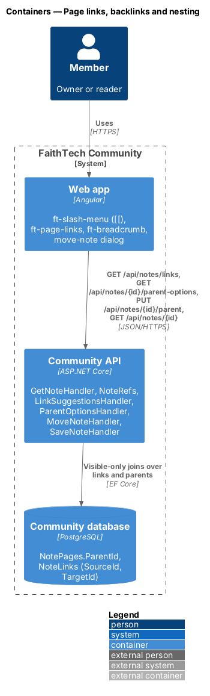
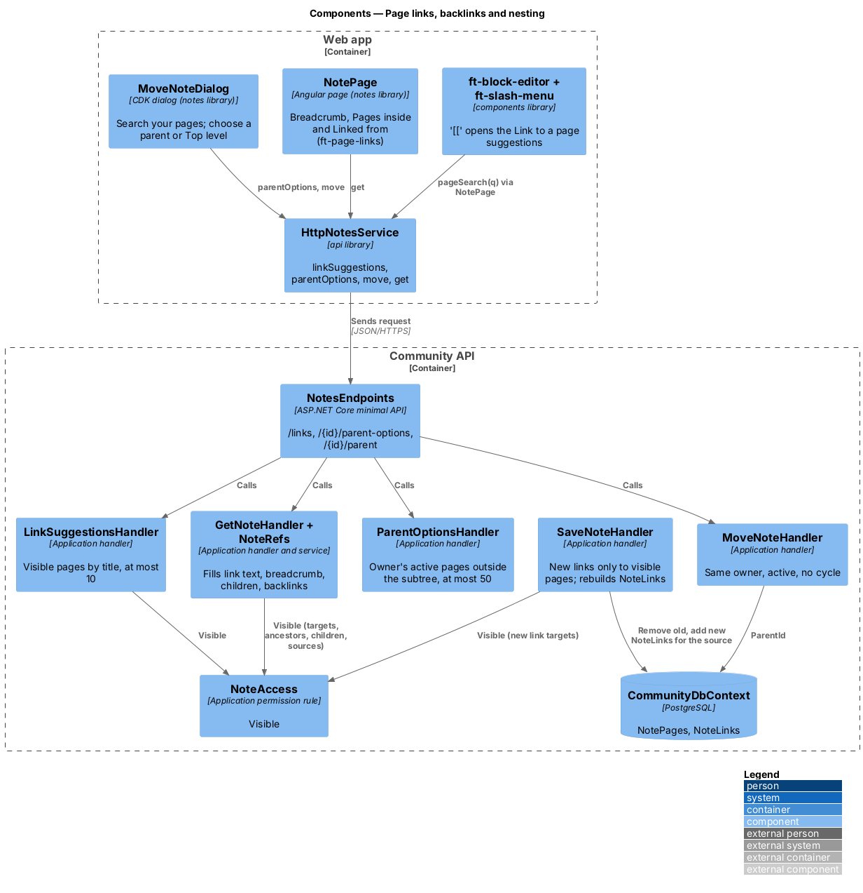
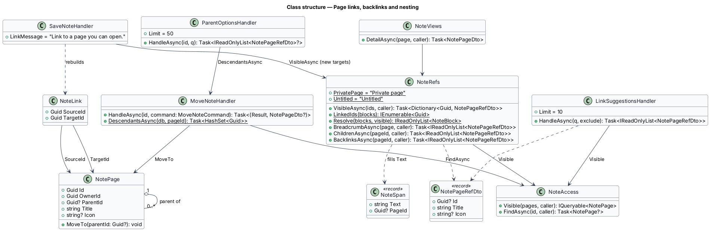
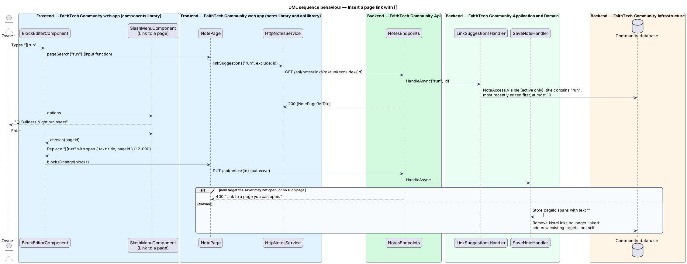
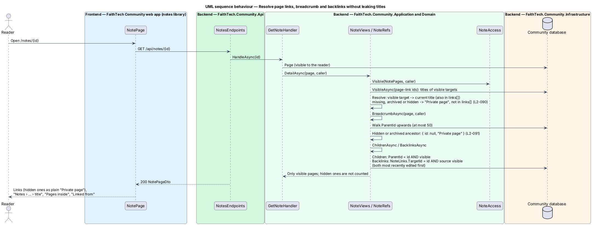
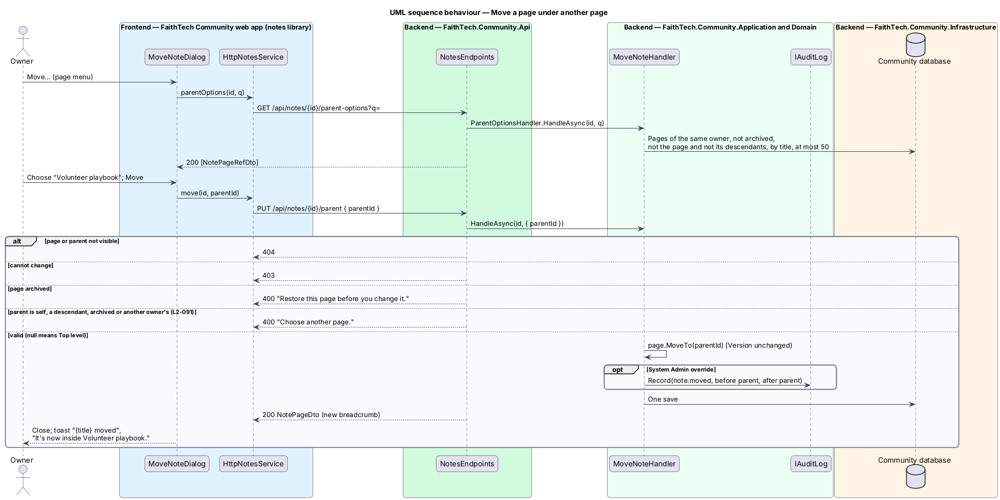

# Page links, backlinks and nesting

## Overview

Pages in Docs & notes (`L1-022`) refer to each other in two ways. A **page link** is a piece of text inside a block that opens another page; a page lists its **backlinks** under "Linked from". A page may also sit **inside** another page, which gives it a breadcrumb and gives the parent a "Pages inside" list. Both relations cross the visibility boundary, so the design resolves them per viewer and never shows the title of a page the viewer may not open.

Key terms:

- **page link** — span with a `pageId`; its text is the target's current title, filled at read time, never stored
- **"Private page"** — text shown in place of a title for a link target or ancestor the viewer may not open, whether it is missing, archived or hidden; the three cases are indistinguishable
- **backlinks** — pages that link to this page and that the viewer may open, shown as "Linked from"; hidden sources are neither named nor counted
- **parent** — page another page sits inside; it shall be owned by the same owner as the child
- **breadcrumb** — "Notes › {ancestors} › {title}" built from the parent chain
- **children** — pages whose parent is this page and that the viewer may open, shown as "Pages inside"

The access rule behind every lookup is `NoteAccess.Visible` (`notes/share-and-visibility`). The decisions on read-time titles and same-owner parents are recorded in [ADR 0025](../../../adr/0025-notes-access-links-and-staff.md); the links table is part of [ADR 0023](../../../adr/0023-notes-block-storage-ordering-and-concurrency.md).

## Description

### Web app

- **Page-link suggestions** — typing `[[` in a text block other than Code opens `ft-slash-menu` labelled "Link to a page", positioned inside the editor under the caret. The text typed after `[[` is the query; the editor calls its `pageSearch` input, which `NotePage` implements with `NOTES_SERVICE.linkSuggestions(q, id)`; the previous suggestions stay until new ones arrive. Options show the page's icon (or 📄) and title; "No pages match “{term}”" when empty. ↑ and ↓ move, Enter or a click replaces `[[query` with a span `{ text: title, pageId }`, Escape closes and keeps the typed text. The slash menu has no page-link entry; `[[` is the one way in.
- **Page links in the editor and the view** — the editor's `pageLink` resolver (supplied by `NotePage` from the page's `links` plus every suggestion seen since) renders a page-link span as an `a` to `/notes/{pageId}` with the target's icon and title; a target the viewer may not open renders as plain text "Private page" with no link, in both modes.
- **Breadcrumb** — `ft-breadcrumb` with "Notes" (`/notes`), "Archived" for an archived page, each ancestor from `breadcrumb`, and the page title as the current item. An ancestor with no `id` reads "Private page" and is not a link (`L2-091`).
- **`PageLinksComponent`** — `ft-page-links` in `components`: a `section` named by its heading, an `h2`, an `ft-list` of pages (icon tile and title, linked when the page has an id) or the empty text, and projected content for actions. It makes no HTTP call. `NotePage` uses it twice: "Pages inside" (`children`, empty text "No pages inside yet.", with *New page inside* for an editor; shown to an editor or when there are children) and "Linked from" (`backlinks`, empty text "No pages link here yet.").
- **New page inside** — the "More actions" item and the button in "Pages inside" call `create(null, id)` and open the new child page.
- **`MoveNoteDialog`** — CDK dialog in the `notes` library opened from *Move*: "Move {title}" with "Choose where this page lives. Only your own pages are listed.", the search field "Search your pages" (debounced by 250 ms, `parentOptions(id, q)`), and an `ft-radio-group` "Put it inside" with "Top level (no parent)" first and then the options, the current parent marked "Current". *Move* (or "Moving…", "Try again" after "Not moved") calls `move(id, parentId)`. On success `NotePage` updates the breadcrumb and shows the toast "{title} moved", "It’s now inside {parent}." or "It’s now at the top level."

### Community API

- **`NoteLink`** — entity in `Domain/Notes/` with `SourceId` and `TargetId`, key `(SourceId, TargetId)`, indexed on `TargetId`. It is not part of the page aggregate, so the save handler writes it.
- **`SaveNoteHandler`** (link part) — `NoteRefs.LinkedIds(blocks)` collects the distinct target ids. A target that is new to the page (not among the ids already stored) shall be a page the saver may open; otherwise the save answers `400` "Link to a page you can open.", the same answer for a page that does not exist. A link already on the page is kept even if the saver can no longer open its target. The handler stores page-link spans with empty text, removes `NoteLinks` rows whose target is no longer linked and adds rows for new targets that exist and are not the page itself, in the same save as the content.
- **`NoteRefs`** — Application service used by `NoteViews`. `VisibleAsync(ids, caller)` loads id, title ("Untitled" when empty) and icon for the ids inside `NoteAccess.Visible` in one query. `Resolve(blocks, visible)` sets each page-link span's text to the target's title or "Private page"; the DTO's `links` lists the visible targets, and a hidden one is never sent. `BreadcrumbAsync` walks `ParentId` from the page up (at most 50 steps, stopping on a cycle) and returns the chain from the top, each ancestor as `{ id, title, icon }` or `{ id: null, "Private page", icon: null }`. Because `Visible` excludes archived pages, an archived ancestor or target reads "Private page" for everyone, its owner included. `ChildrenAsync` and `BacklinksAsync` return visible active pages with `ParentId = id`, or with a `NoteLinks` row targeting the page, most recently edited first. Each query applies `Visible` inside SQL, so hidden pages are never loaded.
- **`LinkSuggestionsHandler`** — `GET /api/notes/links?q=&exclude=`: at most 10 pages from `NoteAccess.Visible` whose title contains `q` (case-insensitive), excluding `exclude` (the page being edited), most recently edited first. An empty `q` returns the 10 most recently edited.
- **`ParentOptionsHandler`** — `GET /api/notes/{id}/parent-options?q=`: `404` unless the caller may open the page; otherwise the page owner's active pages whose title contains `q`, excluding the page and its descendants, ordered by title, at most 50.
- **`MoveNoteHandler`** — `PUT /api/notes/{id}/parent`: `404` when the page is not visible; `403` when the caller may not change it; `400` "Restore this page before you change it." when the page is archived; `404` when the new parent is not visible to the caller; `400` "Choose another page." when the parent is the page itself, one of its descendants (found breadth-first), archived, or owned by anyone other than the page's owner. `null` moves the page to the top level. A move does not change the page's `Version`. A System Admin move of someone else's page writes `note.moved` with the old and new parent. Answers `200 NotePageDto`.
- **`CreateNoteHandler`** (parent part) — a `parentId` the caller may not open answers `404`; one the caller does not own, or that is archived, answers `400` "Choose another page.".
- **Archiving** — archiving a page does not touch its children or its links (`notes/archive-and-search`); the archived page drops out of backlinks, children and suggestions because `Visible` excludes it, and links and breadcrumbs that point to it read "Private page".

### API contract

| Method and path | Request | Responses |
|-----------------|---------|-----------|
| `GET /api/notes/links?q=&exclude=` | — | `200 [NotePageRefDto { id, title, icon }]` (at most 10), `401` |
| `GET /api/notes/{id}/parent-options?q=` | — | `200 [NotePageRefDto]` (at most 50), `401`, `404` |
| `PUT /api/notes/{id}/parent` | `{ parentId: uuid \| null }` | `200 NotePageDto`, `400` "Choose another page." or archived page, `401`, `403`, `404` page or parent not visible |

`NotePageDto` carries `breadcrumb`, `children`, `backlinks` and `links` as `NotePageRefDto { id \| null, title, icon }`, and page-link spans with their `text` filled.

### End-to-end tests

`mock-notes.ts` resolves link text, breadcrumb, children and backlinks with the same visibility rule. `links-and-nesting.spec.ts` inserts a link with `[[`, finds the linking page under "Linked from" on the target, checks "Private page" for a hidden target and a hidden ancestor, creates a page inside another and moves a page. The API tests in `NoteLinksTests.cs` and `NestingTests.cs` cover the stored link set, the new-link rule, title leaks, the cycle and owner refusals and the parent options.

### Accessibility

The suggestions follow the listbox pattern with `aria-controls` and `aria-activedescendant` on the block's text box. The breadcrumb is a `nav` with `aria-current="page"` on the title. "Pages inside" and "Linked from" are sections named by their `h2` headings, so screen-reader users can jump to them.

### Security

No query that serves another page's title runs outside `Visible`. Stored content holds only target ids. A new link to a guessed id is refused with the same `400` whether or not that page exists, and the target owner never sees the author's page in "Linked from" unless they may open it.

## Requirements

The feature realizes the following level-2 (L2) requirements. Each L2 requirement refines a level-1 (L1) requirement, cited by identifier. The acceptance criteria are in `docs/specs/L2.md`.

| L2 ID | Refines (L1) | Requirement |
|-------|--------------|-------------|
| `L2-090` | `L1-022` | Page links and backlinks |
| `L2-091` | `L1-022` | Nested pages, move and breadcrumb |

## Diagrams

### System context

Owners link and nest pages; readers follow links and see only the titles of pages they may open.

### Containers

The web app asks for suggestions, parent options and moves; the API answers from `NotePages.ParentId` and `NoteLinks` with visibility applied in each query.

### Components

`NoteRefs` serves `NoteViews` for every page read; `LinkSuggestionsHandler` serves the `[[` list; `ParentOptionsHandler` and `MoveNoteHandler` serve the move dialog; `SaveNoteHandler` rebuilds `NoteLinks`.

### Class structure

`NotePage` refers to its parent; `NoteLink` joins a source page to a target page. `NoteRefs` produces page references and filled spans.

### Behaviour — insert a page link

`[[` opens suggestions limited to visible pages. The save refuses a new link to a page the saver may not open, stores the target id without its text and rebuilds the source's links.

### Behaviour — resolve links without leaking titles

At read time `NoteRefs` fills titles only for visible targets and ancestors and returns only visible children and backlinks; everything else reads "Private page" or is left out.

### Behaviour — move a page

The dialog offers only the owner's other pages outside the page's own subtree; the server checks the same rule and refuses a cycle with `400`.

## Open questions

- `GET /api/notes/{id}/parent-options` is added to the proposal's API table so the move dialog can list only valid parents; `GET /api/notes/links` stays limited to page-link suggestions. Resolved.
- Nesting has no depth limit in v1; the breadcrumb walk stops after 50 ancestors. Resolved.
- A link from a page to itself is kept in the content but writes no `NoteLinks` row, so a page never lists itself under "Linked from". Resolved.
- Children and backlinks are ordered by most recently edited; manual ordering of child pages is deferred. Resolved.
- An archived ancestor or link target reads "Private page" for everyone, its owner included, because both lookups use `Visible`. Resolved as built.
