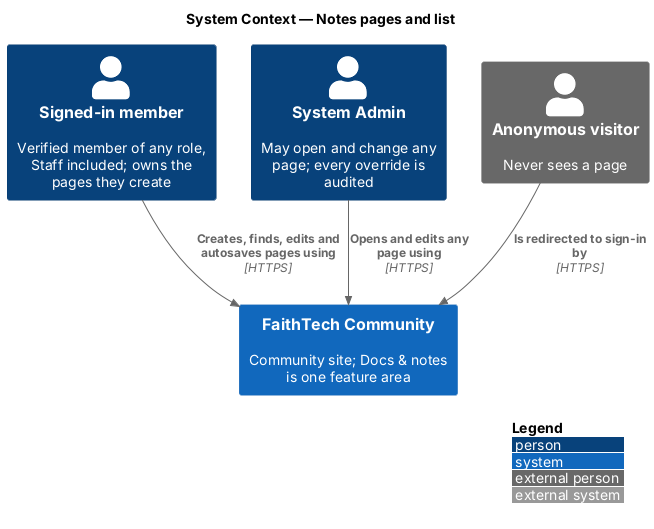
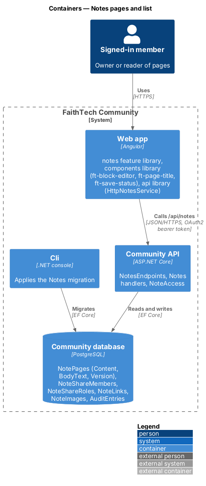
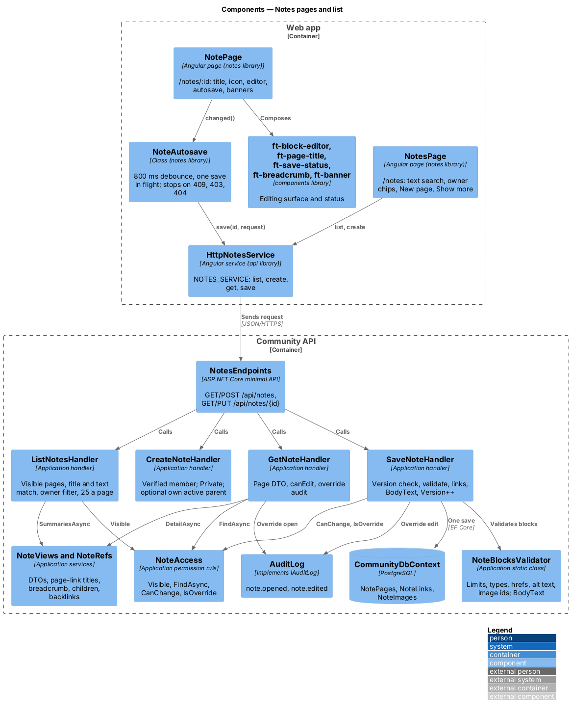
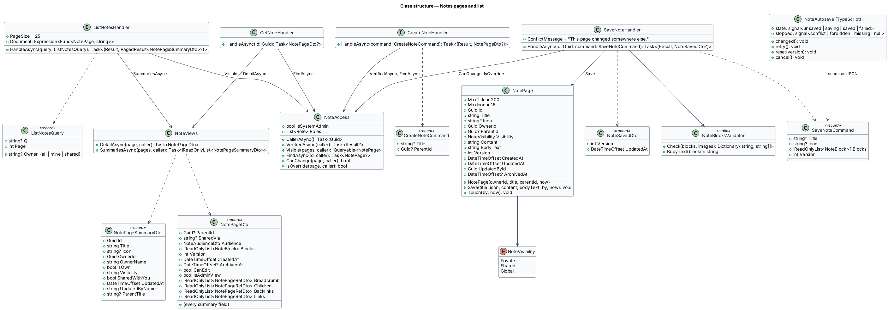
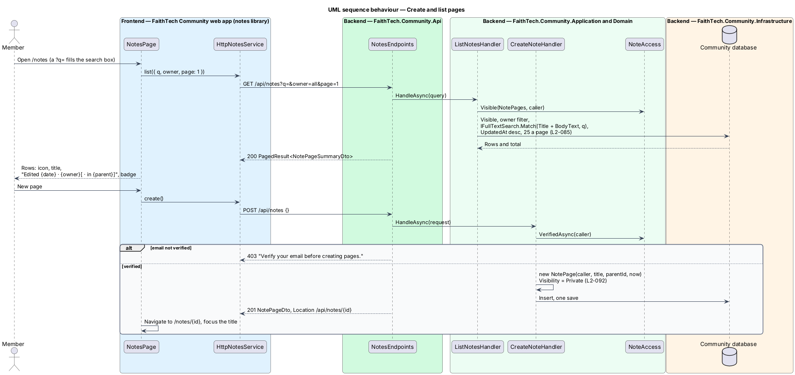
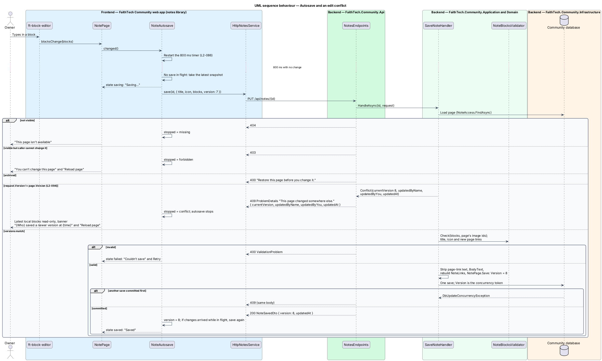

# Notes pages and list

## Overview

**Docs & notes** (`notes`, `L1-022`) gives FaithTech members one place for the living, written knowledge of a city team: meeting notes, run sheets, playbooks and how-tos that today sit in Google Drive, SharePoint and email. Resources (`L1-020`) holds finished files; Docs & notes holds pages that members write in the app.

Key terms:

- **page** — titled, ordered list of blocks owned by one member, with an optional emoji icon, an optional parent page and a visibility
- **block** — one unit of page content: a paragraph, heading, list item, to-do, quote, callout, code, divider, image or link card (`notes/block-editor`)
- **owner** — member who created the page and the only member, besides System Admin, who may change it
- **version** — integer on the page that every save increments; a save names the version it started from (ADR 0023)
- **autosave** — save sent by the editor 800 ms after the last change, with at most one save in flight
- **edit conflict** — save whose version no longer matches the stored page; the server refuses it with `409` and overwrites nothing

This design covers the Notes list, creating a page, opening it as an editor or a read-only view, the page title and icon, autosave and the edit-conflict path. The editing surface is `notes/block-editor`; links, nesting and the breadcrumb are `notes/links-and-backlinks`; visibility and sharing are `notes/share-and-visibility`; archive and search are `notes/archive-and-search`; images are `notes/images`. Storage and concurrency are recorded in [ADR 0023](../../../adr/0023-notes-block-storage-ordering-and-concurrency.md), the editor in [ADR 0024](../../../adr/0024-notes-editor-on-contenteditable-with-cdk.md) and access in [ADR 0025](../../../adr/0025-notes-access-links-and-staff.md).

## Description

The slice runs from the `notes` feature library in the web app to the `NotePages` table in the Community database.

### Web app

- **`NotesPage`** — page in the `notes` library at `/notes` (mock `pages/notes`). `ft-page-header` reads "Notes" with the subtitle "Meeting notes, playbooks and how-tos · {N} page(s)" (or "· none yet"), where N is the count of every visible page, and offers ghost *Archived* (`/notes/archived`) and primary *New page*. Below it a `role="search"` region holds the search box ("Search notes", placeholder "Search page titles and text", debounced by 300 ms) and an `ft-chip-group` "Owner" with the chips *All pages*, *Mine* and *Shared with me*. Under the heading "Recently edited", an `ft-list` row per page shows `ft-icon-tile` (the page's emoji or the default notes icon), the title ("Untitled" when empty), the meta line "Edited {ddd d MMM} · {owner}[ · in {parent}]" with the owner as "you" for the caller's own pages (`editedLine` in `note-format.ts`), and an `ft-badge` "Private", "Shared" or "Shared with you" (nothing for Global, `badgeOf`). The list is ordered by most recently edited, 25 at a time, with *Show more*. Loading, empty ("No pages yet", *Create your first page*), no-results ("No pages match “{term}”", *Clear search*) and error ("We couldn’t load notes", *Try again*) states use `ft-list-skeleton` ("Loading notes") and `ft-empty-state`. A `?q=` in the address fills the search box on arrival, which is how "See all in Notes" from global search lands; the term and filter are not written back to the address.
- **New page** — *New page* calls `create()` and navigates to `/notes/{id}`; the new, untitled page opens with focus in the title. A page is always created Private (`L2-092`); there is no create dialog because a new page has no required field. A failed create shows the danger toast "Page not created", "We couldn’t reach FaithTech. Try again."
- **`NotePage`** — page at `/notes/:id` (mock `pages/note`: editor, read-only, shared-with-you, private, admin, archived, conflict, loading, error, missing). It shows `ft-breadcrumb` (`notes/links-and-backlinks`; "Notes › Archived › {title}" for an archived page), then, for an editor, a toolbar with `ft-save-status`, *Share* and the `ft-menu` "More actions" (*Page settings*, *New page inside*, *Move*, *Archive*). When the page has an icon, it is a button "Change the icon, now {emoji}" that opens *Page settings*. `ft-page-title` is the page's `h1`. One banner follows, the first that applies in this order: conflict, access changed, archived, System Admin, Private (owner), Shared with you, Read only (`notes/share-and-visibility`). Then come `ft-block-editor` and the `ft-page-links` sections "Pages inside" and "Linked from". `editable` is `canEdit` and not archived; a reader gets the same layout with the editor in `readonly` mode and no toolbar.
- **`PageTitleComponent`** — `ft-page-title` in `components`: an `h1` holding a single-line `contenteditable="plaintext-only"` text box labelled "Page title" with the placeholder "Untitled", cut at 200 characters; Enter emits `submitted` and `NotePage` moves focus to the first block. Paste inserts plain text through `document.execCommand('insertText')`, the one use of `execCommand` in the feature. Read-only, it renders the title (or "Untitled") as plain text in the `h1`.
- **`NoteSettingsDialog`** — "Page settings": "Title" (hint "Leave it empty and the page shows as “Untitled”.") and an `ft-emoji-picker` "Icon" with "No icon"; *Save* puts both into the page and autosave sends them.
- **`NoteAutosave`** — plain class in the `notes` library (`note-autosave.ts`), created by `NotePage` for each load. `changed()` restarts an 800 ms timer. When it fires and no save is in flight, it sends `save(id, { title, icon, blocks, version })` from the latest snapshot. Changes made while a save is in flight set a dirty flag, and one more save follows as soon as the response arrives, with the new version. The `state` signal drives `ft-save-status`: `unsaved` (nothing shown), `saving`, `saved`, `failed`. A `400`, `5xx` or network failure sets `failed` and keeps the changes dirty; *Retry* or the next change resends the latest snapshot. A `409`, `403` or `404` sets `stopped` (`conflict` with the problem body, `forbidden` or `missing`) and autosave stops for good until *Reload page* loads the page again. Leaving the page cancels a pending timer; there is no route guard and no `beforeunload` prompt.
- **Paused editing** — while autosave is stopped, `NotePage` shows the latest local blocks in a read-only editor and a title that cannot be changed. A conflict shows the danger `ft-banner` "This page changed somewhere else" with "{Who} saved a newer version at {h:mm am}. Your last changes weren’t saved." ({Who} is "You" when `updatedByYou`) and *Reload page*; a `403` shows "You can’t change this page", "Your access changed while you were editing. Your last changes weren’t saved." and *Reload page*; a `404` replaces the page with "This page isn’t available". Danger banners have `role="alert"`.
- **`SaveStatusComponent`** — `ft-save-status` in `components`: "Saving…" and "Saved" in a `role="status"` element, "Couldn’t save" in a `role="alert"` element with a *Retry* button; nothing is shown in the `unsaved` state, so typing causes no announcements.
- **`NotesService`** / **`NOTES_SERVICE`** / **`HttpNotesService`** — contract, injection token and HTTP implementation in `api/src/lib/notes`. This slice uses `list({ q, owner, page })`, `create(title?, parentId?)`, `get(id)` and `save(id, page)`. Every notes request carries the `HANDLES_FORBIDDEN` context, so a `403` reaches the page instead of the global forbidden handling; the `409` body is typed as `NoteConflict { currentVersion, updatedByName, updatedByYou, updatedAt }`.
- **Shell** — `shell/navigation.ts` adds the nav item "Notes" (`/notes`, `notes` icon) for every signed-in member, after Resources. `app.routes.ts` lazy-loads `NOTES_ROUTES` from `@faithtech-community/notes` at `notes` behind the signed-in guard. `NOTES_ROUTES` maps `''` to `NotesPage`, `archived` to `ArchivedNotesPage` and `:id` to `NotePage`.

### Community API

- **`NotesEndpoints`** — `Api/Endpoints/NotesEndpoints.cs`, a `/api/notes` group. Endpoints require authentication by default, so anonymous callers get `401`. No business rule lives in the endpoints.
- **`NoteAccess`** — the permission rule in `Application/Notes/` (detailed in `notes/share-and-visibility`): `CallerAsync`, `Visible`, `FindAsync`, `CanChange`, `IsOverride`, `VerifiedAsync`.
- **`ListNotesHandler`** — `HandleAsync(ListNotesQuery(Q, Owner, Page))`: starts from `NoteAccess.Visible`; `owner=mine` keeps the caller's pages, `owner=shared` keeps pages owned by someone else that are Shared with the caller by name or by a role held now, and any value other than empty, `all`, `mine` or `shared` answers `400` "Choose all, mine or shared.". `q` goes through `IFullTextSearch.Match` over `Title + " " + BodyText` (the same document as global search), so the list finds words in the title and in the page text. Orders by `UpdatedAt` descending, 25 a page, with the total. `NoteViews.SummariesAsync` builds the rows, including the parent's title ("Private page" when the caller may not open the parent).
- **`CreateNoteHandler`** — refuses a caller whose email is not verified with `403` "Verify your email before creating pages.". It refuses a title over 200 characters after trimming with `400`. An optional `parentId` the caller may not open answers `404`; one the caller does not own, or that is archived, answers `400` "Choose another page.". It creates `new NotePage(ownerId, title, parentId, now)`: Private, version 1, `Content` `[]`, and answers `201` with the `NotePageDto`.
- **`GetNoteHandler`** — loads the page through `NoteAccess.FindAsync` (visible, or archived for its owner and System Admin) and answers `null` (mapped to `404`) otherwise. A System Admin opening a page they do not own that is Private, Shared or archived writes `note.opened`. `NoteViews.DetailAsync` builds the DTO: blocks with page-link text filled, `links`, breadcrumb, children and backlinks through `NoteRefs`, the audience with live role counts, `sharedVia`, `canEdit` (owner or System Admin) and `isAdminView`.
- **`SaveNoteHandler`** — `HandleAsync(id, SaveNoteCommand(Title, Icon, Blocks, Version))`, in this order: `404` when not visible; `403` when the caller may not change it; `400` "Restore this page before you change it." when archived; `409` when `Version` differs from the stored version. It then runs `NoteBlocksValidator.Check` against the page's uploaded image ids, the title and icon rules and the new-page-link rule (`notes/links-and-backlinks`), answering `400` with field errors. On success it strips page-link text, rebuilds `NoteLinks`, calls `NotePage.Save` (title, icon, `Content`, `BodyText`, `UpdatedAt`, `UpdatedById`, `Version + 1`) and saves once, answering `200 { version, updatedAt }`. `Version` is also an EF Core concurrency token, so two saves that pass the check at once cannot both commit; the loser's `DbUpdateConcurrencyException` maps to the same `409`. The `409` is a problem details response with the detail "This page changed somewhere else." and the extensions `currentVersion`, `updatedByName` ("A former member" when the profile is gone), `updatedByYou` and `updatedAt`. A System Admin save of someone else's page writes `note.edited` with the version and title before and after, never the content.

### Data model

| Table | Columns | Notes |
|-------|---------|-------|
| `NotePages` | `Id` (uuid, PK), `Title` (varchar 200), `Icon` (varchar 16, null), `OwnerId` (uuid), `ParentId` (uuid, null), `Visibility` (varchar 16), `Content` (text, JSON array of blocks), `BodyText` (text), `Version` (int, concurrency token), `CreatedAt`, `UpdatedAt`, `UpdatedById`, `ArchivedAt` (null), `SearchVector` (generated `tsvector` over `Title` and `BodyText`, PostgreSQL only) | Indexes on `(ArchivedAt, UpdatedAt)`, `OwnerId`, `ParentId`; GIN on `SearchVector`. `ParentId` has no foreign key; the handlers enforce the parent rule. |
| `NoteShareMembers`, `NoteShareRoles` | generated `Id` (int, PK), `PageId` + `ProfileId` / `Role` | Unique on `(PageId, ProfileId)` and `(PageId, Role)`; `notes/share-and-visibility` |
| `NoteLinks` | `SourceId`, `TargetId` (PK on both) | Index on `TargetId`; `notes/links-and-backlinks` |
| `NoteImages` | `Id`, `PageId`, `BlobName`, `ContentType`, `Size`, `UploadedAt` | Index on `PageId`; `notes/images` |

`ConfigureNotes(builder)` in `CommunityDbContext` maps all five tables; the one migration `20261022160730_Notes` in `Infrastructure/Persistence/Migrations/` creates them and is applied by the Cli (`migrate`), never by the API. The seeder adds no sample pages.

### API contract

| Method and path | Request | Responses |
|-----------------|---------|-----------|
| `GET /api/notes?q=&owner=all\|mine\|shared&page=` | — | `200 PagedResult<NotePageSummaryDto>`, `400` unknown owner value, `401` |
| `POST /api/notes` | `{ title?, parentId? }` | `201 NotePageDto` with `Location`, `400` title too long or parent refused, `401`, `403` email not verified, `404` parent not visible |
| `GET /api/notes/{id}` | — | `200 NotePageDto`, `401`, `404` missing, archived (for anyone but owner and System Admin) or not visible |
| `PUT /api/notes/{id}` | `{ title, icon, blocks, version }` | `200 { version, updatedAt }`, `400` validation or archived, `401`, `403` not owner or System Admin, `404`, `409` problem details `{ currentVersion, updatedByName, updatedByYou, updatedAt }` |

`NotePageSummaryDto`: `id`, `title`, `icon`, `ownerId`, `ownerName`, `isOwn`, `visibility`, `sharedWithYou`, `updatedAt`, `updatedByName`, `parentTitle`. `NotePageDto` has the same fields plus `parentId`, `sharedVia` ("you" or a role name), `audience { members, roles }`, `blocks`, `version`, `createdAt`, `archivedAt`, `canEdit`, `isAdminView`, `breadcrumb`, `children`, `backlinks` and `links`.

### End-to-end tests

`e2e/fixtures/mock-notes.ts` is the fake for every `/api/notes` route: an in-memory page set seeded per test, the same visibility rule, version check and `409` body as the API, and loud failure for any unrecognised request. `e2e/pages/notes.page.ts` and `note.page.ts` own the selectors. `list-and-create.spec.ts`, `editor.spec.ts`, `page-settings.spec.ts` and `conflicts.spec.ts` cover the list, creation, autosave states, *Retry*, the conflict and access-changed banners (the fixture bumps the stored version or revokes access) and axe checks on each state. Unit specs cover `NoteAutosave` and `note-format.ts`; the API tests in `backend/tests/FaithTech.Community.Api.Tests/Notes/` cover create, list, save and conflicts.

### Accessibility

The list is an `ft-list` of links with the badge in each row. The title is the `h1`, holding a text box labelled "Page title" while editable. "Saving…" and "Saved" are polite; "Couldn’t save" and the conflict and access banners are assertive. Every state passes axe in light and dark themes.

### Security

Every read starts from `NoteAccess.Visible`, so the list, the page and the `409` body never expose a page the caller may not open. The `409` body names who saved last only to a caller who may already open the page. Content is JSON data, never HTML, so nothing from a page is rendered as markup (`notes/block-editor`).

## Requirements

The feature realizes the following level-2 (L2) requirements. Each L2 requirement refines a level-1 (L1) requirement, cited by identifier. The acceptance criteria are in `docs/specs/L2.md`.

| L2 ID | Refines (L1) | Requirement |
|-------|--------------|-------------|
| `L2-085` | `L1-022` | Notes list: create and find pages |
| `L2-086` | `L1-022` | Page editor: title, icon, blocks and autosave |
| `L2-094` | `L1-022` | Edit conflicts |

## Diagrams

### System context

Every verified member creates and edits their own pages; System Admin may open and change any page; anonymous visitors never see one.

### Containers

The `notes` library calls the Community API through `HttpNotesService` with a bearer token. The API reads and writes the `NotePages` table; the Cli applies the `Notes` migration.

### Components

`NotePage` hands changes to `NoteAutosave`, which sends whole-page saves. `NotesEndpoints` dispatches to one handler per operation; each handler goes through `NoteAccess`, and `SaveNoteHandler` validates with `NoteBlocksValidator`.

### Class structure

`NotePage` holds the content as a JSON string with an integer `Version`. The handlers return summary and page DTOs; `SaveNoteCommand` carries the version the client started from.

### Behaviour — create and list

The list applies visibility, the owner filter and the text match in one query. *New page* creates a Private page and opens it.

### Behaviour — autosave and an edit conflict

The editor saves 800 ms after the last change, one save at a time. A version mismatch, detected before the write or by the concurrency token during it, answers `409` and stops autosave behind the conflict banner; a `403` or `404` stops it the same way.

### Behaviour — open a page

A page the caller may not open answers `404`. A System Admin opening someone else's Private, Shared or archived page is audited. `canEdit` chooses the editor or the read-only view.

## Open questions

- The list's search box matches the title and the page text through the same `IFullTextSearch` document as global search (`L2-085` AC4). Resolved.
- A conflict keeps the local blocks on screen, read-only, until *Reload page*; copying them out is left to the member. Merging or a "keep mine" option is deferred with co-editing. Resolved.
- A System Admin edit writes one `note.edited` entry per save, so an override editing session can write several entries (ADR 0025). Resolved.
- Saving, sharing, moving or uploading to an archived page answers `400` "Restore this page before you change it.". Resolved.
- Leaving a page within 800 ms of the last change drops that change: the pending timer is cancelled and no route guard or `beforeunload` prompt flushes it. Resolved as built; a flush on leave may be added later.
