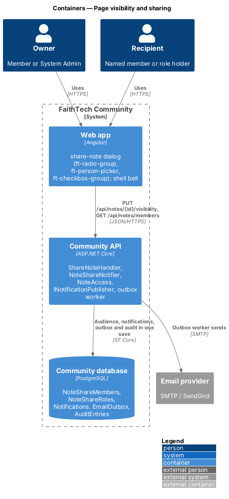
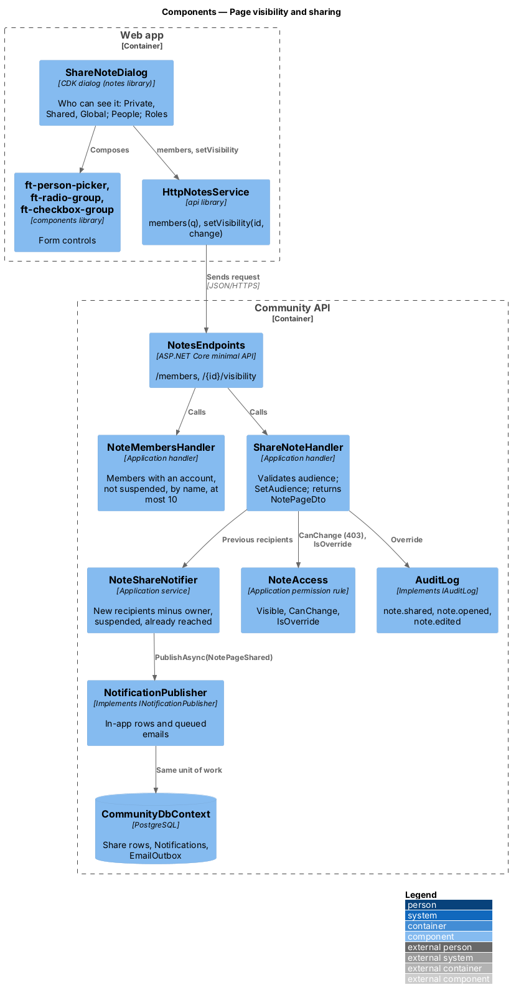
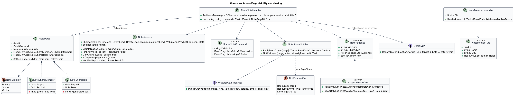

# Page visibility and sharing

## Overview

Every Docs & notes page (`L1-022`) has a **visibility** that decides who may open it, using the same three levels as Resources (`L2-060`, `L2-061`, ADR 0017). Unlike a resource, a new page starts **Private**: notes are often drafts, and the owner chooses when to widen them. Only the owner changes a page; System Admin may override, and every override is audited. This slice covers the rule itself, sharing with members and roles, the `NotePageShared` notification, and how Staff, City Leads and System Admin are treated.

Key terms:

- **Private** — visible to the owner and System Admin only; the default for every new page
- **Shared** — visible to the owner, the members named in its audience, the current holders of the roles named in its audience, and System Admin
- **Global** — visible to every signed-in member
- **audience** — named members (`NoteShareMember`) and named roles (`NoteShareRole`) of a Shared page; a role audience is live, evaluated against the caller's roles on every request
- **recipients** — members notified when a page is shared: each named member plus every current holder of each named role, de-duplicated, excluding the owner, suspended members and anyone the previous audience already reached
- **override** — action by a System Admin on a page they do not own; written to the audit log

The decisions are recorded in [ADR 0025](../../../adr/0025-notes-access-links-and-staff.md).

## Description

### Web app

- **`ShareNoteDialog`** — CDK dialog in the `notes` library (mock `dialogs/share-note`) opened from *Share* in the page toolbar: "Share {title}" with the `ft-radio-group` "Who can see it": *Private* ("Only you (and System Admin)."), *Shared* ("You and the people and roles you choose.") and *Global* ("Every signed-in member can find it."), the current visibility selected. Shared reveals the fieldset "Share with": an `ft-person-picker` "People" ("Search members by name", fed by `members(q)`; each suggestion shows the name with its roles and city; chosen members are removable chips), an `ft-checkbox-group` "Roles" (City Lead, Event Lead, Create Lead, Communications Lead, Volunteer, Product Engineer, Staff) and the note "Everyone you add gets a notification. They can read it, but can’t change it or share it on." Saving Shared with nobody shows "Choose at least one person or role, or pick another visibility." on the People field. The submit reads *Save*, "Saving…" in flight, and *Try again* after the danger alert "Sharing not changed", "We couldn’t reach FaithTech. Nothing changed — try again.". On success `NotePage` takes the returned page and shows the toast "Sharing updated for {title}".
- **Page banners** — `NotePage` shows at most one `ft-banner`, the first that applies after the conflict, access and archived banners: for a System Admin on someone else's page, "You’re viewing this as System Admin", "{Owner} owns this page. Every change you make is written to the audit log."; for the owner of a Private page, "Private", "Only you can see this. System Admin can too, and every time they open it, it’s recorded in the audit log."; for a recipient of a Shared page (`sharedVia`), "Shared with you", "{Owner} shared this with {you | everyone who has the {role} role}. You can read it, but only {Owner} can change it."; for any other reader, "Read only", "Only {Owner} can change this page.". A reader sees no toolbar, so no *Share*.
- **Bell and email** — the `NotePageShared` notice "{Owner} shared {title} with you" links to `/notes/{id}` through the shell's existing notification list.
- **`HttpNotesService`** — `members(q)` calls `GET /api/notes/members?q=`; `setVisibility(id, { visibility, memberIds, roles })` calls `PUT /api/notes/{id}/visibility`.

### Community API

- **`NoteAccess`** — scoped Application service in `Application/Notes/`, modelled on `ResourceAccess`.
  - `Visible(pages, caller)` returns active pages (`ArchivedAt` null) that are Global, owned by the caller, or Shared with a `NoteShareMember` for the caller or a `NoteShareRole` the caller holds now. For System Admin it returns every active page. The caller's roles come from `ICurrentUser`, so a role change applies on the next request.
  - `FindAsync(id, caller)` returns the visible page, or an archived page when the caller is its owner or a System Admin, or `null`.
  - `CanChange(page, caller)` is true for the owner and System Admin only. No role, Staff and City Lead included, grants a write on someone else's page.
  - `IsOverride(page, caller)` is true when a System Admin acts on a page they do not own.
  - `VerifiedAsync(caller)` reads `EmailConfirmed`; only create uses it, refusing an unverified caller with `403` "Verify your email before creating pages.".
  - `ShareableRoles` lists the seven roles offered in the dialog, the same list as for resources.
- **`NotePage.SetAudience(visibility, members, roles)`** — keeps the share rows that stay, removes the rest and adds the new ones; Private and Global clear them. Share rows carry a generated integer key with a unique index on `(PageId, ProfileId)` or `(PageId, Role)`, so a row added to a loaded page is inserted rather than updated. Sharing does not change the page's `Version`.
- **`ShareNoteHandler`** — `HandleAsync(id, ShareNoteCommand(Visibility, MemberIds, Roles))`: `404` when not visible; `403` when the caller may not change it (a recipient trying to re-share, `L2-093`); `400` "Restore this page before you change it." when archived; `400` "Choose who can see it." for an unknown visibility, "Choose roles from the list." for a role that is not shareable, "Choose members who are on FaithTech." for an unknown member id, and "Choose at least one person or role, or pick another visibility." when Shared has neither. It takes the recipients the current audience reaches (`NoteShareNotifier.RecipientsAsync`), applies the new audience, records `note.shared` with the visibility, members and roles before and after on an override, asks the notifier to tell only the new recipients, and saves once. Answers `200 NotePageDto`.
- **`NoteShareNotifier`** — Application service in `Notes/`. Recipients are members with an account, not suspended and not the owner, named in the audience or holding a named role. It calls `INotificationPublisher.PublishAsync(recipients, NotificationKind.NotePageShared, "{Owner} shared {title} with you", "/notes/{id}", actor, email)` with the untitled page named "Untitled". The email has the subject "{Owner} shared {title} with you" and the plain-text body "A page was shared with you", then "{Owner} shared “{title}” with {you | everyone who has the {role} role, which includes you}. Open the page:" followed by the link. It is an activity email and always sent; the announcement opt-out does not apply. Notifications and queued emails join the share's unit of work.
- **`NoteMembersHandler`** — `GET /api/notes/members?q=`: up to 10 members with an account who are not suspended and whose name contains `q`, by name, as `NoteMemberDto { id, name, city, roles }`. Any signed-in member may call it.
- **System Admin auditing** — `GetNoteHandler` writes `note.opened` when a System Admin opens a Private, Shared or archived page they do not own; every other override (`note.edited` with the version and title, `note.shared`, `note.moved` with the parent, `note.archived`, `note.restored`, and image uploads as `note.edited` with `ImageAdded`) is written by the handler that performs it, through `IAuditLog.Record(actor, action, "NotePage", id, before, after)` in the same save. Nothing is written for a member's own pages.

### API contract

| Method and path | Request | Responses |
|-----------------|---------|-----------|
| `PUT /api/notes/{id}/visibility` | `{ visibility, memberIds, roles }` | `200 NotePageDto`, `400`, `401`, `403`, `404` |
| `GET /api/notes/members?q=` | — | `200 [NoteMemberDto { id, name, city, roles }]` (at most 10), `401` |

Every `/api/notes` endpoint answers `401` to an anonymous caller and `404` for a page the caller may not open, whatever the reason.

### End-to-end tests

`mock-notes.ts` applies the same rule, records notifications through the shared notifications fake, and refuses a recipient's share with `403`. `share.spec.ts` and `admin-and-accessibility.spec.ts` sign in through the auth fixture and cover sharing a Private page with a member and a role, the notice, the recipient's read-only view and banner, the Global "Read only" banner, and a System Admin editing someone else's Private page under the System Admin banner. `ShareNoteTests.cs` and `AdminAuditTests.cs` in the API tests cover the share rules, new-recipient notifications and emails, live role audiences, Staff and lead refusals and every audit entry.

### Accessibility

The dialog is an `ft-dialog` with a labelled radio group, the person picker's combobox pattern and the error on the People field. Information banners have `role="status"`; danger banners have `role="alert"`.

### Security

Visibility is a predicate inside every query that reads pages: list, page, search, suggestions, parent titles, backlinks, breadcrumb, children and image streaming. There is no read-all role other than System Admin; Staff read only what the rule grants (`L2-098`). Role audiences are evaluated live, so removing a role removes access at once.

## Requirements

The feature realizes the following level-2 (L2) requirements. Each L2 requirement refines a level-1 (L1) requirement, cited by identifier. The acceptance criteria are in `docs/specs/L2.md`.

| L2 ID | Refines (L1) | Requirement |
|-------|--------------|-------------|
| `L2-092` | `L1-022` | Page visibility and access on the server |
| `L2-093` | `L1-022` | Share pages with members and roles |
| `L2-098` | `L1-022` | Staff and System Admin on pages |

The `NotePageShared` kind also extends the notification sources of `L2-027` (in-app) and `L2-028` (email); the `note.*` actions extend the audit log of `L2-041`.

## Diagrams

### System context

The owner shares a page; recipients are told in the app and by email; System Admin may override with an audit entry.

### Containers

The dialog sends the audience; the API writes the audience, notifications, queued emails and any audit entry in one transaction; the outbox worker sends the email.

### Components

`ShareNoteHandler` checks `NoteAccess`, applies the audience and hands the new recipients to `NoteShareNotifier`, which publishes `NotePageShared`.

### Class structure

`NotePage` composes its share rows; `NoteAccess` turns the caller's id and current roles into one query predicate; `NoteShareNotifier` depends on `INotificationPublisher`.

### Behaviour — share and notify

Only recipients the previous audience did not reach are notified, in the same save as the share; a recipient's attempt to re-share answers `403`.

### Behaviour — visibility, Staff and the System Admin override

The predicate decides `404` for everyone without access, Staff and City Leads included; `CanChange` decides `403` on writes; System Admin overrides are audited.

## Open questions

- Pages may be shared with the same seven roles as resources; Attendee and System Admin are not offered. Resolved.
- The email copy ("A page was shared with you", "Open the page:") follows the `ResourceShared` pattern: a plain-text body followed by the link. Resolved.
- An unverified member may read pages shared with them and may share or upload to pages they already own; only creating a page needs a verified email. Resolved as built.
- The member picker does not leave out the caller; choosing oneself adds a share row but no notification, because the owner is never a recipient. Resolved as built.
