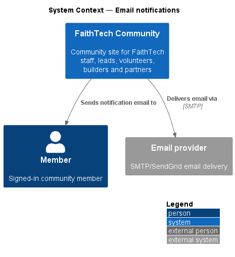
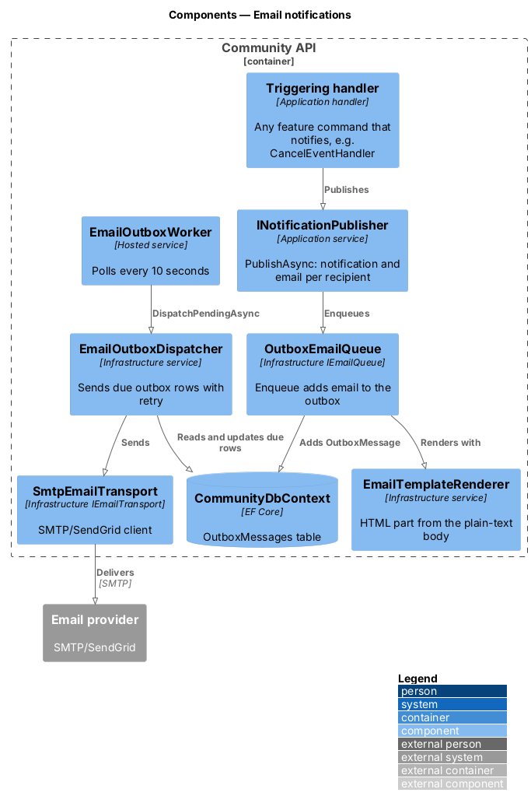
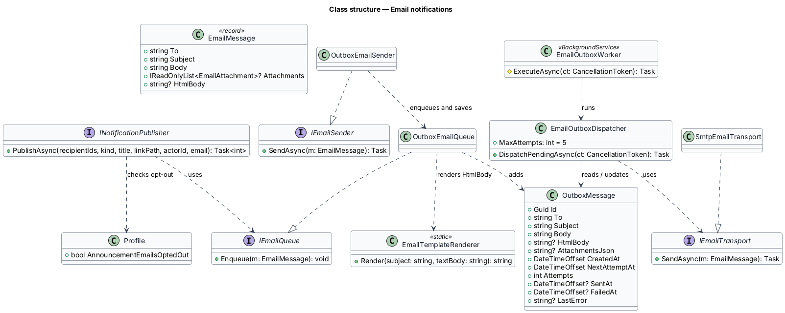

# Email notifications

## Overview

FaithTech Community sends email for the occurrences listed in `L2-028`: a contact signed up, an event cancelled or changed, invites, RSVP confirmations, role changes, Agile assignments and workspace additions, Planning Poker invitations, and announcements. This feature describes the shared outbound email pipeline that every one of those sources uses.

- **email outbox** — table of rendered emails waiting to be delivered, written in the same transaction as the action that triggered them
- **delivery worker** — background service that reads the outbox and hands each message to the email provider
- **announcement opt-out** — member preference that suppresses announcement emails only

The outbox decouples the triggering action from delivery. The triggering action succeeds even when the email provider is unavailable, and the worker retries delivery later (`L2-047`).

## Description

- **`IEmailQueue`** — Application abstraction. `Enqueue(EmailMessage)` adds a message to the outbox inside the caller's unit of work, so it is saved with the action that raised it.
- **`EmailMessage`** — record with `To`, `Subject`, the plain-text `Body`, optional `Attachments` (an RSVP's `.ics`) and `HtmlBody`.
- **`IEmailSender`** / **`OutboxEmailSender`** — the single-email entry point only the identity flows use (verification and password reset): Identity has already saved the account before the token exists, and those emails can be requested again, so this enqueues and saves at once. Every action that changes community data (invites, role changes, contact sign-ups, RSVPs, event cancellation, Agile notifications, announcements) queues through `IEmailQueue` before its own save, so the action and its email commit together or not at all (`L2-047`).
- **`OutboxEmailQueue`** — Infrastructure implementation of `IEmailQueue`. It renders the HTML part with `EmailTemplateRenderer` unless the message brings one.
- **`EmailTemplateRenderer`** — Infrastructure renderer that turns the plain-text body into the HTML part with the design system's `.email` classes (`docs/design-system/patterns/notifications.html`): a paragraph that is only a URL becomes the "Open in FaithTech" button, and a line "Label: URL" becomes a link named Label. Every style is read from the light-theme tokens in `tokens.css`, which the Infrastructure assembly embeds at build time, so no colour, size or font is typed into it. Text is HTML-encoded.
- **`OutboxMessage`** — Infrastructure persistence entity (`OutboxMessages` table) with `Body`, `HtmlBody`, `AttachmentsJson`, `Attempts`, `NextAttemptAt`, `SentAt`, `FailedAt` (terminal: the retry budget is spent) and `LastError`.
- **`EmailOutboxDispatcher`** / **`EmailOutboxWorker`** — the hosted background service in Infrastructure polls due outbox rows, hands each to `IEmailTransport`, and on failure schedules a retry with backoff, up to 5 attempts in all including the first send, after which the row is marked failed.
- **`IEmailTransport`** / **`SmtpEmailTransport`** — Infrastructure transport that delivers through SMTP, which covers the SendGrid relay. It sends the plain-text part with the HTML part as its alternative.
- **`INotificationPublisher.PublishAsync`** — Application service that writes the in-app `Notification` for each recipient and, for sources with an email form, enqueues one email per recipient with the link to the item appended on the `WebApp:Origin`. For `NotificationKind.Announcement` it skips recipients whose `AnnouncementEmailsOptedOut` flag is set; every other kind always emails.
- **`WebAppOptions`** — `WebApp:Origin`, validated at start-up: outside Development the API refuses to start unless it is an `https://` URL, so every link in an email uses HTTPS.

The worker polls every 10 seconds (`Outbox:IntervalSeconds`), so a newly queued email is first sent within 2 minutes whenever the provider is healthy. The retry budget is **5 delivery attempts in all, counting the first send** (`EmailOutboxDispatcher.MaxAttempts`). After failed attempt *n* the next attempt is due 2*n* minutes later, capped at one hour, so the attempts fall at about 0, 2, 6, 14 and 30 minutes. When the fifth attempt fails, the row gets `FailedAt` and the dispatcher never selects it again. The failure stays observable in the outbox row (`Attempts`, `FailedAt`, `LastError` with the recipient address replaced by `[recipient]`) and in an error log entry that names only the message id. A message sent within the budget gets `SentAt` and is never dispatched again.

## Requirements

The feature realizes the following level-2 (L2) requirements. Each L2 requirement refines a level-1 (L1) requirement, cited by identifier.

| L2 ID | Refines (L1) | Requirement |
|-------|--------------|-------------|
| `L2-028` | `L1-010` | These emails are sent: a contact signed up, an event cancelled or changed, invites, RSVP confirmations, role changes, Agile assignments and workspace additions, Planning Poker invitations, and announcements. |

### Acceptance criteria

**`L2-028` — Email notifications**

1. Given a triggering action, when it completes, then the email is queued and sent within 2 minutes, retrying on failure for up to 5 delivery attempts in all, counting the first send, after which it is marked failed and not retried.
2. Given an email, when it is rendered, then it includes a plain-text part, and every link uses HTTPS.
3. Given a user who opted out of announcement emails, when an announcement is sent, then no announcement email reaches them, but other notification emails still do.

## Diagrams

### System context

FaithTech Community sends notification email to members through an external email provider.

### Containers

The Community API writes emails to an outbox in the Community database and delivers them to the email provider over SMTP.

### Components

A triggering handler publishes through `INotificationPublisher`, which enqueues a rendered email. `EmailDeliveryWorker` later delivers it through `IEmailSender`.

### Class structure

`OutboxEmail` owns an `EmailMessage` and tracks attempts and status. `INotificationPublisher` checks `AnnouncementEmailsOptedOut` before it enqueues an announcement.

### Behaviour — deliver a notification email

The triggering action commits the outbox row with its own changes. The worker delivers it within 2 minutes and retries failures up to 5 times (`L2-028`).

