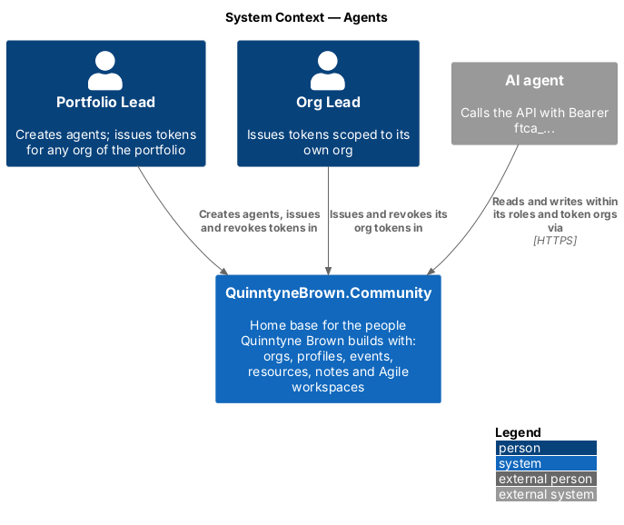
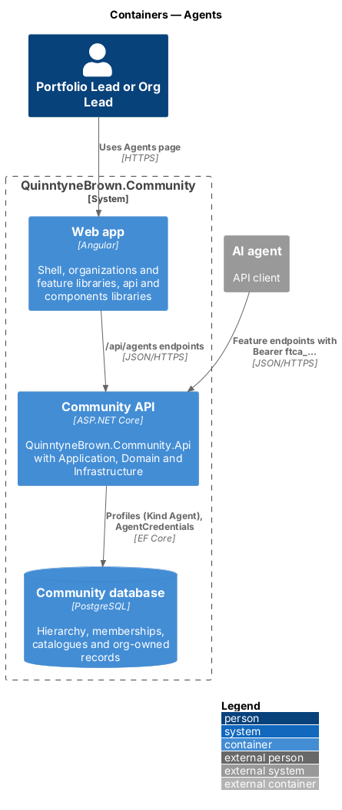
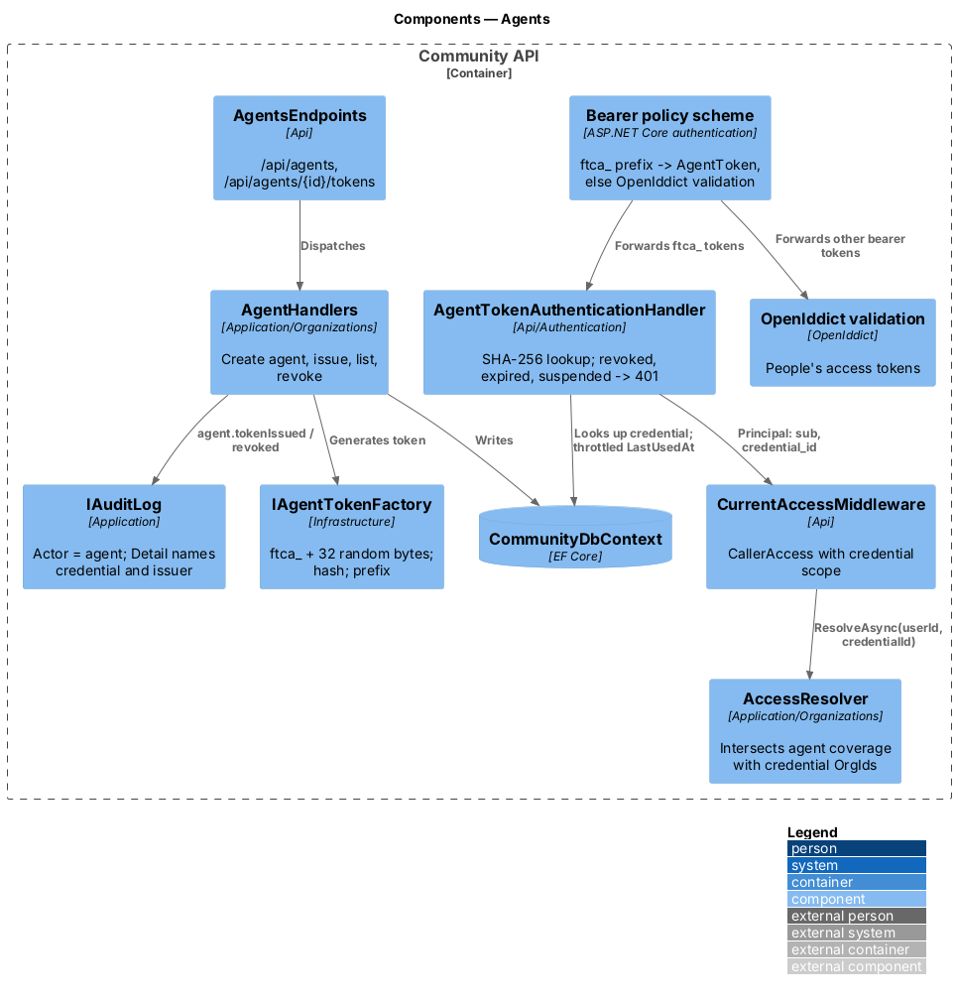
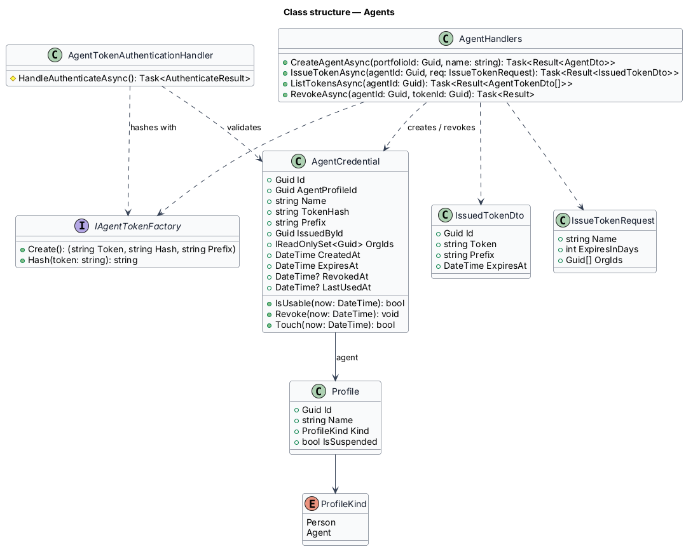
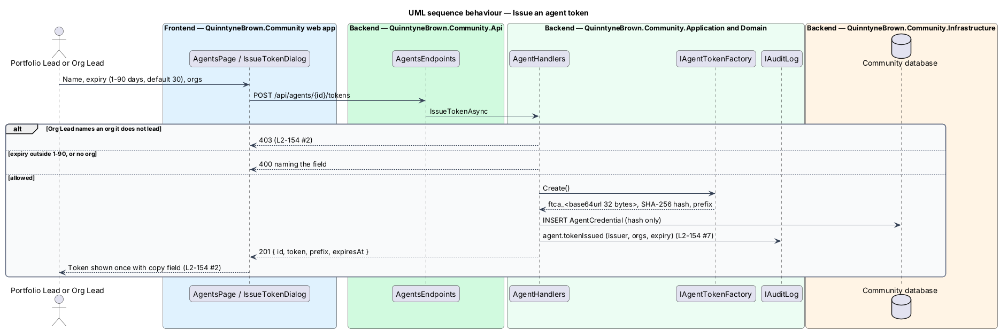
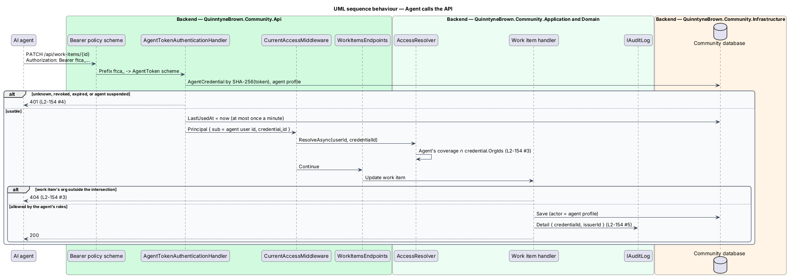

# Agents

## Overview

AI agents read and do work in QuinntyneBrown.Community as first-class members: they hold roles like people, are assigned work items, and every write they make is attributed to them. An agent has no browser, password or email, so it calls the API with a scoped, expiring, revocable personal access token issued by the Portfolio Lead, or by an Org Lead for their own org ([ADR 0036](../../../adr/0036-agent-identities-and-tokens.md)).

- **agent** — `Profile` with `Kind = Agent` and a `CommunityUser` row that has no password, no email and no external logins
- **agent credential** — `AgentCredential` row holding the SHA-256 hash of one token, its scope and its lifetime
- **agent token** — `ftca_` followed by 32 random bytes in base64url; shown once when issued and never stored in plain text
- **`AgentToken` scheme** — ASP.NET Core authentication scheme that validates agent tokens
- **issuer** — person who issued a credential; recorded on the credential and in audit entries

A token never reaches further than both its agent's roles and its issuer's choice of orgs: the access resolver intersects the agent's covered orgs with the credential's `OrgIds`.

## Description

### Domain and persistence

- **`Profile.Kind`** — `Person` (default) or `Agent`. Password, Google and GitHub sign-in refuse an agent because its user row has none of them.
- **`AgentCredential`** (`Id`, `AgentProfileId`, `Name`, `TokenHash` unique, `Prefix` (first 8 characters after `ftca_`), `IssuedById`, `OrgIds`, `CreatedAt`, `ExpiresAt`, `RevokedAt?`, `LastUsedAt?`). `IsUsable(now)` is true when not revoked and `ExpiresAt > now`. `Touch(now)` updates `LastUsedAt` only when it is more than one minute old.

### Authentication (`Api/Authentication/`)

1. A **policy scheme** is the default authenticate scheme. Its `ForwardDefaultSelector` forwards a request whose `Authorization` header starts with `Bearer ftca_` to `AgentToken`, and every other request to OpenIddict validation. Endpoints and the fallback "authenticated" policy are unchanged.
2. **`AgentTokenAuthenticationHandler`** hashes the token with `IAgentTokenFactory.Hash`, loads the credential and its agent, and fails (`401`) when the credential is missing, revoked or expired, the profile is not an agent, or the agent is suspended. On success it calls `Touch` and builds a principal with `sub` (the agent's user id) and `credential_id`.
3. **`CurrentAccessMiddleware`** passes `credential_id` to `AccessResolver.ResolveAsync(userId, credentialId)`, which keeps only covered orgs in the credential's `OrgIds`. Every request looks the credential up, so revocation is immediate.

### Application (`Application/Organizations/`)

- **`AgentHandlers`**:
  - `CreateAgentAsync(portfolioId, name)` — Portfolio Lead or System Admin; creates the profile (`Kind = Agent`) and its user row. Roles are then given through the usual membership, catalogue-role and cross-org-role endpoints (usually the "Portfolio" cross-org role).
  - `IssueTokenAsync(agentId, { name, expiresInDays, orgIds })` — the Portfolio Lead for any org of the portfolio, or an Org Lead for an agent whose token names only orgs they lead; any other org answers `403`. `expiresInDays` is 1 to 90, default 30 (`400` `expiresInDays`); `orgIds` is not empty (`400` `orgIds`). Returns the token once. Audited (`agent.tokenIssued`, issuer, orgs, expiry).
  - `ListTokensAsync(agentId)` — issuer, Portfolio Lead or System Admin; never returns the token or hash.
  - `RevokeAsync(agentId, tokenId)` — the issuer, the Portfolio Lead or a System Admin; anyone else `403`. Audited (`agent.tokenRevoked`).
- **Attribution** — the actor of every write is the agent's profile. `IAuditLog` adds `credentialId` and `issuerId` to `Detail` when the request carries `credential_id`. Activity feeds show the agent's name with an "Agent" badge.
- **Visibility** — `ProfileVisibility` hides agents from People and search unless `includeAgents=true`; pickers show them with the badge ([org-owned data](../org-owned-data-and-context/README.md)).
- **`IAgentTokenFactory`** (Infrastructure) — `Create()` returns the token, its SHA-256 hash (hex) and prefix using `RandomNumberGenerator`.

### Api contracts

| Method and route | Body | Success | Failures |
|------------------|------|---------|----------|
| `GET /api/agents?portfolioId=` | — | `200 AgentDto[]` | `403`, `404` |
| `POST /api/agents` | `{ portfolioId, name }` | `201 AgentDto` | `400`, `403`, `404` |
| `GET /api/agents/{id}/tokens` | — | `200 AgentTokenDto[]` | `403`, `404` |
| `POST /api/agents/{id}/tokens` | `{ name, expiresInDays, orgIds }` | `201 { id, name, prefix, orgs, expiresAt, token }` | `400`, `403`, `404` |
| `DELETE /api/agents/{id}/tokens/{tokenId}` | — | `204` | `403`, `404` |

`AgentDto` is `{ profileId, name, photoUrl, orgs: OrgRef[], crossOrgRoles: RoleRef[], tokenCount }`. `AgentTokenDto` is `{ id, name, prefix, orgs: OrgRef[], issuedBy: PersonRef, createdAt, expiresAt, lastUsedAt, revokedAt }`. An Org Lead sees agents that cover its org and only the tokens that name it.

### Frontend (`frontend/projects/organizations/`)

`AgentsPage` (list with last use), `CreateAgentDialog`, `IssueTokenDialog` with a one-time token reveal (copy field and "You won't see this token again."), and the revoke confirmation. Agents cannot use the web app.

## Requirements

The feature realizes the following level-2 (L2) requirements. Each L2 requirement refines a level-1 (L1) requirement, cited by identifier.

| L2 ID | Refines (L1) | Requirement |
|-------|--------------|-------------|
| `L2-154` | `L1-025`, `L1-015` | Agents and their tokens |

### Acceptance criteria

**`L2-154` — Agents and their tokens**

1. Given the Portfolio Lead, when they create an agent with a name, then a profile of kind Agent is created with no password and no email; it cannot sign in with a password, Google or GitHub.
2. Given the Portfolio Lead (any org of the portfolio) or an Org Lead (their own org only), when they issue a token with a name, an expiry of 1 to 90 days and a set of orgs, then the token is shown once, and the list shows its name, prefix, orgs, expiry and last use; an Org Lead naming another org gets 403.
3. Given a valid token, when the agent calls the API with it, then it acts with its own roles intersected with the token's orgs; a record in another org answers 404.
4. Given a revoked or expired token, or a suspended agent, when it is used, then the API answers 401.
5. Given a write made with a token, when the audit log shows it, then the actor is the agent and the entry names the token and its issuer; activity feeds show the agent's name with an "Agent" badge.
6. Given People and search, when they list profiles, then agents are hidden unless "Include agents" is chosen; where agents appear they carry an "Agent" badge.
7. Given issuing and revoking, when they happen, then each is audited.

## Diagrams

### System context

The Portfolio Lead and Org Leads issue tokens; the AI agent is an external system that calls QuinntyneBrown.Community with them.

### Containers

People manage agents through the web app; agents call the Community API directly with `Bearer ftca_…`.

### Components

The policy scheme forwards agent tokens to `AgentTokenAuthenticationHandler` and other bearer tokens to OpenIddict validation. `CurrentAccessMiddleware` and `AccessResolver` apply the credential's orgs. `AgentHandlers` issue and revoke credentials through `IAgentTokenFactory`.

### Class structure

An `AgentCredential` belongs to a `Profile` of kind `Agent`; the handler and the authentication handler both use `IAgentTokenFactory`.

### Behaviour — issue a token

The token is generated, stored only as a hash, audited and shown once; an Org Lead naming an org it does not lead gets `403` (`L2-154` AC2, AC7).

### Behaviour — agent calls the API

A revoked, expired or suspended token answers `401`; a valid one acts within the agent's roles intersected with the token's orgs, and writes are attributed to the agent with the credential and issuer (`L2-154` AC3 to AC5).

## Open questions

- **Settled: agent authentication is a hashed personal access token** with its own `AgentToken` scheme, not an OpenIddict client-credentials application per agent ([ADR 0036](../../../adr/0036-agent-identities-and-tokens.md)).
- **Settled: resolver cached per request** ([ADR 0034](../../../adr/0034-org-owned-data-and-the-access-resolver.md)); the credential is looked up on every request, so revocation and role changes are immediate.
- **Settled: the web app learns permissions from `GET /api/me/access`** ([ADR 0037](../../../adr/0037-org-addressed-urls-switcher-and-branding.md)); agents may call it too to discover their own coverage.
- Rate limits for agent tokens follow the API's existing limits; agent-specific limits are `<TO SUPPLY>`.
- OAuth client credentials for third-party integrations can be added later beside this scheme.
