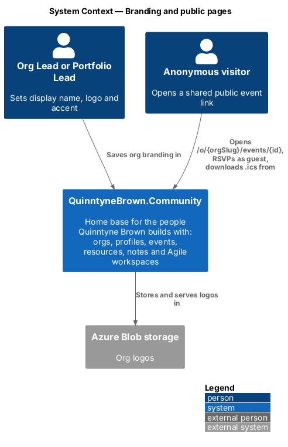
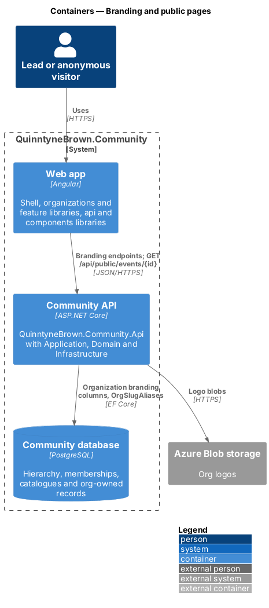
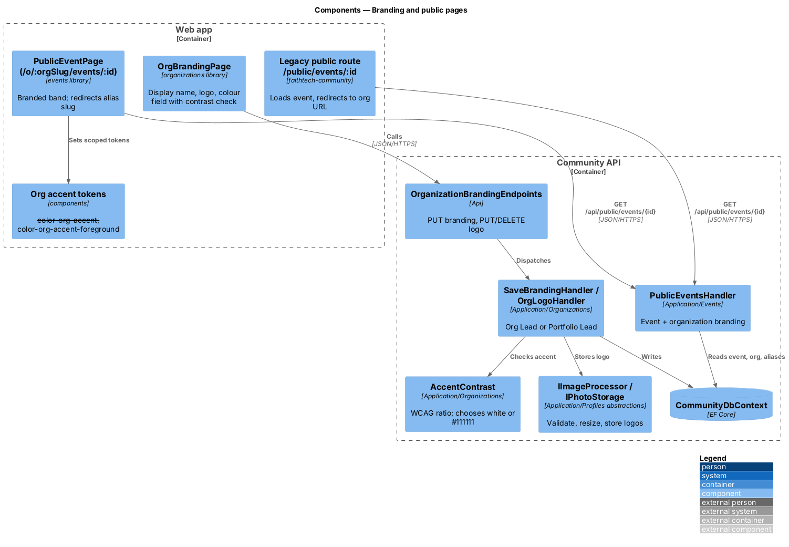
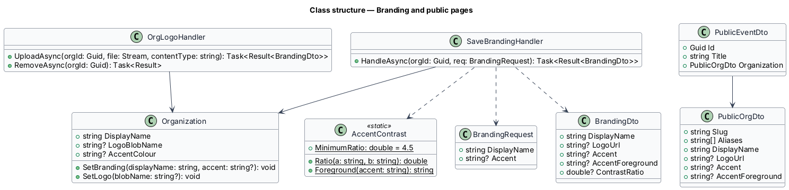
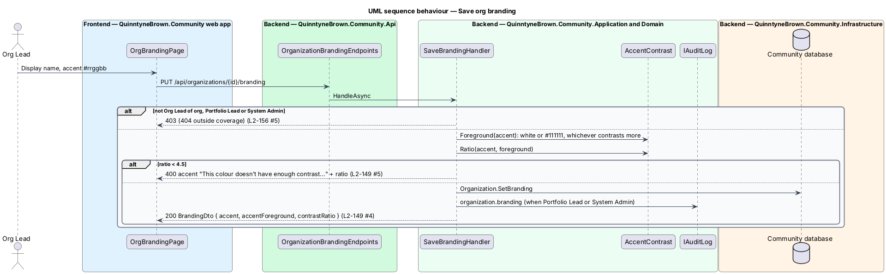
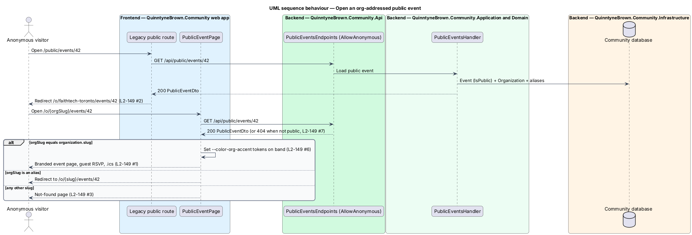

# Branding and public pages

## Overview

Public event pages are the only content anonymous visitors of QuinntyneBrown.Community see. With several orgs, a public page has to say whose event it is, so it moves to an org-addressed URL and carries the org's light branding: display name, logo and accent colour ([ADR 0037](../../../adr/0037-org-addressed-urls-switcher-and-branding.md)). The same branding appears in the org switcher. Sign-in, sign-up and the marketing site stay one shared front door.

- **light branding** — `DisplayName`, `LogoBlobName` and `AccentColour` on `Organization`
- **accent pair** — the accent and its foreground (white or `#111111`, whichever contrasts more), computed by the server
- **scoped org tokens** — `--color-org-accent` and `--color-org-accent-foreground`, set on the shell header and the public event page; components read the tokens, never the hex
- **org-addressed public page** — `/o/{orgSlug}/events/{id}`, outside the auth guard

The accent is used only as a fill behind its foreground (the switcher's mark, the public page's band), never as text on a surface. Saving is refused unless the pair's contrast ratio is at least 4.5:1 (WCAG 2.2 AA for text).

## Description

### Application

- **`AccentContrast`** (`Application/Organizations`) — `Ratio(a, b)` computes the WCAG 2.2 contrast ratio from relative luminance; `Foreground(accent)` returns `#ffffff` or `#111111`, whichever ratio is higher; `MinimumRatio` is 4.5.
- **`SaveBrandingHandler`** — Org Lead of the org, its Portfolio Lead or a System Admin; anyone else `403` (`404` outside coverage). `displayName` is 1 to 80 characters (`400` `displayName`). `accent` is optional, `#rrggbb` (`400` `accent` "Enter a colour as #rrggbb."). When the best ratio is below 4.5 it answers `400` on `accent` with "This colour doesn't have enough contrast. Choose a darker or lighter shade." and `extensions.contrastRatio`. Audited when the caller acts as Portfolio Lead or System Admin.
- **`OrgLogoHandler`** — accepts PNG, JPEG or WebP of at most 2 MB (`400` `logo` otherwise), resizes through `IImageProcessor` to at most 256 × 256 px, and stores it through the blob storage abstraction used for photos (ADR 0002), replacing and deleting the previous blob. `DELETE` clears it.
- **`PublicEventsHandler`** — `GET /api/public/events/{id}` (anonymous) now returns `organization: { slug, aliases, displayName, logoUrl, accent, accentForeground }`. A non-public event, or an event whose org has `events` off or is archived, answers `404` as before. Guest RSVP, guest cancel and `.ics` keep their endpoints and behaviour (L2-023, L2-024).

### Api contracts

| Method and route | Body | Success | Failures |
|------------------|------|---------|----------|
| `PUT /api/organizations/{id}/branding` | `{ displayName, accent }` | `200 BrandingDto` | `400`, `403`, `404` |
| `PUT /api/organizations/{id}/branding/logo` | `multipart/form-data` `file` | `200 BrandingDto` | `400`, `403`, `404` |
| `DELETE /api/organizations/{id}/branding/logo` | — | `204` | `403`, `404` |
| `GET /api/public/events/{id}` | — (anonymous) | `200 PublicEventDto` with `organization` | `404` |

`BrandingDto` is `{ displayName, logoUrl, accent, accentForeground, contrastRatio }`. The same branding appears per org in `GET /api/me/access`.

### Frontend

- **`OrgBrandingPage`** (`organizations` library) — display name, logo upload with preview, and a colour field with a live contrast check from `components`; a `400` on `accent` shows the message and the measured ratio next to the field.
- **Org tokens** (`components`) — a `ftOrgTheme` directive sets `--color-org-accent` and `--color-org-accent-foreground` from a branding object on its host. The shell header and `PublicEventPage` use it; `ft-org-switcher` reads the tokens. Without an accent the tokens fall back to the brand tokens.
- **`PublicEventPage`** (`events` library) is routed at `o/:orgSlug/events/:id` under `PublicShellComponent`, outside `authGuard`, and before the signed-in `o/:orgSlug` routes. When `:orgSlug` equals `organization.slug` it renders the branded band; when it is one of `organization.aliases` it redirects to the current slug; otherwise it shows the not-found page. The signed-in `o/:orgSlug/events/:id` page is reached when the visitor is signed in and covers the org.
- **Legacy route** — `/public/events/:id` loads the public event and redirects to `/o/{slug}/events/{id}`; a `404` shows the not-found page.

## Requirements

The feature realizes the following level-2 (L2) requirements. Each L2 requirement refines a level-1 (L1) requirement, cited by identifier.

| L2 ID | Refines (L1) | Requirement |
|-------|--------------|-------------|
| `L2-149` | `L1-025`, `L1-008` | Org-addressed public event pages and branding |

### Acceptance criteria

**`L2-149` — Org-addressed public event pages and branding**

1. Given a public event, when an anonymous visitor opens `/o/{orgSlug}/events/{id}`, then the page shows the event with the org's display name, logo and accent band, and guest RSVP, cancel and `.ics` work as before.
2. Given the old `/public/events/{id}` URL, when it is opened, then it redirects to `/o/{orgSlug}/events/{id}`.
3. Given a slug that is not the event's org (nor an old slug of it), when the page is opened, then the not-found page is shown.
4. Given the Org Lead or the Portfolio Lead, when they save a display name, a logo (PNG, JPEG or WebP, at most 2 MB) and an accent colour whose contrast with its foreground is at least 4.5:1, then the branding is saved and shown in the switcher and public pages.
5. Given an accent colour whose contrast with both white and `#111111` is below 4.5:1, when it is saved, then the server answers 400 on `accent` with "This colour doesn't have enough contrast. Choose a darker or lighter shade." and the form shows the error and the measured ratio.
6. Given branding, when it is applied, then it is set only through the scoped tokens `--color-org-accent` and `--color-org-accent-foreground`.
7. Given a non-public event or an anonymous visitor, when they ask for anything else, then the response is unchanged (404 or 401).

## Diagrams

### System context

Leads save branding, anonymous visitors open org-addressed public event pages, and logos live in Azure Blob storage.

### Containers

The web app calls the branding endpoints and the anonymous public event endpoint; the Community API stores branding in the database and logos in blob storage.

### Components

`SaveBrandingHandler` checks the accent with `AccentContrast`. `PublicEventsHandler` returns the event with its org's branding, and the public page applies it only through the scoped tokens.

### Class structure

`Organization` holds the branding; `AccentContrast` computes the foreground and ratio; `PublicEventDto` carries `PublicOrgDto`.

### Behaviour — save org branding

An accent whose best contrast is below 4.5:1 is refused with `400` on `accent` and the measured ratio; otherwise the branding is saved with its foreground (`L2-149` AC4, AC5).

### Behaviour — open an org-addressed public event

The old URL redirects to the org URL; an alias redirects to the current slug; any other slug shows the not-found page (`L2-149` AC1 to AC3).

## Open questions

- **Settled: the frontend learns branding per org from `GET /api/me/access`** ([ADR 0037](../../../adr/0037-org-addressed-urls-switcher-and-branding.md)); the public page reads it from the public event response, since visitors have no access document.
- **Settled: resolver cached per request** ([ADR 0034](../../../adr/0034-org-owned-data-and-the-access-resolver.md)); the public endpoint does not use it.
- **Settled: agent tokens** ([ADR 0036](../../../adr/0036-agent-identities-and-tokens.md)) do not change branding rules; an agent with Org Lead powers in an org may save its branding like a person.
- The logo's cache lifetime and URL form follow the profile photo URLs; the exact cache headers are `<TO SUPPLY>`.
- Per-org domains, themes and fonts are out of scope.
