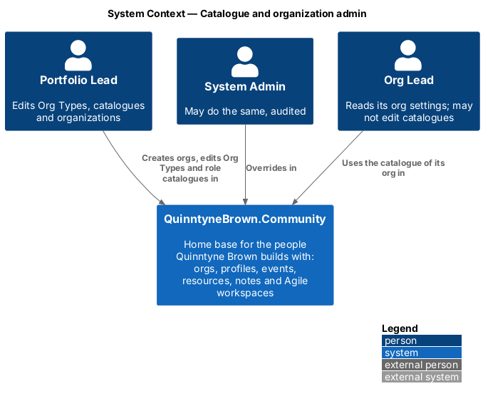
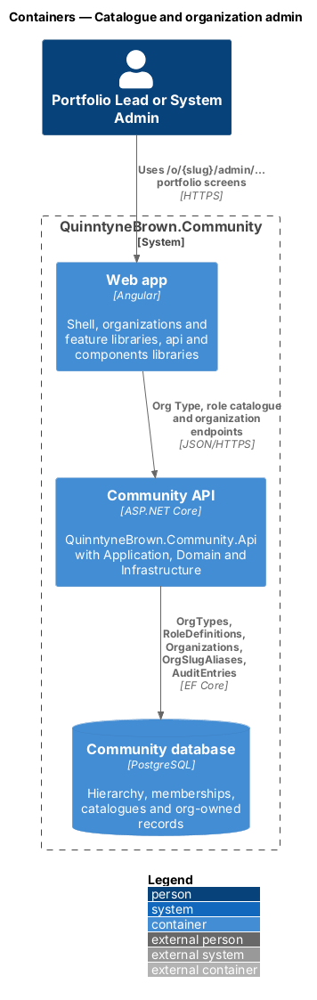
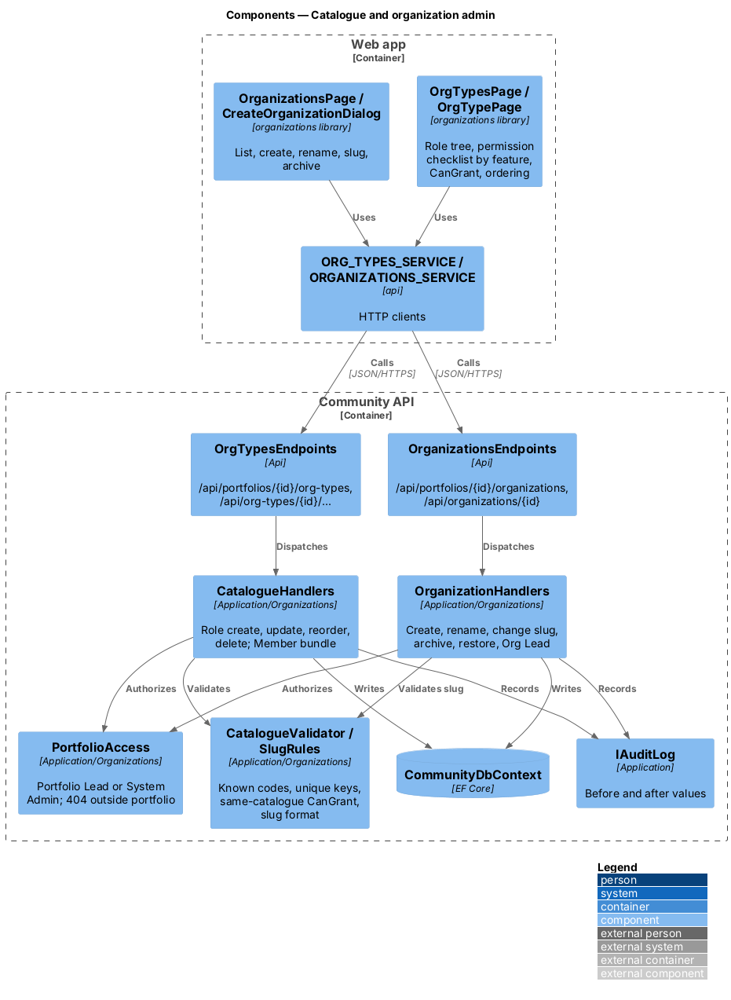
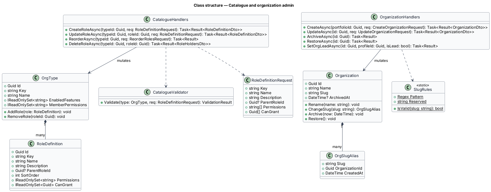
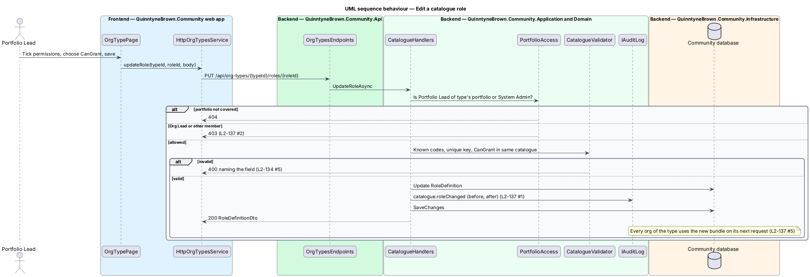
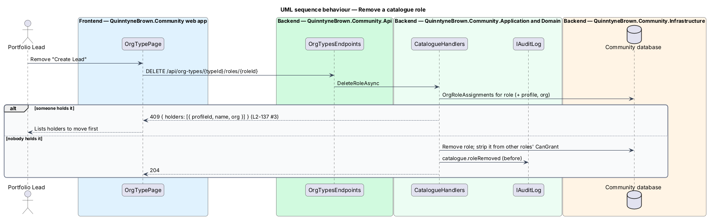
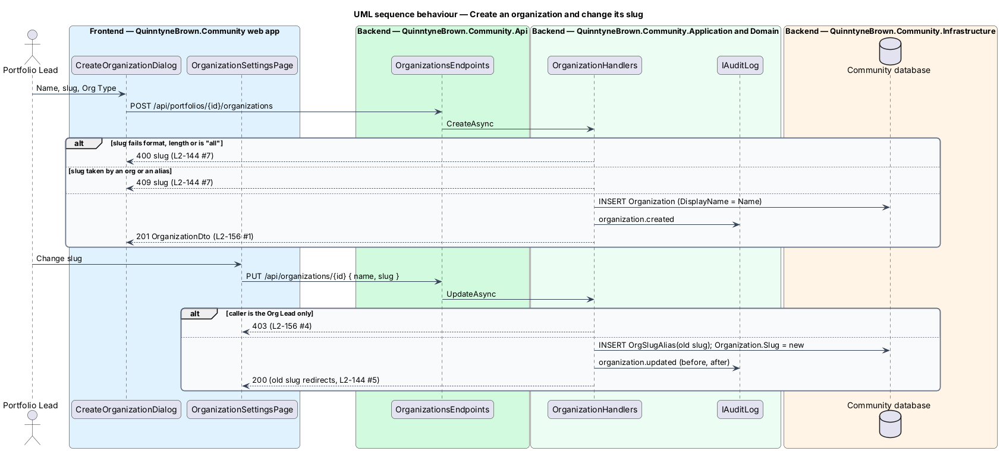

# Catalogue and organization admin

## Overview

Org Types, their role catalogues, feature flags, cross-org roles and organizations belong to the portfolio in QuinntyneBrown.Community, and only the Portfolio Lead (or a System Admin) edits them ([ADR 0033](../../../adr/0033-permission-codes-and-role-catalogues.md), proposal D8). A change to "FaithTech City" applies to every FaithTech city at once. Org Leads use the catalogue but cannot change it; they may change only their org's branding. This design covers the portfolio admin screens and the endpoints behind them.

- **catalogue editor** — screen for one Org Type: role tree (display order only), permission checklist grouped by feature, `CanGrant` list and Member bundle
- **role tree** — display of `RoleDefinition` rows by `ParentRoleId` and `SortOrder`; it grants nothing
- **held role** — catalogue role with at least one `OrgRoleAssignment`; it cannot be removed
- **archived org** — org with `ArchivedAt` set; hidden from switchers and `404` to everyone but the Portfolio Lead and System Admin

Feature switching is in [feature flags](../feature-flags/README.md) and cross-org roles in [cross-org roles](../cross-org-roles/README.md).

## Description

### Application (`Application/Organizations/`)

- **`PortfolioAccess`** — `CanAdminister(access, portfolioId)` is true for the portfolio's Portfolio Lead or a System Admin. A portfolio the caller does not cover answers `404`; an Org Lead or member who covers one of its orgs gets `403`.
- **`CatalogueValidator`** — for a `RoleDefinitionRequest`: `key` matches `^[a-z0-9]+(-[a-z0-9]+)*$`, at most 40 characters and unique in the type; `name` 1 to 60 characters; every permission code is in `Permissions`; `parentRoleId` and every `canGrant` id belong to the same type, and the parent chain has no cycle. Each failure answers `400` naming the field (`key`, `name`, `permissions`, `parentRoleId`, `canGrant`).
- **`CatalogueHandlers`** — create, update, reorder and delete roles, and set the type's name and Member bundle. Delete answers `409` with `{ holders: [{ profileId, name, org: OrgRef }] }` while anyone holds the role, and otherwise removes it from other roles' `CanGrant`. Every change writes an audit entry with before and after values (`catalogue.roleCreated`, `.roleChanged`, `.rolesReordered`, `.roleRemoved`, `orgType.changed`). An edit that strips `workspaces.create` raises `WorkspaceCreatorPermissionLost` for affected owners.
- **`OrgTypeHandlers`** — list and create Org Types (`key` unique per portfolio, `name`); a new type starts with profiles and notes on, an empty catalogue and an empty Member bundle.
- **`OrganizationHandlers`**:
  - `CreateAsync(portfolioId, { name, slug, orgTypeId })` — `DisplayName` defaults to `Name`. Audited (`organization.created`).
  - `UpdateAsync(id, { name, slug })` — Portfolio Lead or System Admin only; an Org Lead gets `403`. A changed slug inserts an `OrgSlugAlias` with the old slug. Audited with before and after.
  - `ArchiveAsync` / `RestoreAsync` — sets or clears `ArchivedAt`. Audited.
  - `SetOrgLeadAsync` — described in [membership and joining](../membership-and-joining/README.md).
  - `GetAsync(id)` — the settings view, readable by the Org Lead, the Portfolio Lead and System Admin.
- **`SlugRules`** — lower-case `a-z`, `0-9` and `-`, 3 to 40 characters, not `all`: else `400` `slug`. Taken by any `Organization.Slug` or `OrgSlugAlias.Slug`: `409` `slug`. A unique index across both is enforced by a shared `OrgSlugs` table of reserved slugs (`Slug` primary key, `OrganizationId`).

### Api contracts

| Method and route | Body | Success | Failures |
|------------------|------|---------|----------|
| `GET /api/portfolios/{portfolioId}/org-types` | — | `200 OrgTypeSummaryDto[]` (`id`, `key`, `name`, `enabledFeatures`, `roleCount`, `orgCount`) | `403`, `404` |
| `POST /api/portfolios/{portfolioId}/org-types` | `{ key, name }` | `201 OrgTypeDto` | `400`, `403`, `404`, `409` |
| `GET /api/org-types/{id}` | — | `200 OrgTypeDto` | `403`, `404` |
| `PUT /api/org-types/{id}` | `{ name, memberPermissions }` | `200 OrgTypeDto` | `400`, `403`, `404` |
| `PUT /api/org-types/{id}/features` | `{ enabled }` | `200 OrgTypeDto` | `400`, `403`, `404` |
| `POST /api/org-types/{id}/roles` | `RoleDefinitionRequest` | `201 RoleDefinitionDto` | `400`, `403`, `404` |
| `PUT /api/org-types/{id}/roles/{roleId}` | `RoleDefinitionRequest` | `200 RoleDefinitionDto` | `400`, `403`, `404` |
| `PUT /api/org-types/{id}/roles/order` | `{ items: [{ roleId, parentRoleId, sortOrder }] }` | `204` | `400`, `403`, `404` |
| `DELETE /api/org-types/{id}/roles/{roleId}` | — | `204` | `403`, `404`, `409` |
| `GET /api/portfolios/{portfolioId}/organizations?archived=` | — | `200 OrganizationSummaryDto[]` | `403`, `404` |
| `POST /api/portfolios/{portfolioId}/organizations` | `{ name, slug, orgTypeId }` | `201 OrganizationDto` | `400`, `403`, `404`, `409` |
| `GET /api/organizations/{id}` | — | `200 OrganizationDto` | `403`, `404` |
| `PUT /api/organizations/{id}` | `{ name, slug }` | `200 OrganizationDto` | `400`, `403`, `404`, `409` |
| `POST /api/organizations/{id}/archive`, `/restore` | — | `204` | `403`, `404` |

- `OrgTypeDto` is `{ id, key, name, enabledFeatures, memberPermissions, roles: RoleDefinitionDto[], permissionCatalogue: [{ feature, enabled, codes: [{ code, label, description }] }] }`.
- `RoleDefinitionDto` is `{ id, key, name, description, parentRoleId, sortOrder, permissions, canGrant, holderCount }`.
- `OrganizationSummaryDto` is `{ id, slug, name, displayName, orgType: { id, name }, memberCount, orgLeads: PersonRef[], archivedAt }`; `OrganizationDto` adds `aliases` and `branding`.

### Frontend (`frontend/projects/organizations/`)

- **`OrganizationsPage`** (default, empty and archived views) and **`CreateOrganizationDialog`** (CDK Dialog).
- **`OrganizationSettingsPage`** — name, slug, type (read-only after creation), archive and restore for the Portfolio Lead; the Org Lead sees only branding ([branding](../branding-and-public-pages/README.md)) and members.
- **`OrgTypesPage`**, **`OrgTypePage`** and **`CreateOrgTypeDialog`** — the catalogue editor composes `components` parts: a role tree with keyboard reorder (move up, move down, indent, outdent buttons with labels), a permission checklist grouped by feature with disabled features hidden, a `CanGrant` checkbox group and the Member bundle. A `409` on remove opens a message listing the holders.
- Routes sit under `/o/:orgSlug/portfolio/…` for the Portfolio Lead (`organizations`, `org-types`, `org-types/:id`, `org-types/:id/features`, `cross-org-roles`, `agents`) and `/o/:orgSlug/settings` (`general`, `branding`, `members`) for the Org Lead. One `PORTFOLIO_SERVICE` in `api` covers Org Types, catalogues, orgs, cross-org roles and agents; `ORGANIZATIONS_SERVICE` keeps members and branding.
- As built, a catalogue role is added and edited in a CDK dialog (`RoleDefinitionDialog`) rather than the mock's side panel, because `AGENTS.md` allows no inline forms; the role list orders roles with labelled Up and Down buttons. Indent and outdent, the Member bundle and the Org Type's name have no screen yet (see `docs/estimates/organizations.md`).

## Requirements

The feature realizes the following level-2 (L2) requirements. Each L2 requirement refines a level-1 (L1) requirement, cited by identifier.

| L2 ID | Refines (L1) | Requirement |
|-------|--------------|-------------|
| `L2-137` | `L1-025`, `L1-014` | Editing catalogues and feature flags |
| `L2-156` | `L1-025` | Creating and managing organizations |

### Acceptance criteria

**`L2-137` — Editing catalogues and feature flags**

1. Given the Portfolio Lead or a System Admin, when they add, rename, reorder or change the permissions or `CanGrant` of a catalogue role, or switch an Org Type's features, then it is saved and an audit entry records the before and after values.
2. Given an Org Lead or any other member, when they call a catalogue or Org Type endpoint, then the server answers 403 (404 for a portfolio they do not cover).
3. Given a catalogue role that someone holds, when the Portfolio Lead removes it, then the server answers 409 naming the holders, and nothing is removed.
4. Given a feature switched off for the type, when the catalogue editor shows a role, then that feature's permissions are hidden; stored codes for it are kept but grant nothing.
5. Given an edit to "FaithTech City", when it is saved, then it applies at once to every org of that type.
6. Given the catalogue editor, when it is used with a keyboard and a screen reader, then every checkbox, the role tree order controls and the `CanGrant` list are reachable and labelled (L2-044).

**`L2-156` — Creating and managing organizations**

1. Given the Portfolio Lead, when they create an org with a name, slug and type, then it is created, audited and listed, and they may make someone its Org Lead.
2. Given the Portfolio Lead, when they rename an org, change its slug or archive it, then it is saved and audited; an archived org disappears from switchers and its records answer 404 to everyone but the Portfolio Lead and System Admin, who may restore it.
3. Given the organizations list, when it opens, then it shows each org with its type, member count and Org Leads, with empty and archived views.
4. Given an Org Lead, when they open their org's settings, then they may change its display name, logo and accent (L2-149), but not its name, slug, type or archive state (403).
5. Given anyone else, when they call these endpoints, then the server answers 403, or 404 outside coverage.

## Diagrams

### System context

The Portfolio Lead edits Org Types, catalogues and organizations; a System Admin may do the same; an Org Lead uses the catalogue of its org.

### Containers

The `organizations` library calls the Community API, which stores catalogues, organizations, slug aliases and audit entries.

### Components

`CatalogueHandlers` and `OrganizationHandlers` authorize through `PortfolioAccess`, validate through `CatalogueValidator` and `SlugRules`, and audit every change.

### Class structure

An `OrgType` composes its `RoleDefinition` rows; an `Organization` composes its `OrgSlugAlias` rows. The handlers mutate these aggregates.

### Behaviour — edit a catalogue role

The handler authorizes the portfolio, validates codes, keys and `CanGrant`, then saves and audits before and after; the new bundle applies to every org of the type on the next request (`L2-137`, `L2-134`).

### Behaviour — remove a catalogue role

A held role answers `409` naming its holders; an unheld role is removed and audited (`L2-137` AC3).

### Behaviour — create an organization and change its slug

Slug rules apply on create and change; an old slug becomes an alias so links redirect (`L2-156`, `L2-144`).

## Open questions

- **Settled: resolver cached per request** ([ADR 0034](../../../adr/0034-org-owned-data-and-the-access-resolver.md)); catalogue edits need no invalidation.
- **Settled: the frontend refreshes `GET /api/me/access`** on org switch and after a `403` ([ADR 0037](../../../adr/0037-org-addressed-urls-switcher-and-branding.md)), so a Portfolio Lead's own catalogue edit shows on the next switch or reload.
- **Settled: agents are created and their tokens issued here or by an Org Lead** ([ADR 0036](../../../adr/0036-agent-identities-and-tokens.md)); see [agents](../agents/README.md).
- Changing an org's type is not offered: it would orphan catalogue role assignments. Recreating the org is the path; a type change is `<TO SUPPLY>` if a requirement appears.
- Org-local roles added by an Org Lead are out of scope.
