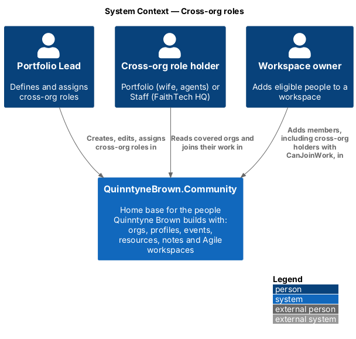
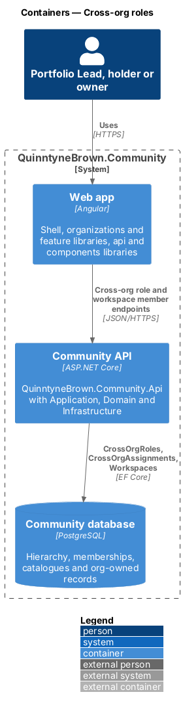
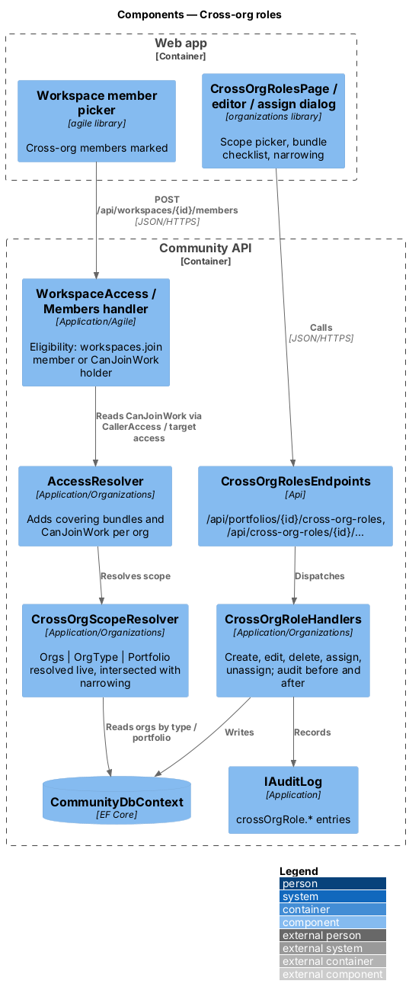
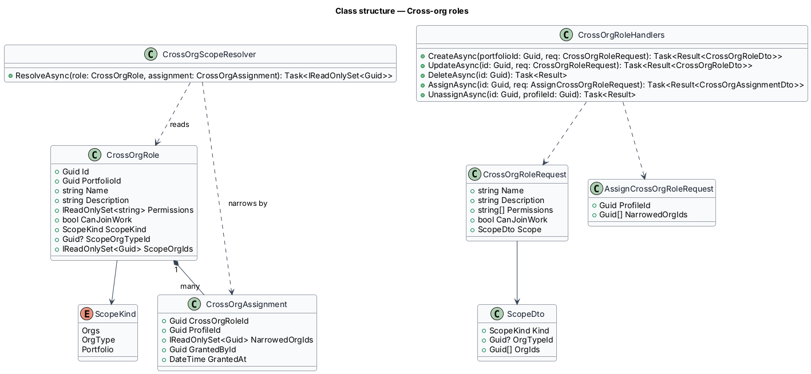
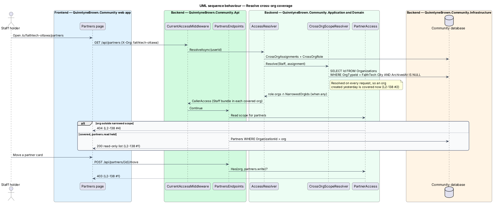
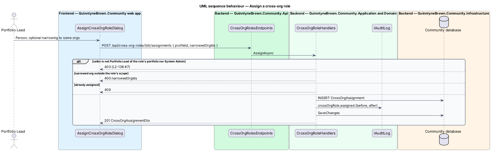
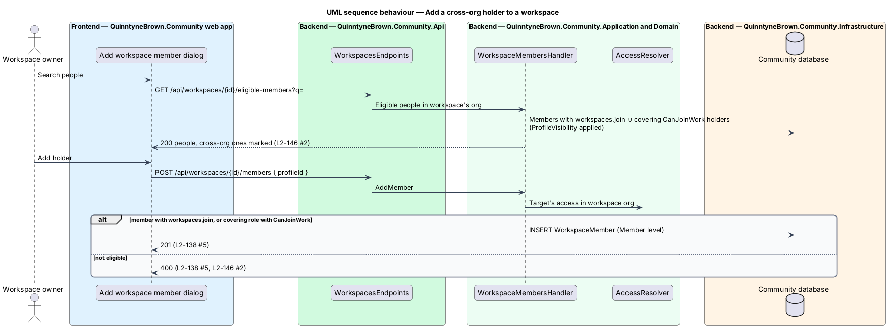

# Cross-org roles

## Overview

Some people read and work across several orgs without leading any of them: FaithTech HQ Staff across every FaithTech city, and Quinntyne's wife and his AI agents across the whole portfolio. QuinntyneBrown.Community serves both with one mechanism, the cross-org role ([ADR 0035](../../../adr/0035-cross-org-roles.md)). This design also places workspaces in one org and defines who may join their work, since `CanJoinWork` on a cross-org role is how cross-org work happens (D12).

- **cross-org role** — portfolio-owned permission bundle applied to a scope of orgs
- **scope** — `Orgs` (a fixed list), `OrgType` (every org of one type, resolved live) or `Portfolio` (every org of the portfolio, resolved live)
- **narrowing** — per-assignment subset of the role's orgs; the covered set is the intersection, never wider
- **`CanJoinWork`** — flag that lets workspace owners in covered orgs add holders as workspace Members and assign them work
- **holder** — person or agent with a `CrossOrgAssignment`; a holder covers but is not a member of the orgs

A holder reads what any member reads in a covered org (events, announcements, team, org-wide items, member profiles) plus the role's bundle. A holder is not on member lists, does not receive org announcements by default and holds no catalogue role. Private items are never covered ([ADR 0039](../../../adr/0039-org-wide-and-portfolio-wide-visibility.md)).

## Description

### Domain

- **`CrossOrgRole`** (`Id`, `PortfolioId`, `Name`, `Description`, `Permissions`, `CanJoinWork`, `ScopeKind`, `ScopeOrgTypeId?`, `ScopeOrgIds`). `ScopeOrgTypeId` is set only for `OrgType`, `ScopeOrgIds` only for `Orgs`. `Name` is unique per portfolio.
- **`CrossOrgAssignment`** (`CrossOrgRoleId`, `ProfileId`, `NarrowedOrgIds`, `GrantedById`, `GrantedAt`), unique per role and profile.
- **`Workspace`** gains `OrganizationId` ([org-owned data](../org-owned-data-and-context/README.md)).

### Seeded roles

| Role | Scope | Bundle | `CanJoinWork` |
|------|-------|--------|---------------|
| Portfolio | Whole portfolio | `people.view`, `partners.read`, `events.rsvpList`, `workspaces.readAll`, `reports.view` | Yes |
| Staff | All orgs of type FaithTech City | `people.view`, `partners.read`, `events.rsvpList`, `workspaces.readAll`, `reports.view`, `resources.create`, `notes.create` | No |

### Application

- **`CrossOrgScopeResolver`** — called by `AccessResolver` for each assignment. It resolves the role's org ids on every request (`SELECT Id FROM Organizations WHERE OrgTypeId = @type AND ArchivedAt IS NULL` for `OrgType`; by `PortfolioId` for `Portfolio`), then intersects with `NarrowedOrgIds` when not empty. A new org of the type is covered on the holder's next request with no reassignment.
- **`CrossOrgRoleHandlers`** — Portfolio Lead of the role's portfolio or System Admin; anyone else `403`, a portfolio outside coverage `404`. Create and update validate codes (known, `400` `permissions`), scope (`400` `scope`: org ids and the type belong to the portfolio) and the name (`409` when taken). Assign validates that `NarrowedOrgIds` lie inside the role's current scope (`400` `narrowedOrgIds`) and that the profile is visible to the caller (`404`). Every change writes an audit entry with before and after values (`crossOrgRole.created`, `.updated`, `.deleted`, `.assigned`, `.unassigned`).
- **Workspace rules** (`WorkspaceAccess`, `Application/Agile`):
  - **Create** — `access.Has(org, workspaces.create)`; Org Lead and Portfolio Lead hold it as a tier. Anyone else `403`.
  - **Eligible member** — a member of the workspace's org whose permissions there include `workspaces.join`, or a holder covering the org through a role with `CanJoinWork`. Anyone else answers `400` as an ineligible person. Suspended people stay ineligible.
  - **Read all** — `workspaces.readAll` in the org, Org Lead, Portfolio Lead or System Admin.
  - **Admin level** — the org's Org Lead, the Portfolio Lead or a System Admin; Owner, Member, read-only and Outsider levels are unchanged.
  - **Owner reassignment** — `WorkspaceCreatorPermissionLost(ProfileId, OrganizationId)` flags every workspace that person owns in that org "needs a new owner" and notifies the org's Org Leads and the Portfolio Lead. Either may reassign to someone holding `workspaces.create` there or to an Org Lead. The old owner stays a member while still eligible.
- **`GET /api/workspaces/{id}/eligible-members?q=`** returns eligible people, filtered by `ProfileVisibility`, each with `crossOrg: true` when eligible only through a cross-org role.

### Api contracts

| Method and route | Body | Success | Failures |
|------------------|------|---------|----------|
| `GET /api/portfolios/{portfolioId}/cross-org-roles` | — | `200 CrossOrgRoleDto[]` | `403`, `404` |
| `POST /api/portfolios/{portfolioId}/cross-org-roles` | `CrossOrgRoleRequest` | `201 CrossOrgRoleDto` | `400`, `403`, `404`, `409` |
| `PUT /api/cross-org-roles/{id}` | `CrossOrgRoleRequest` | `200 CrossOrgRoleDto` | `400`, `403`, `404`, `409` |
| `DELETE /api/cross-org-roles/{id}` | — | `204` | `403`, `404`, `409` (assigned; names holders) |
| `GET /api/cross-org-roles/{id}/assignments` | — | `200 CrossOrgAssignmentDto[]` | `403`, `404` |
| `POST /api/cross-org-roles/{id}/assignments` | `{ profileId, narrowedOrgIds }` | `201 CrossOrgAssignmentDto` | `400`, `403`, `404`, `409` |
| `DELETE /api/cross-org-roles/{id}/assignments/{profileId}` | — | `204` | `403`, `404` |

`CrossOrgRoleRequest` is `{ name, description, permissions: string[], canJoinWork, scope: { kind: "orgs" | "orgType" | "portfolio", orgTypeId?, orgIds? } }`. `CrossOrgRoleDto` adds `id`, `resolvedOrgs: OrgRef[]` and `assignmentCount`. `CrossOrgAssignmentDto` is `{ profile: PersonRef, narrowedOrgs: OrgRef[], coveredOrgs: OrgRef[], grantedBy, grantedAt }`.

### Frontend

`CrossOrgRolesPage`, the editor (permission checklist grouped by feature, scope picker) and `AssignCrossOrgRoleDialog` live in `frontend/projects/organizations/` under the portfolio admin routes. The workspace member picker in `agile` marks cross-org people with an org-role badge ([workspaces and membership](../../agile/workspaces-and-membership/README.md)).

## Requirements

The feature realizes the following level-2 (L2) requirements. Each L2 requirement refines a level-1 (L1) requirement, cited by identifier.

| L2 ID | Refines (L1) | Requirement |
|-------|--------------|-------------|
| `L2-138` | `L1-025` | Cross-org roles and scope |
| `L2-146` | `L1-025`, `L1-012` | Workspaces belong to one org |

### Acceptance criteria

**`L2-138` — Cross-org roles and scope**

1. Given the seeded "Staff" role scoped to all FaithTech City orgs, when a Staff holder opens FaithTech Toronto's partners, People, events with RSVP lists (no guest emails), workspaces and reports, then they are shown read-only; when they try to change any of them, then the server answers 403; they may add and edit only their own resources and note pages.
2. Given a new org of type FaithTech City, when it is created, then every Staff holder covers it on their next request, with no change to their assignment.
3. Given the "Portfolio" role (whole portfolio, `CanJoinWork`), when a holder opens any org of the portfolio, then they read profiles, partners, events and RSVP lists, workspaces, org-wide and role-shared items and reports; they cannot manage events, partners, roles, invites or announcements (403).
4. Given an assignment narrowed to some orgs, when the holder opens another org of the role's scope, then it answers 404.
5. Given a cross-org role with `CanJoinWork`, when a workspace owner in a covered org adds a holder, then the holder becomes a workspace Member; without `CanJoinWork`, then the server answers 400 as for any ineligible person.
6. Given any cross-org role, when its holder asks for another person's private contact, resource or note page, then the server answers 404.
7. Given the Portfolio Lead, when they create, edit, assign or unassign a cross-org role, then it is saved and audited; anyone else gets 403.

**`L2-146` — Workspaces belong to one org**

1. Given a holder of `workspaces.create` in an org, its Org Lead or the Portfolio Lead, when they create a workspace there, then it belongs to that org and they own it; anyone else gets 403.
2. Given a workspace owner, when they add someone, then only members of the org holding `workspaces.join` and holders of a covering cross-org role with `CanJoinWork` are offered and accepted; others get 400; cross-org members are marked in the picker.
3. Given a holder of `workspaces.readAll`, the Org Lead, the Portfolio Lead or a System Admin, when they list workspaces, then they see every workspace of the orgs they cover; others see only the ones they own or belong to.
4. Given an owner who loses `workspaces.create` in the workspace's org or leaves it, when that happens, then the Org Lead and the Portfolio Lead are notified that the workspace needs a new owner, and either may reassign it to someone holding `workspaces.create` there or to an Org Lead; the old owner stays a member if still eligible.
5. Given the in-workspace levels, when they are applied, then "Admin" means the org's Org Lead, the Portfolio Lead or a System Admin, and every other level behaves as before.

## Diagrams

### System context

The Portfolio Lead defines and assigns cross-org roles; holders read covered orgs and, with `CanJoinWork`, are added to their workspaces by owners.

### Containers

The `organizations` and `agile` libraries call the Community API, which stores roles and assignments and resolves their scope from the Community database.

### Components

`CrossOrgRoleHandlers` write and audit roles. `AccessResolver` asks `CrossOrgScopeResolver` for each assignment's live org set; the workspace member handler reads `CanJoinWork` from the resolved access.

### Class structure

A `CrossOrgRole` has a `ScopeKind` and composes its assignments; `CrossOrgScopeResolver` turns both into a set of org ids.

### Behaviour — resolve cross-org coverage

A Staff holder covers a FaithTech City org created after the assignment, reads its pipeline, and is refused changes with `403` (`L2-138`).

### Behaviour — assign a cross-org role

Only the Portfolio Lead or a System Admin assigns; narrowing stays inside the role's scope, and every assignment is audited (`L2-138` AC7).

### Behaviour — add a cross-org holder to a workspace

The picker offers members with `workspaces.join` and covering holders with `CanJoinWork`; anyone else is refused with `400` (`L2-138` AC5, `L2-146` AC2).

## Open questions

- **Settled: scope resolved live, resolver cached per request** ([ADR 0034](../../../adr/0034-org-owned-data-and-the-access-resolver.md), [ADR 0035](../../../adr/0035-cross-org-roles.md)). No cross-request cache, so a new org of a type is covered at once.
- **Settled: agents usually hold the "Portfolio" role** and authenticate with a hashed personal access token whose orgs further narrow their coverage ([ADR 0036](../../../adr/0036-agent-identities-and-tokens.md)).
- **Settled: the frontend reads `canJoinWork` per org from `GET /api/me/access`** ([ADR 0037](../../../adr/0037-org-addressed-urls-switcher-and-branding.md)).
- Deleting a cross-org role that is still assigned answers `409` naming the holders, mirroring catalogue roles (L2-137 AC3); no L2 requirement states it.
- Whether a holder may opt in to an org's announcements is `<TO SUPPLY>`; by default holders receive none.
