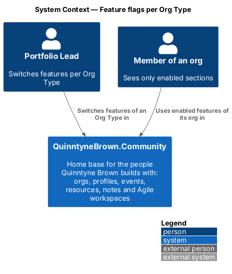
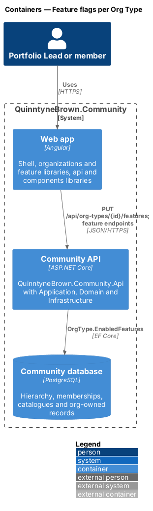
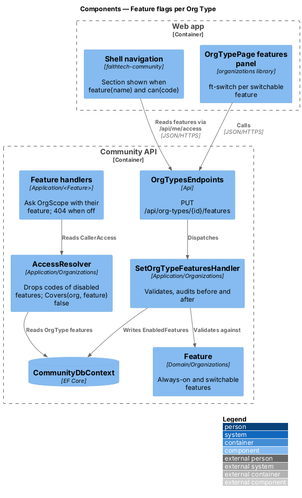
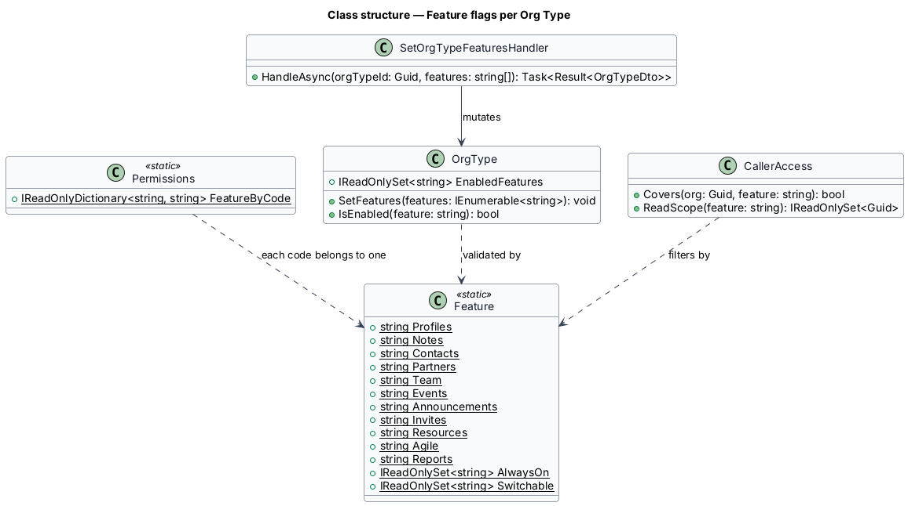
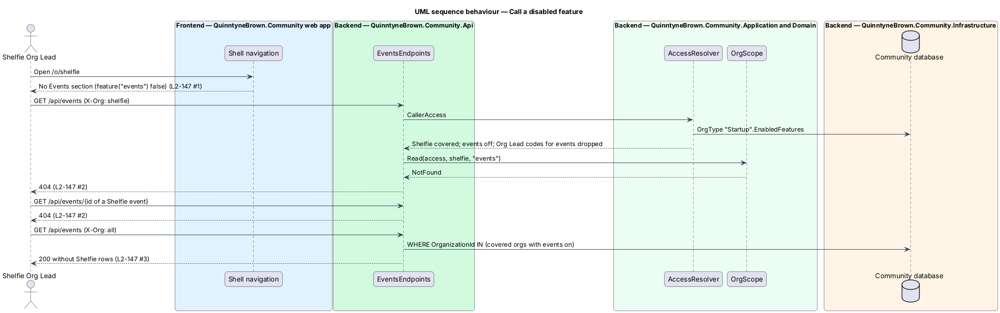
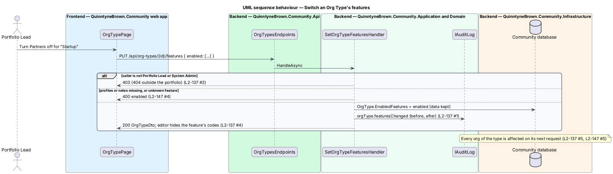

# Feature flags per Org Type

## Overview

A start-up in QuinntyneBrown.Community has no partner pipeline, City Lead or hackathons, so its members should not see those sections and their endpoints should not reach its data. Each Org Type therefore carries a list of enabled features ([ADR 0038](../../../adr/0038-feature-flags-per-org-type.md)). A disabled feature disappears from navigation in every org of the type and its endpoints answer `404` there, for everyone including the Org Lead and the Portfolio Lead.

- **feature** — named area of the product that owns endpoints and permission codes, for example `events`
- **always-on feature** — `profiles` and `notes`; cannot be switched off
- **switchable feature** — `contacts`, `partners`, `team`, `events`, `announcements`, `invites`, `resources`, `agile` and `reports`
- **enabled features** — switchable features that are on for an Org Type; there are no per-org overrides

Turning a feature off keeps its data. Turning it back on shows the data again.

## Description

- **`Feature`** (`Domain/Organizations/Feature.cs`) — constants for the eleven features, `AlwaysOn` and `Switchable`.
- **`Permissions.FeatureByCode`** — each permission code belongs to exactly one feature (table in [hierarchy and permissions](../hierarchy-and-permissions/README.md)).
- **`OrgType.EnabledFeatures`** — set of switchable features that are on. `OrgType.IsEnabled(feature)` is true for an always-on feature or a member of the set. `SetFeatures` rejects unknown names.
- **`AccessResolver`** — drops the codes of disabled features from every holder in orgs of the type, tiers included. `CallerAccess.Covers(org, feature)` is false there, and `ReadScope(feature)` leaves those orgs out.
- **Feature handlers** — every handler names its feature when it asks `OrgScope` ([org-owned data](../org-owned-data-and-context/README.md)):
  - by-id request for a record in an org with the feature off: `404`;
  - list with `X-Org` naming such an org: `404`;
  - list under "All orgs" or with no header: those orgs are left out;
  - creation in such an org: `404`.
  Search sources and reports skip orgs whose feature is off. Child endpoints (RSVPs, work items, contact notes) inherit their root's feature.
- **Public events** — `GET /api/public/events/{id}` answers `404` when `events` is off for the event's org.
- **`SetOrgTypeFeaturesHandler`** — Portfolio Lead of the type's portfolio or System Admin; Org Leads and members `403`, a portfolio outside coverage `404`. The body lists the enabled switchable features. An unknown name, or an attempt to list `profiles` or `notes` as off, answers `400` on `enabled`. It writes an `orgType.featuresChanged` audit entry with before and after values.
- **Endpoint** — `PUT /api/org-types/{id}/features` with `{ "enabled": ["events", "partners", …] }`, answering `200 OrgTypeDto`.
- **Frontend** — the shell navigation shows a section only when `ACCESS_SERVICE.feature(name)` is true for the active org. The features panel of `OrgTypePage` (`organizations` library) shows an `ft-switch` per switchable feature and a fixed "Always on" note for profiles and notes. The catalogue editor hides the permission codes of disabled features; stored codes stay but grant nothing.

## Requirements

The feature realizes the following level-2 (L2) requirements. Each L2 requirement refines a level-1 (L1) requirement, cited by identifier.

| L2 ID | Refines (L1) | Requirement |
|-------|--------------|-------------|
| `L2-147` | `L1-025` | Feature flags per Org Type |

### Acceptance criteria

**`L2-147` — Feature flags per Org Type**

1. Given an Org Type with a feature off, when a member of an org of that type opens the app, then the feature's section is not in the navigation.
2. Given such an org, when anyone (Org Lead and Portfolio Lead included) calls the feature's endpoints for that org or for a record in it, then the server answers 404.
3. Given "All orgs", when lists are combined, then orgs with the feature off are left out.
4. Given `profiles` and `notes`, when the Portfolio Lead edits features, then they cannot be switched off.
5. Given a feature switched back on, when members open it, then the records kept while it was off are shown again.

## Diagrams

### System context

The Portfolio Lead switches features per Org Type; members of an org of that type see only the enabled sections.

### Containers

The web app reads features from `/api/me/access` and edits them through the Community API, which stores them on the Org Type.

### Components

`SetOrgTypeFeaturesHandler` validates against `Feature` and writes `EnabledFeatures`. `AccessResolver` removes disabled codes and coverage, so every feature handler answers `404` without its own flag check.

### Class structure

`OrgType` holds the enabled set, `Permissions` maps each code to a `Feature`, and `CallerAccess` filters by both.

### Behaviour — call a disabled feature

A Shelfie Org Lead sees no Events section and gets `404` for Shelfie events by list and by id; "All orgs" leaves Shelfie out (`L2-147`).

### Behaviour — switch an Org Type's features

Only the Portfolio Lead or a System Admin switches features; the always-on features stay on, and the change is audited and applies to every org of the type on its next request (`L2-147`, `L2-137`).

## Open questions

- **Settled: resolver cached per request** ([ADR 0034](../../../adr/0034-org-owned-data-and-the-access-resolver.md)); a switched feature applies on each caller's next request.
- **Settled: the frontend learns features per org from `GET /api/me/access`** ([ADR 0037](../../../adr/0037-org-addressed-urls-switcher-and-branding.md)), refreshed on org switch and after a `403`. A `404` from a feature switched off mid-session shows the not-found page; the next refresh hides the section.
- **Settled: agent tokens obey the same flags** because the resolver applies them before the token's org intersection ([ADR 0036](../../../adr/0036-agent-identities-and-tokens.md)).
- Per-org overrides are out of scope; they can be added later without a data-model change.
- Notifications already raised by a feature that is later switched off stay in the bell; whether to hide them is `<TO SUPPLY>`.
