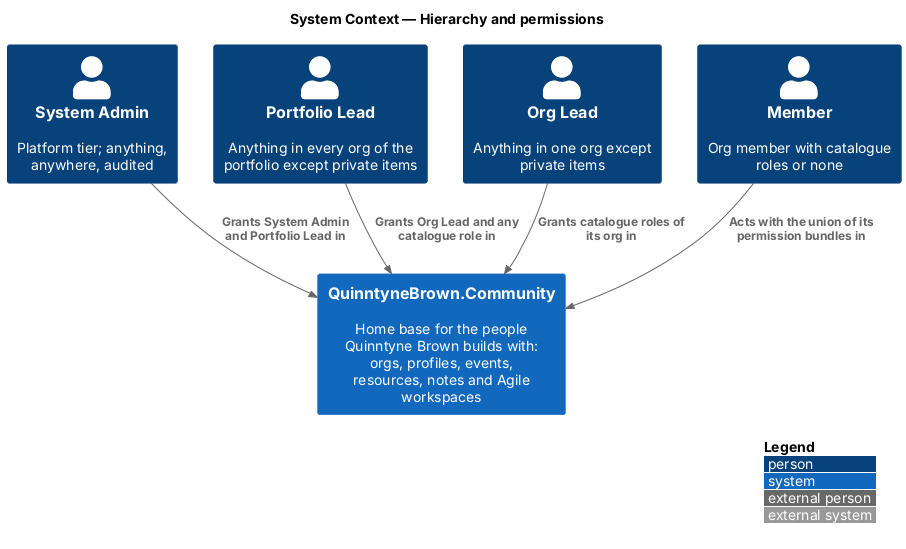
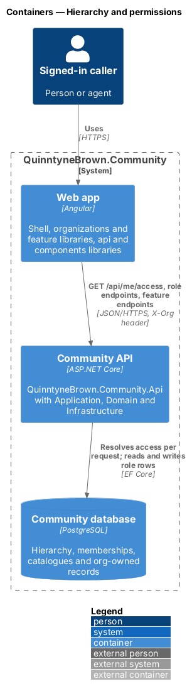
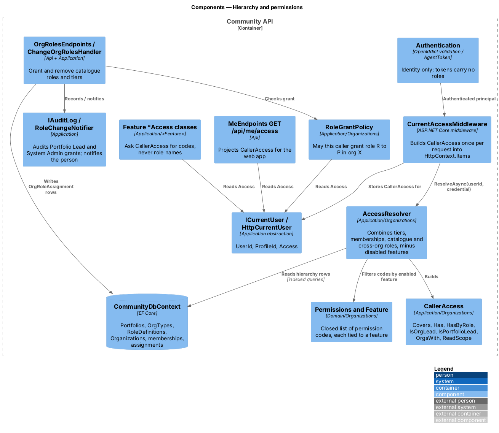
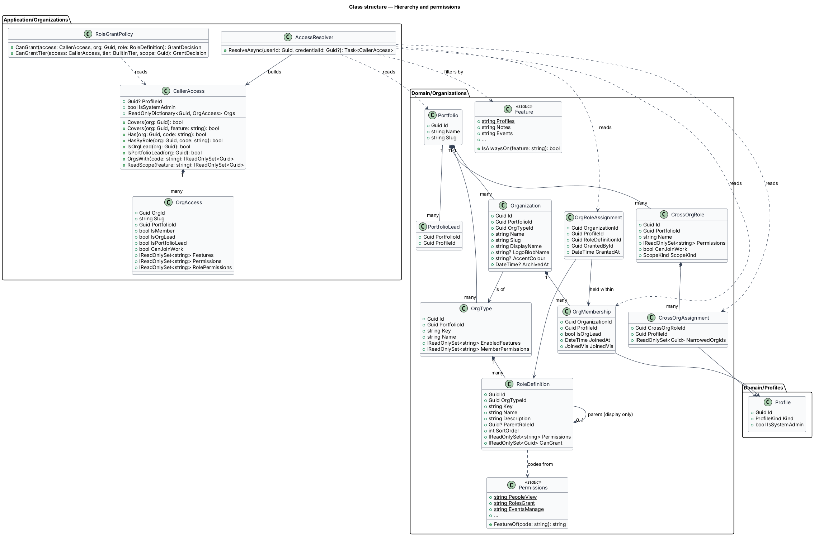
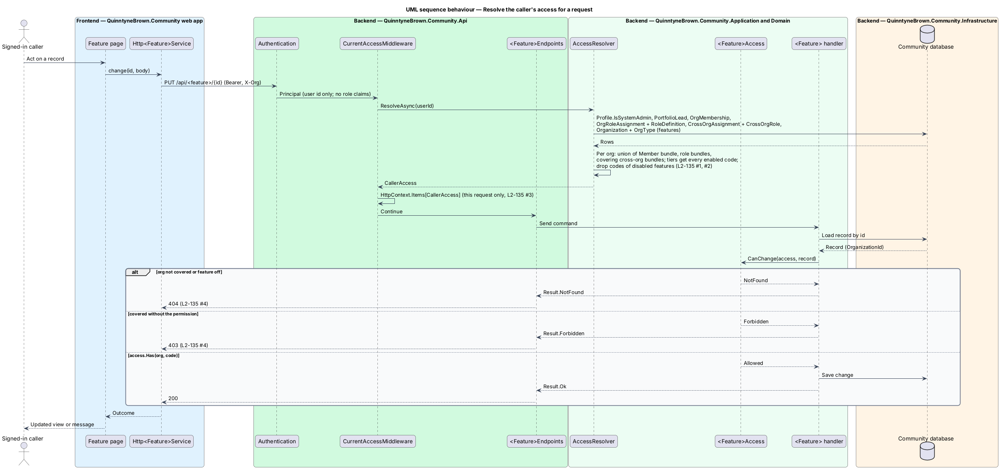
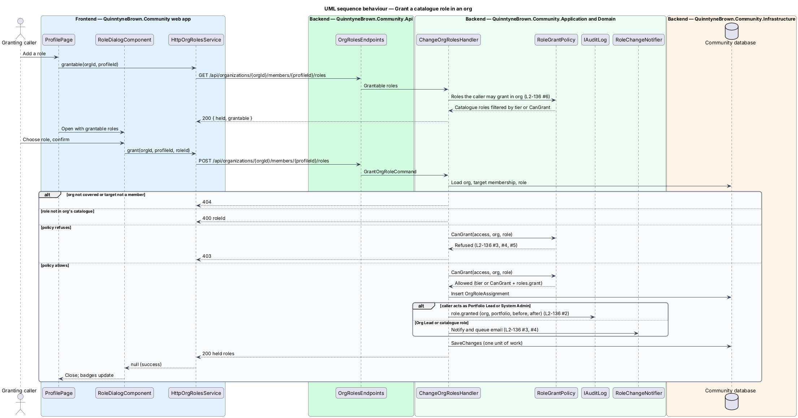

# Hierarchy and permissions

## Overview

QuinntyneBrown.Community hosts several organizations under a portfolio. Before this design, roles were a fixed C# enumeration (`Domain/Profiles/Role.cs`) and about 30 backend files checked role names directly. This design replaces that model with a data-driven hierarchy and one permission engine that every feature asks. It is the first slice group of the `organizations` subsystem and the foundation of every other organizations design.

- **portfolio** — top-level grouping of Org Types, organizations and cross-org roles; one is seeded, "Quinntyne Brown"
- **Org Type** — portfolio-owned template that holds a role catalogue, a Member bundle and the enabled features, for example "FaithTech City" or "Startup"
- **organization (org)** — instance of exactly one Org Type that owns records, for example "FaithTech Toronto"
- **role catalogue** — ordered set of `RoleDefinition` rows of one Org Type
- **permission code** — closed, code-defined string such as `events.manage` that the server checks; each belongs to one feature
- **permission bundle** — set of permission codes held by a catalogue role, a Member bundle or a cross-org role
- **built-in tier** — System Admin, Portfolio Lead, Org Lead or Member; tiers are not data
- **covered org** — org the caller is a member of, leads, or reaches through the Portfolio Lead tier or a cross-org role
- **override** — action a tier allows but no role grants; overrides on other people's items are audited

The server checks permission codes, never role names ([ADR 0033](../../../adr/0033-permission-codes-and-role-catalogues.md)). A person's permissions in an org are the union of the Member bundle, every catalogue role they hold there and every cross-org role covering the org. `ParentRoleId` is a display hint and grants nothing. Permissions are resolved from the database on each request and cached for that request only ([ADR 0034](../../../adr/0034-org-owned-data-and-the-access-resolver.md)), so a grant, a removal or a catalogue edit applies on the caller's next request.

Related designs: [org-owned data and context](../org-owned-data-and-context/README.md) applies the resolver to queries, [cross-org roles](../cross-org-roles/README.md) adds covering bundles, [feature flags](../feature-flags/README.md) removes codes of disabled features, [catalogue admin](../catalogue-admin/README.md) edits the data, and [server authorization](../../platform/server-authorization/README.md) holds the platform-wide rules.

## Description

### Domain (`Domain/Organizations/`, `Domain/Profiles/`)

- **`Portfolio`** (`Id`, `Name`, `Slug`) and **`PortfolioLead`** (`PortfolioId`, `ProfileId`; unique pair).
- **`OrgType`** (`Id`, `PortfolioId`, `Key`, `Name`, `EnabledFeatures`, `MemberPermissions`). `Key` is unique per portfolio. `MemberPermissions` is the Member bundle every member holds with no role; FaithTech City's is `notes.create`.
- **`RoleDefinition`** (`Id`, `OrgTypeId`, `Key`, `Name`, `Description`, `ParentRoleId?`, `SortOrder`, `Permissions`, `CanGrant`). `Key` is kebab-case and unique per type. `CanGrant` holds role ids of the same catalogue. `Permissions` and `CanGrant` are stored as PostgreSQL `text[]` and `uuid[]` columns (in-memory provider: value converters).
- **`Organization`** (`Id`, `PortfolioId`, `OrgTypeId`, `Name`, `Slug`, `DisplayName`, `LogoBlobName?`, `AccentColour?`, `ArchivedAt?`) and **`OrgSlugAlias`** (`Slug`, `OrganizationId`, `CreatedAt`).
- **`OrgMembership`** (`OrganizationId`, `ProfileId`, `IsOrgLead`, `JoinedAt`, `JoinedVia`). The proposal's separate `OrgLead` table is folded into the `IsOrgLead` flag, so an Org Lead is always a member.
- **`OrgRoleAssignment`** (`OrganizationId`, `ProfileId`, `RoleDefinitionId`, `GrantedById`, `GrantedAt`). It requires a membership in the same org; the role's `OrgTypeId` shall equal the org's type.
- **`CrossOrgRole`** and **`CrossOrgAssignment`** — described in [cross-org roles](../cross-org-roles/README.md).
- **`Profile`** gains `Kind` (`Person` | `Agent`) and `IsSystemAdmin`. `ProfileRole` and the `Role` enumeration are deleted ([ADR 0040](../../../adr/0040-reset-and-reseed.md)).
- **`Permissions`** (static) — the closed code list with `FeatureOf(code)`, and **`Feature`** (static) — the feature names, `AlwaysOn` and `Switchable` ([ADR 0038](../../../adr/0038-feature-flags-per-org-type.md)).

#### Permission codes

| Code | Feature | Grants |
|------|---------|--------|
| `people.view` | profiles | The People page with each person's roles |
| `roles.grant` | profiles | Opening role changes; limited to the role's `CanGrant` list |
| `invites.send` | invites | Sending invites into the org |
| `connectLink.own` | invites | Owning a connect link (QR code) for the org |
| `contacts.private` | contacts | Keeping private contacts in the org (own contacts only) |
| `partners.read` | partners | Reading the partner pipeline |
| `partners.write` | partners | Changing the partner pipeline |
| `events.manage` | events | Creating, editing and cancelling events |
| `events.rsvpList` | events | Seeing who RSVP'd and the check-in page (read) |
| `events.rsvpListEmails` | events | Guest emails, RSVP CSV export |
| `events.checkIn` | events | Checking in, undo, walk-ins and the attendance export |
| `announcements.send` | announcements | Sending announcements to the org |
| `resources.create` | resources | Adding resources |
| `notes.create` | notes | Creating note pages |
| `workspaces.create` | agile | Creating and owning workspaces |
| `workspaces.join` | agile | Being added to the org's workspaces |
| `workspaces.readAll` | agile | Reading every workspace of the org |
| `reports.view` | reports | The Reports page for the org |
| `team.member` | team | Being listed on the org's Team page (marker) |
| `team.lead` | team | Matching the Team page's "Leads" filter (marker) |

Adding a code is a code change and a release. An unknown code in a stored bundle is ignored by the resolver.

### Application (`Application/Organizations/`)

- **`AccessResolver`** — `ResolveAsync(Guid userId, Guid? credentialId)` builds a `CallerAccess` with at most six indexed queries: the profile (`IsSystemAdmin`, `Kind`, `IsSuspended`), `PortfolioLead` rows, `OrgMembership` rows with their orgs and types, `OrgRoleAssignment` rows joined to `RoleDefinition`, `CrossOrgAssignment` rows joined to `CrossOrgRole` (scope resolved live), and, for a tier, the orgs of the led portfolios. Archived orgs are left out except for the Portfolio Lead and System Admin (L2-156). The algorithm per covered org:
  1. Start with the Member bundle when the caller is a member.
  2. Add the bundle of each catalogue role held there and of each cross-org role covering the org.
  3. When the caller is Org Lead of the org, Portfolio Lead of its portfolio or System Admin, add every code. Keep the role-derived set separately as `RolePermissions` for `HasByRole`.
  4. Remove every code whose feature is not in the org type's `EnabledFeatures` (always-on features stay).
  5. For an agent token, keep only orgs in the credential's `OrgIds` ([agents](../agents/README.md)).
- **`CallerAccess`** — immutable result. Its contract:

  | Member | Answers |
  |--------|---------|
  | `Covers(org)` | The org is in the caller's covered set |
  | `Covers(org, feature)` | Covered and the feature is enabled there |
  | `Has(org, code)` | The code is held there, by a role or a tier |
  | `HasByRole(org, code)` | Held through the Member bundle, a catalogue role or a cross-org role, not a tier; a `Has` without `HasByRole` is an override |
  | `IsOrgLead(org)`, `IsPortfolioLead(org)` | Tier flags for the org |
  | `IsSystemAdmin` | Platform tier |
  | `OrgsWith(code)` | Covered orgs where `Has` is true |
  | `ReadScope(feature)` | Covered orgs where the feature is enabled |
  | `Orgs` | `OrgAccess` per covered org: slug, portfolio, member, Org Lead, Portfolio Lead, `CanJoinWork`, features, permissions |

- **`RoleGrantPolicy`** — the one place that answers whether a caller may grant or remove a role for a person in an org:

  | Caller | May grant and remove |
  |--------|----------------------|
  | System Admin | System Admin, Portfolio Lead, and anything below |
  | Portfolio Lead | Org Lead, cross-org roles, any catalogue role in its portfolio's orgs |
  | Org Lead | Any catalogue role in its org |
  | Catalogue role holder with `roles.grant` there | Only roles in the union of its held roles' `CanGrant`, in that org |
  | Anyone else | Nothing (`403`) |

- **`ChangeOrgRolesHandler`** (replaces `ChangeRolesHandler`) — `GrantAsync`, `RemoveAsync` and `GrantableAsync`. It loads the org through the caller's coverage (`404` when not covered), requires the target to be a member (`409` "Add this person to the organization first." when visible but not a member), checks the role belongs to the org type's catalogue (`400` `roleId`), asks `RoleGrantPolicy` (`403`), writes the row and, in one unit of work, audits when the caller acts as Portfolio Lead or System Admin, or notifies the person through `RoleChangeNotifier` otherwise. A held role answers `409` on grant; a role not held answers `409` on remove.
- **`TierHandlers`** — System Admin and Portfolio Lead grants and removals, both System Admin only and audited. The last System Admin is protected by `SystemAdminRoster` exactly as in [assign roles](../../admin/assign-roles/README.md). Org Lead grants are in [membership and joining](../membership-and-joining/README.md).
- **Feature `*Access` classes** — `ContactAccess`, `PartnerAccess`, `EventPermissions`, `ResourceAccess`, `NoteAccess`, `WorkspaceAccess`, `ReportAccess`, `ProfileAccess` and the announcement, invite and team checks are rewritten to call `CallerAccess`, for example `access.Has(evt.OrganizationId, Permissions.EventsManage)`. `LeadRoles`, `TeamRoles` and `RoleLabels` are deleted.
- **`WorkspaceCreatorPermissionLost`** (`ProfileId`, `OrganizationId`) replaces `CityLeadRoleRemoved`. `ChangeOrgRolesHandler`, catalogue edits and membership removal raise it whenever an owner no longer holds `workspaces.create` in a workspace's org ([cross-org roles](../cross-org-roles/README.md) covers reassignment).

### Api

- **`CurrentAccessMiddleware`** (replaces `CurrentRolesMiddleware`) runs after authentication and before authorization. It calls `AccessResolver` once and stores the result in `HttpContext.Items`. `HttpCurrentUser.Access` returns it; `ICurrentUser` loses `Roles` and `HasRole`. Anonymous requests get `CallerAccess.Anonymous` (covers nothing). `PrivatePreviewGateMiddleware` stays ahead of all of this (ADR 0026).
- **`OrgRolesEndpoints`** (replaces `RolesEndpoints`):

  | Method and route | Body | Success | Failures |
  |------------------|------|---------|----------|
  | `GET /api/organizations/{orgId}/members/{profileId}/roles` | — | `200 { held: RoleRef[], grantable: RoleRef[] }` | `404` |
  | `POST /api/organizations/{orgId}/members/{profileId}/roles` | `{ roleId }` | `200 RoleRef[]` (held) | `400`, `403`, `404`, `409` |
  | `DELETE /api/organizations/{orgId}/members/{profileId}/roles/{roleId}` | — | `200 RoleRef[]` | `403`, `404`, `409` |
  | `PUT` / `DELETE /api/profiles/{profileId}/system-admin` | — | `204` | `403`, `404`, `409` (last System Admin) |
  | `PUT` / `DELETE /api/portfolios/{portfolioId}/leads/{profileId}` | — | `204` | `403`, `404` |

  `RoleRef` is `{ id, key, name, description }`. Role names shown in the UI always come from the API.
- **`GET /api/me/access`** — the web app's view of `CallerAccess`; its shape and refresh rules are in [org-owned data and context](../org-owned-data-and-context/README.md).

### Frontend

- **`ProfilePage`** (`profiles`) opens `RoleDialogComponent` (`components`) for the active org with the `grantable` list from `ORG_ROLES_SERVICE` (`api`), which replaces `ROLES_SERVICE`. `api/src/lib/shared/role.ts` loses `ROLES`, `assignableRoles` and `isLead`.
- Navigation and pages use `ACCESS_SERVICE.can(code, org?)` only to hide controls; the server stays the authority.

## Requirements

The feature realizes the following level-2 (L2) requirements. Each L2 requirement refines a level-1 (L1) requirement, cited by identifier.

| L2 ID | Refines (L1) | Requirement |
|-------|--------------|-------------|
| `L2-134` | `L1-025`, `L1-003` | Portfolio, Org Types and role catalogues |
| `L2-135` | `L1-025`, `L1-015` | Permissions are resolved from data on every request |
| `L2-136` | `L1-025`, `L1-003` | Granting roles |

### Acceptance criteria

**`L2-134` — Portfolio, Org Types and role catalogues**

1. Given the seeded platform, when the Portfolio Lead opens Org Types, then "FaithTech City" and "Startup" are listed under the portfolio "Quinntyne Brown", each with its roles, features and number of orgs.
2. Given an Org Type, when the Portfolio Lead opens it, then each catalogue role shows its key, name, description, parent (as an indent only), order, permission codes grouped by feature and the roles it can grant.
3. Given a new Organization created with a type, when it is saved, then its members can be granted exactly that type's catalogue roles and no other.
4. Given a role whose parent is another role, when a person holds only the child, then they hold only the child's permissions; nothing is inherited from the parent.
5. Given a request to create a catalogue role with an unknown permission code, a duplicate key in the type, or a `CanGrant` entry from another catalogue, when it is saved, then the server answers 400 naming the field.

**`L2-135` — Permissions are resolved from data on every request**

1. Given a person holding several roles in an org, when they act there, then they may do whatever any of those roles, their Member bundle or a covering cross-org role permits (the union).
2. Given an Org Lead, the Portfolio Lead or a System Admin, when they act in an org they cover, then they hold every permission whose feature is enabled there, except opening other people's private items (L2-148).
3. Given a role that loses a permission or a person who loses a role, when they make their next request, then it is refused, even with a token issued before the change.
4. Given a covered record the caller has no permission to change, when they try, then the server answers 403; given a record outside their coverage, then 404.
5. Given the seeded FaithTech City catalogue, when FaithTech Toronto's members use contacts, partners, events, announcements, invites, resources, notes, team, workspaces and reports, then every rule in L2-008 to L2-133 behaves exactly as before the hierarchy.

**`L2-136` — Granting roles**

1. Given a System Admin, when they grant or remove System Admin or Portfolio Lead, then it succeeds and is audited.
2. Given the Portfolio Lead, when they grant Org Lead, a cross-org role or any catalogue role in an org of their portfolio, then it succeeds and is audited.
3. Given an Org Lead, when they grant or remove any catalogue role in their org, then it succeeds and the person is notified; when they try to grant Org Lead, Portfolio Lead, System Admin or a cross-org role, then the server answers 403.
4. Given a person holding a catalogue role with `roles.grant`, when they grant a role in their own org's `CanGrant` list, then it succeeds and the person is notified; when they grant any other role, or in another org, then the server answers 403 (or 404 outside their coverage).
5. Given a person without any grant right, when they call the role endpoints, then the server answers 403.
6. Given the role dialog, when it opens for a person in an org, then it lists only the roles the caller may grant there, labelled by the catalogue's names.
7. Given an attempt to remove the last System Admin, when it is submitted, then it is refused as before (L2-009).

## Diagrams

### System context

Four built-in tiers act on QuinntyneBrown.Community; each grants only the roles the grant chain allows.

### Containers

The web app reads the caller's resolved permissions from the Community API, which resolves them from the Community database on every request.

### Components

`CurrentAccessMiddleware` builds `CallerAccess` once per request through `AccessResolver`. Feature `*Access` classes and `RoleGrantPolicy` read it; `OrgRolesEndpoints` writes role rows and audits or notifies.

### Class structure

A `Portfolio` composes Org Types, organizations and cross-org roles. An `OrgType` composes its `RoleDefinition` catalogue; `OrgRoleAssignment` ties a role to a membership. `AccessResolver` reads these rows and builds `CallerAccess` with one `OrgAccess` per covered org.

### Behaviour — resolve the caller's access

Every authenticated request resolves access from the database before the endpoint runs. A record outside coverage answers `404`; a covered record without the permission answers `403` (`L2-135`).

### Behaviour — grant a catalogue role

The dialog lists only grantable roles. The handler re-checks the grant with `RoleGrantPolicy`, then audits a Portfolio Lead or System Admin grant, or notifies the person for an Org Lead or catalogue-role grant (`L2-136`).

## Open questions

- **Settled: resolver cached per request, explicit query scoping** ([ADR 0034](../../../adr/0034-org-owned-data-and-the-access-resolver.md)). `AccessResolver` runs once per request and nothing about permissions is cached across requests; handlers scope queries with explicit predicates, not EF Core global query filters. A cross-request cache is deferred, because it would need invalidation on every grant and catalogue edit.
- **Settled: agent authentication is a hashed personal access token** ([ADR 0036](../../../adr/0036-agent-identities-and-tokens.md)); see [agents](../agents/README.md).
- **Settled: the web app learns permissions from `GET /api/me/access`**, refreshed on org switch and after any `403` ([ADR 0037](../../../adr/0037-org-addressed-urls-switcher-and-branding.md)).
- The proposal sketches a separate `OrgLead` table; this design keeps `OrgMembership.IsOrgLead` as ADR 0033 states, so an Org Lead is always a member.
- Removing a person's last role that granted `workspaces.create` raises `WorkspaceCreatorPermissionLost` per affected org. Catalogue edits that strip `workspaces.create` from a role raise it for every holder whose effective permissions lose the code.
- Query budget for `AccessResolver` at expected scale: `<TO SUPPLY>` after the first load test with two orgs seeded.
