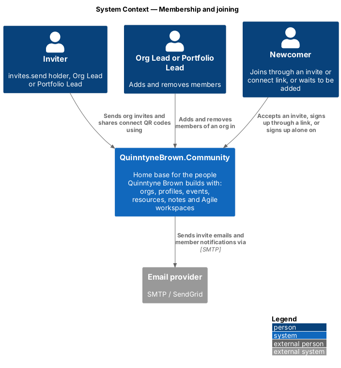
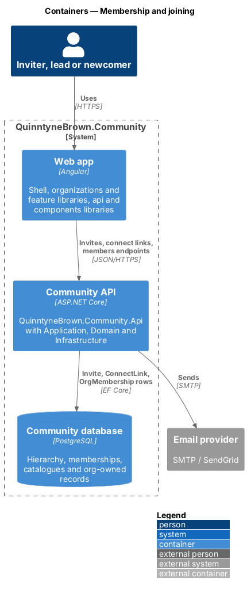
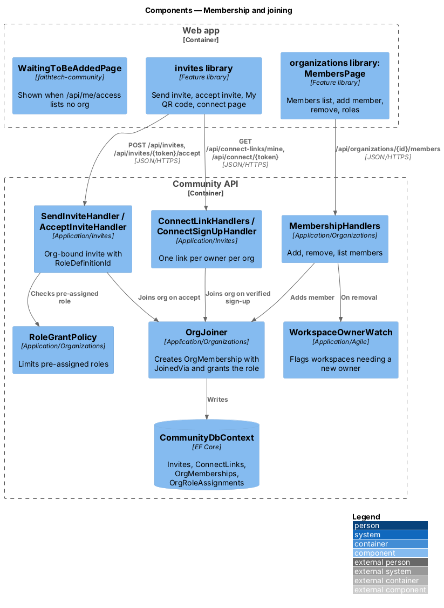
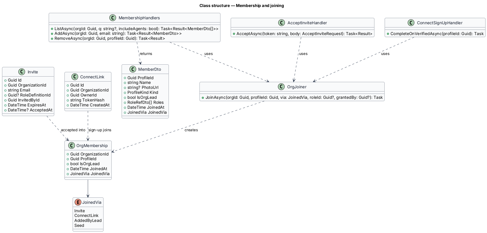
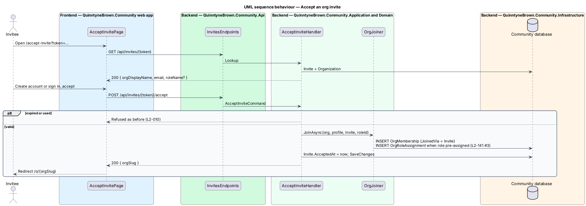
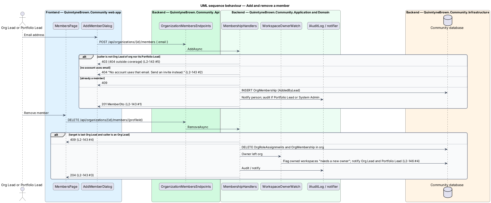
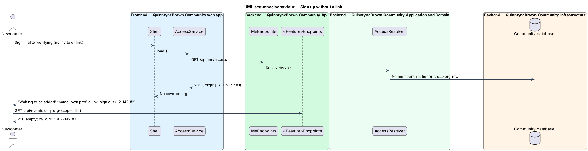

# Membership and joining

## Overview

A person joins an organization in QuinntyneBrown.Community only through that org's invite or connect link, or by being added by its Org Lead or the Portfolio Lead ([ADR 0041](../../../adr/0041-org-bound-invites-and-connect-links.md)). Someone who signs up without a link belongs to no org and waits to be added. This design binds invites and connect links to one org, defines the membership record, and covers adding, removing and Org Lead management.

- **membership** — `OrgMembership` row that makes a profile a member of one org, with how it joined
- **Org Lead** — built-in tier held through `OrgMembership.IsOrgLead`; every org relies on having one
- **org invite** — invite bound to one org, optionally with a pre-assigned catalogue role, expiring after 14 days
- **connect link** — reusable, never-expiring QR link owned by one person in one org (ADR 0021, superseded in part by ADR 0041)
- **"Waiting to be added"** — shell state for a signed-in person who covers no org

The [invites designs](../../invites/send-invite/README.md) keep their screens, tokens and email; this design changes who may invite, where the person lands and what the link grants.

## Description

### Domain

- **`OrgMembership`** (`OrganizationId`, `ProfileId`, `IsOrgLead`, `JoinedAt`, `JoinedVia`) with a unique key on the pair. **`JoinedVia`** is `Invite`, `ConnectLink`, `AddedByLead` or `Seed`.
- **`Invite`** gains a required `OrganizationId` and replaces `Role? Role` with `Guid? RoleDefinitionId`.
- **`ConnectLink`** gains a required `OrganizationId`; the unique index moves from `OwnerId` to (`OwnerId`, `OrganizationId`).

### Application

- **`OrgJoiner`** (`Application/Organizations`) — `JoinAsync(orgId, profileId, via, roleId?, grantedBy?)` inserts the membership when missing and the pre-assigned `OrgRoleAssignment` when given. It is the one path that creates memberships outside the seed.
- **`SendInviteHandler`** — the target org is `CreateTarget("invites", Permissions.InvitesSend)` ([org-owned data](../org-owned-data-and-context/README.md)); Org Leads and the Portfolio Lead hold the code in every org they lead. A pre-assigned role outside the org's catalogue answers `400` `roleId`, and one `RoleGrantPolicy` refuses answers `403`. The email and the accept page name the org's display name.
- **`AcceptInviteHandler`** — on accept, calls `OrgJoiner.JoinAsync(invite.OrganizationId, profile, Invite, invite.RoleDefinitionId, invite.InvitedById)`. An existing account that accepts an invite to another org joins that org too. Expiry and single use are unchanged (L2-010).
- **`ConnectLinkHandlers`** — `GET /api/connect-links/mine` (with `X-Org`) returns or creates the caller's link for the active org when the caller holds `connectLink.own` there, is its Org Lead or its Portfolio Lead; otherwise `403`. Replace keeps its current rules per org. The public lookup (`GET /api/connect/{token}`) returns the owner's name and the org's display name. A link whose owner no longer may own one in that org answers as unknown.
- **`ConnectSignUpHandler`** — when the person verifies their email, calls `OrgJoiner.JoinAsync(link.OrganizationId, profile, ConnectLink)` together with the pending contact link (ADR 0022). No role is granted.
- **`MembershipHandlers`** — Org Lead of the org, its Portfolio Lead or a System Admin; anyone else `403` (`404` outside coverage):
  - `ListAsync(orgId, q, includeAgents)` — members with roles, Org Lead flag, kind (agents badged) and join data, searchable by name or email.
  - `AddAsync(orgId, email)` — finds a profile by verified email. No account answers `404` "No account uses that email. Send an invite instead."; an existing member `409`. The person is notified, and the add is audited when the caller acts as Portfolio Lead or System Admin.
  - `RemoveAsync(orgId, profileId)` — deletes the person's `OrgRoleAssignment` rows and the membership in that org. Records they own stay in the org with them as owner. Owned workspaces are flagged "needs a new owner" through `WorkspaceCreatorPermissionLost` ([cross-org roles](../cross-org-roles/README.md), L2-146). Removing the last Org Lead answers `409` "Every organization needs an Org Lead." unless the caller is the Portfolio Lead or a System Admin.
  - `SetOrgLeadAsync(orgId, profileId, isLead)` — Portfolio Lead or System Admin only (`403` for an Org Lead, L2-136 AC3); audited. The same last-Org-Lead rule applies to clearing the flag.
- **Sign-up without a link** — `SignUpHandler`, `GoogleSignInHandler` and `GitHubSignInHandler` create the profile with no membership.

### Api contracts

| Method and route | Body | Success | Failures |
|------------------|------|---------|----------|
| `POST /api/invites` | `{ email, roleId?, organizationId? }` (else `X-Org`) | `201 InviteDto` with `organization` | `400`, `403`, `404` |
| `GET /api/connect-links/mine` | — (`X-Org`) | `200 { url, organization }` | `403`, `404` |
| `GET /api/organizations/{orgId}/members?q=&includeAgents=` | — | `200 MemberDto[]` | `403`, `404` |
| `POST /api/organizations/{orgId}/members` | `{ email }` | `201 MemberDto` | `400`, `403`, `404`, `409` |
| `DELETE /api/organizations/{orgId}/members/{profileId}` | — | `204` | `403`, `404`, `409` |
| `PUT` / `DELETE /api/organizations/{orgId}/members/{profileId}/org-lead` | — | `204` | `403`, `404`, `409` |

`MemberDto` is `{ profileId, name, photoUrl, kind, isOrgLead, roles: RoleRef[], joinedAt, joinedVia }`.

### Frontend

- **`MembersPage`**, **`AddMemberDialog`** and the remove confirmation live in `frontend/projects/organizations/`, under `/o/:orgSlug/settings/members`. Role changes reuse `RoleDialogComponent` ([hierarchy and permissions](../hierarchy-and-permissions/README.md)).
- **`WaitingToBeAddedPage`** (`faithtech-community`) is shown by the shell when `ACCESS_SERVICE` reports no org. It shows the person's name, a link to their own profile and sign out, and no org navigation. The app reloads access on its next start, so a person added meanwhile lands on the org's home.

## Requirements

The feature realizes the following level-2 (L2) requirements. Each L2 requirement refines a level-1 (L1) requirement, cited by identifier.

| L2 ID | Refines (L1) | Requirement |
|-------|--------------|-------------|
| `L2-141` | `L1-025`, `L1-004` | Joining an org by invite or connect link |
| `L2-142` | `L1-025`, `L1-001` | Sign-up without a link: waiting to be added |
| `L2-143` | `L1-025` | Adding and removing members |

### Acceptance criteria

**`L2-141` — Joining an org by invite or connect link**

1. Given a holder of `invites.send` in FaithTech Toronto, when they send an invite, then the invite belongs to FaithTech Toronto and the email names the org; an Org Lead or the Portfolio Lead may invite into any org they lead; anyone else gets 403.
2. Given an invite with a pre-assigned role, when it is sent, then the role must be one the inviter may grant in that org (L2-136), else 403.
3. Given a person who accepts an org's invite, when they finish, then they are a member of that org with the pre-assigned role; an existing account that accepts joins that org too.
4. Given a holder of `connectLink.own`, the Org Lead or the Portfolio Lead, when they open "My QR code" in an org, then they get that org's link (one per person per org) and the connect page shows the org's display name.
5. Given someone who signs up through a connect link and verifies their email, when they sign in, then they are a member of the link's org and linked as the owner's contact (L2-082), with no role.
6. Given a link owner who loses the right to own a link in that org, when the link is looked up, then it answers as unknown.

**`L2-142` — Sign-up without a link: waiting to be added**

1. Given someone who signs up with a password, Google or GitHub without an invite or connect link, when they verify and sign in, then they belong to no org.
2. Given a signed-in person who belongs to no org and covers none, when the app opens, then it shows "Waiting to be added" with their name, a link to their own profile and to sign out, and no org navigation.
3. Given such a person, when they call any org-scoped endpoint, then lists are empty and records answer 404; their own profile and public events stay available.
4. Given such a person is added to an org, when they next load the app, then the org's home is shown.

**`L2-143` — Adding and removing members**

1. Given an Org Lead or the Portfolio Lead, when they add an existing profile by email to their org, then the person becomes a member, is notified, and the org appears in their switcher.
2. Given an email with no account, when they try to add it, then the server answers 404 with "No account uses that email. Send an invite instead."
3. Given an Org Lead or the Portfolio Lead, when they remove a member, then every catalogue role and the Org Lead flag the person held in that org are removed, records they own stay in the org with them as owner, and workspaces they owned are flagged "needs a new owner" (L2-146).
4. Given the last Org Lead of an org, when an Org Lead removes them, then the server answers 409; the Portfolio Lead may.
5. Given anyone else, when they call the member endpoints, then the server answers 403 (404 outside coverage).
6. Given the members screen, when it opens, then it lists members with their roles and Org Lead flag, searchable, and agents are badged.

## Diagrams

### System context

Inviters, leads and newcomers use QuinntyneBrown.Community to join people to one org; invite emails and member notifications go through the email provider.

### Containers

The `invites` and `organizations` libraries call the Community API, which writes invites, connect links and memberships to the Community database and sends email.

### Components

Invite acceptance, connect sign-up and the add-member handler all join through `OrgJoiner`. Removal hands owned workspaces to `WorkspaceOwnerWatch`.

### Class structure

`OrgMembership` records `JoinedVia`. `Invite` and `ConnectLink` carry their org; `OrgJoiner` is used by every joining path.

### Behaviour — accept an org invite

Accepting makes the person a member of the invite's org with the pre-assigned role (`L2-141`).

### Behaviour — add and remove a member

Adding finds an existing account by email; removing drops the person's roles in the org, keeps their records, and flags owned workspaces (`L2-143`).

### Behaviour — sign up without a link

A person with no membership covers no org, sees "Waiting to be added", and gets empty lists and `404` for records (`L2-142`).

## Open questions

- **Settled: the frontend learns membership from `GET /api/me/access`** ([ADR 0037](../../../adr/0037-org-addressed-urls-switcher-and-branding.md)); "Waiting to be added" is the empty `orgs` case.
- **Settled: resolver cached per request** ([ADR 0034](../../../adr/0034-org-owned-data-and-the-access-resolver.md)); a member added or removed sees the change on the next request.
- **Settled: agents join through the same membership rows** and authenticate with a hashed personal access token ([ADR 0036](../../../adr/0036-agent-identities-and-tokens.md)).
- Leaving an org on one's own (`DELETE /api/organizations/{orgId}/members/me`) is in the proposal (D10) but in no L2 requirement; it is deferred until a requirement exists.
- An invite to an email that already belongs to a member of the org is `<TO SUPPLY>`: refused with `409`, or sent to grant the pre-assigned role.
