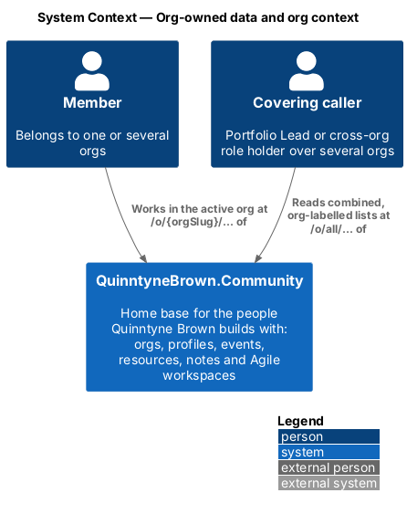
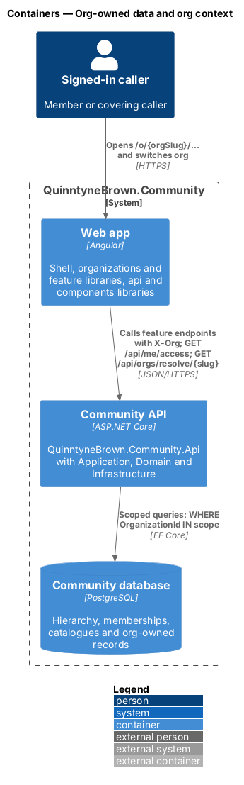
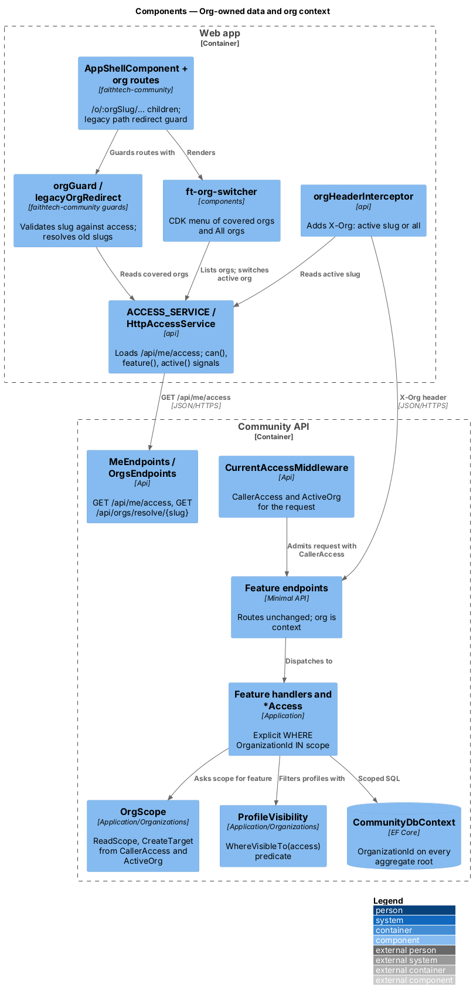
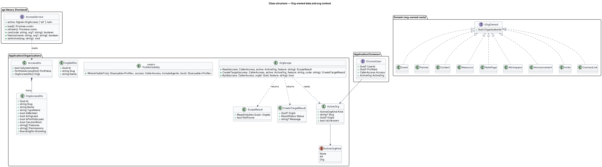
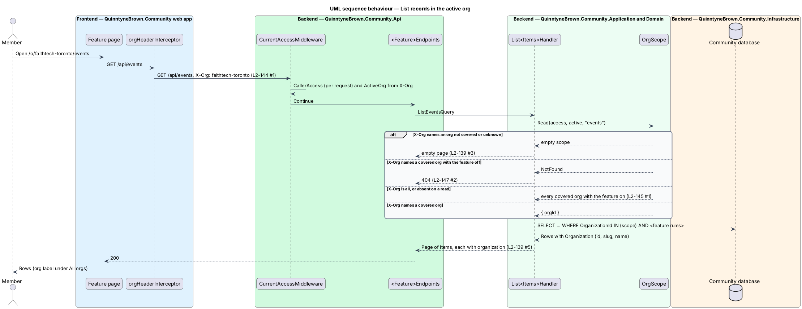
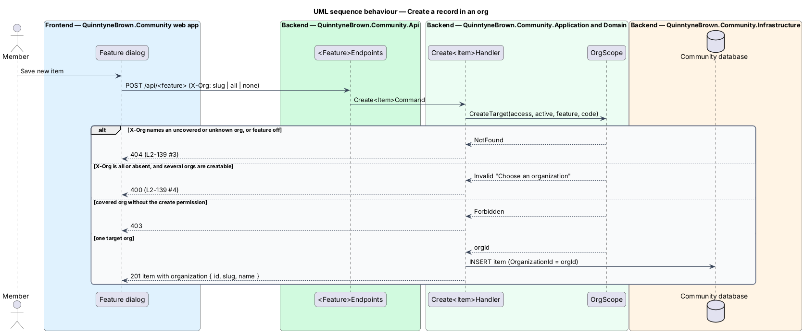
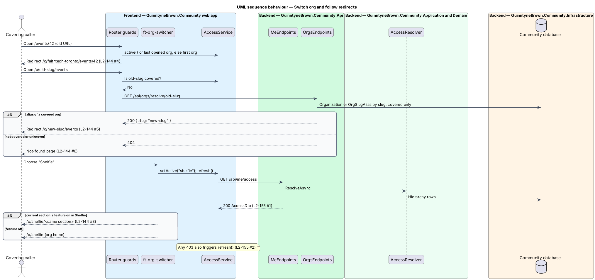

# Org-owned data and org context

## Overview

Every record in QuinntyneBrown.Community belongs to exactly one organization, and every screen of the app works in an active org. This design makes the [access resolver](../hierarchy-and-permissions/README.md) reach the data: it adds `OrganizationId` to the aggregate roots, scopes every query, search source and report to the orgs the caller covers, limits profile visibility to people who share or cover an org, and carries the active org from the URL to the API. It also gives the web app the caller's resolved permissions through `GET /api/me/access`.

- **org-owned root** — aggregate root with a required, indexed `OrganizationId`; its children inherit the org through the root
- **active org** — org named by the URL (`/o/{orgSlug}/…`) and sent to the API as the `X-Org` header
- **"All orgs"** — combined, org-labelled view at `/o/all/…` for callers who cover several orgs
- **read scope** — set of org ids a list may read for one feature: the active org, or every covered org with the feature on
- **org label** — `organization: { id, slug, name }` on each list row, search result and notification
- **slug alias** — former slug of an org, kept as an `OrgSlugAlias` row so old links redirect

The binding decisions are [ADR 0034](../../../adr/0034-org-owned-data-and-the-access-resolver.md) (org-owned data, `X-Org`, explicit scoping, profile visibility), [ADR 0037](../../../adr/0037-org-addressed-urls-switcher-and-branding.md) (routes, switcher, `/api/me/access`) and [ADR 0039](../../../adr/0039-org-wide-and-portfolio-wide-visibility.md) (Org-wide and Portfolio-wide visibility).

## Description

### Org-owned records

| Root (carries `OrganizationId`) | Children reached only through the root |
|---------------------------------|-----------------------------------------|
| `Event` | RSVPs, check-ins |
| `Partner` | Activities, stage changes, duplicate dismissals |
| `Contact`, `PendingConnection` | Contact notes, contact photos |
| `Resource` | Files, tags |
| `NotePage` | Blocks, links, shares, images |
| `Workspace` | Work items, sprints, comments, poker sessions, members |
| `Announcement` | Recipients |
| `Invite`, `ConnectLink` | — |

`Notification` and `AuditEntry` have a nullable `OrganizationId`; `AuditEntry` also has a nullable `PortfolioId`. Profiles are global. Every root implements `IOrgOwned` (Domain), and its `OrganizationId` is set once at creation and never changed.

### The active org on API requests

- **`orgHeaderInterceptor`** (`api`) adds `X-Org: {slug}` or `X-Org: all` to every API request from the active route. Public, auth and `/api/me/access` requests carry none.
- **`CurrentAccessMiddleware`** parses the header into **`ActiveOrg`** (`Kind` `None` | `All` | `Org`, `Slug`, `OrgId`, `IsUnknown`). A slug the caller does not cover, or that does not exist, is `IsUnknown`; the request is not refused at this point, so an org's existence is not revealed.
- **`OrgScope`** (`Application/Organizations`) turns `CallerAccess` and `ActiveOrg` into scopes:

  | Call | `X-Org` absent | `X-Org: all` | `X-Org` covered org, feature on | covered org, feature off | unknown or not covered |
  |------|----------------|--------------|----------------------------------|--------------------------|------------------------|
  | `Read(feature)` | every covered org with the feature | same | `{org}` | `NotFound` → `404` | empty → empty list |
  | `CreateTarget(feature, code)` | the one org where `code` is held, else `400` "Choose an organization" | `400` "Choose an organization" | `{org}`, or `403` without `code` | `404` | `404` |
  | `ById(orgId, feature)` | ignores the header and uses the record's own org: `false` → `404` | | | | |

- Handlers apply the scope explicitly: `db.Events.Where(e => scope.Contains(e.OrganizationId))`. EF Core global query filters are not used. Private-item rules stay explicit beside the org predicate in `ContactAccess`, `ResourceAccess` and `NoteAccess`.
- A request body may name an org (`organizationId`) on creation instead of `X-Org`; it goes through the same `CreateTarget` checks.

### Profile visibility

- **`ProfileVisibility.WhereVisibleTo(IQueryable<Profile>, CallerAccess, bool includeAgents)`** — one predicate: the caller's own profile, every profile for a System Admin, or a profile with an `OrgMembership` in any org of `access.Orgs`. Agents are left out unless `includeAgents` is true.
- It is used by People (`GET /api/people`), search, people pickers, mentions, workspace member pickers and `GET /api/profiles/{id}`. Anything else answers `404`; anonymous callers still get `401`.

### Visibility of resources and note pages

| Level | Stored value | Who sees it |
|-------|--------------|-------------|
| Private | `Private` | The owner; System Admin, audited |
| Shared | `Shared` | The owner, named people who cover the item's org, holders of a named catalogue role (`RoleDefinitionId`) in the item's org, holders of a named cross-org role (`CrossOrgRoleId`) covering the org |
| Org-wide | `OrgWide` (was `Global`) | Everyone who covers the item's org |
| Portfolio-wide | `PortfolioWide` | Everyone who covers any org of the item's portfolio |

Only the Portfolio Lead or a System Admin may set `PortfolioWide` (`403` otherwise). Defaults stay: resources Org-wide, note pages Private. The Portfolio Lead, Org Lead and cross-org roles never see another person's private items, whatever their bundle. Feature specifics are in [resources](../../resources/share/README.md) and [notes](../../notes/share-and-visibility/README.md).

### Coverage of the cross-cutting features

- **Reports** (`GET /api/reports`, export) — scope is `access.OrgsWith(Permissions.ReportsView)` within `ReadScope("reports")`. A new `org` query parameter (a slug) narrows to one org; a slug outside that scope answers `404`. The response gains `orgs: OrgRef[]` for the filter. Anyone without `reports.view` in any org answers `403` ([reports dashboard](../../reports/reports-dashboard/README.md)).
- **Announcements** — `POST /api/announcements` takes `audience: { kind: "org" | "role" | "portfolio", roleId? }`. `org` and `role` need `announcements.send` (or Org Lead) in the target org, and `roleId` shall belong to that org's catalogue. `portfolio` needs the Portfolio Lead tier (`403` otherwise) and stores the announcement on the portfolio with `OrganizationId` of the sending org and `IsPortfolioWide = true`; every member of every org of the portfolio receives it once. Reading lists announcements of covered orgs plus portfolio-wide ones of the caller's portfolios.
- **Notifications** — each `Notification` raised by org activity stores its `OrganizationId`; `NotificationDto` gains `organization: OrgRef | null`, shown as a label in the bell and on the notifications page. Preferences stay per person.
- **Search** (`GET /api/search`) — each `SearchSource` receives the read scope of its feature, so results come only from the active org, or from every covered org under "All orgs". People results use `ProfileVisibility` and hide agents unless `includeAgents=true`. Each result carries its org label.
- **Audit log** (`GET /api/audit-log?org={slug}`) — System Admin reads everything, including entries with no org. The Portfolio Lead reads entries of its portfolios' orgs and portfolio-level entries. An Org Lead reads entries of its orgs only. Anyone else answers `403`. `AuditEntryDto` gains `organization`, and for agent writes `credential: { id, name, issuedBy }`.

### `GET /api/me/access`

Authenticated callers only (`401` otherwise). The response projects `CallerAccess`:

```json
{
  "profileId": "…",
  "isSystemAdmin": false,
  "portfolios": [{ "id": "…", "slug": "quinntyne-brown", "name": "Quinntyne Brown", "isLead": true }],
  "orgs": [
    {
      "id": "…",
      "slug": "faithtech-toronto",
      "name": "FaithTech Toronto",
      "typeName": "FaithTech City",
      "portfolioId": "…",
      "isMember": true,
      "isOrgLead": true,
      "isPortfolioLead": true,
      "canJoinWork": false,
      "features": ["profiles", "notes", "events", "…"],
      "permissions": ["people.view", "events.manage", "…"],
      "branding": { "displayName": "FaithTech Toronto", "logoUrl": null, "accent": "#0b5cad", "accentForeground": "#ffffff" }
    }
  ]
}
```

A caller who covers no org gets `"orgs": []`, and the shell shows "Waiting to be added" ([membership and joining](../membership-and-joining/README.md)).

### Slugs and `GET /api/orgs/resolve/{slug}`

- Slugs are unique platform-wide across `Organization.Slug` and `OrgSlugAlias.Slug`, lower-case `a-z`, `0-9` and `-`, 3 to 40 characters; `all` is reserved. Format errors answer `400` and collisions `409`, both on field `slug` ([catalogue admin](../catalogue-admin/README.md)).
- `GET /api/orgs/resolve/{slug}` (authenticated) answers `200 { "slug": "<current slug>" }` when the slug, or an alias of it, names an org the caller covers, and `404` otherwise.

### Frontend

- **`ACCESS_SERVICE`** (`api`) — `AccessService` contract with `HttpAccessService`. `load()` runs after sign-in; `refresh()` runs on org switch and after any `403` (the HTTP error interceptor calls it before the `/forbidden` redirect or the dialog message). Signals: `access()`, `active()` (an `OrgAccess`, `'all'` or `null`), and helpers `can(code, org?)` and `feature(name, org?)`. The last opened org's slug is kept in `localStorage` as a convenience, wrapped in `try/catch`.
- **Routes** (`faithtech-community`) — signed-in pages move under `o/:orgSlug` inside `AppShellComponent`; feature libraries keep their relative routes. `orgGuard` checks `:orgSlug` against `access()`: a covered slug sets the active org; `all` is allowed only to callers who cover two or more orgs (others are redirected to their org, L2-145 AC4); any other slug calls `/api/orgs/resolve/{slug}` and redirects or shows the not-found page.
- **Legacy redirect** — `legacyOrgRedirect` guards the pre-org paths (`/people`, `/contacts`, `/partners`, `/workspaces`, `/team`, `/events`, `/resources`, `/notes`, `/search`, `/notifications`, `/announcements`, `/reports`, `/admin` and the home path) and rewrites them to `/o/{active org}/…`, where the active org is the last opened org, else the caller's first org. Absolute links inside feature libraries pass through the same redirect.
- **`ft-org-switcher`** (`components`) — a top-bar button with the active org's logo or initial and name, opening a CDK menu of covered orgs (with the type as a caption) and "All orgs". It is hidden when the caller covers one org. Choosing an org keeps the current section when that org has the feature, else opens the org's home. It sets `--color-org-accent` and `--color-org-accent-foreground` on its mark ([branding](../branding-and-public-pages/README.md)).
- **Navigation** shows each section only when the feature is on and the caller holds its permission:

  | Section | Shown when |
  |---------|------------|
  | People | `people.view` |
  | Contacts | `contacts.private` |
  | Partners | `partners.read` |
  | Reports | `reports.view` |
  | Applications | `integrations.view` in the active org, not under "All orgs" ([integrations](../../integrations/application-events/README.md)) |
  | Workspaces | any of `workspaces.create`, `workspaces.join`, `workspaces.readAll`, or `canJoinWork` |
  | Admin | `isSystemAdmin` |
  | Organization settings | Org Lead or Portfolio Lead of the active org |
  | Portfolio admin | Lead of a portfolio |

- **"All orgs"** — People, Workspaces, My work, Resources, Notes and Search show combined lists with an org label (`ft-badge`) on each row. Create buttons are hidden there, or open an org chooser before the create dialog.

## Requirements

The feature realizes the following level-2 (L2) requirements. Each L2 requirement refines a level-1 (L1) requirement, cited by identifier.

| L2 ID | Refines (L1) | Requirement |
|-------|--------------|-------------|
| `L2-139` | `L1-025`, `L1-015` | Org-owned data and isolation |
| `L2-140` | `L1-025`, `L1-002` | Profile visibility by shared org |
| `L2-144` | `L1-025`, `L1-016` | The org in the URL, the switcher and slugs |
| `L2-145` | `L1-025` | The "All orgs" view |
| `L2-148` | `L1-025`, `L1-020`, `L1-022` | Visibility levels and private items |
| `L2-150` | `L1-025`, `L1-024` | Reports scoped to coverage |
| `L2-151` | `L1-025`, `L1-011` | Announcements scoped to an org, and portfolio-wide |
| `L2-152` | `L1-025`, `L1-009`, `L1-010` | Notifications and search across orgs |
| `L2-153` | `L1-025`, `L1-014` | Audit log scoped to coverage |
| `L2-155` | `L1-025` | The caller's access for the web app |

### Acceptance criteria

**`L2-139` — Org-owned data and isolation**

1. Given a member of FaithTech Toronto only, when they request any record of Shelfie by id (event, partner, contact, resource, note page, workspace, work item, announcement, invite), then the server answers 404.
2. Given a member of one org, when they list events, partners, resources, notes, workspaces, announcements, team or search, then only records of orgs they cover are returned.
3. Given a request with `X-Org` naming an org the caller does not cover or that does not exist, when a list is requested, then nothing is returned, and creation answers 404.
4. Given a request with no `X-Org`, when the caller covers several orgs and creates a record without naming an org, then the server answers 400 "Choose an organization"; when they cover exactly one creatable org, then the record is created there.
5. Given a created record, when it is read back, then it carries its organization's id, slug and name.

**`L2-140` — Profile visibility by shared org**

1. Given two people who share an org, when either opens the other's profile, then it is shown.
2. Given a FaithTech Toronto attendee and a Shelfie engineer who share no org, when either opens the other's profile, searches for them, or looks for them in People, a people picker, a mention or a workspace member picker, then they are not found (404 for the profile).
3. Given a holder of a cross-org role covering one of a person's orgs, the Portfolio Lead over one of their orgs, or a System Admin, when they open the profile, then it is shown.
4. Given a person, when they open their own profile, then it is shown even if they belong to no org.
5. Given an anonymous visitor, when they ask for any profile, then the response is 401 (unchanged).

**`L2-144` — The org in the URL, the switcher and slugs**

1. Given a signed-in member, when they open an app page, then its URL is `/o/{orgSlug}/…` and the API receives the org as `X-Org`.
2. Given a person who covers one org, when the shell renders, then no switcher is shown.
3. Given a person who covers several orgs, when they open the switcher, then it lists every covered org with its type and "All orgs"; choosing one keeps the current section when that org has the feature, else opens the org's home.
4. Given an old URL such as `/events/{id}` or `/workspaces`, when it is opened, then the app redirects to the same page under `/o/{active org}/…`.
5. Given a slug changed by the Portfolio Lead, when the old slug's URL is opened, then the app redirects to the new slug.
6. Given a slug for an org the person does not cover, when it is opened, then the not-found page is shown.
7. Given a slug that is not lower-case, uses characters other than `a-z`, `0-9` and `-`, is shorter than 3 or longer than 40 characters, is `all`, or is taken (now or as an old slug), when it is saved, then the server answers 400 or 409 naming the field.
8. Given the switcher, when it is used with a keyboard and a screen reader, then it opens with Enter or Space, moves with the arrow keys, closes with Escape, and announces the active org; long org names truncate with the full name available (L2-044).

**`L2-145` — The "All orgs" view**

1. Given a person who covers several orgs, when they open `/o/all/people`, `/o/all/workspaces`, `/o/all/resources`, `/o/all/notes` or My work on `/o/all`, then the lists combine every covered org and each row shows its org label.
2. Given "All orgs", when a page would create something, then its create button is hidden or asks which org.
3. Given work items assigned to them in several orgs, when they open My work under "All orgs", then they see all of them labelled by org.
4. Given a person who covers one org, when they open `/o/all/…`, then they are redirected to their org.

**`L2-148` — Visibility levels and private items**

1. Given a resource or note page, when its visibility is chosen, then the options are Private, Shared, Org-wide (named with the org) and, for the Portfolio Lead only, Portfolio-wide.
2. Given an Org-wide item, when anyone who covers its org lists or opens it, then it is shown; anyone else gets 404.
3. Given a Portfolio-wide item, when anyone who covers any org of the portfolio opens it, then it is shown.
4. Given anyone but the Portfolio Lead or a System Admin, when they set Portfolio-wide, then the server answers 403.
5. Given a Shared item naming a catalogue role, when a holder of that role in the item's org opens it, then it is shown; a holder of the same role key in another org gets 404.
6. Given another person's private contact, contact note, private resource or private note page, when the Portfolio Lead, an Org Lead or a cross-org role holder asks for it by id, list or search, then it is not found; a System Admin may open it and the access is audited.
7. Given defaults, when a resource or note page is created, then resources are Org-wide and note pages Private.

**`L2-150` — Reports scoped to coverage**

1. Given a holder of `reports.view`, the Org Lead, the Portfolio Lead or a System Admin, when they open Reports, then figures cover only the orgs where they hold it and the feature is on, with an org filter listing those orgs.
2. Given an org filter value outside the caller's scope, when the report is requested, then the server answers 404.
3. Given anyone else, when they open Reports, then the server answers 403 as before.

**`L2-151` — Announcements scoped to an org, and portfolio-wide**

1. Given a holder of `announcements.send` (or the Org Lead) in an org, when they send, then the audience is that org's members, or a role audience chosen from that org's catalogue, and the email opt-out still applies.
2. Given the Portfolio Lead, when they choose "Everyone in the portfolio", then every member of every org of the portfolio receives it once, and it is shown labelled "Portfolio".
3. Given anyone else, when they choose portfolio-wide, then the server answers 403.
4. Given members, when they read announcements, then they see only announcements of orgs they cover and portfolio-wide announcements of their portfolio, each with its org label.

**`L2-152` — Notifications and search across orgs**

1. Given a notification raised by activity in an org, when it is shown in the bell or the notifications page, then it carries the org's name as a label.
2. Given search in an org, when results are returned, then they come only from that org and are filtered by the same rules as the lists; under "All orgs" they come from every covered org with org labels.
3. Given a person result, when search returns it, then it follows profile visibility (L2-140) and leaves out agents unless asked.

**`L2-153` — Audit log scoped to coverage**

1. Given an Org Lead, when they open their org's audit log, then they see entries for that org only.
2. Given the Portfolio Lead, when they open the audit log, then they see entries for every org of the portfolio and portfolio-level entries.
3. Given a System Admin, when they open the audit log, then they see everything, including platform entries with no org.
4. Given anyone else, when they ask for an audit log, then the server answers 403.
5. Given an entry, when it is shown, then it carries its org (if any), its actor and, for an agent, the issuer of the token used.

**`L2-155` — The caller's access for the web app**

1. Given a signed-in caller, when the app calls `GET /api/me/access`, then it returns whether they are a System Admin, their portfolios (and whether they lead them) and every covered org with its slug, name, type, features, branding, flags (member, Org Lead, Portfolio Lead, can join work) and resolved permission codes.
2. Given a role change, when the app next receives a 403 or the person switches org, then it reloads access and the navigation updates.
3. Given the navigation, when it renders for an org, then each section is shown only when the feature is on and the caller holds the permission the section needs (People: `people.view`; Contacts: `contacts.private`; Partners: `partners.read`; Reports: `reports.view`; Workspaces: any workspace permission or `CanJoinWork`; Admin: System Admin; Organization settings: Org Lead or Portfolio Lead; Portfolio admin: Portfolio Lead).

## Diagrams

### System context

Members work in one active org at a time; covering callers also read combined lists under "All orgs".



### Containers

The web app carries the active org in the URL and sends it as `X-Org`; the Community API scopes every query to covered orgs in SQL.



### Components

`ACCESS_SERVICE` loads `/api/me/access` and drives the guards, the switcher and `orgHeaderInterceptor`. On the server, `CurrentAccessMiddleware` provides `CallerAccess` and `ActiveOrg`; handlers ask `OrgScope` and `ProfileVisibility` for explicit predicates.



### Class structure

`ICurrentUser` exposes `ActiveOrg` beside `CallerAccess`. `OrgScope` returns read and create scopes. Every org-owned root realizes `IOrgOwned`. `AccessDto` is the wire form of `CallerAccess` that `AccessService` loads.



### Behaviour — list records in the active org

The header picks the scope; an uncovered org yields an empty list, a covered org with the feature off yields `404`, and every row carries its org (`L2-139`, `L2-145`, `L2-147`).



### Behaviour — create a record in an org

Creation needs one target org: an ambiguous request answers `400` "Choose an organization", an uncovered org `404`, and a missing permission `403` (`L2-139`).



### Behaviour — switch org and follow redirects

Old URLs redirect under the active org, old slugs resolve to the current one, unknown slugs show the not-found page, and switching org refreshes access (`L2-144`, `L2-155`).



## Open questions

- **Settled: resolver cached per request, explicit query scoping** ([ADR 0034](../../../adr/0034-org-owned-data-and-the-access-resolver.md)). Scope predicates are written in each handler from `OrgScope`; global query filters are not used.
- **Settled: the frontend learns permissions from `GET /api/me/access`**, refreshed on org switch and after any `403` ([ADR 0037](../../../adr/0037-org-addressed-urls-switcher-and-branding.md)). The navigation hides sections from it; the server stays the authority.
- **Settled: agent authentication is a hashed personal access token** ([ADR 0036](../../../adr/0036-agent-identities-and-tokens.md)). Agents send `X-Org` like the web app, or omit it to read every org their token covers.
- Reports keep the existing `city` filter inside the org scope; whether it is still useful once FaithTech cities are orgs is `<TO SUPPLY>` after Phase 2 review.
- A portfolio-wide announcement is stored on the sending org with a portfolio flag so that `Announcement` keeps a required `OrganizationId`; its recipients are resolved at send time, not live.
